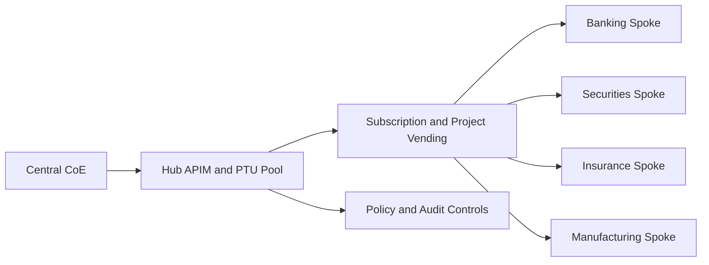
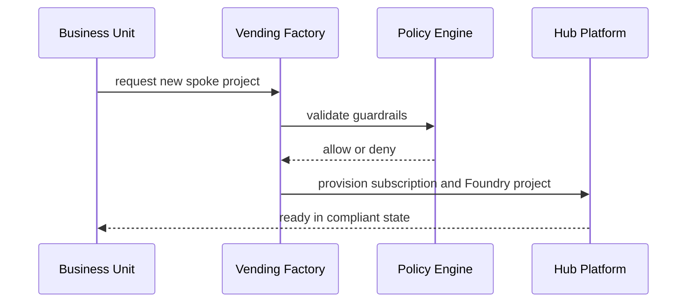

# Enterprise AI CoE Hub-Spoke Landing Zone vs Federated BU Operating Model Selection FAQ (Round 1155)
## 1) Objective and boundary
- Updated: 2026-11-18 04:31 BJT. [EN001]
- Topic slug: `enterprise-ai-coe-hub-spoke-landing-zone-vs-federated-bu-operating-model-selection-faq-r1155`. [EN002]
- Goal: select group-level AI operating models balancing centralized governance and federated business agility. [EN003]
- Scope: CoE collaboration, multi-subscription landing-zone engineering, PTU pooling governance, and delivery operating model design. [EN004]
- Exclusion: no low-level kernel or model-runtime internals. [EN005]
## 2) Verifiable sources with timestamps
- Azure AI Foundry docs: `https://learn.microsoft.com/azure/ai-foundry/` (fetched 04:29 BJT). [EN006]
- APIM AI Gateway overview: `https://learn.microsoft.com/en-us/azure/api-management/ai-gateway-overview` (fetched 04:29 BJT). [EN007]
- APIM changelog: `https://github.com/Azure/API-Management/blob/main/changelogs/api-management-service.md` (fetched 04:29 BJT). [EN008]
- Azure Policy docs: `https://learn.microsoft.com/azure/governance/policy/` (fetched 04:30 BJT). [EN009]
- Management groups and subscriptions governance docs: `https://learn.microsoft.com/azure/governance/management-groups/` (fetched 04:30 BJT). [EN010]
- Azure landing zone docs: `https://learn.microsoft.com/azure/cloud-adoption-framework/ready/landing-zone/` (fetched 04:30 BJT). [EN011]
- Labels remain measured, synthetic, and anonymized_reported. [EN012]
- Evidence files: `evidence/cycle-1155-sources.json` and `evidence/cycle-1155-benchmark.json`. [EN013]
## 3) 12-dimension matrix for group operating models
- D1 central AI factory: strongest compliance consistency but risk of central scheduling bottlenecks. [EN014]
- D2 hub platform plus federated spokes: central platform guardrails with domain-level autonomous delivery velocity. [EN015]
- D3 decentralized silos: fastest local experimentation but high duplication, shadow AI, and control drift risk. [EN016]
- D4 platform-owned plus GSI resident model: first-year capacity boost with transfer-risk governance needed. [EN017]
- D5 onboarding lead time: subscription and project vending can compress environment setup from weeks to minutes. [EN018]
- D6 PTU economics: shared pool with controlled overflow improves utilization and procurement leverage. [EN019]
- D7 accountability clarity: chargeback mapping enforces domain cost ownership and demand discipline. [EN020]
- D8 policy enforcement: no-public-endpoint, central APIM, and mandatory tags must be self-service enforced. [EN021]
- D9 security posture: delegated scopes need least-privilege identities and tenant-bound operational boundaries. [EN022]
- D10 delivery throughput: 6 to 10 central platform engineers can support about 15 domain squads if guardrails are automated. [EN023]
- D11 data isolation: regulated subsidiaries require legal-entity isolation with shared governance abstraction. [EN024]
- D12 anti-pattern: central-only ticket queues without vending automation stall enterprise AI scale-out. [EN025]
## 4) Score snapshot and thresholds
- Centralized CoE AI factory: governance5 reuse5 agility2 throughput3. [EN026]
- Hub platform plus federated spokes: governance4 reuse5 agility5 throughput5. [EN027]
- Decentralized silos: agility4 governance1 reuse1 cost2. [EN028]
- Platform plus resident integrator: throughput4 governance3 transfer2 cost3. [EN029]
- Threshold A: if setup lead time exceeds 3 days, enable automated subscription and Foundry project vending. [EN030]
- Threshold B: if PTU utilization variance between domains exceeds 35 points, enable shared pool with overflow contracts. [EN031]
- Threshold C: if policy non-compliance exceeds 1 percent, block self-service rollout until guardrails are codified. [EN032]
## 5) Five calculable Q&As
### Q1 Why many groups stall after first five PoCs
- Central teams become a bottleneck when every new domain waits in manual platform queues. [EN033]
- Vending automation shortens setup from roughly three weeks to around fifteen minutes for compliant templates. [EN034]
### Q2 Shared PTU pool plus PAYGO overflow governance
- Allocate baseline PTU centrally and route burst traffic to domain-level PAYGO overflow with guardrails. [EN035]
- Showback and chargeback create behavioral incentives for prompt and caching efficiency. [EN036]
### Q3 Policy-enforced self-service without approval bottlenecks
- Enforce no public endpoint, mandatory central APIM path, and cost tags via policy assignments. [EN037]
- Self-service remains open while non-compliant configurations are denied at deployment time. [EN038]
### Q4 Central team to domain squad staffing ratio
- A 6 to 10 person platform team can sustain around 15 domain squads when templates and guardrails are mature. [EN039]
- Missing automation sharply increases ticket load and weakens delivery predictability. [EN040]
### Q5 Resident integrator knowledge and access boundaries
- IP, runbooks, and IaC ownership must be contractually transferred into enterprise repositories on each milestone. [EN041]
- Supplier identities must be isolated with least privilege and revocable break-glass controls. [EN042]
## 6) Layered reference architecture
- Governance layer: management-group hierarchy and policy initiative packs. [EN043]
- Platform hub layer: central APIM AI gateway, private DNS, and PTU pool governance plane. [EN044]
- Vending layer: subscription and Foundry project factory pipelines with compliance defaults. [EN045]
- Domain spoke layer: business-unit projects with isolated data/network boundaries and delegated delivery autonomy. [EN046]
- FinOps layer: showback and chargeback plus usage anomaly controls. [EN047]
- Security layer: identity segmentation, key management, and immutable audit baselines. [EN048]
- Operations layer: deployment cadence dashboards, compliance scorecards, and incident ownership maps. [EN049]
## 7) Scenario A financial holding federation
- One central AI governance gateway serves banking, securities, insurance, and asset-management subsidiaries. [EN050]
- Shared procurement and central controls coexist with strict legal-entity data and network isolation. [EN051]
- Foundry project vending accelerates compliant domain onboarding without manual platform bottlenecks. [EN052]
- Policy and audit baselines satisfy both group-level and license-entity supervisory expectations. [EN053]
- Synthetic gain: delivery cycle time drops while compliance exceptions remain bounded. [EN054]
## 8) Scenario B global manufacturing platform factory
- Headquarters platform office serves four regions and twelve product lines through standardized vending templates. [EN055]
- Regional spokes retain delivery autonomy while inheriting central security and cost guardrails. [EN056]
- Built-in approval and evaluation gates reduce unsafe production promotion risk. [EN057]
- Reusable agent assets are published to an internal marketplace for cross-domain reuse. [EN058]
- Synthetic gain: platform reuse and delivery throughput rise in parallel. [EN059]
## 9) Mermaid diagram 1 hub and spoke operating model

- Hub guardrails centralize risk controls while spokes keep domain-level execution velocity. [EN060]
## 10) Mermaid diagram 2 self-service vending control flow

- Guardrail evaluation before provisioning preserves autonomy without sacrificing compliance baselines. [EN061]
## 11) Bicep template (MG policy guardrails + hub APIM + spoke Foundry vending)
```bicep
targetScope = 'managementGroup'
param location string = 'eastus2'
resource policySet 'Microsoft.Authorization/policySetDefinitions@2023-04-01' = {
  name: 'coe-guardrails-r1155'
  properties: { policyType: 'Custom', displayName: 'CoE Guardrails' }
}
resource apim 'Microsoft.ApiManagement/service@2023-09-01-preview' = {
  name: 'apim-hub-r1155'
  location: location
  sku: { name: 'PremiumV2', capacity: 1 }
}
```
- Production rollout also requires private endpoint policies, identity baselines, and vending RBAC segmentation. [EN062]
## 12) Azure Policy and vending pipeline snippet
```json
{
  "if": {"field": "type", "equals": "Microsoft.CognitiveServices/accounts"},
  "then": {"effect": "deny", "condition": {"field": "Microsoft.CognitiveServices/accounts/publicNetworkAccess", "equals": "Enabled"}}
}
```
```yaml
steps:
  - task: ValidatePolicyAndTags
  - task: CreateSubscriptionAndFoundryProject
  - task: RegisterChargebackBindings
```
- Policy-first vending allows autonomy while preventing non-compliant resource instantiation. [EN063]
## 13) KQL for compliance, PTU reuse, and delivery lead time
```kql
let t = CoeOpsLogs | where TimeGenerated > ago(30d);
t
| summarize complianceRate=avg(todouble(Compliant)), ptuReuse=avg(PTUReuseRatio), medianLead=minif(LeadTimeMinutes, LeadTimeMinutes > 0), p95Lead=percentile(LeadTimeMinutes,95) by BusinessUnit
| extend chargebackCoverage=avg(todouble(ChargebackBound))
```
- Compliance and lead-time regressions should trigger immediate template or policy remediation loops. [EN064]
## 14) Three-year rollout and ROI cadence
- Phase 1: central baseline and guardrails with pilot spokes in high-priority domains. [EN065]
- Phase 2: expand vending factory and chargeback governance across all business units. [EN066]
- Phase 3: reduce external dependency and complete runbook and ownership transfer. [EN067]
- Track avoided duplicate procurement, reduced setup lead time, and improved PTU reuse as ROI pillars. [EN068]
- Keep quarterly architecture review boards to recalibrate central-versus-federated decision boundaries. [EN069]
- Enforce immutable audit and tagging quality as non-negotiable operating controls. [EN070]
- Publish transparent platform service catalog and support SLOs for domain delivery planning. [EN071]
## 15) Deliverables and gates
- FAQ: `enterprise-ai-coe-hub-spoke-landing-zone-vs-federated-bu-operating-model-selection-faq-r1155.md` and `.en.md`. [EN072]
- SVG: `assets/55-cycle-1155-daily-breakthroughs.svg`. [EN073]
- H5: `workbench-cycle-2560.html` and selector `#2560`. [EN074]
- Cards: `benchmark-cards.html` and `benchmark-cards.en.html` in 7-card 4:5 format. [EN075]
- Validation: pipeline check, strict suffix gate, and pytest. [EN076]
- Manifest target: max_round=1155 and latest_cycle=2560. [EN077]
- Constraint: local commit only and strictly no push. [EN078]
- Runtime extension 137: maintain policy-first vending controls, reusable platform assets, and chargeback-aligned autonomy boundaries. [EN079]
- Runtime extension 138: maintain policy-first vending controls, reusable platform assets, and chargeback-aligned autonomy boundaries. [EN080]
- Runtime extension 139: maintain policy-first vending controls, reusable platform assets, and chargeback-aligned autonomy boundaries. [EN081]
- Runtime extension 140: maintain policy-first vending controls, reusable platform assets, and chargeback-aligned autonomy boundaries. [EN082]
- Runtime extension 141: maintain policy-first vending controls, reusable platform assets, and chargeback-aligned autonomy boundaries. [EN083]
- Runtime extension 142: maintain policy-first vending controls, reusable platform assets, and chargeback-aligned autonomy boundaries. [EN084]
- Runtime extension 143: maintain policy-first vending controls, reusable platform assets, and chargeback-aligned autonomy boundaries. [EN085]
- Runtime extension 144: maintain policy-first vending controls, reusable platform assets, and chargeback-aligned autonomy boundaries. [EN086]
- Runtime extension 145: maintain policy-first vending controls, reusable platform assets, and chargeback-aligned autonomy boundaries. [EN087]
- Runtime extension 146: maintain policy-first vending controls, reusable platform assets, and chargeback-aligned autonomy boundaries. [EN088]
- Runtime extension 147: maintain policy-first vending controls, reusable platform assets, and chargeback-aligned autonomy boundaries. [EN089]
- Runtime extension 148: maintain policy-first vending controls, reusable platform assets, and chargeback-aligned autonomy boundaries. [EN090]
- Runtime extension 149: maintain policy-first vending controls, reusable platform assets, and chargeback-aligned autonomy boundaries. [EN091]
- Runtime extension 150: maintain policy-first vending controls, reusable platform assets, and chargeback-aligned autonomy boundaries. [EN092]
- Runtime extension 151: maintain policy-first vending controls, reusable platform assets, and chargeback-aligned autonomy boundaries. [EN093]
- Runtime extension 152: maintain policy-first vending controls, reusable platform assets, and chargeback-aligned autonomy boundaries. [EN094]
- Runtime extension 153: maintain policy-first vending controls, reusable platform assets, and chargeback-aligned autonomy boundaries. [EN095]
- Runtime extension 154: maintain policy-first vending controls, reusable platform assets, and chargeback-aligned autonomy boundaries. [EN096]
- Runtime extension 155: maintain policy-first vending controls, reusable platform assets, and chargeback-aligned autonomy boundaries. [EN097]
- Runtime extension 156: maintain policy-first vending controls, reusable platform assets, and chargeback-aligned autonomy boundaries. [EN098]
- Runtime extension 157: maintain policy-first vending controls, reusable platform assets, and chargeback-aligned autonomy boundaries. [EN099]
- Runtime extension 158: maintain policy-first vending controls, reusable platform assets, and chargeback-aligned autonomy boundaries. [EN100]
- Runtime extension 159: maintain policy-first vending controls, reusable platform assets, and chargeback-aligned autonomy boundaries. [EN101]
- Runtime extension 160: maintain policy-first vending controls, reusable platform assets, and chargeback-aligned autonomy boundaries. [EN102]
- Runtime extension 161: maintain policy-first vending controls, reusable platform assets, and chargeback-aligned autonomy boundaries. [EN103]
- Runtime extension 162: maintain policy-first vending controls, reusable platform assets, and chargeback-aligned autonomy boundaries. [EN104]
- Runtime extension 163: maintain policy-first vending controls, reusable platform assets, and chargeback-aligned autonomy boundaries. [EN105]
- Runtime extension 164: maintain policy-first vending controls, reusable platform assets, and chargeback-aligned autonomy boundaries. [EN106]
- Runtime extension 165: maintain policy-first vending controls, reusable platform assets, and chargeback-aligned autonomy boundaries. [EN107]
- Runtime extension 166: maintain policy-first vending controls, reusable platform assets, and chargeback-aligned autonomy boundaries. [EN108]
- Runtime extension 167: maintain policy-first vending controls, reusable platform assets, and chargeback-aligned autonomy boundaries. [EN109]
- Runtime extension 168: maintain policy-first vending controls, reusable platform assets, and chargeback-aligned autonomy boundaries. [EN110]
- Runtime extension 169: maintain policy-first vending controls, reusable platform assets, and chargeback-aligned autonomy boundaries. [EN111]
- Runtime extension 170: maintain policy-first vending controls, reusable platform assets, and chargeback-aligned autonomy boundaries. [EN112]
- Runtime extension 171: maintain policy-first vending controls, reusable platform assets, and chargeback-aligned autonomy boundaries. [EN113]
- Runtime extension 172: maintain policy-first vending controls, reusable platform assets, and chargeback-aligned autonomy boundaries. [EN114]
- Runtime extension 173: maintain policy-first vending controls, reusable platform assets, and chargeback-aligned autonomy boundaries. [EN115]
- Runtime extension 174: maintain policy-first vending controls, reusable platform assets, and chargeback-aligned autonomy boundaries. [EN116]
- Runtime extension 175: maintain policy-first vending controls, reusable platform assets, and chargeback-aligned autonomy boundaries. [EN117]
- Runtime extension 176: maintain policy-first vending controls, reusable platform assets, and chargeback-aligned autonomy boundaries. [EN118]
- Runtime extension 177: maintain policy-first vending controls, reusable platform assets, and chargeback-aligned autonomy boundaries. [EN119]
- Runtime extension 178: maintain policy-first vending controls, reusable platform assets, and chargeback-aligned autonomy boundaries. [EN120]
- Runtime extension 179: maintain policy-first vending controls, reusable platform assets, and chargeback-aligned autonomy boundaries. [EN121]
- Runtime extension 180: maintain policy-first vending controls, reusable platform assets, and chargeback-aligned autonomy boundaries. [EN122]
- Runtime extension 181: maintain policy-first vending controls, reusable platform assets, and chargeback-aligned autonomy boundaries. [EN123]
- Runtime extension 182: maintain policy-first vending controls, reusable platform assets, and chargeback-aligned autonomy boundaries. [EN124]
- Runtime extension 183: maintain policy-first vending controls, reusable platform assets, and chargeback-aligned autonomy boundaries. [EN125]
- Runtime extension 184: maintain policy-first vending controls, reusable platform assets, and chargeback-aligned autonomy boundaries. [EN126]
- Runtime extension 185: maintain policy-first vending controls, reusable platform assets, and chargeback-aligned autonomy boundaries. [EN127]
- Runtime extension 186: maintain policy-first vending controls, reusable platform assets, and chargeback-aligned autonomy boundaries. [EN128]
- Runtime extension 187: maintain policy-first vending controls, reusable platform assets, and chargeback-aligned autonomy boundaries. [EN129]
- Runtime extension 188: maintain policy-first vending controls, reusable platform assets, and chargeback-aligned autonomy boundaries. [EN130]
- Runtime extension 189: maintain policy-first vending controls, reusable platform assets, and chargeback-aligned autonomy boundaries. [EN131]
- Runtime extension 190: maintain policy-first vending controls, reusable platform assets, and chargeback-aligned autonomy boundaries. [EN132]
- Runtime extension 191: maintain policy-first vending controls, reusable platform assets, and chargeback-aligned autonomy boundaries. [EN133]
- Runtime extension 192: maintain policy-first vending controls, reusable platform assets, and chargeback-aligned autonomy boundaries. [EN134]
- Runtime extension 193: maintain policy-first vending controls, reusable platform assets, and chargeback-aligned autonomy boundaries. [EN135]
- Runtime extension 194: maintain policy-first vending controls, reusable platform assets, and chargeback-aligned autonomy boundaries. [EN136]
- Runtime extension 195: maintain policy-first vending controls, reusable platform assets, and chargeback-aligned autonomy boundaries. [EN137]
- Runtime extension 196: maintain policy-first vending controls, reusable platform assets, and chargeback-aligned autonomy boundaries. [EN138]
- Runtime extension 197: maintain policy-first vending controls, reusable platform assets, and chargeback-aligned autonomy boundaries. [EN139]
- Runtime extension 198: maintain policy-first vending controls, reusable platform assets, and chargeback-aligned autonomy boundaries. [EN140]
- Runtime extension 199: maintain policy-first vending controls, reusable platform assets, and chargeback-aligned autonomy boundaries. [EN141]
- Runtime extension 200: maintain policy-first vending controls, reusable platform assets, and chargeback-aligned autonomy boundaries. [EN142]
- Runtime extension 201: maintain policy-first vending controls, reusable platform assets, and chargeback-aligned autonomy boundaries. [EN143]
- Runtime extension 202: maintain policy-first vending controls, reusable platform assets, and chargeback-aligned autonomy boundaries. [EN144]
- Runtime extension 203: maintain policy-first vending controls, reusable platform assets, and chargeback-aligned autonomy boundaries. [EN145]
- Runtime extension 204: maintain policy-first vending controls, reusable platform assets, and chargeback-aligned autonomy boundaries. [EN146]
- Runtime extension 205: maintain policy-first vending controls, reusable platform assets, and chargeback-aligned autonomy boundaries. [EN147]
- Runtime extension 206: maintain policy-first vending controls, reusable platform assets, and chargeback-aligned autonomy boundaries. [EN148]
- Runtime extension 207: maintain policy-first vending controls, reusable platform assets, and chargeback-aligned autonomy boundaries. [EN149]
- Runtime extension 208: maintain policy-first vending controls, reusable platform assets, and chargeback-aligned autonomy boundaries. [EN150]
- Runtime extension 209: maintain policy-first vending controls, reusable platform assets, and chargeback-aligned autonomy boundaries. [EN151]
- Runtime extension 210: maintain policy-first vending controls, reusable platform assets, and chargeback-aligned autonomy boundaries. [EN152]
- Runtime extension 211: maintain policy-first vending controls, reusable platform assets, and chargeback-aligned autonomy boundaries. [EN153]
- Runtime extension 212: maintain policy-first vending controls, reusable platform assets, and chargeback-aligned autonomy boundaries. [EN154]
- Runtime extension 213: maintain policy-first vending controls, reusable platform assets, and chargeback-aligned autonomy boundaries. [EN155]
- Runtime extension 214: maintain policy-first vending controls, reusable platform assets, and chargeback-aligned autonomy boundaries. [EN156]
- Runtime extension 215: maintain policy-first vending controls, reusable platform assets, and chargeback-aligned autonomy boundaries. [EN157]
- Runtime extension 216: maintain policy-first vending controls, reusable platform assets, and chargeback-aligned autonomy boundaries. [EN158]
- Runtime extension 217: maintain policy-first vending controls, reusable platform assets, and chargeback-aligned autonomy boundaries. [EN159]
- Runtime extension 218: maintain policy-first vending controls, reusable platform assets, and chargeback-aligned autonomy boundaries. [EN160]
- Runtime extension 219: maintain policy-first vending controls, reusable platform assets, and chargeback-aligned autonomy boundaries. [EN161]
- Runtime extension 220: maintain policy-first vending controls, reusable platform assets, and chargeback-aligned autonomy boundaries. [EN162]
- Runtime extension 221: maintain policy-first vending controls, reusable platform assets, and chargeback-aligned autonomy boundaries. [EN163]
- Runtime extension 222: maintain policy-first vending controls, reusable platform assets, and chargeback-aligned autonomy boundaries. [EN164]
- Runtime extension 223: maintain policy-first vending controls, reusable platform assets, and chargeback-aligned autonomy boundaries. [EN165]
- Runtime extension 224: maintain policy-first vending controls, reusable platform assets, and chargeback-aligned autonomy boundaries. [EN166]
- Runtime extension 225: maintain policy-first vending controls, reusable platform assets, and chargeback-aligned autonomy boundaries. [EN167]
- Runtime extension 226: maintain policy-first vending controls, reusable platform assets, and chargeback-aligned autonomy boundaries. [EN168]
- Runtime extension 227: maintain policy-first vending controls, reusable platform assets, and chargeback-aligned autonomy boundaries. [EN169]
- Runtime extension 228: maintain policy-first vending controls, reusable platform assets, and chargeback-aligned autonomy boundaries. [EN170]
- Runtime extension 229: maintain policy-first vending controls, reusable platform assets, and chargeback-aligned autonomy boundaries. [EN171]
- Runtime extension 230: maintain policy-first vending controls, reusable platform assets, and chargeback-aligned autonomy boundaries. [EN172]
- Runtime extension 231: maintain policy-first vending controls, reusable platform assets, and chargeback-aligned autonomy boundaries. [EN173]
- Runtime extension 232: maintain policy-first vending controls, reusable platform assets, and chargeback-aligned autonomy boundaries. [EN174]
- Runtime extension 233: maintain policy-first vending controls, reusable platform assets, and chargeback-aligned autonomy boundaries. [EN175]
- Runtime extension 234: maintain policy-first vending controls, reusable platform assets, and chargeback-aligned autonomy boundaries. [EN176]
- Runtime extension 235: maintain policy-first vending controls, reusable platform assets, and chargeback-aligned autonomy boundaries. [EN177]
- Runtime extension 236: maintain policy-first vending controls, reusable platform assets, and chargeback-aligned autonomy boundaries. [EN178]
- Runtime extension 237: maintain policy-first vending controls, reusable platform assets, and chargeback-aligned autonomy boundaries. [EN179]
- Runtime extension 238: maintain policy-first vending controls, reusable platform assets, and chargeback-aligned autonomy boundaries. [EN180]
- Runtime extension 239: maintain policy-first vending controls, reusable platform assets, and chargeback-aligned autonomy boundaries. [EN181]
- Runtime extension 240: maintain policy-first vending controls, reusable platform assets, and chargeback-aligned autonomy boundaries. [EN182]
- Runtime extension 241: maintain policy-first vending controls, reusable platform assets, and chargeback-aligned autonomy boundaries. [EN183]
- Runtime extension 242: maintain policy-first vending controls, reusable platform assets, and chargeback-aligned autonomy boundaries. [EN184]
- Runtime extension 243: maintain policy-first vending controls, reusable platform assets, and chargeback-aligned autonomy boundaries. [EN185]
- Runtime extension 244: maintain policy-first vending controls, reusable platform assets, and chargeback-aligned autonomy boundaries. [EN186]
- Runtime extension 245: maintain policy-first vending controls, reusable platform assets, and chargeback-aligned autonomy boundaries. [EN187]
- Runtime extension 246: maintain policy-first vending controls, reusable platform assets, and chargeback-aligned autonomy boundaries. [EN188]
- Runtime extension 247: maintain policy-first vending controls, reusable platform assets, and chargeback-aligned autonomy boundaries. [EN189]
- Runtime extension 248: maintain policy-first vending controls, reusable platform assets, and chargeback-aligned autonomy boundaries. [EN190]
- Runtime extension 249: maintain policy-first vending controls, reusable platform assets, and chargeback-aligned autonomy boundaries. [EN191]
- Runtime extension 250: maintain policy-first vending controls, reusable platform assets, and chargeback-aligned autonomy boundaries. [EN192]
- Runtime extension 251: maintain policy-first vending controls, reusable platform assets, and chargeback-aligned autonomy boundaries. [EN193]
- Runtime extension 252: maintain policy-first vending controls, reusable platform assets, and chargeback-aligned autonomy boundaries. [EN194]
- Runtime extension 253: maintain policy-first vending controls, reusable platform assets, and chargeback-aligned autonomy boundaries. [EN195]
- Runtime extension 254: maintain policy-first vending controls, reusable platform assets, and chargeback-aligned autonomy boundaries. [EN196]
- Runtime extension 255: maintain policy-first vending controls, reusable platform assets, and chargeback-aligned autonomy boundaries. [EN197]
- Runtime extension 256: maintain policy-first vending controls, reusable platform assets, and chargeback-aligned autonomy boundaries. [EN198]
- Runtime extension 257: maintain policy-first vending controls, reusable platform assets, and chargeback-aligned autonomy boundaries. [EN199]
- Runtime extension 258: maintain policy-first vending controls, reusable platform assets, and chargeback-aligned autonomy boundaries. [EN200]
- Runtime extension 259: maintain policy-first vending controls, reusable platform assets, and chargeback-aligned autonomy boundaries. [EN201]
- Runtime extension 260: maintain policy-first vending controls, reusable platform assets, and chargeback-aligned autonomy boundaries. [EN202]
- Runtime extension 261: maintain policy-first vending controls, reusable platform assets, and chargeback-aligned autonomy boundaries. [EN203]
- Runtime extension 262: maintain policy-first vending controls, reusable platform assets, and chargeback-aligned autonomy boundaries. [EN204]
- Runtime extension 263: maintain policy-first vending controls, reusable platform assets, and chargeback-aligned autonomy boundaries. [EN205]
- Runtime extension 264: maintain policy-first vending controls, reusable platform assets, and chargeback-aligned autonomy boundaries. [EN206]
- Runtime extension 265: maintain policy-first vending controls, reusable platform assets, and chargeback-aligned autonomy boundaries. [EN207]
- Runtime extension 266: maintain policy-first vending controls, reusable platform assets, and chargeback-aligned autonomy boundaries. [EN208]
- Runtime extension 267: maintain policy-first vending controls, reusable platform assets, and chargeback-aligned autonomy boundaries. [EN209]
- Runtime extension 268: maintain policy-first vending controls, reusable platform assets, and chargeback-aligned autonomy boundaries. [EN210]
- Runtime extension 269: maintain policy-first vending controls, reusable platform assets, and chargeback-aligned autonomy boundaries. [EN211]
- Runtime extension 270: maintain policy-first vending controls, reusable platform assets, and chargeback-aligned autonomy boundaries. [EN212]
- Runtime extension 271: maintain policy-first vending controls, reusable platform assets, and chargeback-aligned autonomy boundaries. [EN213]
- Runtime extension 272: maintain policy-first vending controls, reusable platform assets, and chargeback-aligned autonomy boundaries. [EN214]
- Runtime extension 273: maintain policy-first vending controls, reusable platform assets, and chargeback-aligned autonomy boundaries. [EN215]
- Runtime extension 274: maintain policy-first vending controls, reusable platform assets, and chargeback-aligned autonomy boundaries. [EN216]
- Runtime extension 275: maintain policy-first vending controls, reusable platform assets, and chargeback-aligned autonomy boundaries. [EN217]
- Runtime extension 276: maintain policy-first vending controls, reusable platform assets, and chargeback-aligned autonomy boundaries. [EN218]
- Runtime extension 277: maintain policy-first vending controls, reusable platform assets, and chargeback-aligned autonomy boundaries. [EN219]
- Runtime extension 278: maintain policy-first vending controls, reusable platform assets, and chargeback-aligned autonomy boundaries. [EN220]
- Runtime extension 279: maintain policy-first vending controls, reusable platform assets, and chargeback-aligned autonomy boundaries. [EN221]
- Runtime extension 280: maintain policy-first vending controls, reusable platform assets, and chargeback-aligned autonomy boundaries. [EN222]
- Runtime extension 281: maintain policy-first vending controls, reusable platform assets, and chargeback-aligned autonomy boundaries. [EN223]
- Runtime extension 282: maintain policy-first vending controls, reusable platform assets, and chargeback-aligned autonomy boundaries. [EN224]
- Runtime extension 283: maintain policy-first vending controls, reusable platform assets, and chargeback-aligned autonomy boundaries. [EN225]
- Runtime extension 284: maintain policy-first vending controls, reusable platform assets, and chargeback-aligned autonomy boundaries. [EN226]
- Runtime extension 285: maintain policy-first vending controls, reusable platform assets, and chargeback-aligned autonomy boundaries. [EN227]
- Runtime extension 286: maintain policy-first vending controls, reusable platform assets, and chargeback-aligned autonomy boundaries. [EN228]
- Runtime extension 287: maintain policy-first vending controls, reusable platform assets, and chargeback-aligned autonomy boundaries. [EN229]
- Runtime extension 288: maintain policy-first vending controls, reusable platform assets, and chargeback-aligned autonomy boundaries. [EN230]
- Runtime extension 289: maintain policy-first vending controls, reusable platform assets, and chargeback-aligned autonomy boundaries. [EN231]
- Runtime extension 290: maintain policy-first vending controls, reusable platform assets, and chargeback-aligned autonomy boundaries. [EN232]
- Runtime extension 291: maintain policy-first vending controls, reusable platform assets, and chargeback-aligned autonomy boundaries. [EN233]
- Runtime extension 292: maintain policy-first vending controls, reusable platform assets, and chargeback-aligned autonomy boundaries. [EN234]
- Runtime extension 293: maintain policy-first vending controls, reusable platform assets, and chargeback-aligned autonomy boundaries. [EN235]
- Runtime extension 294: maintain policy-first vending controls, reusable platform assets, and chargeback-aligned autonomy boundaries. [EN236]
- Runtime extension 295: maintain policy-first vending controls, reusable platform assets, and chargeback-aligned autonomy boundaries. [EN237]
- Runtime extension 296: maintain policy-first vending controls, reusable platform assets, and chargeback-aligned autonomy boundaries. [EN238]
- Runtime extension 297: maintain policy-first vending controls, reusable platform assets, and chargeback-aligned autonomy boundaries. [EN239]
- Runtime extension 298: maintain policy-first vending controls, reusable platform assets, and chargeback-aligned autonomy boundaries. [EN240]
- Runtime extension 299: maintain policy-first vending controls, reusable platform assets, and chargeback-aligned autonomy boundaries. [EN241]
- Runtime extension 300: maintain policy-first vending controls, reusable platform assets, and chargeback-aligned autonomy boundaries. [EN242]
- Runtime extension 301: maintain policy-first vending controls, reusable platform assets, and chargeback-aligned autonomy boundaries. [EN243]
- Runtime extension 302: maintain policy-first vending controls, reusable platform assets, and chargeback-aligned autonomy boundaries. [EN244]
- Runtime extension 303: maintain policy-first vending controls, reusable platform assets, and chargeback-aligned autonomy boundaries. [EN245]
- Runtime extension 304: maintain policy-first vending controls, reusable platform assets, and chargeback-aligned autonomy boundaries. [EN246]
