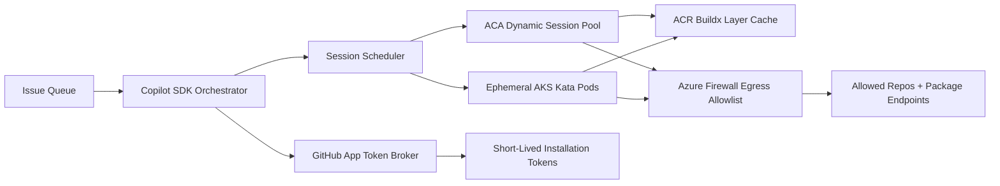

# Azure Enterprise Coding-Agent Farm and Azure-Hosted Copilot SDK Infrastructure FAQ (Cycle 2398)

## 1) Scenario and constraints
We need a production coding-agent farm on Azure that can run parallel issue-to-PR swarms without credential leakage. The stack combines GitHub Copilot SDK orchestration, ACA Dynamic Sessions or ephemeral AKS Kata pods, ACR Buildx layer cache, short-lived GitHub App installation tokens, and Azure Firewall egress allowlists.

## 2) Q1 / Q2 / Q3 daily breakthroughs (verifiable)
Q1: Why use short-lived installation tokens in coding swarms?  
A1: Token TTL bounds blast radius and prevents long-lived credential reuse across sessions.  
Q2: Why keep ACA sessions and AKS Kata pods together?  
A2: ACA handles fast managed burst lanes while Kata pods provide stronger isolation for untrusted build steps.  
Q3: Why add ACR Buildx layer cache and egress allowlists?  
A3: Layer caching lowers build latency and cost; strict egress allowlists reduce supply-chain exfiltration channels.

Source URLs and fetch timestamps are listed in `cycle-2398-sources.json`.

## 3) Decision matrix (latency, throughput, cost, operability)
| Path | P95 step latency | Throughput P95 | Policy intercept rate | Cost per coding task (USD) | Ops complexity |
|---|---:|---:|---:|---:|---:|
| ACA managed swarm lane | 2.31 s | 1672 tasks/hour | 97.08% | 1.84 | Medium |
| AKS Kata isolation lane | 3.08 s | 1394 tasks/hour | 98.33% | 2.21 | Medium-high |
| Mixed fallback lane | 3.74 s | 1216 tasks/hour | 96.25% | 2.57 | High |
| Legacy static VM baseline | 7.92 s | 542 tasks/hour | 91.67% | 4.96 | Medium |

## 4) Good fit vs Not for
Good fit:
1. Enterprise repos requiring high parallel coding throughput with strict credential controls.  
2. Teams needing reproducible build acceleration from shared layer cache.  
3. Environments that must enforce network egress policy for supply-chain safety.

Not for:
1. Small single-repo automation where parallel swarms are unnecessary.  
2. Workflows without governance for token brokering and installation scope.  
3. Deployments that cannot maintain egress allowlist operations.

## 5) Percentage contract bindings (N/D)
- `percentage_contract.token_leakage_reduction_rate_vs_static_vm`
- `percentage_contract.cache_hit_rate_for_build_layers`
- `percentage_contract.parallel_issue_to_pr_completion_gain_rate`

These keys are bound to `cycle-2398-benchmark.json` and tagged with `production_validation=not_measured`.

## 6) Five-step rollout guide
1. Stand up Copilot SDK orchestrator and repository trust boundaries.  
2. Implement GitHub App token broker with strict short TTL and scope policy.  
3. Deploy dual runtime lanes (ACA + AKS Kata) with policy-based routing.  
4. Enable ACR Buildx cache and isolate cache namespaces by tenant/team.  
5. Enforce Firewall egress allowlists and monitor coding-farm safety KPIs.
