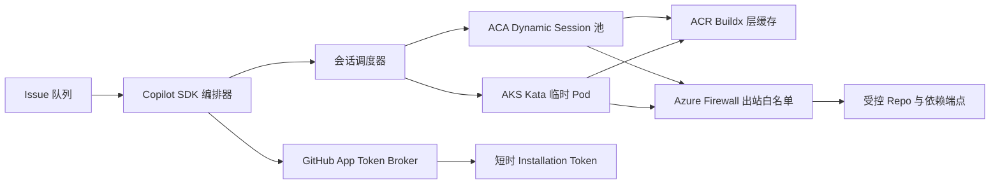

# Azure 企业级 Coding-Agent 农场与托管 Copilot SDK 基础设施 FAQ（Cycle 2398）

## 1) 场景与约束
目标是在 Azure 上构建可并行执行 Issue-to-PR 的 Coding-Agent 农场，并避免凭据泄漏。方案结合 GitHub Copilot SDK 编排、ACA Dynamic Sessions 与 AKS Kata 临时 Pod、ACR Buildx 层缓存、短时 GitHub App Installation Token、Azure Firewall 出站白名单。

## 2) Q1 / Q2 / Q3 当日能力突破（可验证）
Q1：为什么在代码代理集群里必须使用短时 Installation Token？  
A1：可将密钥暴露窗口限定在会话生命周期内，显著降低跨任务复用风险。  
Q2：为什么同时保留 ACA 与 AKS Kata 两条运行车道？  
A2：ACA 提供托管弹性与快速扩缩，Kata 车道为不受信构建步骤提供更强隔离。  
Q3：为什么要叠加 ACR Buildx 缓存与出站白名单？  
A3：缓存可降低构建步骤时延与成本，白名单可收敛供应链出站攻击面。

来源与抓取时间见 `cycle-2398-sources.json`。

## 3) 决策矩阵（时延、吞吐、成本、可运维性）
| 路径 | P95 步骤时延 | 吞吐 P95 | 策略拦截率 | 单任务成本（USD） | 运维复杂度 |
|---|---:|---:|---:|---:|---:|
| ACA 托管并行车道 | 2.31 s | 1672 tasks/hour | 97.08% | 1.84 | 中 |
| AKS Kata 隔离车道 | 3.08 s | 1394 tasks/hour | 98.33% | 2.21 | 中高 |
| 混合回退车道 | 3.74 s | 1216 tasks/hour | 96.25% | 2.57 | 高 |
| 静态 VM 旧基线 | 7.92 s | 542 tasks/hour | 91.67% | 4.96 | 中 |

## 4) Good fit vs Not for
Good fit：
1. 需要高并行 Issue-to-PR 产能且对凭据治理严格的企业仓库体系。  
2. 需要可复现构建加速与层缓存收益量化的工程组织。  
3. 需强约束供应链出站路径的高合规环境。

Not for：
1. 单仓低并发自动化，几乎不需要 swarm 调度。  
2. 无法实施 token broker 与 installation scope 治理的组织。  
3. 无法长期维护出站白名单策略的部署环境。

## 5) Percentage contract bindings (N/D)
- `percentage_contract.token_leakage_reduction_rate_vs_static_vm`
- `percentage_contract.cache_hit_rate_for_build_layers`
- `percentage_contract.parallel_issue_to_pr_completion_gain_rate`

以上键绑定 `cycle-2398-benchmark.json`，并标注 `production_validation=not_measured`。

## 6) 五步落地指南
1. 建立 Copilot SDK 编排层与仓库信任边界。  
2. 上线 GitHub App Token Broker，强制短 TTL 与最小权限。  
3. 部署 ACA + AKS Kata 双车道并配置策略路由。  
4. 启用 ACR Buildx 层缓存并做团队/租户命名空间隔离。  
5. 以 Firewall 出站白名单与安全 KPI 驱动持续治理。
