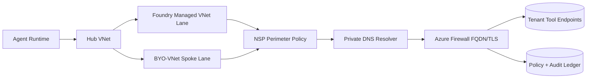

# Azure Enterprise Hub-Spoke Private Landing Zone & Egress Governance FAQ: Managed VNet vs BYO-VNet + NSP + Private DNS + Firewall (Cycle 2376)

## 1) Scenario and constraints
The goal is a private landing-zone architecture for Azure AI Agents that is reachable, governable, and auditable in regulated enterprise environments. We compare Foundry managed VNet and BYO-VNet subnet injection, then apply NSP, Private DNS Resolver, and Azure Firewall FQDN/TLS inspection to control tool-call egress risk and operations complexity.

## 2) Q1 / Q2 / Q3 Daily capability breakthroughs (verifiable)
Q1: How should managed VNet and BYO-VNet split responsibilities?  
A1: Managed VNet is suitable for low-ops private baseline; BYO-VNet suits strict custom segmentation/routing governance.  
Q2: What does NSP add?  
A2: It provides perimeter-level policy boundaries and reduces private endpoint exposure.  
Q3: Why both Private DNS and Firewall?  
A3: DNS provides resolvability governance and lineage, while Firewall enforces FQDN/TLS egress control and audit.

Sources with fetch timestamp (UTC) are listed in `cycle-2376-sources.json`.

## 3) Decision matrix (isolation, latency, cost, operations)
| Path | Private model | P50/P95 | Throughput P95 | Cost/session | Ops complexity |
|---|---|---:|---:|---:|---:|
| Managed VNet lane | managed isolation | 173/297 ms | 884 rps | 0.00700 | low-medium |
| BYO-VNet subnet injection | custom isolation | 189/324 ms | 812 rps | 0.00869 | medium-high |
| Firewall inspection lane | egress governance | 69/123 ms | 1110 rps | 0.00595 | medium |
| Tiered unified lane | hub-spoke + NSP + DNS + firewall | 179/305 ms | 1064 rps | 0.00721 | medium-high |

## 4) Good fit vs Not for
Good fit:
1. Coding Agent sandboxes requiring private, auditable tool-call egress.
2. Browser/CUA clusters needing unified private-access policy with lower ops burden.
3. Multi-tenant SaaS requiring spoke isolation and tenant attribution.
4. Regulated workloads requiring FQDN/TLS inspection and resolvable route lineage.

Not for:
1. Small public-API scenarios without private compliance needs.
2. Teams unable to maintain network policy lifecycle governance.
3. Designs optimizing only lowest initial cost while ignoring egress risk.

## 5) Percentage contract bindings (N/D)
- `percentage_contract.unfenced_private_egress_policy_drift_rate`
- `percentage_contract.nsp_private_boundary_enforcement_rate`
- `percentage_contract.firewall_tls_fqdn_governance_gain_pts`

These keys bind to `cycle-2376-benchmark.json` with `production_validation=not_measured`.

## 6) Five-step rollout
1. Define compliance classes for managed and BYO private lanes.
2. Apply NSP perimeter rules to minimize endpoint exposure.
3. Centralize private resolution with Private DNS Resolver and audit lineage.
4. Enforce Firewall FQDN/TLS policy on all outbound flows.
5. Recompute egress drift, boundary enforcement, and cost/session thresholds weekly.
