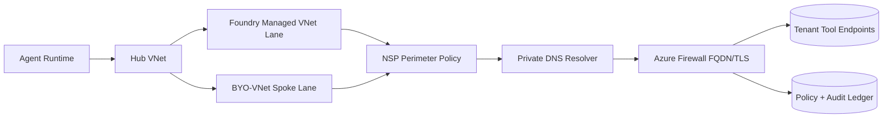

# Azure 企业 Hub-Spoke 私网落区与出口治理 FAQ：Managed VNet vs BYO-VNet + NSP + Private DNS + Firewall（Cycle 2376）

## 1) 场景与约束
目标是在受监管企业环境中，为 Azure AI Agent 建立“可达、可控、可审计”的私网落区：对比 Foundry Managed VNet 与 BYO-VNet 子网注入，并结合 NSP、Private DNS Resolver、Azure Firewall FQDN/TLS 检查，控制工具调用出口风险与运营复杂度。

## 2) Q1 / Q2 / Q3 当日能力突破（可验证）
Q1：Managed VNet 与 BYO-VNet 如何分工？  
A1：Managed VNet 适合低运维私网基线；BYO-VNet 适合强隔离和自定义路由合规。  
Q2：NSP 的治理价值是什么？  
A2：它在网络边界层提供统一准入策略，减少私有终结点暴露面。  
Q3：Private DNS + Firewall 为什么必须同时存在？  
A3：DNS 负责解析治理与可追溯，Firewall 负责 FQDN/TLS 出口控制与审计。

来源与抓取时间（UTC）写入 `cycle-2376-sources.json`。

## 3) 决策矩阵（隔离、时延、成本、运维）
| 路径 | 私网模型 | P50/P95 | 吞吐 P95 | 单会话成本 | 运维复杂度 |
|---|---|---:|---:|---:|---:|
| Managed VNet 私网车道 | 托管隔离 | 173/297 ms | 884 rps | 0.00700 | 低中 |
| BYO-VNet 子网注入 | 自定义隔离 | 189/324 ms | 812 rps | 0.00869 | 中高 |
| Firewall 检查车道 | 出口治理 | 69/123 ms | 1110 rps | 0.00595 | 中 |
| 融合分层车道 | Hub-Spoke + NSP + DNS + Firewall | 179/305 ms | 1064 rps | 0.00721 | 中高 |

## 4) Good fit vs Not for
Good fit：
1. Coding Agent sandbox：工具出口必须私网化且可审计。  
2. Browser/CUA 集群：需要低运维私网访问与策略统一。  
3. 多租户 SaaS：需要 spoke 级隔离和租户归因。  
4. 金融合规：需要 FQDN/TLS 检查和解析/路由可追溯。

Not for：
1. 小规模公开 API 场景，且无私网合规要求。  
2. 不能维护网络策略生命周期的团队。  
3. 仅追求最小初始成本、忽视出口治理风险的场景。

## 5) Percentage contract bindings (N/D)
- `percentage_contract.unfenced_private_egress_policy_drift_rate`
- `percentage_contract.nsp_private_boundary_enforcement_rate`
- `percentage_contract.firewall_tls_fqdn_governance_gain_pts`

以上键绑定 `cycle-2376-benchmark.json`，并标注 `production_validation=not_measured`。

## 6) 五步落地指南
1. 先定义 Managed/BYO 两条私网车道的合规分级。  
2. 用 NSP 固化边界准入规则并最小化终结点暴露。  
3. 用 Private DNS Resolver 统一私有域名解析与审计。  
4. 所有出站流量经过 Firewall FQDN/TLS 策略。  
5. 周度复盘 egress drift、boundary enforcement、cost/session 并迭代阈值。
