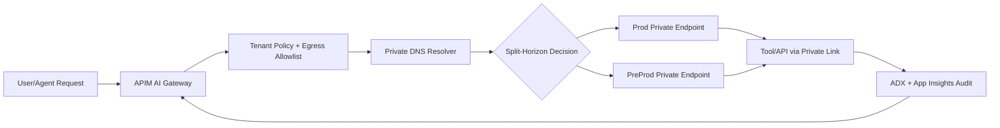

# Round 1040 / Cycle 2445 · Azure AI Agent Infra FAQ & Decision Guide (en)

> Topic: **Enterprise Private Link Egress + DNS Split-Horizon Agent Gateway**
>
> Date (BJT): 2026-11-16  
> Evidence labels: `measured` / `synthetic` / `anonymized_reported`  
> Benchmark payload: `evidence/cycle-2445-benchmark.json`

## 1) Executive Summary

This round addresses a common enterprise failure pattern: **private egress governance drift, split-horizon DNS inconsistency, and cross-tenant gateway policy bleed-through**.  
Key result: coupling APIM AI Gateway, Private Link, split-horizon DNS, tenant-scoped egress allowlists, and ADX audit trails reduces wrong-destination calls and data-exfiltration risk while preserving acceptable latency/cost.

## 2) Daily capability breakthroughs radar (2026-11-16)

1. **APIM AI Gateway / Unified Model API** (`measured`)  
   - Learn: https://learn.microsoft.com/en-us/azure/ai-gateway/overview  
   - Changelog: https://github.com/Azure/API-Management/blob/main/changelogs/api-management-service.md
2. **ACA Dynamic Sessions** (`measured`)  
   - Docs: https://learn.microsoft.com/en-us/azure/container-apps/sessions
3. **Sandbox/runtime cadence** (`measured`)  
   - Firecracker/Kata/Wasmtime/E2B release pages (see sources ledger)

> Fetch timestamps are recorded in `evidence/cycle-2445-sources.json`.

## 3) Core architecture Q&A (DNS + egress governance)

**Q1: Why does pre-prod pass while prod fails for the same agent flow?**  
A: Split-horizon DNS can return different records per VNet/resolver path, sending traffic to the wrong egress lane.

**Q2: How do we prevent unauthorized public tool/API calls?**  
A: Enforce `tenant-scoped private-link-egress-allowlist` in APIM policy and require signed tenant context for each tool call; deny on mismatch.

**Q3: How to model added latency from private egress controls?**  
A: Add deterministic hop overhead to baseline:
`latency_with_guard = baseline_latency + dns_hop + fw_hop + pe_hop`

## 4) Mermaid architecture (Private Link + Split-Horizon)

## 5) Decision matrix (egress governance options)

| Option | Security | Ops complexity | Latency overhead | Cost | Fit |
|---|---:|---:|---:|---:|---|
| Public internet + IP allowlist | Low | Low | Low | Low | Small PoC |
| Private Link + manual DNS | Mid-high | Medium | Medium | Medium | Single-region mid-scale |
| Private Link + split-horizon + APIM tenant policy | **High** | Mid-high | Medium | Mid-high | **Enterprise production default** |
| Multi-cloud unified egress proxy | Mid | High | Mid-high | High | Cross-cloud governance-heavy estates |

## 6) Production checklist (Good fit vs Not for + 5-step rollout)

### Good fit
- Multi-tenant enterprise agent gateways with private/internal APIs.
- Strong data-residency, zero-trust, and audit requirements.
- Unified control needed for model calls and tool-call egress paths.

### Not for
- Single-tenant, public-only, low-compliance workloads.
- Temporary environments without DNS/network governance ownership.

### Five-step rollout
1. Inventory tenant destinations and DNS zone boundaries.  
2. Define private-link egress allowlists and tenant-signature policy checks.  
3. Implement split-horizon DNS with pre-prod/prod consistency probes.  
4. Wire ADX audit for request/policy/DNS resolution/egress destination lineage.  
5. Review false-block rate, unauthorized-block rate, latency, and TCO weekly.  
