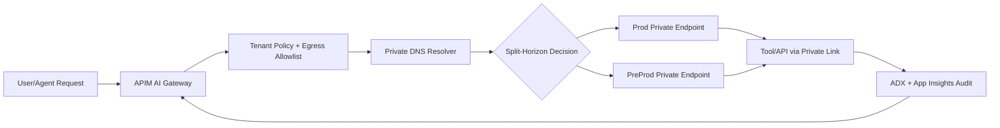

# Round 1040 / Cycle 2445 · Azure AI Agent Infra FAQ & 决策指南（zh-CN）

> Topic: **Enterprise Private Link Egress + DNS Split-Horizon Agent Gateway**
>
> Date (BJT): 2026-11-16  
> Evidence labels: `measured` / `synthetic` / `anonymized_reported`  
> Benchmark payload: `evidence/cycle-2445-benchmark.json`

## 1) Executive Summary

本轮主题是企业最常见“上线后才暴露”的 Agent Infra 风险：**私网出口治理 + DNS 分域解析漂移 + 多租户网关策略串扰**。  
核心结论：将 APIM AI Gateway、Private Link、DNS split-horizon、租户级 egress allowlist 和 ADX 审计联动，能够显著降低跨环境数据泄露与错误外呼风险，同时保持可控延迟与成本。

## 2) Daily capability breakthroughs radar（2026-11-16）

1. **APIM AI Gateway / Unified Model API**（`measured`）  
   - Learn: https://learn.microsoft.com/en-us/azure/ai-gateway/overview  
   - Changelog: https://github.com/Azure/API-Management/blob/main/changelogs/api-management-service.md
2. **ACA Dynamic Sessions**（`measured`）  
   - Docs: https://learn.microsoft.com/en-us/azure/container-apps/sessions
3. **Sandbox/runtime cadence**（`measured`）  
   - Firecracker/Kata/Wasmtime/E2B release pages（见 sources ledger）

> 所有来源抓取时间见 `evidence/cycle-2445-sources.json`。

## 3) Core architecture Q&A（DNS 与出口治理实战）

**Q1: 为什么同一请求在预生产通过、生产失败？**  
A: split-horizon DNS 在不同 VNet/Resolver 链路返回不同 A 记录，Agent Gateway 走错 egress 路径导致出站被拒或命中错误目标。

**Q2: 如何防止 Agent 越权访问公网工具端点？**  
A: 在 APIM policy 中执行 `tenant-scoped private-link-egress-allowlist`，并要求每次工具调用附带租户上下文签名，未匹配直接阻断。

**Q3: 如何估算私网出口策略对延迟影响？**  
A: 将额外 hops（DNS resolver + firewall + private endpoint）折算成固定开销，再对比基线 p50/p95：  
`latency_with_guard = baseline_latency + dns_hop + fw_hop + pe_hop`

## 4) Mermaid architecture（Private Link + Split-Horizon）

## 5) Decision matrix（出口治理方案选型）

| 方案 | 安全性 | 运维复杂度 | 延迟开销 | 成本 | 适用 |
|---|---:|---:|---:|---:|---|
| 全公网 + IP allowlist | 低 | 低 | 低 | 低 | 小规模 PoC |
| Private Link + 手工 DNS | 中高 | 中 | 中 | 中 | 单区域中型场景 |
| Private Link + Split-Horizon + APIM 租户策略 | **高** | 中高 | 中 | 中高 | **企业生产推荐** |
| 多云统一出口代理 | 中 | 高 | 中高 | 高 | 跨云统一治理需求 |

## 6) Production checklist（Good fit vs Not for + 五步落地）

### Good fit
- 多租户企业 Agent 网关，涉及内网系统/私有 API。
- 存在严格数据驻留、零信任和审计要求。
- 需要统一控制 AI 模型调用与工具调用出口策略。

### Not for
- 单租户、纯公网、低合规场景。
- 不具备 DNS 与网络治理能力的临时实验环境。

### 五步落地
1. 盘点租户级工具/API 目的端与 DNS 区域边界。  
2. 建立 private-link-egress-allowlist 与租户签名策略。  
3. 落地 split-horizon DNS 并做双环境解析一致性巡检。  
4. 接入 ADX 审计链路（请求、策略命中、解析结果、出口目的端）。  
5. 周期复盘误拦截率、越权阻断率、延迟与成本。  
