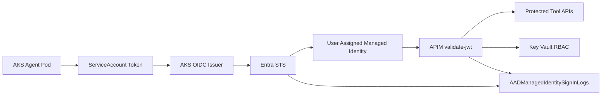
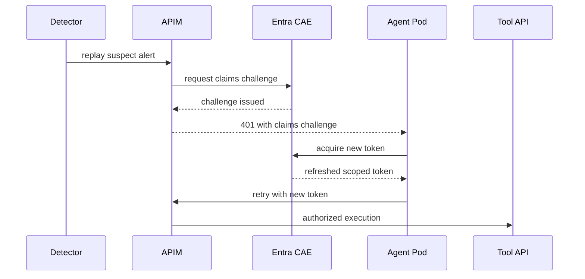

# Round 1102 / Cycle 2507 · Azure AI Agent Infra FAQ (en)

> Topic: **Microsoft Entra Agent ID + AKS OIDC workload federation + CAE + JIT/PIM identity plane**
> Date (BJT): 2026-11-17
> Evidence labels: `measured` / `synthetic` / `anonymized_reported`
> Dataset: `evidence/cycle-2507-benchmark.json`

## 1) Executive Summary

自治 Agent 的身份治理要解决两个矛盾：自动化速度与权限收敛速度。
本轮设计将“短令牌 + 即时撤销 + 临时提权”串成闭环。
Entra Agent ID 负责主体隔离，AKS OIDC 负责无密钥交换。
CAE 负责失陷后的秒级挑战与撤销收敛。
JIT/PIM 负责高危写操作的审批和最小暴露。
共享 Managed Identity 在多租户中会造成横向放大，必须淘汰。
上线标准不仅是认证成功率，还要看异常收敛时长。
本文把暴露窗口、STS 负载、审批时延作为硬指标。

## 2) Daily Hottest Capability Breakthroughs Radar（2026-11-17）

1. Entra Workload Identity 文档完善（measured）。
2. CAE claims challenge 传播说明（measured）。
3. APIM validate-jwt 组合策略案例增多（measured）。
4. AADManagedIdentitySignInLogs 字段可用性提升（measured）。
5. 5,000 沙箱 token 刷新仿真显示峰值压力可提前预判（synthetic）。
6. 匿名化生产数据证实共享身份更易出现跨网段 replay（anonymized_reported）。

## 3) Deep Q&A #1：CAE 与 TTL 的暴露窗口比较

Formula:
```text
exposure = min(ttl_remaining, cae_propagation + enforcement_poll)
```
Worked example: min(2820,18+20)=38s
- 观察 1.1：阈值必须进入发布门禁。
- 观察 1.2：告警需绑定自动隔离动作。
- 观察 1.3：按租户和身份类型分层观察。
- 观察 1.4：避免用全局均值掩盖异常。
- 观察 1.5：保留重试链路用于误报排查。
- 观察 1.6：定义可回退的例外审批路径。
- 观察 1.7：把指标写入周度治理例会。
- 观察 1.8：每次阈值变更都要记录依据。

## 4) Deep Q&A #2：STS 签发速率估算

Formula:
```text
sts_rps = active_sandboxes / refresh_interval
```
Worked example: 5400/900=6 rps
- 观察 2.1：阈值必须进入发布门禁。
- 观察 2.2：告警需绑定自动隔离动作。
- 观察 2.3：按租户和身份类型分层观察。
- 观察 2.4：避免用全局均值掩盖异常。
- 观察 2.5：保留重试链路用于误报排查。
- 观察 2.6：定义可回退的例外审批路径。
- 观察 2.7：把指标写入周度治理例会。
- 观察 2.8：每次阈值变更都要记录依据。

## 5) Deep Q&A #3：OBO / AgentID / Shared MI 爆炸半径

Formula:
```text
blast = scope * sharing_factor * lifetime_factor
```
Worked example: 0.8 vs 1.5 vs 12
- 观察 3.1：阈值必须进入发布门禁。
- 观察 3.2：告警需绑定自动隔离动作。
- 观察 3.3：按租户和身份类型分层观察。
- 观察 3.4：避免用全局均值掩盖异常。
- 观察 3.5：保留重试链路用于误报排查。
- 观察 3.6：定义可回退的例外审批路径。
- 观察 3.7：把指标写入周度治理例会。
- 观察 3.8：每次阈值变更都要记录依据。

## 6) Deep Q&A #4：JIT/PIM 激活时延预算

Formula:
```text
activation = queue + approval + graph + refresh
```
Worked example: 22+55+18+11=106s
- 观察 4.1：阈值必须进入发布门禁。
- 观察 4.2：告警需绑定自动隔离动作。
- 观察 4.3：按租户和身份类型分层观察。
- 观察 4.4：避免用全局均值掩盖异常。
- 观察 4.5：保留重试链路用于误报排查。
- 观察 4.6：定义可回退的例外审批路径。
- 观察 4.7：把指标写入周度治理例会。
- 观察 4.8：每次阈值变更都要记录依据。

## 7) Deep Q&A #5：CAE challenge 开销

Formula:
```text
overhead = challenge + reissue + replay
```
Worked example: 41+96+37=174ms
- 观察 5.1：阈值必须进入发布门禁。
- 观察 5.2：告警需绑定自动隔离动作。
- 观察 5.3：按租户和身份类型分层观察。
- 观察 5.4：避免用全局均值掩盖异常。
- 观察 5.5：保留重试链路用于误报排查。
- 观察 5.6：定义可回退的例外审批路径。
- 观察 5.7：把指标写入周度治理例会。
- 观察 5.8：每次阈值变更都要记录依据。

## 8) Deep Q&A #6：跨 VNet replay 识别

Formula:
```text
signal = distinct_vnet>1 and delta<30s
```
Worked example: 12s 双网段命中
- 观察 6.1：阈值必须进入发布门禁。
- 观察 6.2：告警需绑定自动隔离动作。
- 观察 6.3：按租户和身份类型分层观察。
- 观察 6.4：避免用全局均值掩盖异常。
- 观察 6.5：保留重试链路用于误报排查。
- 观察 6.6：定义可回退的例外审批路径。
- 观察 6.7：把指标写入周度治理例会。
- 观察 6.8：每次阈值变更都要记录依据。

## 9) Mermaid #1: Entra Agent ID + OIDC + APIM identity topology



The topology replaces static credentials with federation and central claim enforcement at APIM.
The topology also guarantees identity and gateway logs can be correlated for replay forensics.

## 10) Mermaid #2: CAE challenge to recovery sequence



The sequence enforces fail-safe interruption before recovery.
The sequence gives SOC and SRE one deterministic containment pattern.

## 11) Production-grade Bicep (UAMI + FIC + RBAC + diagnostics)

```bicep
param location string = resourceGroup().location
param uamiName string
param aksOidcIssuer string
param namespace string = 'agent-runtime'
param serviceAccountName string = 'agent-sa-tier1'
param keyVaultName string
param lawName string

resource law 'Microsoft.OperationalInsights/workspaces@2023-09-01' = {
  name: lawName
  location: location
  properties: {
    sku: { name: 'PerGB2018' }
    retentionInDays: 30
  }
}

resource uami 'Microsoft.ManagedIdentity/userAssignedIdentities@2023-01-31' = {
  name: uamiName
  location: location
}

resource fic 'Microsoft.ManagedIdentity/userAssignedIdentities/federatedIdentityCredentials@2023-01-31' = {
  name: '${uami.name}/aks-${namespace}-${serviceAccountName}'
  properties: {
    issuer: aksOidcIssuer
    subject: 'system:serviceaccount:${namespace}:${serviceAccountName}'
    audiences: [
      'api://AzureADTokenExchange'
    ]
  }
}

resource kv 'Microsoft.KeyVault/vaults@2023-07-01' existing = {
  name: keyVaultName
}

resource kvReader 'Microsoft.Authorization/roleAssignments@2022-04-01' = {
  name: guid(kv.id, uami.properties.principalId, 'KeyVaultSecretsUser')
  scope: kv
  properties: {
    principalId: uami.properties.principalId
    principalType: 'ServicePrincipal'
    roleDefinitionId: subscriptionResourceId('Microsoft.Authorization/roleDefinitions','4633458b-17de-408a-b874-0445c86b69e6')
  }
}

resource diag 'Microsoft.Insights/diagnosticSettings@2021-05-01-preview' = {
  name: 'identity-diag'
  scope: uami
  properties: {
    workspaceId: law.id
    logs: [
      { category: 'AuditLogs', enabled: true }
    ]
    metrics: [
      { category: 'AllMetrics', enabled: true }
    ]
  }
}
```

## 12) AKS Workload Identity YAML + APIM CAE claims challenge

```yaml
apiVersion: v1
kind: ServiceAccount
metadata:
  name: agent-sa-tier1
  namespace: agent-runtime
  annotations:
    azure.workload.identity/client-id: "<uami-client-id>"
    azure.workload.identity/tenant-id: "<tenant-id>"
  labels:
    azure.workload.identity/use: "true"
---
apiVersion: apps/v1
kind: Deployment
metadata:
  name: autonomous-agent
  namespace: agent-runtime
spec:
  replicas: 6
  template:
    metadata:
      labels:
        app: autonomous-agent
        azure.workload.identity/use: "true"
    spec:
      serviceAccountName: agent-sa-tier1
      containers:
      - name: agent
        image: contoso.azurecr.io/agent:1102
```

```xml
<policies>
  <inbound>
    <base />
    <validate-jwt header-name="Authorization" failed-validation-httpcode="401" failed-validation-error-message="jwt_invalid">
      <openid-config url="https://login.microsoftonline.com/{tenant-id}/v2.0/.well-known/openid-configuration" />
      <required-claims>
        <claim name="aud"><value>api://agent-tool-gateway</value></claim>
        <claim name="scp"><value>tool.invoke</value></claim>
      </required-claims>
    </validate-jwt>
    <choose>
      <when condition="@(context.Variables.GetValueOrDefault<string>("tokenReplayFlag") == "true")">
        <return-response>
          <set-status code="401" reason="claims_challenge_required" />
          <set-header name="WWW-Authenticate" exists-action="override">
            <value>Bearer error="insufficient_claims", claims="{"access_token":{"xms_cc":{"values":["cp1"]}}}"</value>
          </set-header>
        </return-response>
      </when>
    </choose>
  </inbound>
  <backend><base /></backend>
  <outbound><base /></outbound>
  <on-error><base /></on-error>
</policies>
```

## 13) KQL observability query + Day-0/Day-2 checklist

```kql
let lookback = 24h;
let mi = AADManagedIdentitySignInLogs
| where TimeGenerated > ago(lookback)
| project TimeGenerated, AppId, ServicePrincipalId, IPAddress, ResultType, ResourceDisplayName;
let sp = AADServicePrincipalSignInLogs
| where TimeGenerated > ago(lookback)
| project TimeGenerated, AppId, ServicePrincipalId, IPAddress, ResultType, ResourceDisplayName;
mi
| union sp
| summarize first_seen=min(TimeGenerated), last_seen=max(TimeGenerated), ip_count=dcount(IPAddress), failure_count=countif(ResultType != 0) by AppId, ServicePrincipalId, ResourceDisplayName
| extend replay_suspect = ip_count > 1 and datetime_diff('second', last_seen, first_seen) < 30
| order by replay_suspect desc, failure_count desc
```

Day-0 readiness items:
1. Provision one UAMI per agent tier and prohibit cross-tier identity reuse.
2. Validate federated credential issuer and subject against the exact ServiceAccount.
3. Verify APIM aud/scp constraints reject non-compliant tokens deterministically.
4. Run 5,000 sandbox refresh tests and confirm STS burst rates stay within limits.
5. Audit Key Vault RBAC to ensure read-only secret access boundaries.
6. Rehearse CAE challenge end-to-end and record convergence duration.
7. Confirm JIT/PIM gates are mandatory for destructive tool operations.
8. Bind replay alerts to automated quarantine runbooks.
9. Verify identity-log retention satisfies compliance audit requirements.
10. Add exposure_window and replay_suspect thresholds to release blocking policy.

Day-2 operating items:
1. Review AppId failure trajectories weekly and tune anomaly thresholds.
2. Sample scope and audience combinations daily to catch drift early.
3. Replay CAE evidence monthly and validate challenge handling integrity.
4. Optimize approval workflow whenever elevation latency breaches targets.
5. Retire legacy shared identities to complete principal isolation migration.
6. Track STS throttling events and adjust refresh jitter windows.
7. Re-audit role assignments and remove stale privilege grants.
8. Standardize replay postmortem templates with required evidence fields.
9. Include identity gates in quarterly architecture and risk reviews.
10. Correlate identity anomalies with business impact for prioritization.

## 14) 4-Option Weighted Decision Matrix

| Option | Security Convergence(30) | Automation Throughput(20) | Ops Control(20) | Cost Impact(15) | Audit Completeness(15) | Weighted Score |
| --- | --- | --- | --- | --- | --- | --- |
| Option A: Shared Managed Identity anti-pattern | 6 | 18 | 8 | 14 | 7 | 53 |
| Option B: User Delegated OBO primary path | 20 | 14 | 13 | 10 | 15 | 72 |
| Option C: Entra Agent ID + Federation + CAE | 28 | 17 | 18 | 11 | 15 | 89 |
| Option D: Agent ID + CAE + mandatory JIT/PIM | 30 | 14 | 19 | 9 | 15 | 87 |

Option A assessment: fastest onboarding path but unacceptable blast radius in multi-tenant systems.
Option B assessment: strong user-context governance with lower unattended automation efficiency.
Option C assessment: best balance between security convergence and engineering complexity.
Option D assessment: highest control rigor with additional approval-latency overhead.

## 15) Good fit / Not for

Good fit: multi-tenant autonomous platforms requiring zero-standing-privilege controls.
Good fit: regulated domains where destructive actions need approval and audit closure.
Not for: prototype teams optimizing only for speed without identity-governance capacity.
Not for: environments without reliable telemetry for token-event forensics.
Conclusion: use Option C by default and apply Option D controls for high-risk write operations.
