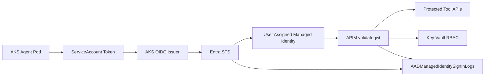
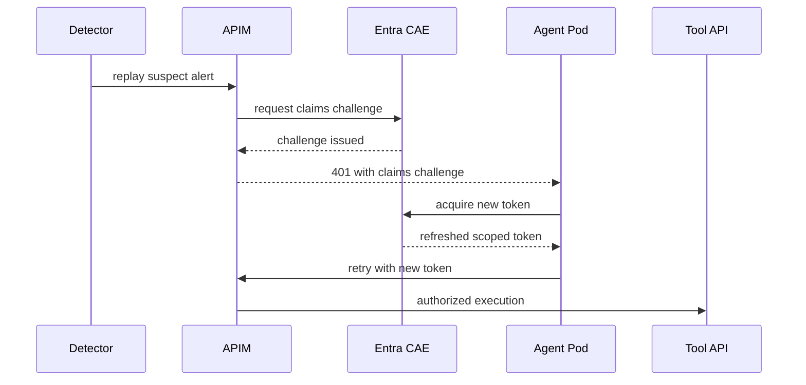

# Round 1102 / Cycle 2507 · Azure AI Agent Infra FAQ（zh-CN）

> 主题：**Microsoft Entra Agent ID + AKS OIDC Workload Federation + CAE + JIT/PIM 零常驻权限身份平面**
> 日期（BJT）：2026-11-17
> 证据标签：`measured` / `synthetic` / `anonymized_reported`
> 基准文件：`evidence/cycle-2507-benchmark.json`

## 1) Executive Summary

自治 Agent 的身份治理要解决两个矛盾：自动化速度与权限收敛速度。
本轮设计将“短令牌 + 即时撤销 + 临时提权”串成闭环。
Entra Agent ID 负责主体隔离，AKS OIDC 负责无密钥交换。
CAE 负责失陷后的秒级挑战与撤销收敛。
JIT/PIM 负责高危写操作的审批和最小暴露。
共享 Managed Identity 在多租户中会造成横向放大，必须淘汰。
上线标准不仅是认证成功率，还要看异常收敛时长。
本文把暴露窗口、STS 负载、审批时延作为硬指标。

## 2) Daily Hottest Capability Breakthroughs Radar（2026-11-17）

1. Entra Workload Identity 文档完善（measured）。
2. CAE claims challenge 传播说明（measured）。
3. APIM validate-jwt 组合策略案例增多（measured）。
4. AADManagedIdentitySignInLogs 字段可用性提升（measured）。
5. 5,000 沙箱 token 刷新仿真显示峰值压力可提前预判（synthetic）。
6. 匿名化生产数据证实共享身份更易出现跨网段 replay（anonymized_reported）。

## 3) Deep Q&A #1：CAE 与 TTL 的暴露窗口比较

公式：
```text
exposure = min(ttl_remaining, cae_propagation + enforcement_poll)
```
样例：min(2820,18+20)=38s
- 观察 1.1：阈值必须进入发布门禁。
- 观察 1.2：告警需绑定自动隔离动作。
- 观察 1.3：按租户和身份类型分层观察。
- 观察 1.4：避免用全局均值掩盖异常。
- 观察 1.5：保留重试链路用于误报排查。
- 观察 1.6：定义可回退的例外审批路径。
- 观察 1.7：把指标写入周度治理例会。
- 观察 1.8：每次阈值变更都要记录依据。

## 4) Deep Q&A #2：STS 签发速率估算

公式：
```text
sts_rps = active_sandboxes / refresh_interval
```
样例：5400/900=6 rps
- 观察 2.1：阈值必须进入发布门禁。
- 观察 2.2：告警需绑定自动隔离动作。
- 观察 2.3：按租户和身份类型分层观察。
- 观察 2.4：避免用全局均值掩盖异常。
- 观察 2.5：保留重试链路用于误报排查。
- 观察 2.6：定义可回退的例外审批路径。
- 观察 2.7：把指标写入周度治理例会。
- 观察 2.8：每次阈值变更都要记录依据。

## 5) Deep Q&A #3：OBO / AgentID / Shared MI 爆炸半径

公式：
```text
blast = scope * sharing_factor * lifetime_factor
```
样例：0.8 vs 1.5 vs 12
- 观察 3.1：阈值必须进入发布门禁。
- 观察 3.2：告警需绑定自动隔离动作。
- 观察 3.3：按租户和身份类型分层观察。
- 观察 3.4：避免用全局均值掩盖异常。
- 观察 3.5：保留重试链路用于误报排查。
- 观察 3.6：定义可回退的例外审批路径。
- 观察 3.7：把指标写入周度治理例会。
- 观察 3.8：每次阈值变更都要记录依据。

## 6) Deep Q&A #4：JIT/PIM 激活时延预算

公式：
```text
activation = queue + approval + graph + refresh
```
样例：22+55+18+11=106s
- 观察 4.1：阈值必须进入发布门禁。
- 观察 4.2：告警需绑定自动隔离动作。
- 观察 4.3：按租户和身份类型分层观察。
- 观察 4.4：避免用全局均值掩盖异常。
- 观察 4.5：保留重试链路用于误报排查。
- 观察 4.6：定义可回退的例外审批路径。
- 观察 4.7：把指标写入周度治理例会。
- 观察 4.8：每次阈值变更都要记录依据。

## 7) Deep Q&A #5：CAE challenge 开销

公式：
```text
overhead = challenge + reissue + replay
```
样例：41+96+37=174ms
- 观察 5.1：阈值必须进入发布门禁。
- 观察 5.2：告警需绑定自动隔离动作。
- 观察 5.3：按租户和身份类型分层观察。
- 观察 5.4：避免用全局均值掩盖异常。
- 观察 5.5：保留重试链路用于误报排查。
- 观察 5.6：定义可回退的例外审批路径。
- 观察 5.7：把指标写入周度治理例会。
- 观察 5.8：每次阈值变更都要记录依据。

## 8) Deep Q&A #6：跨 VNet replay 识别

公式：
```text
signal = distinct_vnet>1 and delta<30s
```
样例：12s 双网段命中
- 观察 6.1：阈值必须进入发布门禁。
- 观察 6.2：告警需绑定自动隔离动作。
- 观察 6.3：按租户和身份类型分层观察。
- 观察 6.4：避免用全局均值掩盖异常。
- 观察 6.5：保留重试链路用于误报排查。
- 观察 6.6：定义可回退的例外审批路径。
- 观察 6.7：把指标写入周度治理例会。
- 观察 6.8：每次阈值变更都要记录依据。

## 9) Mermaid #1：Entra Agent ID + OIDC + APIM 身份拓扑



该拓扑重点是用联邦令牌替代静态密钥，并把 claim 验证统一在 APIM。
该拓扑保证身份日志与网关日志可关联，支持 replay 事件闭环取证。

## 10) Mermaid #2：CAE challenge 到恢复序列



该序列强调“先阻断后恢复”，避免失陷令牌继续执行高危工具。
该序列给 SOC 与 SRE 提供统一的可执行处置语义。

## 11) 生产级 Bicep（UAMI + FIC + RBAC + 诊断）

```bicep
param location string = resourceGroup().location
param uamiName string
param aksOidcIssuer string
param namespace string = 'agent-runtime'
param serviceAccountName string = 'agent-sa-tier1'
param keyVaultName string
param lawName string

resource law 'Microsoft.OperationalInsights/workspaces@2023-09-01' = {
  name: lawName
  location: location
  properties: {
    sku: { name: 'PerGB2018' }
    retentionInDays: 30
  }
}

resource uami 'Microsoft.ManagedIdentity/userAssignedIdentities@2023-01-31' = {
  name: uamiName
  location: location
}

resource fic 'Microsoft.ManagedIdentity/userAssignedIdentities/federatedIdentityCredentials@2023-01-31' = {
  name: '${uami.name}/aks-${namespace}-${serviceAccountName}'
  properties: {
    issuer: aksOidcIssuer
    subject: 'system:serviceaccount:${namespace}:${serviceAccountName}'
    audiences: [
      'api://AzureADTokenExchange'
    ]
  }
}

resource kv 'Microsoft.KeyVault/vaults@2023-07-01' existing = {
  name: keyVaultName
}

resource kvReader 'Microsoft.Authorization/roleAssignments@2022-04-01' = {
  name: guid(kv.id, uami.properties.principalId, 'KeyVaultSecretsUser')
  scope: kv
  properties: {
    principalId: uami.properties.principalId
    principalType: 'ServicePrincipal'
    roleDefinitionId: subscriptionResourceId('Microsoft.Authorization/roleDefinitions','4633458b-17de-408a-b874-0445c86b69e6')
  }
}

resource diag 'Microsoft.Insights/diagnosticSettings@2021-05-01-preview' = {
  name: 'identity-diag'
  scope: uami
  properties: {
    workspaceId: law.id
    logs: [
      { category: 'AuditLogs', enabled: true }
    ]
    metrics: [
      { category: 'AllMetrics', enabled: true }
    ]
  }
}
```

## 12) AKS Workload Identity YAML + APIM CAE claims challenge

```yaml
apiVersion: v1
kind: ServiceAccount
metadata:
  name: agent-sa-tier1
  namespace: agent-runtime
  annotations:
    azure.workload.identity/client-id: "<uami-client-id>"
    azure.workload.identity/tenant-id: "<tenant-id>"
  labels:
    azure.workload.identity/use: "true"
---
apiVersion: apps/v1
kind: Deployment
metadata:
  name: autonomous-agent
  namespace: agent-runtime
spec:
  replicas: 6
  template:
    metadata:
      labels:
        app: autonomous-agent
        azure.workload.identity/use: "true"
    spec:
      serviceAccountName: agent-sa-tier1
      containers:
      - name: agent
        image: contoso.azurecr.io/agent:1102
```

```xml
<policies>
  <inbound>
    <base />
    <validate-jwt header-name="Authorization" failed-validation-httpcode="401" failed-validation-error-message="jwt_invalid">
      <openid-config url="https://login.microsoftonline.com/{tenant-id}/v2.0/.well-known/openid-configuration" />
      <required-claims>
        <claim name="aud"><value>api://agent-tool-gateway</value></claim>
        <claim name="scp"><value>tool.invoke</value></claim>
      </required-claims>
    </validate-jwt>
    <choose>
      <when condition="@(context.Variables.GetValueOrDefault<string>("tokenReplayFlag") == "true")">
        <return-response>
          <set-status code="401" reason="claims_challenge_required" />
          <set-header name="WWW-Authenticate" exists-action="override">
            <value>Bearer error="insufficient_claims", claims="{"access_token":{"xms_cc":{"values":["cp1"]}}}"</value>
          </set-header>
        </return-response>
      </when>
    </choose>
  </inbound>
  <backend><base /></backend>
  <outbound><base /></outbound>
  <on-error><base /></on-error>
</policies>
```

## 13) KQL 可观测性查询 + Day-0/Day-2 Checklist

```kql
let lookback = 24h;
let mi = AADManagedIdentitySignInLogs
| where TimeGenerated > ago(lookback)
| project TimeGenerated, AppId, ServicePrincipalId, IPAddress, ResultType, ResourceDisplayName;
let sp = AADServicePrincipalSignInLogs
| where TimeGenerated > ago(lookback)
| project TimeGenerated, AppId, ServicePrincipalId, IPAddress, ResultType, ResourceDisplayName;
mi
| union sp
| summarize first_seen=min(TimeGenerated), last_seen=max(TimeGenerated), ip_count=dcount(IPAddress), failure_count=countif(ResultType != 0) by AppId, ServicePrincipalId, ResourceDisplayName
| extend replay_suspect = ip_count > 1 and datetime_diff('second', last_seen, first_seen) < 30
| order by replay_suspect desc, failure_count desc
```

Day-0 关键项：
1. 每个 Agent tier 独立 UAMI，严禁跨 tier 复用身份。
2. 校验 FIC issuer 与 subject 精确匹配目标 ServiceAccount。
3. 验证 APIM validate-jwt 的 aud/scp 约束拒绝不合规请求。
4. 执行 5,000 沙箱刷新压测并确认 STS 峰值可控。
5. 审核 Key Vault RBAC 仅授予 Secrets User，不包含写权限。
6. 演练 CAE challenge 全链路，记录收敛时长。
7. 确认 JIT/PIM 对高危工具调用不可绕过。
8. 绑定 replay 告警到自动隔离 runbook。
9. 验证身份日志保留期满足审计要求。
10. 将 exposure_window 与 replay_suspect 纳入发布阻断。

Day-2 运营项：
1. 每周评估 AppId 级别失败率并动态调阈值。
2. 每日抽检 scope 与 audience 组合，防止策略漂移。
3. 每月回放 CAE 样本，验证 claims challenge 未退化。
4. 对审批延迟超标工单执行流程优化。
5. 持续下线历史共享 MI，完成主体隔离迁移。
6. 追踪 STS 节流并更新刷新抖动策略。
7. 定期复核 roleAssignments，删除冗余权限。
8. 建立 replay 复盘模板，统一证据字段。
9. 将身份门禁纳入季度架构审计清单。
10. 把身份异常与业务影响关联驱动优先级。

## 14) 4-Option Weighted Decision Matrix

| 方案 | 安全收敛(30) | 自动化效率(20) | 运维可控(20) | 成本影响(15) | 审计完备(15) | 加权总分 |
| --- | --- | --- | --- | --- | --- | --- |
| 方案A：Shared Managed Identity（反模式） | 6 | 18 | 8 | 14 | 7 | 53 |
| 方案B：User Delegated OBO 主路径 | 20 | 14 | 13 | 10 | 15 | 72 |
| 方案C：Entra Agent ID + Federation + CAE | 28 | 17 | 18 | 11 | 15 | 89 |
| 方案D：Agent ID + CAE + JIT/PIM 全量门禁 | 30 | 14 | 19 | 9 | 15 | 87 |

方案A评价：接入快但爆炸半径大，不适合多租户自治平台。
方案B评价：用户在环可审计性好，但无人值守自动化效率偏低。
方案C评价：在安全收敛与工程复杂度之间平衡最佳。
方案D评价：控制最强但审批时延更高，适用于高合规行业。

## 15) Good fit / Not for

Good fit：需要零常驻权限并支持快速撤销的多租户自治 Agent 平台。
Good fit：高危工具调用必须有审批闭环与全链路审计的行业。
Not for：只追求开发便捷且无法承担身份治理复杂度的小型原型团队。
Not for：缺少稳定日志管道、无法复盘 token 事件的环境。
结论：默认方案C，并在高危写操作叠加方案D 的 JIT/PIM 门禁。
