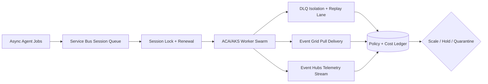

# Azure Event-Driven Async Agent Swarm FAQ: Service Bus Session Lock + DLQ + Event Grid Pull + Event Hubs (Cycle 2374)

## 1) Scenario and constraints
The goal is to run long-lived background agent swarms on ACA/AKS while balancing exclusive task ownership, poison-message isolation, high-throughput telemetry, and autoscaling. Command lane uses Service Bus session locks, failures go to DLQ, dispatch uses Event Grid Namespace pull delivery, telemetry uses Event Hubs, and KEDA scales from queue-driven metrics.

## 2) Q1 / Q2 / Q3 Daily capability breakthroughs (verifiable)
Q1: Why split control and telemetry planes?  
A1: It prevents high telemetry throughput from backpressuring command execution.  
Q2: Why is DLQ central for agent swarms?  
A2: It isolates poison messages and narrows cross-tenant blast radius during replay.  
Q3: Which KEDA triggers matter most?  
A3: Queue lag, active session locks, and lock age are stronger than CPU-only autoscaling.

Sources with fetch timestamp (UTC) are listed in `cycle-2374-sources.json`.

## 3) Decision matrix (isolation, latency, throughput, cost)
| Path | Core mechanism | P50/P95 | Throughput P95 | Cost/session | Ops complexity |
|---|---|---:|---:|---:|---:|
| Service Bus Session Lock | lock stewardship | 156/274 ms | 774 rps | 0.00663 | medium |
| Event Grid Pull Delivery | pull dispatch | 131/236 ms | 1116 rps | 0.00508 | medium |
| Event Hubs Telemetry | high-throughput telemetry | 88/162 ms | 2974 rps | 0.00430 | low-medium |
| Tiered async fusion | lock+pull+stream | 149/266 ms | 1238 rps | 0.00602 | medium-high |

## 4) Good fit vs Not for
Good fit:
1. Coding Agent sandboxes needing lock custody for long-running tasks.
2. Browser/CUA clusters requiring queue-depth-aware elasticity.
3. Multi-tenant SaaS requiring tenant-scoped DLQ replay isolation.
4. Regulated workloads requiring auditable telemetry and policy lineage.

Not for:
1. Low-concurrency short tasks without poison isolation requirements.
2. Teams unable to maintain replay and lock-renewal controls.
3. CPU-only autoscaling designs that ignore queue and lock signals.

## 5) Percentage contract bindings (N/D)
- `percentage_contract.unfenced_session_lock_renewal_drift_rate`
- `percentage_contract.dlq_poison_isolation_effective_rate`
- `percentage_contract.event_hub_telemetry_stream_efficiency_gain_pts`

These keys bind to `cycle-2374-benchmark.json` with `production_validation=not_measured`.

## 6) Five-step rollout
1. Define lock TTL, renewal windows, and expiry adjudication policy.
2. Route poison messages to DLQ with isolated replay queues.
3. Move telemetry fully to Event Hubs; keep control plane minimal.
4. Scale with KEDA on queue lag + active locks + lock age.
5. Recompute lock drift, DLQ rate, telemetry pressure, and cost/session weekly.
