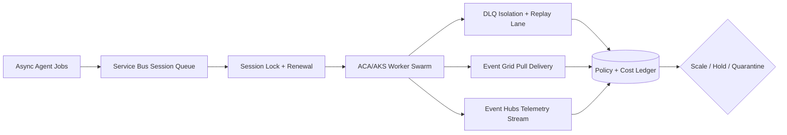

# Azure 事件驱动异步 Agent 群选型 FAQ：Service Bus Session Lock + DLQ + Event Grid Pull + Event Hubs（Cycle 2374）

## 1) 场景与约束
目标是在 ACA/AKS 上运行长时后台 Agent 群时，兼顾“任务独占执行、失败隔离回放、遥测高吞吐、弹性扩缩容”：命令流使用 Service Bus Session Lock，失败流进入 DLQ，分发流采用 Event Grid Namespace Pull，遥测流采用 Event Hubs，并由 KEDA 按队列指标驱动扩缩。

## 2) Q1 / Q2 / Q3 当日能力突破（可验证）
Q1：为什么要把控制与遥测拆开？  
A1：控制面和遥测面分离可避免高吞吐日志反压阻塞任务执行。  
Q2：DLQ 在 Agent 群里的关键作用？  
A2：它将 poison-message 与正常流隔离，降低跨租户影响面。  
Q3：KEDA 的关键触发器应是什么？  
A3：优先使用 queue lag、active session locks、lock age，而非仅 CPU。

来源与抓取时间（UTC）写入 `cycle-2374-sources.json`。

## 3) 决策矩阵（隔离、时延、吞吐、成本）
| 路径 | 关键机制 | P50/P95 | 吞吐 P95 | 单会话成本 | 运维复杂度 |
|---|---|---:|---:|---:|---:|
| Service Bus Session Lock | 独占锁续租 | 156/274 ms | 774 rps | 0.00663 | 中 |
| Event Grid Pull Delivery | 主动拉取分发 | 131/236 ms | 1116 rps | 0.00508 | 中 |
| Event Hubs Telemetry | 遥测高吞吐 | 88/162 ms | 2974 rps | 0.00430 | 低中 |
| 分层异步融合 | 锁+拉取+遥测 | 149/266 ms | 1238 rps | 0.00602 | 中高 |

## 4) Good fit vs Not for
Good fit：
1. Coding Agent sandbox：长任务需要独占锁与超时续租。  
2. Browser/CUA 集群：需要 queue-depth 驱动弹性，避免突发拥塞。  
3. 多租户 SaaS：需要 DLQ 隔离和按租户回放。  
4. 金融合规：需要可审计遥测流与不可篡改策略链。

Not for：
1. 低并发短任务，且无需 poison-message 隔离。  
2. 不允许维护回放与锁续租策略的团队。  
3. 仅按 CPU 扩缩容、忽略队列指标与锁年龄的场景。

## 5) Percentage contract bindings (N/D)
- `percentage_contract.unfenced_session_lock_renewal_drift_rate`
- `percentage_contract.dlq_poison_isolation_effective_rate`
- `percentage_contract.event_hub_telemetry_stream_efficiency_gain_pts`

以上键绑定 `cycle-2374-benchmark.json`，并标注 `production_validation=not_measured`。

## 6) 五步落地指南
1. 为长任务定义 session lock TTL、renew window、超时裁决策略。  
2. 将 poison-message 强制送入 DLQ，建立隔离回放队列。  
3. 把遥测完全切到 Event Hubs，控制面只保留命令与状态。  
4. KEDA 引入 queue lag + active locks + lock age 多指标策略。  
5. 周度复盘 lock drift、DLQ rate、telemetry pressure、cost/session。
