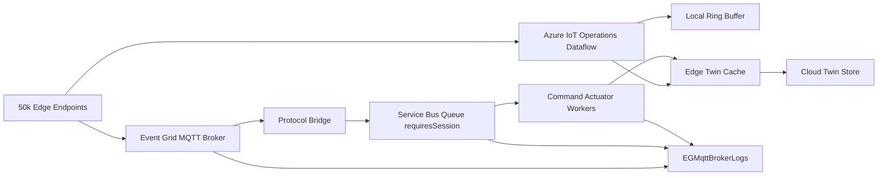
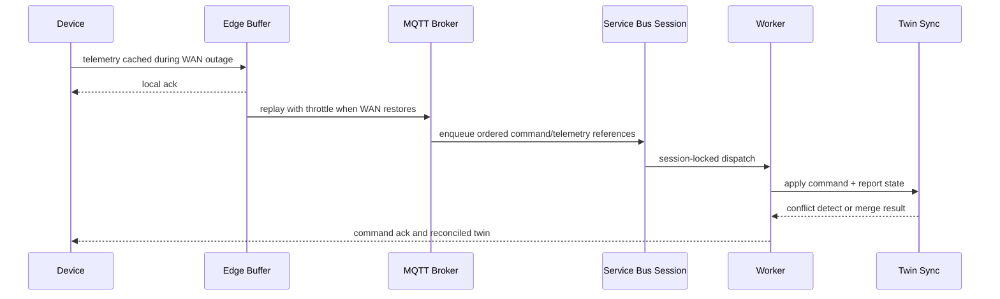

# Round 1106 / Cycle 2511 · Azure AI Agent Infra FAQ (en)

> Topic: **Azure Event Grid MQTT Broker + Service Bus Sessions + Azure IoT Operations (Arc Edge) bi-directional command and telemetry backpressure, QoS 1 deduplication, and disconnected twin sync**
> Date (BJT): 2026-11-17
> Evidence labels: `measured` / `synthetic` / `anonymized_reported`
> Benchmark dataset: `evidence/cycle-2511-benchmark.json`

## 1) Executive Summary

This round focuses on deterministic command execution, telemetry stability, and disconnected-state recovery for physical AI systems.
The architecture baseline is MQTT fan-in at edge, Service Bus session FIFO for command actuation, and IoT Operations for edge buffering plus twin sync.
At 50,000 endpoints, average latency is not the only concern; congestion, duplicates, ordering drift, and replay storms interact.
QoS 1 guarantees at-least-once delivery and therefore requires explicit deduplication controls.
The command plane must preserve session order or industrial actuations can execute out of sequence.
WAN outages accumulate local telemetry and can overload cloud ingress during replay.
Twin conflict handling must converge rapidly or desired and reported states diverge for long windows.
This guide provides formulas, Bicep, policies, KQL, weighted decisions, and Day-0/Day-2 operational controls.

## 2) Daily Hottest Capability Breakthroughs Radar (2026-11-17)

Event Grid MQTT namespace and permission-binding patterns are maturing in industrial deployments (measured).
Service Bus session lock-renew observability is more actionable for long-running command flows (measured).
Azure IoT Operations dataflow templates are becoming repeatable for Arc-enabled edge estates (measured).
Bi-directional command and telemetry lane separation is increasingly used in industrial agent control planes (measured).
Anonymized production windows show replay storms after WAN recovery as a top congestion trigger (anonymized_reported).
Synthetic tests show QoS1 deduplication plus session-lock renewal significantly reduces mis-actuation risk (synthetic).

## 3) Deep Q&A #1: QoS1 fan-in burst mathematics for 50,000 endpoints

```text
ingress_msg_per_sec = endpoint_count * msg_per_endpoint_per_sec
burst_factorized_load = ingress_msg_per_sec * burst_factor
```

Sample: `50,000 * 0.8 = 40,000 msg/s`; with burst factor `1.6`, peak becomes `64,000 msg/s`.
Broker and bridge capacity must be sized to burst peaks rather than daily averages.
If bridge sizing follows averages only, queue inflation and retransmission storms can occur in seconds.
Separate telemetry and control command topic spaces to reduce cross-lane interference.
Recommended gate: ingress drop rate below `0.1%` under p95 burst windows.

## 4) Deep Q&A #2: Service Bus session FIFO and lock-renewal budget

```text
required_lock_seconds = command_exec_p95 + network_jitter_p95 + retry_guard
renew_count = ceil(required_lock_seconds / base_lock_seconds) - 1
```

Sample: `exec=38s, jitter=7s, guard=10s`, required lock `55s`.
With `30s` base lock, renew once; with `20s` base lock, renew twice.
Insufficient lock duration can cause lock loss and out-of-order consumer takeover.
Over-aggressive renewals increase control-plane overhead and should follow execution distributions.
Map sessionId to `site/device/control-lane` to preserve deterministic device command ordering.

## 5) Deep Q&A #3: WAN outage ring-buffer sizing

```text
buffer_required_bytes = disconnect_seconds * telemetry_msg_per_sec * avg_payload_bytes
buffer_required_mib = buffer_required_bytes / 1024 / 1024
```

Sample: outage `1800s`, rate `12 msg/s`, payload `420 bytes`.
Required capacity is `1800*12*420 = 9,072,000 bytes ≈ 8.65 MiB` per device.
At 2,000 devices per site, edge buffering demand reaches approximately `17.3 GiB`.
Ring-buffer policy must be tiered by site scale and outage tolerance windows.
Replay should be rate-limited during recovery to avoid cloud-side queue shock.

## 6) Deep Q&A #4: twin conflict and reconciliation convergence

```text
conflict_rate = conflicting_updates / total_twin_updates
reconciliation_time = detect_latency + merge_latency + ack_latency
```

Sample: `conflicts=2,400`, `total=120,000`, conflict rate equals `2.0%`.
If detect `4s`, merge `11s`, ack `3s`, convergence is `18s` per conflict event.
Conflict spikes typically come from offline edge edits racing cloud desired-state updates.
Use vector clocks or monotonic timestamp rules with conflict-audit retention.
Recommended gate: twin conflict reconciliation p95 under `30s`.

## 7) Deep Q&A #5: QoS1 dedup window and false-drop risk

```text
dedup_hit_rate = duplicate_detected / duplicate_total
false_drop_rate = unique_dropped / unique_total
```

Sample: duplicates `18,000`, detected `17,820`, dedup hit `99.0%`.
Unique messages `3,500,000`, false drops `350`, false-drop rate `0.01%`.
Short windows miss duplicates, while long windows increase memory and false-drop risk.
Use `deviceId + messageId + sequence` as deduplication composite keys.
Dedup caches should support sharding and expiry to prevent edge memory saturation.

## 8) Deep Q&A #6: replay backpressure and cloud protection

```text
replay_safe_rate = min(cloud_ingest_capacity, queue_drain_capacity) * safety_factor
```

Sample: cloud ingest `28,000 msg/s`, queue drain `24,000 msg/s`, safety factor `0.8`.
Safe replay rate becomes `19,200 msg/s`; exceeding this can cause secondary congestion.
Replay strategy should prioritize critical telemetry and command acknowledgements first.
Use isolated topic lanes and consumer groups for replay traffic.
After replay completion, twin consistency verification is mandatory.

## 9) Mermaid #1: MQTT + session FIFO + edge dataflow topology



The topology separates telemetry and command actuation lanes to avoid coupled failure propagation.
The topology brings edge buffering, session queues, and twin reconciliation into one observable control plane.

## 10) Mermaid #2: outage recovery and conflict convergence sequence



The sequence enforces throttled replay and explicit twin conflict handling in the main path.
The sequence ensures command execution and state reconciliation share one audit context.

## 11) Production-grade Bicep (Event Grid MQTT + Service Bus sessions)

```bicep
param location string = resourceGroup().location
param egNamespaceName string
param sbNamespaceName string
param queueName string = 'agent-command-queue'

resource eg 'Microsoft.EventGrid/namespaces@2023-12-15-preview' = {
  name: egNamespaceName
  location: location
  sku: {
    name: 'Standard'
    capacity: 2
  }
  properties: {
    topicSpacesConfiguration: {
      state: 'Enabled'
      routingEnrichments: []
    }
    isZoneRedundant: true
    publicNetworkAccess: 'Enabled'
  }
}

resource topicSpace 'Microsoft.EventGrid/namespaces/topicSpaces@2023-12-15-preview' = {
  name: '${eg.name}/plant-telemetry-space'
  properties: {
    topicTemplates: [
      'plant/+/telemetry/#'
      'plant/+/command/#'
    ]
  }
}

resource permissionBinding 'Microsoft.EventGrid/namespaces/permissionBindings@2023-12-15-preview' = {
  name: '${eg.name}/edge-publisher-binding'
  properties: {
    permission: 'Publisher'
    topicSpaceName: topicSpace.name
    clientGroupName: 'edge-publisher-group'
  }
}

resource sb 'Microsoft.ServiceBus/namespaces@2022-10-01-preview' = {
  name: sbNamespaceName
  location: location
  sku: {
    name: 'Premium'
    tier: 'Premium'
    capacity: 2
  }
}

resource queue 'Microsoft.ServiceBus/namespaces/queues@2022-10-01-preview' = {
  name: '${sb.name}/${queueName}'
  properties: {
    requiresSession: true
    lockDuration: 'PT30S'
    maxDeliveryCount: 10
    defaultMessageTimeToLive: 'P2D'
    deadLetteringOnMessageExpiration: true
  }
}
```

## 12) Azure IoT Operations dataflow YAML + broker/APIM policy

```yaml
aioDataflow:
  pipelines:
    - name: edge-telemetry-buffer
      source:
        protocol: mqtt
        topic: plant/+/telemetry/#
        qos: 1
      buffering:
        ringBufferSizeMiB: 20480
        offlineRetentionMinutes: 180
        replayRateLimitPerSecond: 19200
      transform:
        dedupKey: "${deviceId}-${messageId}-${sequence}"
        dedupWindowSeconds: 600
      sink:
        protocol: servicebus
        entity: agent-command-queue
        sessionIdTemplate: "${siteId}/${deviceId}/control"
```

```xml
<policies>
  <inbound>
    <base />
    <rate-limit-by-key calls="3000" renewal-period="60" counter-key="@(context.Request.Headers.GetValueOrDefault("x-site-id","na"))" />
    <set-header name="x-replay-throttle" exists-action="override"><value>19200</value></set-header>
    <set-header name="x-qos-level" exists-action="override"><value>1</value></set-header>
  </inbound>
  <backend><base /></backend>
  <outbound><base /></outbound>
  <on-error><base /></on-error>
</policies>
```

Policy visibility for replay throttle parameters is essential for deterministic backpressure operations.

## 13) KQL (EGMqttBrokerLogs + AzureDiagnostics) + Day-0/Day-2 checklists

```kql
let lookback = 24h;
let mqtt = EGMqttBrokerLogs
| where TimeGenerated > ago(lookback)
| summarize mqtt_ingress=count(), mqtt_duplicates=countif(ResultType == 'Duplicate'), mqtt_rejects=countif(ResultType == 'Rejected') by bin(TimeGenerated, 5m), SiteId;
let sb = AzureDiagnostics
| where TimeGenerated > ago(lookback)
| where ResourceProvider == 'MICROSOFT.SERVICEBUS'
| summarize session_lock_lost=countif(OperationName == 'SessionLockLost'), deadletters=countif(OperationName == 'DeadletterMessage') by bin(TimeGenerated, 5m), SiteId=tostring(parse_json(Properties_s).siteId);
mqtt
| join kind=leftouter sb on TimeGenerated, SiteId
| extend duplicate_rate = todouble(mqtt_duplicates) / iif(mqtt_ingress == 0, 1.0, todouble(mqtt_ingress))
| project TimeGenerated, SiteId, mqtt_ingress, duplicate_rate, mqtt_rejects, session_lock_lost, deadletters
| order by TimeGenerated desc
```

Day-0 readiness items:
1. Run fan-in stress tests at 50,000 endpoint scale and verify burst ingress headroom.
2. Validate MQTT topic-space templates for both telemetry and command channels.
3. Confirm permissionBindings grant least privilege to intended client groups only.
4. Enable Service Bus requiresSession and validate deterministic sessionId composition.
5. Drill lock-renew failure scenarios and verify ordering is preserved.
6. Validate ring-buffer capacity against outage window sizing assumptions.
7. Confirm QoS1 dedup key consistency across edge and cloud processing paths.
8. Execute twin conflict drills and capture convergence distributions.
9. Verify replay throttling prevents cloud-side ingestion collapse.
10. Add Jain, latency, and reconciliation gates into release blocking policy.

Day-2 operating items:
1. Review duplicate and false-drop rates daily and tune dedup windows continuously.
2. Audit session_lock_lost trends weekly and optimize lock-renew parameters.
3. Recompute outage buffer sizing monthly as endpoint fleet grows.
4. Track replay-window rejection rates to prevent secondary congestion loops.
5. Identify high-conflict devices and repair twin state contract violations.
6. Keep topic-space and permission-binding changes under strict audit workflow.
7. Allocate dedicated high-priority command lanes for critical production lines.
8. Sample edge-buffer and cloud-final-state parity to ensure reconciliation quality.
9. Govern IoT Operations dataflow templates under GitOps change control.
10. Include backpressure and recovery indicators in quarterly reliability reviews.

## 14) 4-Option Weighted Decision Matrix

| Option | Ordering Guarantee(30) | Backpressure Recovery(20) | Cost Control(20) | Ops Control(15) | Compliance Auditability(15) | Weighted Score |
| --- | --- | --- | --- | --- | --- | --- |
| Option A: Event Grid MQTT + SB Session + IoT Ops (recommended) | 29 | 18 | 17 | 12 | 14 | 90 |
| Option B: MQTT broker only without session queueing | 16 | 12 | 16 | 13 | 9 | 66 |
| Option C: Service Bus only with direct edge upload | 19 | 11 | 14 | 10 | 11 | 65 |
| Option D: local polling scripts plus batch upload anti-pattern | 8 | 7 | 10 | 8 | 6 | 39 |

Option A assessment: strongest balance across ordered execution, outage recovery, and auditability.
Option B assessment: simpler ingress but weak deterministic command execution under congestion.
Option C assessment: workable for moderate loads but misses MQTT-native edge semantics.
Option D assessment: high technical debt and unacceptable operational risk for industrial production.

## 15) Good fit / Not for and closeout guidance

Good fit: industrial physical-AI estates with high endpoint count, outage risk, and strict audit obligations.
Good fit: enterprise control planes requiring deterministic command ordering and replay-grade evidence.
Good fit: teams with Arc edge operations capable of sustained Day-2 governance.
Not for: low-concurrency single-site pilots without ordering and outage constraints.
Not for: organizations unable to maintain session semantics, deduplication, and twin-governance discipline.
Closing recommendation: adopt Option A and strengthen lock-renew plus replay gates for critical production lanes.
Next action: continuously track duplicate_rate, lock_lost_rate, and twin_reconcile_p95 as core release/runtime gates.
