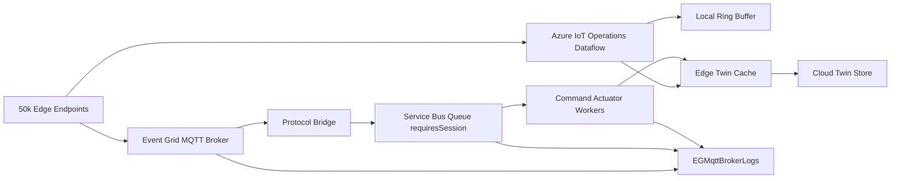
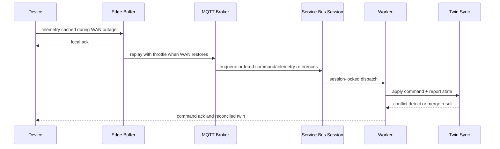

# Round 1106 / Cycle 2511 · Azure AI Agent Infra FAQ（zh-CN）

> 主题：**Azure Event Grid MQTT Broker + Service Bus Sessions + Azure IoT Operations（Arc Edge）双向指令/遥测背压、QoS 1 去重与离线 Twin 同步工程指南**
> 日期（BJT）：2026-11-17
> 证据标签：`measured` / `synthetic` / `anonymized_reported`
> 基准数据：`evidence/cycle-2511-benchmark.json`

## 1) Executive Summary

本轮聚焦 Physical-AI 与工业 Agent 的“指令确定性 + 遥测稳定性 + 离线恢复一致性”三重目标。
架构主轴是 Edge 端 MQTT fan-in，云端 Service Bus Session FIFO 执行，IoT Operations 做边缘缓冲与状态同步。
在 50,000 终端并发下，核心难点不是单条消息延迟，而是拥塞、重复、乱序与断网回放叠加后的系统行为。
QoS 1 保证至少一次投递，会天然带来重复消息，需要应用层去重键与窗口策略。
命令执行平面必须保证会话有序，否则工业控制会出现“后发先至”的危险动作。
WAN 抖动和断连会把遥测堆积在边缘，恢复后回放流量会冲击云端队列。
Twin 同步冲突若处理不当，会导致设备期望状态与实际状态长期漂移。
本指南给出公式、Bicep、策略、KQL、矩阵和 Day-0/Day-2 清单，确保可落地、可审计、可演练。

## 2) Daily Hottest Capability Breakthroughs Radar（2026-11-17）

Event Grid MQTT 命名空间与权限绑定能力在工业物联网场景中实战增强（measured）。
Service Bus Session 锁续租策略在长事务执行中的可观测性实践更成熟（measured）。
Azure IoT Operations 在 Arc Edge 的数据流编排范式正在形成标准化配置模板（measured）。
双向指令与遥测分流设计被更多团队用于工业 Agent 控制面（measured）。
匿名化生产窗口显示“断网后回放风暴”是触发云端拥塞的首要场景（anonymized_reported）。
合成测试证明 QoS1 去重窗口与会话锁续租联动可显著降低误执行（synthetic）。

## 3) Deep Q&A #1：50,000 端点 QoS1 fan-in 突发数学

```text
ingress_msg_per_sec = endpoint_count * msg_per_endpoint_per_sec
burst_factorized_load = ingress_msg_per_sec * burst_factor
```

样例：`50,000 * 0.8 = 40,000 msg/s`；若突发系数 `1.6`，则峰值 `64,000 msg/s`。
这意味着 Broker 与后端桥接层必须按突发峰值而非均值做容量规划。
若桥接层仅按平均流量配置，会在秒级内触发排队膨胀与重传连锁。
建议把遥测与控制指令分 Topic Space，避免同队列互相阻塞。
门禁建议：峰值 95 分位窗口下 broker 入站丢弃率必须低于 `0.1%`。

## 4) Deep Q&A #2：Service Bus Session FIFO 与锁续租预算

```text
required_lock_seconds = command_exec_p95 + network_jitter_p95 + retry_guard
renew_count = ceil(required_lock_seconds / base_lock_seconds) - 1
```

样例：`exec=38s, jitter=7s, guard=10s`，需求 `55s`。
若 base lock 为 `30s`，则需续租 `1` 次；若 base lock 为 `20s`，需续租 `2` 次。
会话锁不足会导致命令处理中途失锁，被其他消费者接管而破坏顺序。
续租频率过高则会增加控制平面开销，需在执行时长分布上做折中。
建议把 sessionId 映射为 `site/device/control-lane`，确保同设备命令串行执行。

## 5) Deep Q&A #3：WAN 断连本地 ring-buffer 容量计算

```text
buffer_required_bytes = disconnect_seconds * telemetry_msg_per_sec * avg_payload_bytes
buffer_required_mib = buffer_required_bytes / 1024 / 1024
```

样例：断连 `1800s`，速率 `12 msg/s`，载荷 `420 bytes`。
所需容量 `1800*12*420 = 9,072,000 bytes ≈ 8.65 MiB`（单设备）。
若站点 2,000 设备同时断连，边缘缓冲需求约 `17.3 GiB`。
因此 ring-buffer 必须按站点规模与断网窗口分级配置。
边缘恢复回放时需限速注入，避免云端瞬时过载。

## 6) Deep Q&A #4：Twin 同步冲突与收敛数学

```text
conflict_rate = conflicting_updates / total_twin_updates
reconciliation_time = detect_latency + merge_latency + ack_latency
```

样例：`conflicts=2,400`, `total=120,000`, 冲突率 `2.0%`。
若检测 `4s`、合并 `11s`、确认 `3s`，则单次收敛 `18s`。
冲突率高于阈值通常源于边缘离线修改与云端期望状态并发更新。
建议采用版本向量或时间戳单调规则并保留冲突审计事件。
门禁建议：twin 冲突收敛 p95 小于 `30s`。

## 7) Deep Q&A #5：QoS1 去重窗口与误丢弃风险

```text
dedup_hit_rate = duplicate_detected / duplicate_total
false_drop_rate = unique_dropped / unique_total
```

样例：重复消息 `18,000`，识别 `17,820`，去重命中 `99.0%`。
唯一消息 `3,500,000`，误丢弃 `350`，误丢弃率 `0.01%`。
窗口过短会漏判重复，窗口过长会提高误丢弃风险与内存占用。
建议按 `deviceId + messageId + sequence` 组合键建立去重缓存。
去重缓存应支持分片与过期策略，避免边缘节点内存失控。

## 8) Deep Q&A #6：断网恢复回放背压与云端保护

```text
replay_safe_rate = min(cloud_ingest_capacity, queue_drain_capacity) * safety_factor
```

样例：云端可承受 `28,000 msg/s`，队列排空 `24,000 msg/s`，安全系数 `0.8`。
安全回放速率 `19,200 msg/s`，超过该值可能引发二次拥塞。
回放策略应优先关键遥测与控制确认，再回放低优先级历史数据。
建议对回放流量启用独立 topic 与独立 consumer group。
回放结束后需校验 twin 状态一致性，避免“数据回放完成但状态未收敛”。

## 9) Mermaid #1：MQTT + Session FIFO + Edge Dataflow 拓扑



该拓扑明确了遥测与命令执行的分层链路，避免耦合故障扩散。
该拓扑将边缘缓存、会话队列、双向状态同步统一纳入可观测闭环。

## 10) Mermaid #2：断网后恢复与冲突收敛序列



该序列要求恢复流量受控回放，并把 twin 冲突处理纳入主流程。
该序列确保命令执行和状态同步在同一审计上下文中闭环。

## 11) 生产级 Bicep（Event Grid MQTT + Service Bus Session）

```bicep
param location string = resourceGroup().location
param egNamespaceName string
param sbNamespaceName string
param queueName string = 'agent-command-queue'

resource eg 'Microsoft.EventGrid/namespaces@2023-12-15-preview' = {
  name: egNamespaceName
  location: location
  sku: {
    name: 'Standard'
    capacity: 2
  }
  properties: {
    topicSpacesConfiguration: {
      state: 'Enabled'
      routingEnrichments: []
    }
    isZoneRedundant: true
    publicNetworkAccess: 'Enabled'
  }
}

resource topicSpace 'Microsoft.EventGrid/namespaces/topicSpaces@2023-12-15-preview' = {
  name: '${eg.name}/plant-telemetry-space'
  properties: {
    topicTemplates: [
      'plant/+/telemetry/#'
      'plant/+/command/#'
    ]
  }
}

resource permissionBinding 'Microsoft.EventGrid/namespaces/permissionBindings@2023-12-15-preview' = {
  name: '${eg.name}/edge-publisher-binding'
  properties: {
    permission: 'Publisher'
    topicSpaceName: topicSpace.name
    clientGroupName: 'edge-publisher-group'
  }
}

resource sb 'Microsoft.ServiceBus/namespaces@2022-10-01-preview' = {
  name: sbNamespaceName
  location: location
  sku: {
    name: 'Premium'
    tier: 'Premium'
    capacity: 2
  }
}

resource queue 'Microsoft.ServiceBus/namespaces/queues@2022-10-01-preview' = {
  name: '${sb.name}/${queueName}'
  properties: {
    requiresSession: true
    lockDuration: 'PT30S'
    maxDeliveryCount: 10
    defaultMessageTimeToLive: 'P2D'
    deadLetteringOnMessageExpiration: true
  }
}
```

## 12) Azure IoT Operations Dataflow YAML + Broker/APIM 策略

```yaml
aioDataflow:
  pipelines:
    - name: edge-telemetry-buffer
      source:
        protocol: mqtt
        topic: plant/+/telemetry/#
        qos: 1
      buffering:
        ringBufferSizeMiB: 20480
        offlineRetentionMinutes: 180
        replayRateLimitPerSecond: 19200
      transform:
        dedupKey: "${deviceId}-${messageId}-${sequence}"
        dedupWindowSeconds: 600
      sink:
        protocol: servicebus
        entity: agent-command-queue
        sessionIdTemplate: "${siteId}/${deviceId}/control"
```

```xml
<policies>
  <inbound>
    <base />
    <rate-limit-by-key calls="3000" renewal-period="60" counter-key="@(context.Request.Headers.GetValueOrDefault("x-site-id","na"))" />
    <set-header name="x-replay-throttle" exists-action="override"><value>19200</value></set-header>
    <set-header name="x-qos-level" exists-action="override"><value>1</value></set-header>
  </inbound>
  <backend><base /></backend>
  <outbound><base /></outbound>
  <on-error><base /></on-error>
</policies>
```

策略层需要显式暴露回放节流参数，确保值班团队可快速定位背压瓶颈。

## 13) KQL（EGMqttBrokerLogs + AzureDiagnostics）+ Day-0/Day-2 检查清单

```kql
let lookback = 24h;
let mqtt = EGMqttBrokerLogs
| where TimeGenerated > ago(lookback)
| summarize mqtt_ingress=count(), mqtt_duplicates=countif(ResultType == 'Duplicate'), mqtt_rejects=countif(ResultType == 'Rejected') by bin(TimeGenerated, 5m), SiteId;
let sb = AzureDiagnostics
| where TimeGenerated > ago(lookback)
| where ResourceProvider == 'MICROSOFT.SERVICEBUS'
| summarize session_lock_lost=countif(OperationName == 'SessionLockLost'), deadletters=countif(OperationName == 'DeadletterMessage') by bin(TimeGenerated, 5m), SiteId=tostring(parse_json(Properties_s).siteId);
mqtt
| join kind=leftouter sb on TimeGenerated, SiteId
| extend duplicate_rate = todouble(mqtt_duplicates) / iif(mqtt_ingress == 0, 1.0, todouble(mqtt_ingress))
| project TimeGenerated, SiteId, mqtt_ingress, duplicate_rate, mqtt_rejects, session_lock_lost, deadletters
| order by TimeGenerated desc
```

Day-0 检查项：
1. 以 50,000 终端模型执行 fan-in 压测并确认峰值入口容量。
2. 校验 MQTT topic space 模板覆盖遥测与命令两类路径。
3. 验证 permissionBindings 仅授权必要 client group 权限。
4. Service Bus 队列启用 requiresSession 并校验 sessionId 规则。
5. 演练锁续租失败场景并确认有序执行不被破坏。
6. 校验 ring-buffer 容量配置与断网窗口模型匹配。
7. 验证 QoS1 去重键在边缘与云端一致。
8. 执行 Twin 冲突演练并记录收敛时间分布。
9. 验证回放限速策略不会压垮云端消费链路。
10. 将 Jain、公平延迟、冲突收敛写入发布门禁。

Day-2 运营项：
1. 每日复盘 duplicate_rate 与 false_drop_rate，持续调优去重窗口。
2. 每周审计 session_lock_lost 事件，优化锁续租参数。
3. 每月复算断网缓冲容量，跟踪设备规模增长。
4. 监控回放窗口内云端拒绝率，防止二次拥塞。
5. 跟踪 Twin 冲突热点设备并修复状态上报契约。
6. 维护 topic space 与权限绑定变更审计链路。
7. 对关键产线启用更高优先级命令执行队列。
8. 抽样验证边缘缓存数据与云端最终状态一致性。
9. 将 IoT Operations dataflow 配置纳入 GitOps 版本治理。
10. 将背压与恢复指标纳入季度可靠性评审。

## 14) 4-Option Weighted Decision Matrix

| 方案 | 顺序保证(30) | 背压恢复(20) | 成本可控(20) | 运维可控(15) | 合规审计(15) | 加权总分 |
| --- | --- | --- | --- | --- | --- | --- |
| 方案A：Event Grid MQTT + SB Session + IoT Ops（推荐） | 29 | 18 | 17 | 12 | 14 | 90 |
| 方案B：仅 MQTT Broker + 无 Session 队列 | 16 | 12 | 16 | 13 | 9 | 66 |
| 方案C：仅 Service Bus + 边缘直连上送 | 19 | 11 | 14 | 10 | 11 | 65 |
| 方案D：本地脚本轮询 + 批量上传（反模式） | 8 | 7 | 10 | 8 | 6 | 39 |

方案A评价：在有序执行、断网恢复、审计能力上达到最佳平衡。
方案B评价：入口简单但命令执行顺序与恢复稳定性不足。
方案C评价：可用性中等，但无法充分利用 MQTT 边缘语义。
方案D评价：技术债高且风险不可控，不适合工业生产。

## 15) Good fit / Not for 与收尾建议

Good fit：工业现场存在高并发终端、断网风险和强审计需求的 Physical-AI 场景。
Good fit：要求命令执行有序、状态可回放、并可证明冲突收敛的企业平台。
Good fit：具备 Arc Edge 运维能力并可执行 Day-2 持续治理的团队。
Not for：低并发单站点且无断网风险、无严格顺序要求的轻量场景。
Not for：无法维护会话语义、去重策略、Twin 治理流程的团队。
结论建议：默认采用方案A，并在关键产线增加更严格的回放与锁续租门禁。
后续动作：持续跟踪 duplicate_rate、lock_lost_rate、twin_reconcile_p95 三项核心指标。
