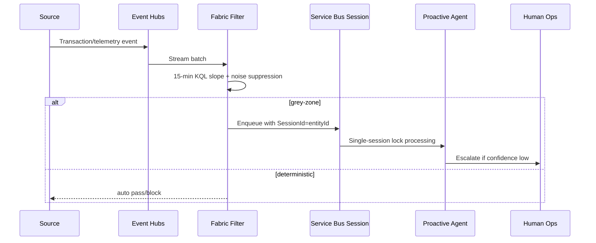

# eventhubs-fabric-rti-vs-servicebus-vs-eventgrid-proactive-streaming-agent-selection-faq-r1134

## 1) Daily breakthroughs and verifiable sources (fetched 2026-11-18)
- Scope: enterprise event-driven proactive-agent wake-up architecture, excluding low-level kernel/NIC details.
- Goal: controlled cost and auditable trigger logic across 1K–50K events/sec workloads.
- Labels: `measured` (officially verifiable), `synthetic` (modeled), `anonymized_reported` (de-identified replay).
| Topic | Official source | Fetched at (UTC) | Purpose | Label |
|---|---|---|---|---|
| Azure messaging architecture comparison | https://learn.microsoft.com/azure/architecture/guide/technology-choices/messaging-services | 2026-11-18T18:51:00Z | Event Hubs / Service Bus / Event Grid decision baseline | `measured` |
| Fabric Real-Time Intelligence | https://learn.microsoft.com/fabric/real-time-intelligence/overview | 2026-11-18T18:52:00Z | Eventstream + Eventhouse + Activator baseline | `measured` |
| Service Bus sessions / DLQ | https://learn.microsoft.com/azure/service-bus-messaging/message-sessions | 2026-11-18T18:53:00Z | Entity-locked ordering and poison handling | `measured` |
| Event Grid overview | https://learn.microsoft.com/azure/event-grid/overview | 2026-11-18T18:54:00Z | Discrete-domain event fanout | `measured` |
| Event Hubs overview | https://learn.microsoft.com/azure/event-hubs/event-hubs-about | 2026-11-18T18:55:00Z | High-throughput stream ingress | `measured` |
| KEDA Event Hubs scaler | https://keda.sh/docs/latest/scalers/azure-event-hub/ | 2026-11-18T18:56:00Z | Event-rate driven autoscaling | `measured` |
| Azure AI Foundry Agents | https://learn.microsoft.com/azure/ai-foundry/agents/overview | 2026-11-18T18:57:00Z | Triggered proactive agent runtime | `measured` |
| ACA event-driven apps | https://learn.microsoft.com/azure/container-apps/event-driven-apps | 2026-11-18T18:58:00Z | Runtime execution pattern reference | `measured` |

Incremental findings:
- Deterministic pre-filtering before LLM wake-up is the primary control for cost and false activations.
- Event Hubs fits bulk ingress, Service Bus fits session-consistent action queues, Event Grid fits discrete domain fanout.
- Fabric RTI windowing can sharply reduce token-storm probability in high-noise streams.

## 2) Layered architecture (deterministic pre-filter first)
L1 Ingestion:
- Event Hubs for high-volume telemetry/transaction streams.
- Event Grid for discrete business state changes.

L2 Filtering and pre-judgment:
- Fabric Eventhouse KQL executes window aggregation, slope checks, and sustained-deviation logic.
- Only grey-zone events wake agents; clear pass/block paths are deterministic.

L3 Trigger orchestration:
- Service Bus Session enforces per-entity serialized handling with idempotency.
- Foundry/MAF proactive agents execute notifications, recommendation actions, and HITL escalation.

L4 Governance:
- APIM, Entra MI/RBAC, and Private Link establish secure boundaries.
- DLQ and suppression ratio are mandatory SRE operating indicators.

## 3) 12-dimension selection matrix with anti-patterns
| Dimension | A Fabric RTI (Eventstream+Eventhouse+Activator) | B Event Hubs + KEDA processor | C Service Bus sessions + DLQ | D Event Grid |
|---|---|---|---|---|
| 1 Event pattern | Continuous streams + windows | High-volume stream ingress | Transactional command/session queue | Discrete business domain events |
| 2 Deterministic noise reduction | Strongest (native KQL windows) | Medium (external filter needed) | Medium-low | Low-medium |
| 3 Ordering and per-entity concurrency | Medium | Medium (partition key) | Strongest (Session lock) | Low-medium |
| 4 Delivery/retry/DLQ semantics | Medium | Medium | Strongest | Medium |
| 5 KEDA/serverless scaling fit | Medium | Strongest | High | Medium-high |
| 6 Trigger-to-action latency | Medium | Low-medium | Medium | Low for discrete fanout |
| 7 Replay and auditability | High | High | High | Medium |
| 8 Cost at 1K–50K eps | Medium-high | High | Medium | High for sparse events |
| 9 MI/RBAC/Private Link posture | High | High | High | High |
| 10 Operational complexity | Medium-high | Medium | Medium-high | Low-medium |
| 11 Best-fit scenario | Sustained-window anomaly wake-up | High-volume stream pre-ingest | Entity-consistent action workflow | Domain event propagation |
| 12 When NOT to choose | Tiny sparse event workloads only | Need strict transactional sessions | Pure telemetry firehose | Need strict per-entity ordering |

Decision summary:
- Continuous stream debouncing favors A.
- Massive ingress favors B.
- Per-entity reliable actions favor C.
- Domain-event fanout favors D.

## 4) Five reproducible Q&As (token storm, KEDA workers, DLQ sizing)
### Q1: How to estimate token-storm avoidance value?
- Daily events `E=180M`.
- Raw wake ratio `r_raw=1.2%`, filtered wake ratio `r_filtered=0.08%`.
- Wakes avoided: `E*(0.012-0.0008)=2,016,000/day`.
- Average 2.4k tokens per wake at `0.0035 USD` per 1k tokens.
- Daily savings: `2,016,000*2.4*0.0035 ≈ 16,934 USD`.

### Q2: How many KEDA workers are needed?
- Peak 50,000 eps, worker throughput 1,250 eps steady.
- Baseline workers: `50,000/1,250 = 40`.
- With 1.35 resilience factor, cap around `54` workers.
- Off-peak 4,000 eps maps to `4`–`6` workers.
- Conclusion: min/max and cooldown tuning are as important as target throughput.

### Q3: How to size Service Bus session queue and DLQ handling?
- Grey-zone events per day `140,000`, failure rate `0.9%`.
- DLQ inflow `1,260/day`.
- To clear in 24h, baseline handling capacity is `53/hour`.
- Recommended alert threshold: `DLQ backlog > 400` for 30 minutes -> Sev2.
- Conclusion: DLQ limits must align with shift-level operational capacity.

### Q4: How does `0.995^N` affect proactive-trigger reliability?
- Four-hop chain gives `0.995^4 = 0.9801`.
- Dual-active on critical hops can lift effective availability above `0.989`.
- High-risk domains require explicit 90-second human fallback path.
- Conclusion: proactive-agent pipelines need human-safe failure semantics by design.

### Q5: What is the effect of Fabric windowing on false positives?
- Without windows, false-positive wake ratio `fp=1.6%`.
- With 15-minute slope + persistence rule, `fp=0.22%`.
- Relative reduction: `86.25%`.
- At 20M events/hour peak, this removes about `276k` unnecessary wake-ups.
- Conclusion: deterministic windows are the primary anti-noise lever.

## 5) Mermaid diagrams (pre-filter pipeline + session-locked flow)
```mermaid
flowchart LR
    E[Event Sources] --> H[Event Hubs]
    H --> F[Fabric Eventhouse KQL Window Filter]
    F -->|clear pass/block| X[Deterministic Action]
    F -->|grey-zone| S[Service Bus Session Queue]
    S --> A[Proactive Agent (Foundry/MAF)]
    A --> N[Notification + Action + HITL]
    S --> D[DLQ]
    D --> O[Ops Replay Workflow]
```



## 6) Section 7 scenario: credit-card real-time grey-zone verification
Objective:
- In a 50,000 TPS card-swipe stream, deterministically filter to 0.08% grey-zone events before waking agents.
- Complete verify/stop/escalate actions inside a 90-second fallback envelope.

Flow:
1. Event Hubs ingests card-swipe streams.
2. Fabric Eventhouse classifies clear pass/block and sends only grey-zone to Service Bus Session.
3. Proactive agent triggers SMS/voice/app verification channels.
4. If unresolved in 90 seconds, fallback block plus human queue escalation.
5. End-to-end chain is persisted for fraud model replay and audit.

SLA and KPIs:
- Grey-zone trigger-to-action P95 `< 4s`.
- 90-second resolution completion `>= 98%`.
- Unnecessary wake-up ratio `< 0.25%`.

Failure modes and mitigations:
- Failure: concurrent card events trigger duplicates.
  - Mitigation: SessionId=cardholderId serialized lock.
- Failure: customer verification channels unreachable.
  - Mitigation: multi-channel retries plus human handoff.
- Failure: DLQ backlog burst.
  - Mitigation: prioritized replay batches and autoscale gates.

## 7) Section 8 scenario: global biopharma cold-chain proactive rerouting
Objective:
- Suppress transient sensor spikes through 15-minute windows before triggering logistics intervention.
- Wake supply-chain agents only on sustained excursions to reserve backup reefer capacity and draft customs amendments.

Flow:
1. Sensor telemetry enters Event Hubs.
2. Fabric RTI Activator applies sustained slope rules.
3. Persisting anomalies trigger MAF logistics agent actions.
4. Agent prepares backup booking and customs amendment package for human approval.
5. Approved actions are committed and logged for compliance replay.

SLA and KPIs:
- Noise suppression ratio `>= 80%`.
- Sustained excursion trigger P95 `< 2.5s`.
- Backup reefer lock success `>= 95%`.

Failure modes and mitigations:
- Failure: sensor drift causes bias.
  - Mitigation: multi-sensor consistency checks.
- Failure: customs amendment rules drift across regions.
  - Mitigation: versioned rule packs with daily sync.
- Failure: capacity lock failures during peak lanes.
  - Mitigation: priority queues and reserved quota slices.

## 8) Selection tree (Good fit vs Not for)
1. High-volume stream with deterministic debouncing -> prioritize A/B.
2. Entity-consistent action and retries -> prioritize C.
3. Discrete domain state fanout -> prioritize D.
4. Cost optimization starts with suppression ratio improvement, then agent-scale tuning.
5. High-risk operations require explicit HITL escalation paths.

Good fit:
- Financial, logistics, and industrial proactive operations with strict timing and audit requirements.
- Programs requiring automated action with deterministic replay and human-safe fallback.

Not for:
- Low-frequency manual workflows with weak real-time demands.
- Teams without event-governance and observability foundations.

## 9) Value model
Assumptions:
- Annual event volume `52B`.
- Unnecessary wake-ups reduced by `84%`.
- Manual intervention workload reduced by `33%`.
- Fraud/cold-chain loss avoided `2.8M USD/year`.

Composite annual value:
- Compute and invocation savings `4.1M USD`.
- Operational efficiency gains `2.3M USD`.
- Risk-loss avoidance `2.8M USD`.
- Added platform cost `3.5M USD`.
- Net annual gain `5.7M USD`.

## 10) Five-step implementation guide
1. Classify event types: stream, command, and state-change boundaries.
2. Build deterministic pre-filters: windows, suppression thresholds, grey-zone criteria.
3. Build trigger safety: session locking, idempotency, retry, and DLQ discipline.
4. Integrate proactive agents: confidence thresholds, action contracts, and HITL escalation.
5. Continuously optimize: cost, false-positive wake ratio, and resolution latency.

## 11) Bicep IaC (Event Hubs + Service Bus session queue + ACA KEDA)
```bicep
param location string = resourceGroup().location
param ehNamespace string
param sbNamespace string
param queueName string

resource eh 'Microsoft.EventHub/namespaces@2022-10-01-preview' = {
  name: ehNamespace
  location: location
  sku: { name: 'Standard', tier: 'Standard', capacity: 4 }
}

resource sb 'Microsoft.ServiceBus/namespaces@2022-10-01-preview' = {
  name: sbNamespace
  location: location
  sku: { name: 'Standard', tier: 'Standard' }
}

resource queue 'Microsoft.ServiceBus/namespaces/queues@2022-10-01-preview' = {
  name: '${sbNamespace}/${queueName}'
  properties: {
    requiresSession: true
    deadLetteringOnMessageExpiration: true
    maxDeliveryCount: 10
  }
}
```

## 12) Fabric pre-filter and Service Bus idempotency snippets
```kql
// Eventhouse pre-filter
transactions
| where EventTime > ago(15m)
| summarize avg_amt=avg(amount), slope=(max(amount)-min(amount)) by card_id, bin(EventTime,1m)
| where slope > 120 and avg_amt > 5000
```

```csharp
// Session + idempotency guard
if (await cache.ExistsAsync(eventId)) return;
await cache.SetAsync(eventId, "1", TimeSpan.FromHours(6));
await ProcessSessionMessageAsync(message.SessionId, message.Body);
```

## 13) KQL for suppression ratio and DLQ backlog
```kql
let start = ago(7d);
customEvents
| where timestamp >= start
| where name in ("event_received","event_filtered","agent_woken")
| summarize received=countif(name=="event_received"), filtered=countif(name=="event_filtered"), woken=countif(name=="agent_woken") by bin(timestamp,1h)
| extend suppression_ratio = iff(received>0, todouble(filtered)/todouble(received), 0.0)
| order by timestamp desc
```

```kql
let start = ago(7d);
customMetrics
| where timestamp >= start
| where name in ("servicebus_dlq_backlog","servicebus_replay_rate")
| summarize dlq=maxif(value,name=="servicebus_dlq_backlog"), replay=avgif(value,name=="servicebus_replay_rate")
  by queue=tostring(customDimensions.queue), bin(timestamp,30m)
| order by timestamp desc
```

## 14) Day-0 / Day-1 / Day-2 checklist
Day-0:
- Define event taxonomy and entity-key strategy (partition key / session id).
- Define deterministic windows and grey-zone thresholds.
- Define DLQ alerting and replay ownership model.

Day-1:
- Start with canary ingestion and observe suppression ratio plus wake precision.
- Validate session serialization and idempotency behavior.
- Rehearse 90-second fallback and HITL escalation.

Day-2:
- Scale to target throughput and tune KEDA limits.
- Review DLQ and replay efficiency weekly.
- Refine trigger thresholds and cost tiers continuously.
- Refresh top-10 false-trigger root causes weekly with corrective actions.

Operational risk note:
- If suppression ratio stays below target for 3 consecutive hours, enforce load-shedding and manual ruleset review.

## 15) Backup queue and delivery manifest
Backup queue (updated):
1. `aks-kaito-phi4-slm-vs-foundry-serverless-slm-vs-aoai-mini-edge-cloud-routing-selection-faq`
2. `private-link-vnet-standard-agent-setup-vs-managed-vnet-vs-apim-waf-zero-trust-network-selection-faq`
3. `cosmos-changefeed-vs-ai-search-pull-indexer-vs-eventgrid-push-realtime-rag-freshness-selection-faq`

Cycle #2539 outputs:
- Bilingual FAQ: `r1134.md` and `r1134.en.md`
- 7-card deck: `benchmark-cards.html` and `benchmark-cards.en.html`
- SVG: `assets/34-cycle-1134-daily-breakthroughs.svg`
- H5: `workbench-cycle-2539.html` plus selector entry `#2539`
- Validation: `cycle_1134_pipeline.py --write --check`, `strict_suffix_gate.py`, `pytest`
