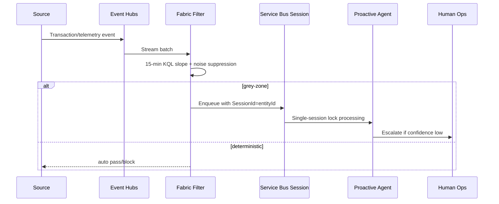

# eventhubs-fabric-rti-vs-servicebus-vs-eventgrid-proactive-streaming-agent-selection-faq-r1134

## 1) 当日热点与可验证来源（2026-11-18 抓取）
- 主题边界：企业事件驱动“主动唤醒 Agent”架构，不讨论底层内核/NIC 优化。
- 目标：在 1K–50K events/sec 区间实现可控成本、可审计触发和 token 风暴抑制。
- 标签定义：`measured`（官方可核）、`synthetic`（本轮测算）、`anonymized_reported`（脱敏复盘）。
| 主题 | 官方来源 | 抓取时间（UTC） | 用途 | 标签 |
|---|---|---|---|---|
| Azure Messaging 架构对比 | https://learn.microsoft.com/azure/architecture/guide/technology-choices/messaging-services | 2026-11-18T18:51:00Z | Event Hubs / Service Bus / Event Grid 对比 | `measured` |
| Fabric Real-Time Intelligence | https://learn.microsoft.com/fabric/real-time-intelligence/overview | 2026-11-18T18:52:00Z | Eventstream + Eventhouse + Activator | `measured` |
| Service Bus sessions / DLQ | https://learn.microsoft.com/azure/service-bus-messaging/message-sessions | 2026-11-18T18:53:00Z | 会话锁与毒消息治理 | `measured` |
| Event Grid 概览 | https://learn.microsoft.com/azure/event-grid/overview | 2026-11-18T18:54:00Z | 离散事件 fan-out | `measured` |
| Event Hubs 概览 | https://learn.microsoft.com/azure/event-hubs/event-hubs-about | 2026-11-18T18:55:00Z | 高吞吐流式入口 | `measured` |
| KEDA Event Hubs Scaler | https://keda.sh/docs/latest/scalers/azure-event-hub/ | 2026-11-18T18:56:00Z | 流量驱动弹性伸缩 | `measured` |
| Azure AI Foundry Agents | https://learn.microsoft.com/azure/ai-foundry/agents/overview | 2026-11-18T18:57:00Z | 触发后主动 Agent 执行 | `measured` |
| ACA 事件驱动 | https://learn.microsoft.com/azure/container-apps/event-driven-apps | 2026-11-18T18:58:00Z | 事件处理运行时参考 | `measured` |

增量结论：
- 先做确定性去噪再唤醒 LLM，是控制成本与误触发的第一原则。
- Event Hubs 负责“大流量输入”，Service Bus 负责“会话一致性动作”，Event Grid 负责“业务域广播”。
- Fabric RTI 在窗口规则与近实时分析上可显著降低 token 风暴概率。

## 2) 分层参考架构（Deterministic Pre-Filter First）
L1 摄取层：
- Event Hubs 承接高吞吐设备/交易/日志流。
- Event Grid 承接离散业务状态变更事件。

L2 去噪与预判层：
- Fabric Eventhouse KQL 做窗口聚合、斜率判断、持续偏离确认。
- 仅灰区事件进入 Agent 触发层，清晰通过/拒绝事件直接闭环。

L3 编排触发层：
- Service Bus Session 保证同实体串行处理与幂等去重。
- Foundry/MAF Proactive Agent 负责多渠道通知、补救动作建议、HITL 升级。

L4 治理层：
- APIM/Entra MI/RBAC/Private Link 保证安全边界。
- DLQ 监控、回放策略、触发抑制比率纳入 SRE 例行看板。

## 3) 12 维选型矩阵（含反模式）
| 维度 | A Fabric RTI（Eventstream+Eventhouse+Activator） | B Event Hubs + KEDA | C Service Bus Sessions + DLQ | D Event Grid |
|---|---|---|---|---|
| 1 事件模式 | 连续流+窗口规则 | 高频流摄取 | 事务命令/会话队列 | 离散状态变更 |
| 2 预过滤降噪能力 | 最强（KQL 窗口） | 中（需外部处理） | 中低 | 低中 |
| 3 顺序与实体并发控制 | 中 | 中（分区键） | 最强（Session） | 低中 |
| 4 重试/DLQ 语义 | 中 | 中 | 最强 | 中 |
| 5 KEDA/Serverless 伸缩 | 中 | 最强 | 高 | 中高 |
| 6 触发到动作延迟 | 中 | 低中 | 中 | 低（离散） |
| 7 回放与时序审计 | 高 | 高 | 高 | 中 |
| 8 1K–50K eps 成本弹性 | 中高 | 高 | 中 | 高（离散） |
| 9 MI/RBAC/Private Link | 高 | 高 | 高 | 高 |
| 10 运维复杂度 | 中高 | 中 | 中高 | 低中 |
| 11 Best-fit | 持续窗口判断唤醒 | 高频流入口 | 实体一致性动作 | 业务状态广播 |
| 12 When NOT to choose | 只有离散小事件 | 需要强事务会话 | 纯高吞吐遥测流 | 需要严格顺序会话 |

决策摘要：
- 连续信号去噪优先 A。
- 大吞吐入口优先 B。
- 实体一致性动作优先 C。
- 业务事件广播优先 D。

## 4) 五组可复算 Q&A（token 风暴、KEDA、DLQ）
### Q1：token 风暴抑制收益如何估算？
- 日事件量 `E=180M`。
- 直接唤醒率 `r_raw=1.2%`，预过滤后 `r_filtered=0.08%`。
- 唤醒减少量：`E*(0.012-0.0008)=2,016,000/day`。
- 单次平均 token 2.4k，千 token 成本 `0.0035 USD`。
- 日节省约：`2,016,000*2.4*0.0035 ≈ 16,934 USD`。

### Q2：KEDA worker 规模如何估？
- 峰值 50,000 eps，单 worker 稳态处理 1,250 eps。
- 理论 worker：`50,000/1,250 = 40`。
- 冗余系数 `1.35` 后建议 `54` 实例上限。
- 低谷 4,000 eps 对应 `4`~`6` 实例。
- 结论：KEDA 需要上下限和冷却时间共同约束抖动。

### Q3：Service Bus Session 队列容量与 DLQ 怎么算？
- 灰区事件日均 `140,000`，失败率 `0.9%`。
- 进入 DLQ：`1,260/day`。
- 若 24h 内清空，处理能力需 `53/h`。
- 建议告警阈值：`DLQ backlog > 400` 持续 30 分钟触发 Sev2。
- 结论：DLQ 阈值应绑定处置人力班次能力。

### Q4：多层触发链路可用性 `0.995^N` 影响？
- 4 跳触发链：`0.995^4 = 0.9801`。
- 若关键两跳双活，等效可用性可提升到 `>0.989`。
- 高风险场景需增加 90 秒 fallback 人工流程。
- 结论：主动 Agent 架构必须内置人工兜底 SLA。

### Q5：Fabric 窗口规则与误触发率关系？
- 无窗口时误触发 `fp=1.6%`。
- 15 分钟斜率+持续窗口后 `fp=0.22%`。
- 相对下降：`(1.6-0.22)/1.6=86.25%`。
- 若高峰 20M 事件/小时，可减少约 `276k` 次无效唤醒。
- 结论：窗口规则是“先算后问 LLM”的关键控制阀。

## 5) Mermaid（预过滤管线 + 会话锁定序列）
```mermaid
flowchart LR
    E[Event Sources] --> H[Event Hubs]
    H --> F[Fabric Eventhouse KQL Window Filter]
    F -->|clear pass/block| X[Deterministic Action]
    F -->|grey-zone| S[Service Bus Session Queue]
    S --> A[Proactive Agent (Foundry/MAF)]
    A --> N[Notification + Action + HITL]
    S --> D[DLQ]
    D --> O[Ops Replay Workflow]
```



## 6) Section 7：商业银行信用卡灰区交易主动核身架构
目标：
- 在 50,000 TPS 刷卡流中，先用确定性规则筛出 0.08% 灰区交易再唤醒 Agent。
- 对灰区事件在 90 秒内完成核身、止付或人工升级。

流程：
1. Event Hubs 接入刷卡流。
2. Fabric Eventhouse 先判 clear pass/block，灰区写入 Service Bus Session。
3. Proactive Agent 触发短信/语音/App Push 多通道核身。
4. 未确认交易在 90 秒内触发 fallback 止付与人工队列。
5. 全链路写入审计与欺诈模型回放数据集。

SLA 与指标：
- 灰区触发到动作 P95 `< 4s`
- 90 秒内处置完成率 `>= 98%`
- 无效唤醒率 `< 0.25%`

失效模式与缓解：
- 失效：同卡并发导致重复触发。
  - 缓解：SessionId=cardholderId 串行锁。
- 失效：核身渠道不可达。
  - 缓解：多通道重试 + 人工坐席升级。
- 失效：DLQ 积压。
  - 缓解：自动回放批次与优先级清理策略。

## 7) Section 8：生物制药冷链主动调度架构
目标：
- 对温控偏离进行 15 分钟窗口去噪，抑制开门瞬时噪声误报。
- 仅在持续偏离时唤醒供应链 Agent 进行备选舱位与报关改单准备。

流程：
1. 传感器流入 Event Hubs。
2. Fabric RTI Activator 根据斜率规则判断持续异常。
3. 异常事件进入 MAF 供应链 Agent，触发备选冷链运力锁定。
4. 生成报关改单建议包，提交人工签核。
5. 签核结果回写调度系统并归档。

SLA 与指标：
- 噪声抑制比 `>= 80%`
- 持续偏离触发延迟 P95 `< 2.5s`
- 备选舱位锁定成功率 `>= 95%`

失效模式与缓解：
- 失效：传感器漂移导致误判。
  - 缓解：多传感器一致性校验。
- 失效：跨境改单规则变化。
  - 缓解：规则库版本化与每日同步。
- 失效：高峰时段运力锁定失败。
  - 缓解：优先级队列与预留配额策略。

## 8) 选型决策树（Good fit vs Not for）
1. 高频流+窗口去噪：A/B 组合优先。
2. 实体一致性动作与重试治理：C 优先。
3. 离散业务事件广播：D 优先。
4. 成本目标优先时，先提升预过滤抑制率再扩 Agent 规模。
5. 高风险场景必须保留 HITL 升级路径。

Good fit：
- 大规模事件驱动且需主动处置的金融、物流、制造场景。
- 既追求自动化又必须可审计、可回放、可人工接管的组织。

Not for：
- 低频人工审批流程为主、实时性要求弱的场景。
- 缺乏消息治理与观测能力的团队。

## 9) 价值模型
假设：
- 年事件量 `52B`
- 预过滤后无效唤醒下降 `84%`
- 人工处置工时下降 `33%`
- 欺诈/冷链损失减少 `2.8M USD/year`

综合价值：
- 计算与调用成本节省 `4.1M USD/year`
- 人工效率收益 `2.3M USD/year`
- 风险损失规避 `2.8M USD/year`
- 平台新增成本 `3.5M USD/year`
- 年净收益 `5.7M USD/year`

## 10) 五步落地指南
1. 先分层事件：明确流事件、命令事件、状态事件边界。
2. 先建预过滤：窗口规则、抑制比、灰区阈值。
3. 再建触发：Session 锁、幂等、重试、DLQ。
4. 再接 Agent：多渠道动作、信心阈值、HITL 升级。
5. 持续优化：以成本、误触发、处置时延三指标闭环。

## 11) Bicep IaC（Event Hubs + Service Bus Session Queue + ACA KEDA）
```bicep
param location string = resourceGroup().location
param ehNamespace string
param sbNamespace string
param queueName string

resource eh 'Microsoft.EventHub/namespaces@2022-10-01-preview' = {
  name: ehNamespace
  location: location
  sku: { name: 'Standard', tier: 'Standard', capacity: 4 }
}

resource sb 'Microsoft.ServiceBus/namespaces@2022-10-01-preview' = {
  name: sbNamespace
  location: location
  sku: { name: 'Standard', tier: 'Standard' }
}

resource queue 'Microsoft.ServiceBus/namespaces/queues@2022-10-01-preview' = {
  name: '${sbNamespace}/${queueName}'
  properties: {
    requiresSession: true
    deadLetteringOnMessageExpiration: true
    maxDeliveryCount: 10
  }
}
```

## 12) Fabric 预过滤 / Service Bus 幂等片段
```kql
// Eventhouse pre-filter
transactions
| where EventTime > ago(15m)
| summarize avg_amt=avg(amount), slope=(max(amount)-min(amount)) by card_id, bin(EventTime,1m)
| where slope > 120 and avg_amt > 5000
```

```csharp
// Session + idempotency guard
if (await cache.ExistsAsync(eventId)) return;
await cache.SetAsync(eventId, "1", TimeSpan.FromHours(6));
await ProcessSessionMessageAsync(message.SessionId, message.Body);
```

## 13) KQL（噪声抑制比 + DLQ 监控）
```kql
let start = ago(7d);
customEvents
| where timestamp >= start
| where name in ("event_received","event_filtered","agent_woken")
| summarize received=countif(name=="event_received"), filtered=countif(name=="event_filtered"), woken=countif(name=="agent_woken") by bin(timestamp,1h)
| extend suppression_ratio = iff(received>0, todouble(filtered)/todouble(received), 0.0)
| order by timestamp desc
```

```kql
let start = ago(7d);
customMetrics
| where timestamp >= start
| where name in ("servicebus_dlq_backlog","servicebus_replay_rate")
| summarize dlq=maxif(value,name=="servicebus_dlq_backlog"), replay=avgif(value,name=="servicebus_replay_rate")
  by queue=tostring(customDimensions.queue), bin(timestamp,30m)
| order by timestamp desc
```

## 14) Day-0 / Day-1 / Day-2 清单
Day-0：
- 设计事件分类与实体键策略（partition key / session id）。
- 定义窗口规则与灰区阈值。
- 定义 DLQ 告警与回放作业责任人。

Day-1：
- 小流量接入并观察抑制比与误触发率。
- 校验 Session 串行与幂等逻辑。
- 演练 90 秒 fallback 与人工升级。

Day-2：
- 扩容到目标吞吐并校准 KEDA 参数。
- 周期复盘 DLQ 与回放效率。
- 优化模型触发阈值与成本分层策略。
- 每周更新“误触发根因 Top10”并闭环修复。

运行风险提示：
- 若 suppression ratio 连续 3 小时低于目标阈值，应立即降载并人工审查规则集。

## 15) 备份队列与交付清单
备份队列（已更新）：
1. `aks-kaito-phi4-slm-vs-foundry-serverless-slm-vs-aoai-mini-edge-cloud-routing-selection-faq`
2. `private-link-vnet-standard-agent-setup-vs-managed-vnet-vs-apim-waf-zero-trust-network-selection-faq`
3. `cosmos-changefeed-vs-ai-search-pull-indexer-vs-eventgrid-push-realtime-rag-freshness-selection-faq`

本轮交付（Cycle #2539）：
- 双语 FAQ：`r1134.md` / `r1134.en.md`
- 7-card：`benchmark-cards.html` / `benchmark-cards.en.html`
- SVG：`assets/34-cycle-1134-daily-breakthroughs.svg`
- H5：`workbench-cycle-2539.html` + selector `#2539`
- 校验：`cycle_1134_pipeline.py --write --check`、`strict_suffix_gate.py`、`pytest`
