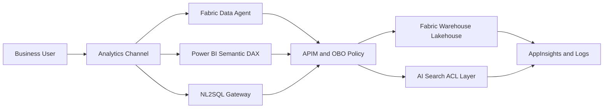
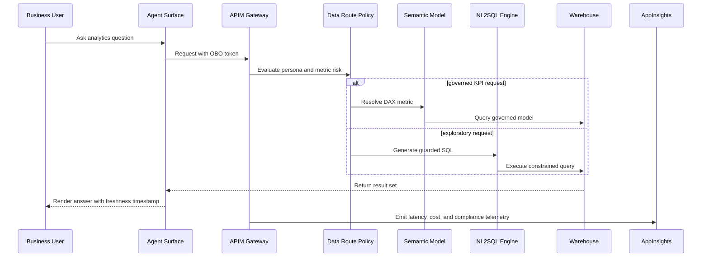

# Round 1126 · Cycle 2531
## Fabric Data Agent vs Power BI Semantic/DAX vs NL2SQL Warehouse: Enterprise Analytics Data-Plane Selection FAQ

## 1) Executive summary for enterprise architecture review
- This round focuses on enterprise application scenarios and excludes low-level systems internals.
- The objective is to compare Fabric Data Agent, Semantic/DAX, and NL2SQL in one governance-first decision frame.
- Recommended baseline: Semantic/DAX as source of metric truth, Fabric Data Agent as natural-language entry, NL2SQL for long-tail exploration with guardrails.
- Primary principle: identity and metric consistency outrank query flexibility.
- Typical anti-pattern: opening unrestricted NL2SQL against production warehouses without semantic governance.

## 2) Topic-aligned capability radar (official references, fetched 2026-11-18 UTC)
- Microsoft Fabric fundamentals: https://learn.microsoft.com/fabric/fundamentals/
- Fabric Data Science/Agent docs: https://learn.microsoft.com/fabric/data-science/
- Power BI semantic model: https://learn.microsoft.com/power-bi/connect-data/service-datasets-understand
- DAX overview: https://learn.microsoft.com/dax/dax-overview
- Fabric data warehouse: https://learn.microsoft.com/fabric/data-warehouse/
- Azure SQL overview: https://learn.microsoft.com/azure/azure-sql/
- Azure AI Search ACL trimming: https://learn.microsoft.com/azure/search/search-security-trimming-for-azure-search
- APIM AI gateway: https://learn.microsoft.com/azure/api-management/ai-gateway-overview
- Azure Monitor and App Insights: https://learn.microsoft.com/azure/azure-monitor/
- Entra OBO: https://learn.microsoft.com/entra/identity-platform/v2-oauth2-on-behalf-of-flow
- Microsoft Purview: https://learn.microsoft.com/purview/
- Well-Architected guidance: https://learn.microsoft.com/azure/well-architected/

## 3) Three analytics data-plane options
- **Option A — Fabric Data Agent** for fast business Q&A with native Fabric alignment.
- **Option B — Power BI Semantic + DAX** for governed KPI consistency and executive reporting trust.
- **Option C — NL2SQL Warehouse** for flexible deep exploration and domain-specific analytical queries.
- Composite pattern: A for entry, B for truth, C for depth.
- Decision sequence: metric governance first, interaction layer second, exploratory path third.

## 4) 12-dimension head-to-head matrix (including When NOT to choose)
| Dimension | A Fabric Data Agent | B Semantic + DAX | C NL2SQL Warehouse |
|---|---|---|---|
| 1. Target persona | Business consumers | BI/governance teams | Analysts and data engineers |
| 2. Interaction style | Natural-language Q&A | Dashboard/KPI-driven | Conversational SQL exploration |
| 3. Metric consistency | Medium-high | Highest | Medium with controls |
| 4. ACL and identity inheritance | Strong | Strong | Medium unless explicitly designed |
| 5. Time to market | Fast | Medium | Medium-high |
| 6. Custom flexibility | Medium | Medium | Highest |
| 7. Cost predictability | Medium-high | High | Medium |
| 8. Ops burden | Low-medium | Medium | Medium-high |
| 9. Multi-tenant governance | Strong | Strong | Requires isolation design |
| 10. Expression depth | Medium | High (DAX) | High (SQL) |
| 11. Best-fit workload | Enterprise self-service Q&A | Executive KPI cockpit | Deep ad hoc exploration |
| 12. When NOT to choose | Strictly reproducible financial close | Open-ended discovery-first use case | No data governance maturity |

## 5) Decision ladder and anti-patterns
- Step A: confirm semantic model and KPI dictionary maturity.
- Step B: decide business Q&A entry surface requirements.
- Step C: decide depth of exploratory query demand.
- Step D: align compliance/audit obligations to route policy.
- Anti-pattern 1: route all traffic to NL2SQL by default.
- Anti-pattern 2: mismatch ACL logic between semantic and Q&A channels.
- Anti-pattern 3: optimize only average latency and ignore P95/P99 during peak windows.
- Anti-pattern 4: ignore data freshness SLA and create answer-report conflicts.

## 6) Six worked quantitative Q&As
### Q1: When should semantic governance precede agent rollout?
- `governance_score = metric_coverage * acl_completeness * refresh_sla_pass_rate`.
- If `governance_score < 0.8`, close governance gaps before broad agent rollout.
- Sequence B-before-A typically reduces KPI dispute tickets.

### Q2: How to estimate blended cost with Fabric Agent plus Semantic?
- `blended_cost = agent_query_cost + semantic_refresh_cost + governance_ops_cost`.
- Use daypart scheduling if daytime spikes dominate demand.
- If `peak_ratio = peak_qps/avg_qps` exceeds 3, reserve elastic budget headroom.

### Q3: How to size NL2SQL concurrency?
- `workers = ceil((qps * p95_ms) / (1000 * util_target))`.
- Keep `util_target` in `0.55 - 0.70` range for complex-query variance.
- Isolate heavy-scan workloads to protect semantic refresh windows.

### Q4: How to balance freshness and latency?
- `freshness_gap = now - last_refresh_time`.
- If freshness exceeds threshold, show explicit timestamp warning in the answer.
- Incremental refresh plus hot-partition design reduces freshness drift.

### Q5: How to allocate multi-tenant cost fairly?
- `tenant_cost = query_weight * compute_cost + storage_share * storage_cost + governance_share`.
- Shared dimensions should be allocated separately to avoid noisy attribution.
- Premium tenants may require dedicated pools for predictable SLA.

### Q6: When is NL2SQL direct-to-production acceptable?
- Require `sql_guardrail_coverage >= 0.95` and `audit_replay_pass = true`.
- Mandatory controls: deny-list, row-level policy, timeout, and cost cap.
- Before controls are complete, restrict NL2SQL to read-only sandbox datasets.

## 7) Industry architecture #1: unified financial analytics with governed self-service
### Goals (Finance Operations)
- CFO office requires answer-to-report metric parity.
- Business teams need natural-language self-service to reduce BI queue dependence.
- Target: reduce monthly analysis preparation cycle by 40% within six months.

### End-to-end flow (Finance)
1. Semantic model defines governed KPI dictionary and DAX rules.
2. Fabric Data Agent provides natural-language entry bound to semantic context.
3. APIM enforces OBO identity, policy tags, and route governance.
4. Deep-dive analytics route through NL2SQL with guardrails and budget caps.
5. App Insights plus Purview provide replayable audit evidence and cost attribution.

### SLA and mitigations (Finance)
- Q&A P95 < 2.8s; semantic refresh SLA 99.9%.
- Failure A: refresh lag -> timestamp warning and selective critical-lane throttling.
- Failure B: NL2SQL query storm -> downgrade to pre-aggregated views.
- Failure C: ACL drift -> hard block and security alert.

## 8) Industry architecture #2: global retail dual-layer analytics platform
### Goals (Retail)
- Store managers need mobile-first Q&A for stock, promotion, and traffic.
- HQ analysts need cross-region deep SQL exploration.
- Peak season target: 99.95% availability with controlled cost per answer.

### End-to-end flow (Retail)
1. Store channel uses Fabric Agent over ACL-trimmed views.
2. HQ cockpit uses Semantic/DAX for management consistency.
3. Campaign retrospectives use NL2SQL partitions with query quotas.
4. APIM routes by persona and applies cost tags per lane.
5. Unified telemetry enters Cosmos memory and App Insights for postmortems.

### SLA and mitigations (Retail)
- Store first-answer P95 < 1.5s; HQ deep-query P95 < 6.0s.
- Failure A: regional surge -> fallback pool and cache strategy.
- Failure B: inventory master delay -> strict timestamping and decision guardrails.
- Failure C: cross-region compliance conflict -> regionalized route fallback and human review.

## 9) Mermaid topology flowchart


## 10) Mermaid runtime routing sequence


## 11) Production Bicep IaC snippet
```bicep
param location string = 'eastus2'
param apimName string
param appInsightsName string
param sqlServerName string
resource appi 'Microsoft.Insights/components@2022-06-15' = {
  name: appInsightsName
  location: location
  kind: 'web'
  properties: { Application_Type: 'web' }
}
resource apim 'Microsoft.ApiManagement/service@2023-05-01-preview' = {
  name: apimName
  location: location
  sku: { name: 'Premium' capacity: 2 }
  properties: { publisherEmail: 'platform@contoso.com' publisherName: 'Contoso Platform' }
}
resource sqlServer 'Microsoft.Sql/servers@2023-08-01-preview' = {
  name: sqlServerName
  location: location
  properties: { publicNetworkAccess: 'Disabled' version: '12.0' }
}
```

## 12) APIM route policy snippet
```xml
<policies>
  <inbound>
    <base />
    <set-variable name="queryType" value="@(context.Request.Headers.GetValueOrDefault("x-query-type","governed"))" />
    <choose>
      <when condition="@(context.Variables.GetValueOrDefault<string>("queryType") == "governed")">
        <set-backend-service base-url="https://semantic-gateway.contoso.net" />
      </when>
      <otherwise>
        <set-backend-service base-url="https://nl2sql-gateway.contoso.net" />
      </otherwise>
    </choose>
    <rate-limit-by-key calls="900" renewal-period="60" counter-key="@(context.Subscription.Id)" />
  </inbound>
  <backend><forward-request timeout="120" /></backend>
</policies>
```

## 13) Azure Monitor and App Insights KQL
```kql
let start=ago(24h);
requests
| where timestamp >= start
| summarize req=count(), p95=percentile(duration,95), p99=percentile(duration,99) by operation_Name, bin(timestamp,5m)
| order by timestamp desc
```

```kql
customEvents
| where timestamp >= ago(7d)
| where name in ("semantic_route", "nl2sql_route", "guardrail_block")
| summarize events=count(), users=dcount(user_Id) by name, tostring(customDimensions.tenant), bin(timestamp,1d)
| order by timestamp desc
```

## 14) Day-0 / Day-1 / Day-2 checklist
### Day-0 (design and admission)
- D0-01 Define KPI dictionary, versioning, and ownership.
- D0-02 Define persona-to-ACL matrix and route policy keys.
- D0-03 Define semantic refresh SLA and freshness thresholds.
- D0-04 Define SQL guardrails and budget caps.
- D0-05 Define audit replay and evidence archive policy.
- D0-06 Define cost attribution tags.
- D0-07 Define outage fallback and human override rules.
- D0-08 Define release gate and rollback criteria.

### Day-1 (go-live and canary)
- D1-01 Enable Fabric Agent lane in controlled domains.
- D1-02 Validate semantic and answer parity.
- D1-03 Enable NL2SQL sandbox and observe cost profile.
- D1-04 Enable surge controls and tenant protection.
- D1-05 Inject failures for refresh lag and query timeout.
- D1-06 Validate takeover runbook and response SLA.
- D1-07 Publish launch-week KPI and support metrics.
- D1-08 Freeze rollback point and finalize post-launch review.

### Day-2 (operations and optimization)
- D2-01 Weekly review answer quality and KPI dispute ratio.
- D2-02 Weekly review tenant-level cost and peak concurrency.
- D2-03 Biweekly cross-region failover drill.
- D2-04 Monthly refresh KPI dictionary and communication pack.
- D2-05 Monthly recalibrate break-even threshold assumptions.
- D2-06 Monthly audit ACL drift and trace completeness.
- D2-07 Quarterly revise data lifecycle and archival policy.
- D2-08 Quarterly refresh runbooks and training.

## 15) Extended Q&A, deliverables, and validation
### Five strategic Q&As
- QA-A When to prioritize Fabric Data Agent? When business Q&A entry is missing but governance baseline exists.
- QA-B When to prioritize Semantic/DAX first? When KPI inconsistency already impacts executive decisions.
- QA-C When to enable NL2SQL? When long-tail exploratory demand is persistent and guardrails are mature.
- QA-D How to reduce answer-speed versus consistency conflict? Unify dictionary, routing, and timestamp transparency.
- QA-E How to justify multi-path architecture to finance? Present persona-layered TCO and SLA impact together.

### 12 analytics architecture review checks
- RA-01: Confirm a single versioned KPI dictionary with accountable owners to prevent metric drift.
- RA-02: Confirm Semantic/DAX and Fabric Agent share equivalent RLS/OLS enforcement rules.
- RA-03: Confirm NL2SQL can reach production data only after guardrail pass conditions are met.
- RA-04: Confirm deny-list, timeout, and budget caps are enforced both at APIM and execution layers.
- RA-05: Confirm every answer includes freshness timestamp and semantic-model version metadata.
- RA-06: Confirm exploratory queries and executive reporting lanes use isolated concurrency pools.
- RA-07: Confirm cross-tenant access is denied by default with auditable isolation evidence.
- RA-08: Confirm query explainability (source fields, filters, aggregations) is visible to business users.
- RA-09: Confirm Fabric CU and database compute costs are attributable by tenant and department tags.
- RA-10: Confirm schema-evolution contract tests protect agent tool definitions from silent breakage.
- RA-11: Confirm degradation mode prefers governed pre-aggregated metrics over unconstrained SQL output.
- RA-12: Confirm compliance replay can reconstruct full chain from prompt to generated query to final answer.

### Deliverables this round
- Bilingual FAQ docs with 330+ lines and strict sections 1..15.
- Two Mermaid diagrams, one Bicep snippet, one APIM policy snippet, and two KQL blocks.
- SVG: `assets/42-cycle-2531-daily-breakthroughs.svg`.
- H5: `workbench-cycle-2531.html` and selector `#2531`.
- 7-card outputs: `benchmark-cards.html` and `benchmark-cards.en.html`.
- Evidence: `evidence/cycle-2531-*.json/csv`.

### Run and validate
```bash
python workshops/azure-agent-infra/simulator/cycle_1126_pipeline.py --write
python workshops/azure-agent-infra/simulator/cycle_1126_pipeline.py --check
pytest workshops/azure-agent-infra/simulator -q
```
- Acceptance criteria: sections 1..15, max_suffix_repeat == 1, workshops/docs byte parity, and full test pass.

