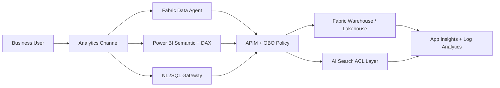
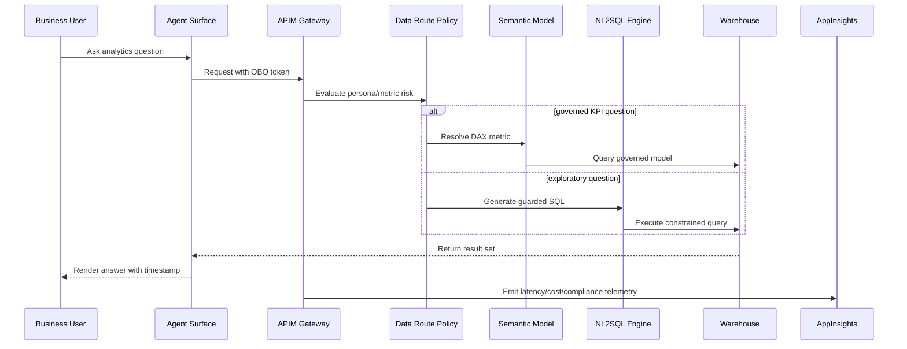

# Round 1126 · Cycle 2531
## Fabric Data Agent vs Power BI Semantic/DAX vs NL2SQL Warehouse：企业分析型 Agent 数据面选型 FAQ

## 1) 执行摘要（面向企业架构评审）
- 本轮聚焦企业应用场景，不讨论底层数据库内核、驱动或硬件调优细节。
- 目标是把数据分析 Agent 的三条主路径（Fabric Data Agent、Semantic/DAX、NL2SQL）放在同一决策框架内比较。
- 推荐基线：高治理报表优先 Semantic/DAX；自然语言探索优先 Fabric Data Agent；深度域内自定义推理可补 NL2SQL。
- 关键原则：权限模型与指标口径一致性优先于“能答出来”。
- 典型反模式：未经语义层治理就直接 NL2SQL 直连生产仓库并开放广域访问。

## 2) Topic-aligned capability radar（官方来源，抓取时间 2026-11-18 UTC）
- Microsoft Fabric overview: https://learn.microsoft.com/fabric/fundamentals/
- Fabric Data Agent docs: https://learn.microsoft.com/fabric/data-science/
- Power BI semantic model: https://learn.microsoft.com/power-bi/connect-data/service-datasets-understand
- DAX fundamentals: https://learn.microsoft.com/dax/dax-overview
- Microsoft Fabric Warehouse: https://learn.microsoft.com/fabric/data-warehouse/
- Azure SQL + security: https://learn.microsoft.com/azure/azure-sql/
- Azure AI Search + ACL trimming: https://learn.microsoft.com/azure/search/search-security-trimming-for-azure-search
- APIM AI gateway: https://learn.microsoft.com/azure/api-management/ai-gateway-overview
- Azure Monitor + App Insights: https://learn.microsoft.com/azure/azure-monitor/
- Entra OBO flow: https://learn.microsoft.com/entra/identity-platform/v2-oauth2-on-behalf-of-flow
- Purview governance: https://learn.microsoft.com/purview/
- Well-Architected data platform guidance: https://learn.microsoft.com/azure/well-architected/

## 3) 三类分析数据面方案定义
- **Option A — Fabric Data Agent**：以 Fabric 原生数据资产、Copilot 交互与企业治理为核心，强调快速落地。
- **Option B — Power BI Semantic + DAX**：以指标定义、语义层一致性和报表治理为核心，强调可解释与可审计。
- **Option C — NL2SQL over Warehouse**：以自然语言到 SQL 的灵活查询为核心，强调探索效率与定制可控。
- 扩展组合：A 负责自然语言入口，B 负责指标口径，C 负责深度长尾分析。
- 决策顺序：先选口径治理，再选交互入口，最后补深度查询通道。

## 4) 12 维度 head-to-head 选型矩阵（含 When NOT to choose）
| 维度 | A Fabric Data Agent | B Semantic + DAX | C NL2SQL Warehouse |
|---|---|---|---|
| 1. 目标用户 | 分析消费者与业务经理 | BI 团队与治理团队 | 数据分析师与工程团队 |
| 2. 交互体验 | 自然语言问答 | 报表/仪表板驱动 | 对话式 SQL 探索 |
| 3. 指标口径一致性 | 中高 | 最高 | 中（需额外约束） |
| 4. 权限继承与 ACL | 强 | 强 | 中（需显式实现） |
| 5. 上线速度 | 快 | 中 | 中高 |
| 6. 自定义灵活度 | 中 | 中 | 最高 |
| 7. 成本可预测性 | 中高 | 高 | 中 |
| 8. 调优与运维负担 | 低中 | 中 | 中高 |
| 9. 多租户治理 | 强 | 强 | 需额外隔离设计 |
| 10. 复杂分析表达力 | 中 | 高（DAX） | 高（SQL） |
| 11. Best-fit 场景 | 企业自助问数 | 管理驾驶舱/KPI | 临时深度探索/专题分析 |
| 12. When NOT to choose | 严苛可复算金融口径 | 高度自由探索需求 | 无数据治理体系时 |

## 5) 决策树与反模式
- Step A：是否已有统一语义模型与指标字典？若有，优先 B 作为真相层。
- Step B：是否要快速覆盖业务问数入口？若是，优先 A 作为问答层。
- Step C：是否存在大量长尾专题分析？若是，补 C 但加 SQL guardrail。
- Step D：是否要求跨域合规审计？则统一接入 Purview + Entra OBO + APIM 观测。
- 反模式 1：把 NL2SQL 当默认路径，绕过语义层。
- 反模式 2：语义层与问答层使用不同权限裁剪逻辑。
- 反模式 3：只看 P50，不看 P95/P99 与高峰并发退化。
- 反模式 4：忽略数据刷新 SLA，导致问答结果与报表口径冲突。

## 6) 6 个量化 Q&A（容量、并发、TCO）
### Q1：何时该先建语义层再上 Agent？
- `governance_score = metric_coverage * acl_completeness * refresh_sla_pass_rate`。
- 当 `governance_score < 0.8`，先补语义治理再扩展问答渠道。
- 经验：先 B 后 A，能显著降低业务争议工单量。

### Q2：Fabric Agent 与 Semantic 报表并行时怎么算总成本？
- `blended_cost = agent_query_cost + semantic_refresh_cost + governance_ops_cost`。
- 若问答峰值集中在白天，建议分时策略降低仓库并发成本。
- `peak_ratio = peak_qps / avg_qps` 高于 3 时要做弹性预算池。

### Q3：NL2SQL 并发容量估算
- `workers = ceil((qps * p95_ms) / (1000 * util_target))`。
- `util_target` 建议 0.55~0.7，预留复杂查询抖动。
- 对写临时表/大扫描需单独配额，避免冲击报表刷新。

### Q4：语义层刷新频率与查询延迟怎么平衡？
- `freshness_gap = now - last_refresh_time`。
- 若 `freshness_gap` 超过业务阈值，问答层必须提示“口径时间戳”。
- 新鲜度优先场景可启用增量刷新 + 热分区策略。

### Q5：多租户成本分摊怎么做？
- `tenant_cost = query_weight * compute_cost + storage_share * storage_cost + governance_share`。
- 建议把跨租户公共维表成本单独分摊，避免错误归因。
- 对高价值租户可启用专属并发池，提升 SLA 可解释性。

### Q6：何时允许 NL2SQL 直连生产仓库？
- 条件：`sql_guardrail_coverage >= 0.95` 且 `audit_replay_pass = true`。
- 必须具备 deny-list、row-level policy、query timeout 与成本上限。
- 未满足前置条件时，NL2SQL 仅限只读沙箱数据集。

## 7) 行业架构一：集团财务与经营分析“统一口径 + 自助问数”平台
### 场景目标（Finance Operations）
- CFO 办公室要求“问答结果与董事会报表口径完全一致”。
- 业务部门需要自然语言自助问数，减少对 BI 团队排队依赖。
- 目标：在 6 个月内把月度分析准备周期缩短 40%。

### 架构流程（Finance）
1. Power BI Semantic 模型定义统一指标词典与 DAX 计算口径。
2. Fabric Data Agent 提供自然语言入口，并绑定语义模型上下文。
3. APIM 统一路由、节流、审计标签，所有请求携带 OBO 身份。
4. 专题分析走 NL2SQL 通道，但受 SQL guardrail 与预算上限控制。
5. App Insights + Purview 输出可回放审计证据与成本归因看板。

### SLA 与缓解（Finance）
- 问答链路 P95 < 2.8s；报表刷新 SLA 99.9%。
- 失效 A：语义刷新滞后 -> 触发口径时间戳提示并限流关键问答。
- 失效 B：NL2SQL 复杂查询雪崩 -> 自动降级到预计算视图。
- 失效 C：权限漂移 -> OBO 校验失败即阻断并告警。

## 8) 行业架构二：全球零售集团“门店运营问数 + 总部策略分析”双层平台
### 场景目标（Retail）
- 门店经理需要移动端快速问数（库存、促销、客流）。
- 总部分析团队需要跨区域、跨品类深度 SQL 专题分析。
- 目标：高峰季节保持 99.95% 可用并控制单位问答成本。

### 架构流程（Retail）
1. 门店端通过 Fabric Agent 访问受权限裁剪的数据视图。
2. 总部看板通过 Semantic/DAX 保持管理口径一致。
3. 专项活动复盘通过 NL2SQL 访问仓库分区并受配额控制。
4. APIM 按 persona 路由到不同计算池并记录成本标签。
5. 统一记忆与日志进入 Cosmos + App Insights 以支持复盘。

### SLA 与缓解（Retail）
- 门店问数首包 P95 < 1.5s；总部专题查询 P95 < 6.0s。
- 失效 A：区域流量暴涨 -> 自动切换备用查询池与缓存策略。
- 失效 B：库存主数据延迟 -> 标注数据时点并限制关键决策输出。
- 失效 C：跨区合规冲突 -> 触发区域化回退策略与人工复核。

## 9) Mermaid 架构图（flowchart）


## 10) Mermaid 运行时路由（sequenceDiagram）


## 11) 生产 Bicep IaC 片段
```bicep
param location string = 'eastus2'
param apimName string
param appInsightsName string
param sqlServerName string

resource appi 'Microsoft.Insights/components@2022-06-15' = {
  name: appInsightsName
  location: location
  kind: 'web'
  properties: { Application_Type: 'web' }
}

resource apim 'Microsoft.ApiManagement/service@2023-05-01-preview' = {
  name: apimName
  location: location
  sku: { name: 'Premium' capacity: 2 }
  properties: { publisherEmail: 'platform@contoso.com' publisherName: 'Contoso Platform' }
}

resource sqlServer 'Microsoft.Sql/servers@2023-08-01-preview' = {
  name: sqlServerName
  location: location
  properties: {
    publicNetworkAccess: 'Disabled'
    version: '12.0'
  }
}
```

## 12) APIM SQL 路由策略片段
```xml
<policies>
  <inbound>
    <base />
    <set-variable name="queryType" value="@(context.Request.Headers.GetValueOrDefault("x-query-type","governed"))" />
    <choose>
      <when condition="@(context.Variables.GetValueOrDefault<string>("queryType") == "governed")">
        <set-backend-service base-url="https://semantic-gateway.contoso.net" />
      </when>
      <otherwise>
        <set-backend-service base-url="https://nl2sql-gateway.contoso.net" />
      </otherwise>
    </choose>
    <rate-limit-by-key calls="900" renewal-period="60" counter-key="@(context.Subscription.Id)" />
    <set-header name="x-data-governance" exists-action="override"><value>r1126</value></set-header>
  </inbound>
  <backend><forward-request timeout="120" /></backend>
</policies>
```

## 13) Azure Monitor / App Insights KQL
```kql
let start=ago(24h);
requests
| where timestamp >= start
| summarize req=count(), p95=percentile(duration,95), p99=percentile(duration,99) by operation_Name, bin(timestamp,5m)
| order by timestamp desc
```

```kql
customEvents
| where timestamp >= ago(7d)
| where name in ("semantic_route", "nl2sql_route", "guardrail_block")
| summarize events=count(), users=dcount(user_Id) by name, tostring(customDimensions.tenant), bin(timestamp,1d)
| order by timestamp desc
```

## 14) Day-0 / Day-1 / Day-2 清单
### Day-0（设计与准入）
- D0-01：定义指标词典、口径版本与责任人。
- D0-02：定义 persona 与权限映射矩阵。
- D0-03：定义问答路由策略与 fallback 路径。
- D0-04：定义成本归因标签体系。
- D0-05：定义语义刷新 SLA 与数据新鲜度阈值。
- D0-06：定义 SQL guardrail（deny-list/timeout/cost cap）。
- D0-07：定义审计回放与证据归档要求。
- D0-08：定义发布门禁与回滚标准。

### Day-1（上线与灰度）
- D1-01：按业务域灰度启用 Fabric Agent 入口。
- D1-02：验证 Semantic 与问答结果口径一致性。
- D1-03：启用 NL2SQL 只读沙箱并监测 query 成本。
- D1-04：建立高峰限流和跨租户保护策略。
- D1-05：执行首轮故障注入（语义延迟、SQL 超时、权限漂移）。
- D1-06：验证人工兜底流程与值班响应。
- D1-07：发布上线周 KPI 与工单回顾。
- D1-08：冻结回滚点并输出复盘报告。

### Day-2（运行与优化）
- D2-01：每周复盘问答准确率与口径争议率。
- D2-02：每周复盘租户级成本与峰值并发。
- D2-03：双周演练跨区域路由与降级。
- D2-04：每月刷新指标词典版本并通告业务。
- D2-05：每月更新 break-even 阈值模型。
- D2-06：每月审查审计可追溯性与权限漂移。
- D2-07：季度更新数据生命周期与归档策略。
- D2-08：季度复核平台值班与应急演练质量。

## 15) 扩展问答、交付清单与验收命令
### 五条扩展问答
- QA-A：何时先上 Fabric Data Agent？当业务问数入口缺失且治理基线可用时。
- QA-B：何时必须先做 Semantic/DAX？当指标口径争议已影响经营决策时。
- QA-C：何时启用 NL2SQL？当长尾专题分析需求持续增长且 guardrail 完整时。
- QA-D：如何控制“答得快但不一致”？统一语义词典 + 路由策略 + 时点提示。
- QA-E：如何让财务接受多路径并存？用 persona 分层 TCO 与 SLA 共同解释价值。

### 12 条数据分析架构评审清单
- RA-01：确认 KPI 指标词典存在唯一版本号与发布责任人，避免问答口径漂移。
- RA-02：确认 Semantic/DAX 与 Fabric Agent 共享同一权限裁剪规则（RLS/OLS）。
- RA-03：确认 NL2SQL 仅在 guardrail 通过后可访问生产数据面。
- RA-04：确认 SQL deny-list、超时上限、预算上限在 APIM 层与执行层双重生效。
- RA-05：确认每次问答均返回数据时点与语义模型版本号。
- RA-06：确认探索型查询与经营型报表使用隔离并发池，互不抢占关键窗口。
- RA-07：确认跨租户访问默认拒绝，并具备租户隔离审计证据。
- RA-08：确认查询解释信息（字段来源、过滤条件、聚合口径）可视化给业务用户。
- RA-09：确认 Fabric CU 与数据库计算成本的归因标签按部门/租户可追溯。
- RA-10：确认 schema 变更有自动契约测试，避免 Agent 工具定义失效。
- RA-11：确认故障降级时优先返回受治理的预聚合指标而非自由 SQL 结果。
- RA-12：确认合规抽检可回放“用户问题→生成查询→执行结果→最终回答”全链路。

### 本轮交付
- FAQ（zh/en）330+ 行，章节 1..15 完整。
- 2 张 Mermaid、1 段 Bicep、1 段 APIM 策略、2 段 KQL。
- SVG：`assets/42-cycle-2531-daily-breakthroughs.svg`。
- H5：`workbench-cycle-2531.html` 与 selector `#2531`。
- 7-card：`benchmark-cards.html` 与 `benchmark-cards.en.html`。
- Evidence：`evidence/cycle-2531-*.json/csv`。

### 运行与验收
```bash
python workshops/azure-agent-infra/simulator/cycle_1126_pipeline.py --write
python workshops/azure-agent-infra/simulator/cycle_1126_pipeline.py --check
pytest workshops/azure-agent-infra/simulator -q
```
- 验收门槛：sections 1..15、max_suffix_repeat == 1、workshops/docs 字节一致、测试通过。

