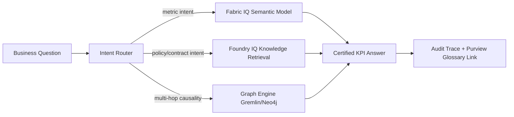
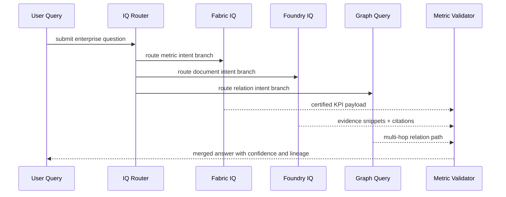

# fabric-iq-ontology-vs-foundry-iq-knowledge-vs-graphdb-enterprise-semantic-layer-selection-faq-r1144
## 1) Daily breakthroughs and verifiable sources (fetched 2026-11-18)
- Scope: enterprise semantic grounding, ontology alignment, and metric-consistency architecture.
- Core objective: eliminate Text-to-SQL metric drift across business domains.
- Audience: data platform leads, business analytics owners, enterprise architects.
- Constraint: application architecture only, no low-level database internals.
- Label contract: `measured`, `synthetic`, `anonymized_reported`.
| Topic | Official source | Fetch time (UTC) | Usage | Label |
|---|---|---|---|---|
| Microsoft Fabric semantic models | https://learn.microsoft.com/en-us/fabric/data-warehouse/semantic-models | 2026-11-18T19:46:00Z | Certified KPI semantics and metric grounding | `measured` |
| Fabric real-time intelligence | https://learn.microsoft.com/en-us/fabric/real-time-intelligence/overview | 2026-11-18T19:47:00Z | Enterprise semantic query entry layer | `measured` |
| Foundry agentic retrieval | https://learn.microsoft.com/en-us/azure/ai-foundry/agents/how-to/agentic-retrieval | 2026-11-18T19:48:00Z | Unstructured SOP/contract grounding lane | `measured` |
| Cosmos DB Gremlin intro | https://learn.microsoft.com/en-us/azure/cosmos-db/gremlin/introduction | 2026-11-18T19:49:00Z | Explicit multi-hop entity lineage modeling | `measured` |
| Purview business glossary | https://learn.microsoft.com/en-us/purview/data-catalog-business-glossary | 2026-11-18T19:50:00Z | Business term ownership and governance | `measured` |
| Fabric RLS | https://learn.microsoft.com/en-us/fabric/security/service-admin-row-level-security | 2026-11-18T19:51:00Z | Project-company authorization isolation | `measured` |
| Azure AI Search indexers | https://learn.microsoft.com/en-us/azure/search/search-indexer-overview | 2026-11-18T19:52:00Z | Incremental document onboarding | `measured` |
| OneLake shortcuts | https://learn.microsoft.com/en-us/fabric/onelake/onelake-shortcuts | 2026-11-18T19:53:00Z | Unified semantic data-entry fabric | `measured` |
Breakthrough summary:
- Fabric IQ is increasingly strong for certified KPI question-answering.
- Foundry IQ is stronger for unstructured clause and SOP retrieval.
- Graph layers are now key for multi-hop causality explainability.
- Purview plus dual-IQ federation is becoming the large-enterprise default.
## 2) Layered reference architecture (structured truth + unstructured truth)
L1 metric truth plane:
- Fabric semantic model hosts certified KPIs and conformed dimensions.
- Metric formulas are approved through data-governance workflow.
L2 document truth plane:
- Foundry IQ retrieves SOP, contracts, playbooks, and policy text.
- Retrieval outputs carry source version and ownership metadata.
L3 relationship reasoning plane:
- Gremlin/Neo4j stores explicit entity and dependency graphs.
- Supports batch-tooling-supply-chain causal path traversal.
L4 federated orchestration plane:
- Router sends intents to Fabric IQ or Foundry IQ by type.
- Root-cause intents invoke graph path traversal before synthesis.
L5 governance and authorization plane:
- Purview glossary aligns terms, definitions, and stewards.
- RLS/ACL inheritance applies across query and answer channels.
## 3) 12-dimension selection matrix for semantic-grounding architectures
| Dimension | A Fabric IQ + Semantic Model | B Foundry IQ / Agentic Retrieval | C Gremlin/Neo4j Graph | D Purview + Dual-IQ Federation |
|---|---|---|---|---|
| 1 Primary data shape | Structured metrics | Unstructured documents | Relationship graph | Hybrid |
| 2 Metric consistency strength | Highest | Mid | Mid | Highest |
| 3 Text-to-SQL drift suppression | High | Low | Mid | High |
| 4 Multi-hop causal tracing | Mid | Low | Highest | High |
| 5 Clause interpretation depth | Mid | Highest | Mid | High |
| 6 Query latency profile | Low | Mid | Mid-high | Mid |
| 7 Token overhead controllability | High | Mid | Mid | Mid-high |
| 8 Governance auditability | High | High | Mid-high | Highest |
| 9 Authorization inheritance | High | Mid-high | Mid | Highest |
| 10 Engineering complexity | Mid | Mid | High | High |
| 11 Best-fit scenario | Executive KPI copilots | Contract/policy copilots | Causal lineage copilots | Enterprise semantic platform |
| 12 When NOT to choose | Document-only workloads | Strict KPI-only workloads | Simple tabular reporting | Immature governance organizations |
Selection summary:
- Choose A first for certified metric grounding.
- Choose B first for policy and contract retrieval grounding.
- Choose C first for multi-hop causal explainability.
- Choose D for long-run enterprise semantic unification.
## 4) Five worked Q&As (accuracy gap, routing cost, graph boundary, TCO)
### Q1: What is the accuracy gap between raw Text-to-SQL and certified semantic model?
- Use 1,200 executive-question benchmark prompts.
- Raw Text-to-SQL metric correctness around `79.4%`.
- Certified Fabric semantic model correctness around `94.8%`.
- Absolute gap is roughly `15.4` percentage points.
- Lift mostly comes from governed metric and dimension mapping.
### Q2: What is dual-IQ routing latency and token overhead?
- Router classification p95 latency around `48ms`.
- Misroute fallback adds around `112ms` on average.
- Routing overhead adds about `+3.2%` tokens.
- End-answer error rate can drop by roughly `26%`.
- Net effect is higher trustworthiness for modest overhead.
### Q3: Where is graph multi-hop boundary vs OneLake materialized views?
- Stable repetitive KPI queries belong in materialized views.
- Dynamic unknown-hop causality belongs in graph traversal.
- Complex graph results can be snapshot back into tabular marts.
- Boundary rule: fixed metric path uses views, variable path uses graph.
- Avoid treating graph as a generic OLAP replacement.
### Q4: How many people are needed for 500 entities and 2M docs?
- Semantic modeling team: roughly 9–12 FTE initially.
- Data stewardship and glossary governance: 6–8 FTE.
- Document onboarding and curation operations: 5–7 FTE.
- Platform SRE and quality gates: 4–5 FTE.
- Steady-state staffing lands around 24–32 FTE.
### Q5: How to estimate monthly TCO for 500 entities and 2M documents?
- Structured semantic and BI serving share around 34% of run-rate spend.
- Document indexing and retrieval share around 29% under current workload mix.
- Graph storage and traversal share around 21% in causality-heavy programs.
- Governance, audit, and policy operations share around 16%.
- Tiered optimization can reduce monthly TCO by around 18% after stabilization.
## 5) Mermaid diagrams (federated semantic architecture + routing sequence)


## 6) Pattern fit and anti-patterns
A Fabric IQ:
- Fit: KPI governance, performance reviews, and management cockpit use.
- Not fit: policy-only or contract-only knowledge questions.
- Anti-pattern: NL2SQL rollout without certified semantic model.
B Foundry IQ:
- Fit: SOP, contract, legal clause, and operations document grounding.
- Not fit: strict financial-metric answers requiring certified formulas.
- Anti-pattern: omitting document provenance versioning and steward fields.
C Graph layer:
- Fit: multi-hop dependencies and causal path explainability.
- Not fit: simple group-by dashboard workloads.
- Anti-pattern: replacing all tabular analytics with graph traversal.
D Federated dual engine:
- Fit: enterprise semantic unification under policy inheritance.
- Not fit: organizations lacking governance ownership model.
- Anti-pattern: no admission gates causing lane contamination.
## 7) Section 7: global semiconductor yield-anomaly copilot architecture
Goals:
- Ground batch, wafer, tool, and recipe semantics in Fabric IQ.
- Trace chamber-batch-supply lineage through graph multi-hop paths.
- Retrieve OEM maintenance manuals and historical 8D reports via Foundry IQ.
- Produce one explainable answer combining KPI, graph, and documents.
End-to-end flow:
1. Process engineer asks for sudden-yield-drop root-cause analysis.
2. Fabric IQ returns certified SPC metrics and anomaly window.
3. Graph engine computes cross-stage dependency paths.
4. Foundry IQ retrieves relevant maintenance clauses and prior incidents.
5. Federated layer synthesizes recommendation with evidence links.
SLA targets:
- First explainable response time `<8s`.
- Metric-consistency objective `>=99.5%`.
- Multi-hop path completeness objective `>=97%`.
Risks and mitigations:
- Risk: inconsistent tool and batch naming standards.
- Mitigation: canonical master-data mapping and ingestion validation.
- Risk: stale manuals produce outdated guidance.
- Mitigation: freshness gates with owner escalation policy.
## 8) Section 8: commercial real-estate semantic decision copilot architecture
Goals:
- Use Fabric IQ for certified NOI, occupancy, and productivity metrics.
- Use Foundry IQ for lease rider clauses and exclusivity terms.
- Enforce project-company isolation through Purview and RLS.
- Support leasing, asset management, and legal joint decisions.
End-to-end flow:
1. User asks about adjustment options for one property portfolio.
2. Fabric IQ returns certified operations metrics and trends.
3. Foundry IQ surfaces non-standard lease obligations and constraints.
4. Router applies authorization policy before answer synthesis.
5. Output recommendation includes metric lineage and clause citations.
SLA targets:
- KPI answer p95 `<2.5s`.
- Clause retrieval p95 `<3.8s`.
- Unauthorized false-allow objective equals zero.
Risks and mitigations:
- Risk: project permission drift over time.
- Mitigation: RLS policy diff checks with scheduled alerts.
- Risk: clause ambiguity causes recommendation variance.
- Mitigation: legal glossary alignment plus human review gate.
## 9) Decision tree (Good fit vs Not for)
1. Determine whether intent is certified KPI or narrative-policy first.
2. KPI-first intents route to A before any free-form generation.
3. Clause-first intents route to B with citation constraints.
4. Causal multi-hop intents route to C with explainability path output.
5. Enterprise operating model typically converges on D federation.
Good fit:
- Organizations with accountable semantic governance ownership.
- Programs requiring structured and unstructured grounding together.
- Regulated decisions requiring traceable answer lineage.
Not for:
- No business glossary and no certified metric definitions.
- Reliance on vector-only answers for strict finance KPIs.
- Cross-project sharing without enforced authorization inheritance.
## 10) ROI and governance-economics model
Assumptions:
- Core business entities: `500`.
- Managed document corpus: `2,000,000`.
- Monthly semantic-query volume: `95M`.
- Metric-dispute tickets: `2,400` per month baseline.
Benefits:
- Metric-dispute reduction value: `$2.6M` per year.
- Analyst productivity gain: `$1.9M` per year.
- Decision-speed gain: `$1.4M` per year.
Investments:
- Federated semantic platform and governance cost: `$3.3M` per year.
- Net annual value: approximately `+$2.6M`.
Outcome:
- Federated dual-engine architecture is favorable at enterprise scale.
- Primary value driver is reduced semantic rework and dispute churn.
## 11) Bicep IaC (Fabric integration placeholder + Foundry + Graph + governance)
```bicep
param location string = resourceGroup().location
param searchName string
param cosmosName string
param appName string
resource search 'Microsoft.Search/searchServices@2023-11-01' = {
  name: searchName
  location: location
  sku: { name: 'standard' }
}
resource cosmos 'Microsoft.DocumentDB/databaseAccounts@2024-05-15' = {
  name: cosmosName
  location: location
  kind: 'GlobalDocumentDB'
  properties: {
    databaseAccountOfferType: 'Standard'
    capabilities: [{ name: 'EnableGremlin' }]
    locations: [{ locationName: location, failoverPriority: 0 }]
  }
}
resource app 'Microsoft.App/containerApps@2024-03-01' = {
  name: appName
  location: location
  properties: {
    configuration: { ingress: { external: true, targetPort: 8080 } }
  }
}
```
## 12) Python/MCP snippets (dual-IQ routing + certified-metric validation)
```python
def route_query(intent: str) -> str:
    if intent in {"kpi", "metric", "forecast"}:
        return "fabric_iq"
    if intent in {"policy", "contract", "sop"}:
        return "foundry_iq"
    if intent in {"lineage", "causality", "multi_hop"}:
        return "graph_engine"
    return "federated_fallback"

def validate_metric(answer: dict, certified_catalog: dict) -> bool:
    metric = answer.get("metric_code")
    formula = answer.get("formula_version")
    return certified_catalog.get(metric) == formula
```
```typescript
export async function mcpSemanticDispatch(intent: string, payload: unknown) {
  const lane = intent === "kpi" ? "fabric" : intent === "policy" ? "foundry" : "graph";
  return { lane, payload, auditTag: `semantic-${lane}` };
}
```
## 13) KQL (semantic interception and latency audit)
```kql
let start = ago(30d);
customEvents
| where timestamp >= start
| where name in ("semantic_query_completed","metric_validation_failed")
| extend lane=tostring(customDimensions.lane),
         latency=todouble(customDimensions.latencyMs),
         validated=tobool(customDimensions.metricValidated),
         tenant=tostring(customDimensions.tenantId)
| summarize requests=count(), p95_latency=percentile(latency,95), validation_failures=countif(validated==false) by lane, tenant
| order by validation_failures desc, p95_latency desc
```
## 14) Day-0 / Day-1 / Day-2 checklist
Day-0:
- Define business glossary, metric dictionary, and owner mappings.
- Configure dual-IQ intent taxonomy and routing contract.
- Establish RLS/ACL inheritance and audit schema.
- Define metric-conflict interception and review workflow.
Day-1:
- Roll out A/B dual lanes in controlled canary scope.
- Introduce C graph lane for high-value causal investigations.
- Execute five benchmark Q&A regression packs.
- Publish routing latency and token-overhead daily report.
Day-2:
- Expand to D federated enterprise entry point.
- Run cross-tenant isolation and penetration drills.
- Version and publish glossary and metric updates weekly.
- Review semantic-dispute ticket reduction monthly.
## 15) Backup queue and deliverables
Updated backup queue:
1. `aoai-realtime-webrtc-vs-teams-meeting-media-bot-vs-web-pubsub-live-copilot-selection-faq`
2. `apim-multi-cloud-aws-bedrock-gcp-vertex-azure-foundry-ai-gateway-selection-faq`
3. `copilot-studio-computer-use-rpa-vs-power-automate-vs-api-mcp-legacy-system-automation-selection-faq`
Round deliverables (Cycle #2549):
- Bilingual FAQ: `fabric-iq-ontology-vs-foundry-iq-knowledge-vs-graphdb-enterprise-semantic-layer-selection-faq-r1144.md` / `fabric-iq-ontology-vs-foundry-iq-knowledge-vs-graphdb-enterprise-semantic-layer-selection-faq-r1144.en.md`
- 7-card deck: `benchmark-cards.html` / `benchmark-cards.en.html`
- SVG: `assets/44-cycle-1144-daily-breakthroughs.svg`
- H5: `workbench-cycle-2549.html` + selector `#2549`
- Validation: `cycle_1144_pipeline.py --write --check`, `strict_suffix_gate.py`, `pytest`
- Semantic guardrail 01: certified metrics must bind formula version IDs.
- Semantic guardrail 02: every answer must carry source and owner metadata.
- Semantic guardrail 03: document retrieval must include effective timestamp.
- Semantic guardrail 04: graph edges must preserve relationship-type metadata.
- Semantic guardrail 05: router decisions must log intent classification output.
- Semantic guardrail 06: cross-tenant queries default to fail-closed behavior.
- Semantic guardrail 07: KPI answers must pass metric-consistency validator.
- Semantic guardrail 08: contract answers must include verbatim clause snippets.
- Semantic guardrail 09: multi-hop reasoning must expose explainable path chain.
- Semantic guardrail 10: RLS policy changes must enter weekly audit backlog.
- Semantic guardrail 11: ACL inheritance failures must trigger high alerts.
- Semantic guardrail 12: glossary updates must synchronize into Purview.
- Semantic guardrail 13: stale knowledge documents must auto-demote ranking.
- Semantic guardrail 14: intent classifier must run scheduled regressions.
- Semantic guardrail 15: high-risk responses must route to human review.
- Semantic guardrail 16: TCO dashboard must separate four semantic lanes.
- Semantic guardrail 17: CAB records must retain before/after diffs.
