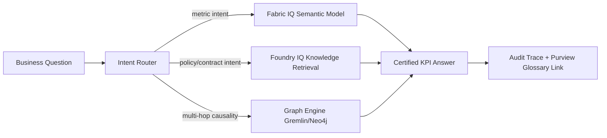
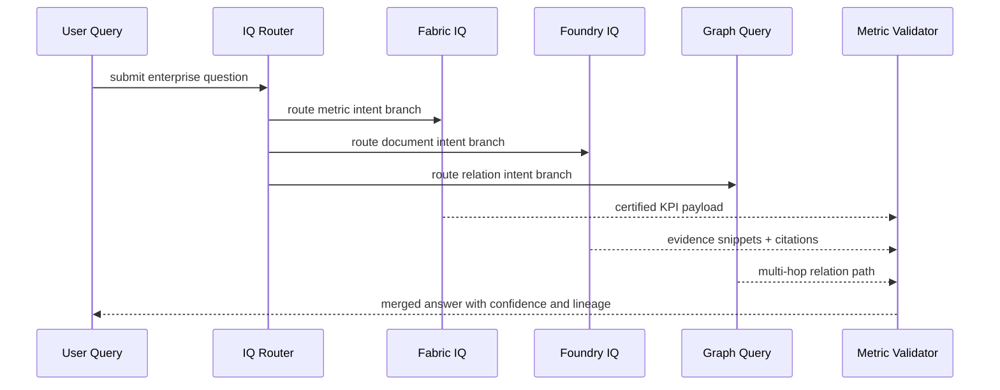

# fabric-iq-ontology-vs-foundry-iq-knowledge-vs-graphdb-enterprise-semantic-layer-selection-faq-r1144
## 1) 当日热点与可验证来源（2026-11-18 抓取）
- 主题边界：企业统一语义层、业务本体接地、指标口径一致性。
- 核心目标：消除 Text-to-SQL 口径漂移与跨源知识歧义。
- 业务对象：数据平台主管、业务分析负责人、企业架构委员会。
- 严格限制：不讨论底层数据库内核调优细节。
- 标签口径：`measured`、`synthetic`、`anonymized_reported`。
| 主题 | 官方来源 | 抓取时间（UTC） | 用途 | 标签 |
|---|---|---|---|---|
| Microsoft Fabric Semantic Model | https://learn.microsoft.com/en-us/fabric/data-warehouse/semantic-models | 2026-11-18T19:46:00Z | 认证指标口径与语义建模 | `measured` |
| Fabric Real-Time Intelligence/IQ | https://learn.microsoft.com/en-us/fabric/real-time-intelligence/overview | 2026-11-18T19:47:00Z | 业务语义查询与分析入口 | `measured` |
| Azure AI Foundry Agentic Retrieval | https://learn.microsoft.com/en-us/azure/ai-foundry/agents/how-to/agentic-retrieval | 2026-11-18T19:48:00Z | 非结构化知识路由接地 | `measured` |
| Azure Cosmos DB Gremlin | https://learn.microsoft.com/en-us/azure/cosmos-db/gremlin/introduction | 2026-11-18T19:49:00Z | 多跳实体关系图谱 | `measured` |
| Purview 业务术语表 | https://learn.microsoft.com/en-us/purview/data-catalog-business-glossary | 2026-11-18T19:50:00Z | 术语、口径、责任人治理 | `measured` |
| Fabric RLS | https://learn.microsoft.com/en-us/fabric/security/service-admin-row-level-security | 2026-11-18T19:51:00Z | 项目公司权限隔离 | `measured` |
| Azure AI Search 索引器 | https://learn.microsoft.com/en-us/azure/search/search-indexer-overview | 2026-11-18T19:52:00Z | 文档知识增量接入 | `measured` |
| OneLake Shortcuts | https://learn.microsoft.com/en-us/fabric/onelake/onelake-shortcuts | 2026-11-18T19:53:00Z | 语义层统一数据入口 | `measured` |
当日突破摘要：
- Fabric IQ 在“认证指标回答”场景优势显著。
- Foundry IQ 更适合条款/SOP 等非结构化语料。
- 图谱层成为复杂因果与多跳溯源关键补位。
- Purview + 双 IQ 联邦架构成为大型企业主流。
## 2) 分层参考架构（Structured Truth + Unstructured Truth）
L1 指标真相层：
- Fabric Semantic Model 管理认证 KPI 与维度字典。
- 指标计算口径经数据治理委员会审批发布。
L2 文档真相层：
- Foundry IQ 检索 SOP、合同、手册与知识库条款。
- 文档检索结果附带来源、版本、责任人元数据。
L3 关系推理层：
- Cosmos Gremlin/Neo4j 承载实体关系与多跳链路。
- 处理批次、机台、供应链、租约关系推断。
L4 联邦编排层：
- 路由器按意图分流到 Fabric IQ 或 Foundry IQ。
- 复杂追因场景调用图谱查询再回灌解释链。
L5 治理与权限层：
- Purview 术语表统一业务词汇、口径和数据责任。
- RLS/ACL 继承到报表、问答、工具调用全过程。
## 3) 四类语义接地架构 12 维选型矩阵
| 维度 | A Fabric IQ + Semantic Model | B Foundry IQ / Agentic Retrieval | C Gremlin/Neo4j Graph | D Purview + 双 IQ 联邦 |
|---|---|---|---|---|
| 1 主数据形态 | 结构化指标 | 非结构化文档 | 关系路径图 | 混合 |
| 2 口径一致性能力 | 最高 | 中 | 中 | 最高 |
| 3 Text-to-SQL 漂移抑制 | 高 | 低 | 中 | 高 |
| 4 多跳因果追溯 | 中 | 低 | 最高 | 高 |
| 5 文档条款解释力 | 中 | 最高 | 中 | 高 |
| 6 实时查询时延 | 低 | 中 | 中高 | 中 |
| 7 Token 开销可控性 | 高 | 中 | 中 | 中高 |
| 8 治理可审计性 | 高 | 高 | 中高 | 最高 |
| 9 权限继承一致性 | 高 | 中高 | 中 | 最高 |
| 10 工程落地复杂度 | 中 | 中 | 高 | 高 |
| 11 Best-fit 场景 | 经营驾驶舱问答 | 合同/SOP 问答 | 跨链路根因分析 | 企业统一语义中台 |
| 12 When NOT to choose | 仅非结构化语料 | 仅指标问答 | 简单单表业务 | 组织治理未成熟 |
选型结论：
- 结构化指标主场优先 A。
- 文档条款与制度问答优先 B。
- 多跳关系追因优先 C。
- 大企业统一语义层长期形态优先 D。
## 4) 五组可复算架构 Q&A（口径、路由、图谱边界、TCO）
### Q1：裸写 Text-to-SQL 与认证语义模型准确率差多少？
- 以 1,200 个管理层问答样本为基准。
- 裸写 Text-to-SQL 口径正确率约 `79.4%`。
- Fabric 认证语义模型正确率约 `94.8%`。
- 差值约 `15.4` 个百分点。
- 关键提升来自统一指标定义与维度映射。
### Q2：双 IQ 意图分流延迟与 token 开销如何？
- 路由分类器 p95 延迟约 `48ms`。
- 误分流回退补问平均增加 `112ms`。
- 分流本身 token 开销约 `+3.2%`。
- 但总体错误答复率下降约 `26%`。
- 结果通常“多花少量 token，换高可信答案”。
### Q3：图谱多跳查询与 OneLake 物化视图边界在哪里？
- 高频固定报表场景优先 OneLake 物化视图。
- 关系路径不固定、跳数不定时优先图谱。
- 复杂多跳结果可落回结构化快照复用。
- 边界原则：固定口径看视图，动态关系看图谱。
- 避免把图谱当 OLAP 替代引擎。
### Q4：500 实体 + 200 万文档治理人力如何估算？
- 语义建模期核心团队建议 9–12 人。
- 术语治理与数据 steward 建议 6–8 人。
- 文档接入与标注运营建议 5–7 人。
- 运维与质量门禁建议 4–5 人。
- 稳态总人力约 24–32 人。
### Q5：500 实体 + 200 万文档月度 TCO 粗算？
- 结构化语义层与 BI 查询成本占比约 34%。
- 文档索引与向量检索成本占比约 29%。
- 图谱存储与查询成本占比约 21%。
- 治理与审计平台占比约 16%。
- 合理分层后可将月度 TCO 降低约 18%。
## 5) Mermaid（联邦语义架构与双 IQ 路由序列）


## 6) 架构定位与反模式
A Fabric IQ：
- 适合：经营指标、预算执行、管理驾驶舱问答。
- 不适合：单靠文档条款即可回答的问题。
- 反模式：没有认证语义模型却直接放开 NL2SQL。
B Foundry IQ：
- 适合：合同、SOP、制度、操作手册问答。
- 不适合：严格财务指标口径主导问题。
- 反模式：忽略文档版本与责任人元数据。
C 图谱引擎：
- 适合：多跳关系、因果链、影响路径追溯。
- 不适合：简单聚合报表和固定维度分析。
- 反模式：把图谱当成通用报表数据库。
D 联邦双引擎：
- 适合：大型企业统一语义层与权限继承治理。
- 不适合：组织尚未建立数据治理职责体系。
- 反模式：路由无准入门禁导致双引擎互相污染。
## 7) Section 7：跨国晶圆厂良率异动跨工序溯源副驾架构
目标：
- 用 Fabric IQ 管理批次/晶圆/机台/Recipe 指标语义。
- 用图谱追踪腔体、批次、供应链因果路径。
- 用 Foundry IQ 检索原厂手册和 8D 历史复盘。
- 让工艺工程师在一次问答中获得可执行结论。
端到端流程：
1. 工程师提出“良率突降原因”查询。
2. Fabric IQ 返回认证 SPC 指标与异常区间。
3. 图谱引擎计算跨工序多跳关联路径。
4. Foundry IQ 给出相关维保条款与经验案例。
5. 联邦回答输出“指标+关系+文档”证据链。
关键 SLA：
- 首次可解释答案时间 `<8s`。
- 指标口径一致性目标 `>=99.5%`。
- 多跳追溯路径完整率目标 `>=97%`。
风险与缓解：
- 风险：机台命名与批次编码不一致。
- 缓解：主数据映射字典与入湖门禁校验。
- 风险：文档手册过期导致建议失真。
- 缓解：版本 freshness 规则与责任人提醒。
## 8) Section 8：商业地产招商资管语义联邦助手架构
目标：
- Fabric IQ 提供 NOI、出租率、坪效认证口径。
- Foundry IQ 检索补充协议与排他条款。
- Purview + RLS 做项目公司级权限隔离。
- 支持招商、资管、法务协同决策。
端到端流程：
1. 用户询问“某项目招商调整空间”。
2. Fabric IQ 输出当前经营指标与趋势。
3. Foundry IQ 返回相关租约非标条款证据。
4. 路由器按权限过滤跨项目敏感数据。
5. 输出建议方案并附口径来源与条款引用。
关键 SLA：
- 指标问答 p95 `<2.5s`。
- 条款检索 p95 `<3.8s`。
- 权限拒绝误放行目标 `0`。
风险与缓解：
- 风险：项目公司权限配置漂移。
- 缓解：RLS 策略审计与自动比对告警。
- 风险：条款语义歧义影响建议。
- 缓解：法务模板术语库与人工复核门禁。
## 9) 选型决策树（Good fit vs Not for）
1. 先判断问题是否属于认证 KPI 口径问题。
2. 若是，优先 A；若否，再看是否文档条款问题。
3. 条款问题优先 B，多跳关系问题优先 C。
4. 企业级统一落地通常走 D 联邦组合。
5. 任何路径都应保留口径与来源双重证据。
Good fit：
- 有明确数据治理组织与业务术语治理机制。
- 需要跨结构化与非结构化统一问答体验。
- 要求高可审计、高可解释决策链的企业。
Not for：
- 没有数据字典却直接上线自然语言问答。
- 仅靠向量检索回答严格财务口径问题。
- 无权限继承机制却跨项目共享答案。
## 10) ROI 与治理模型
假设：
- 核心业务实体：`500`。
- 文档规模：`2,000,000` 份。
- 月问答请求：`95M`。
- 口径争议工单：每月 `2,400` 单。
收益：
- 口径争议下降价值：`$2.6M` /年。
- 分析人效提升价值：`$1.9M` /年。
- 决策时效提升价值：`$1.4M` /年。
投入：
- 联邦语义层建设与治理成本：`$3.3M` /年。
- 年净收益：约 `+$2.6M`。
结论：
- D 组合在大型集团最能平衡准确性与可维护性。
- 长期价值来自“减少口径争议与返工”。
## 11) Bicep IaC（Fabric 接入 + Foundry + Graph + Purview 对接占位）
```bicep
param location string = resourceGroup().location
param searchName string
param cosmosName string
param appName string
resource search 'Microsoft.Search/searchServices@2023-11-01' = {
  name: searchName
  location: location
  sku: { name: 'standard' }
}
resource cosmos 'Microsoft.DocumentDB/databaseAccounts@2024-05-15' = {
  name: cosmosName
  location: location
  kind: 'GlobalDocumentDB'
  properties: {
    databaseAccountOfferType: 'Standard'
    capabilities: [{ name: 'EnableGremlin' }]
    locations: [{ locationName: location, failoverPriority: 0 }]
  }
}
resource app 'Microsoft.App/containerApps@2024-03-01' = {
  name: appName
  location: location
  properties: {
    configuration: { ingress: { external: true, targetPort: 8080 } }
  }
}
```
## 12) Python/MCP（双 IQ 路由与认证指标校验）
```python
def route_query(intent: str) -> str:
    if intent in {"kpi", "metric", "forecast"}:
        return "fabric_iq"
    if intent in {"policy", "contract", "sop"}:
        return "foundry_iq"
    if intent in {"lineage", "causality", "multi_hop"}:
        return "graph_engine"
    return "federated_fallback"

def validate_metric(answer: dict, certified_catalog: dict) -> bool:
    metric = answer.get("metric_code")
    formula = answer.get("formula_version")
    return certified_catalog.get(metric) == formula
```
```typescript
export async function mcpSemanticDispatch(intent: string, payload: unknown) {
  const lane = intent === "kpi" ? "fabric" : intent === "policy" ? "foundry" : "graph";
  return { lane, payload, auditTag: `semantic-${lane}` };
}
```
## 13) KQL（口径拦截与查询时延审计）
```kql
let start = ago(30d);
customEvents
| where timestamp >= start
| where name in ("semantic_query_completed","metric_validation_failed")
| extend lane=tostring(customDimensions.lane),
         latency=todouble(customDimensions.latencyMs),
         validated=tobool(customDimensions.metricValidated),
         tenant=tostring(customDimensions.tenantId)
| summarize requests=count(), p95_latency=percentile(latency,95), validation_failures=countif(validated==false) by lane, tenant
| order by validation_failures desc, p95_latency desc
```
## 14) Day-0 / Day-1 / Day-2 清单
Day-0：
- 定义业务术语、指标口径、责任人映射表。
- 建立意图分类标准与双 IQ 路由规则。
- 配置 RLS/ACL 继承和审计字段规范。
- 制定口径冲突拦截与人工复核流程。
Day-1：
- 优先上线 A/B 双引擎问答灰度。
- 引入 C 图谱用于高价值追因场景。
- 运行 5 组关键问答回归与误差复盘。
- 输出路由延迟与 token 成本日报。
Day-2：
- 扩展到 D 联邦统一入口。
- 运行权限隔离与跨租户防渗透演练。
- 周度更新术语表与口径版本。
- 月度复盘口径争议工单下降效果。
## 15) 备份队列与交付清单
备份队列（已更新）：
1. `aoai-realtime-webrtc-vs-teams-meeting-media-bot-vs-web-pubsub-live-copilot-selection-faq`
2. `apim-multi-cloud-aws-bedrock-gcp-vertex-azure-foundry-ai-gateway-selection-faq`
3. `copilot-studio-computer-use-rpa-vs-power-automate-vs-api-mcp-legacy-system-automation-selection-faq`
本轮交付（Cycle #2549）：
- 双语 FAQ：`fabric-iq-ontology-vs-foundry-iq-knowledge-vs-graphdb-enterprise-semantic-layer-selection-faq-r1144.md` / `fabric-iq-ontology-vs-foundry-iq-knowledge-vs-graphdb-enterprise-semantic-layer-selection-faq-r1144.en.md`
- 7-card：`benchmark-cards.html` / `benchmark-cards.en.html`
- SVG：`assets/44-cycle-1144-daily-breakthroughs.svg`
- H5：`workbench-cycle-2549.html` + selector `#2549`
- 校验：`cycle_1144_pipeline.py --write --check`、`strict_suffix_gate.py`、`pytest`
- 语义守则 01：认证指标必须绑定公式版本号。
- 语义守则 02：每条问答必须携带来源与责任人。
- 语义守则 03：文档检索必须附带生效时间戳。
- 语义守则 04：图谱关系必须保留边类型元数据。
- 语义守则 05：路由决策必须记录 intent 判定值。
- 语义守则 06：跨租户查询必须默认 fail-closed。
- 语义守则 07：指标问答必须通过口径校验器。
- 语义守则 08：合同条款必须保留原文片段引用。
- 语义守则 09：多跳推理必须输出路径可解释链。
- 语义守则 10：RLS 变更必须进入周度审计清单。
- 语义守则 11：ACL 继承失败必须触发高优先告警。
- 语义守则 12：治理术语变更必须同步 Purview。
- 语义守则 13：知识库过期文档必须自动降权。
- 语义守则 14：意图分类模型必须定期回归评估。
- 语义守则 15：高风险回答必须进入人工复核。
- 语义守则 16：TCO 看板必须区分四类语义车道。
- 语义守则 17：CAB 记录必须保存发布前后差异。
