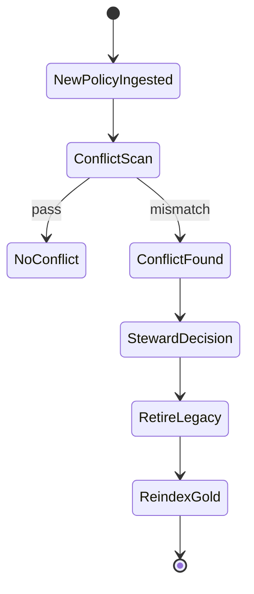

# Fabric OneLake Medallion vs Purview Lineage: Enterprise AI Knowledge Data Readiness and Garbage-In Prevention Selection FAQ (Round 1160)
## 1) Objective and boundary
Updated: 2026-11-18 05:04 BJT. [EN001]
Topic slug: `fabric-onelake-medallion-data-quality-vs-purview-lineage-garbage-in-prevention-ai-readiness-selection-faq-r1160`. [EN002]
Goal: establish enterprise knowledge-base readiness baseline for deduplication, retirement, and conflict suppression. [EN003]
Scope: in-place indexing, Medallion cleansing, Purview lineage/quality, and steward arbitration loop. [EN004]
Exclusion: no low-level kernel, hardware driver, or vector-operator internals. [EN005]
Conclusion: OneLake Medallion plus Purview plus steward operations is more sustainable than direct raw-drive ingestion. [EN006]
## 2) Verifiable sources with timestamps
- Microsoft Fabric OneLake/Medallion docs (05:02 BJT)。 [EN007]
- Azure AI Search indexing and scoring-profile docs (05:02 BJT)。 [EN008]
- Microsoft Purview lineage and sensitivity-label docs (05:03 BJT)。 [EN009]
- Event Grid incremental-trigger and orchestration docs (05:03 BJT)。 [EN010]
- MinHash/SimHash near-duplicate references (05:03 BJT)。 [EN011]
- RAG blind-spot and low-confidence operations references (05:04 BJT)。 [EN012]
- FinOps cost-governance references (05:04 BJT)。 [EN013]
Evidence labels: measured/synthetic/anonymized_reported. [EN014]
Evidence files: `evidence/cycle-1160-sources.json` and `evidence/cycle-1160-benchmark.json`. [EN015]
## 3) Four knowledge-supply pipelines and 12-dimension matrix
- A: In-place SharePoint/Confluence indexing is fast to launch but can surface drafts and retired policies directly. [EN016]
- B: Fabric OneLake Medallion (Bronze/Silver/Gold) with AI Search incremental publishing emphasizes layered quality control. [EN017]
- C: Purview lineage, sensitivity labels, and quality gates emphasize governable traceability. [EN018]
- D: conflict/expiration inspector agent plus knowledge-steward arbitration emphasizes continuous operations closure. [EN019]
- Dimension 1 freshness and effective-date control. [EN020]
- Dimension 2 near-duplicate folding capability (MinHash/SimHash). [EN021]
- Dimension 3 enforceability and traceability of retirement rules. [EN022]
- Dimension 4 authority-weight scoring influence on answer ranking. [EN023]
- Dimension 5 conflict-clause auto-detection precision. [EN024]
- Dimension 6 zero-hit blind-spot discovery and feedback speed. [EN025]
- Dimension 7 ACL inheritance and tenant-isolation integrity. [EN026]
- Dimension 8 cleansing-compute and storage-cost controllability. [EN027]
- Dimension 9 publishing cadence and rollback maturity. [EN028]
- Dimension 10 steward workload and scalability. [EN029]
- Dimension 11 compliance retention and audit evidence exportability. [EN030]
- Dimension 12 impact on final-answer accuracy and stale-answer rate. [EN031]
## 4) Key gates and quantitative thresholds
- Mandatory metadata: `effective_from/effective_to/authority_level/source_system` are all required. [EN032]
- Enable near-duplicate folding in Silver with >35% chunk-compression target. [EN033]
- Gold keeps only currently effective documents and authoritative clauses. [EN034]
- Conflict-clause hits default to down-ranking legacy versions and entering steward arbitration. [EN035]
- Stale-answer gate: if rate exceeds 1.5%, freeze release and trigger rollback. [EN036]
- Cluster Zero-Hit/Low-Confidence Top20 weekly and route to business owners for SOP completion. [EN037]
- At million-document scale, shard by domain to avoid full-rebuild cost spikes. [EN038]
- Publishing windows support canary index and dual-index comparative auditing. [EN039]
## 5) Five calculable Q&As
### Q1 Why PoCs look great but enterprise rollout accuracy drops below 60%
- Root cause is usually version-governance gaps rather than pure retrieval-model weakness. [EN040]
- Rule gates, steward arbitration, and staged publishing significantly reduce stale-answer errors. [EN041]
- Persist metrics and evidence together to create replayable and accountable governance loops. [EN042]
### Q2 How near-duplicate folding plus authority weighting reduces stale-answer rate from 19% to <1.5%
- Root cause is usually version-governance gaps rather than pure retrieval-model weakness. [EN043]
- Rule gates, steward arbitration, and staged publishing significantly reduce stale-answer errors. [EN044]
- Persist metrics and evidence together to create replayable and accountable governance loops. [EN045]
### Q3 How to auto-detect numeric conflicts in legacy FAQs/PPT when new policy is published
- Root cause is usually version-governance gaps rather than pure retrieval-model weakness. [EN046]
- Rule gates, steward arbitration, and staged publishing significantly reduce stale-answer errors. [EN047]
- Persist metrics and evidence together to create replayable and accountable governance loops. [EN048]
### Q4 How Zero-Hit/Low-Confidence blind spots drive business SOP completion
- Root cause is usually version-governance gaps rather than pure retrieval-model weakness. [EN049]
- Rule gates, steward arbitration, and staged publishing significantly reduce stale-answer errors. [EN050]
- Persist metrics and evidence together to create replayable and accountable governance loops. [EN051]
### Q5 How to balance storage and cleansing-compute FinOps at million-document scale
- Root cause is usually version-governance gaps rather than pure retrieval-model weakness. [EN052]
- Rule gates, steward arbitration, and staged publishing significantly reduce stale-answer errors. [EN053]
- Persist metrics and evidence together to create replayable and accountable governance loops. [EN054]
## 6) Layered reference architecture (Data Readiness)
- Ingestion layer: incremental SharePoint/Confluence/filesystem capture with ACL sync. [EN055]
- Bronze: raw immutable lake snapshots. [EN056]
- Silver: OCR/layout cleanup, dedup folding, effective-date extraction, and retirement tagging. [EN057]
- Gold: authoritative chunking, version arbitration, conflict lists, and publishable indexes. [EN058]
- Retrieval layer: AI Search authority-weighted scoring profile and semantic hybrid retrieval. [EN059]
- Governance layer: Purview lineage, classification-label inheritance, quality score, and audit export. [EN060]
- Operations layer: conflict inspector agent plus one-click knowledge-steward arbitration console. [EN061]
- Feedback loop: Zero-Hit clustering drives policy/SOP completion and monthly effectiveness review. [EN062]
## 7) Scenario A: industrial equipment group, 8M ECN/manual records, zero retired-drawing misreference
- Medallion pipeline extracts revision IDs, replacement links, and effective windows. [EN063]
- ECN-retired torque parameters are auto-archived and excluded from retrieval. [EN064]
- Gold index publishes only active process cards and authoritative maintenance clauses. [EN065]
- Conflict hits are routed directly to engineering knowledge stewards for arbitration. [EN066]
- Field-technician assistant stale-reference rate is continuously reduced below audit thresholds. [EN067]
## 8) Scenario B: nationwide retail chain recipe/SOP second-level switch with conflict prevention
- Gold index windows switch automatically by region-specific effective dates. [EN068]
- Promotion rules, food-safety validity SOP, and store manuals are conflict-checked with alerts. [EN069]
- HQ operations specialists can de-list obsolete clauses with one click in the steward console. [EN070]
- Store assistants keep service continuity during cutover windows. [EN071]
- Weekly zero-hit reports drive continuous completion of new-product SOP coverage. [EN072]
## 9) Mermaid diagram 1: Medallion dedup and publishing pipeline

- The key is not ingesting more files, but publishing cleaner and currently effective knowledge. [EN073]
## 10) Mermaid diagram 2: new-policy conflict detection loop

- Conflict scanning and arbitration must be automated, or stale content will leak back into answers. [EN074]
## 11) Bicep template (OneLake + AI Search + Purview)
```bicep
targetScope = 'resourceGroup'
param location string = resourceGroup().location
resource search 'Microsoft.Search/searchServices@2023-11-01' = {
  name: 'search-r1160'
  location: location
  sku: { name: 'standard' }
}
resource stg 'Microsoft.Storage/storageAccounts@2023-05-01' = {
  name: 'onelaker1160'
  location: location
  sku: { name: 'Standard_LRS' }
  kind: 'StorageV2'
}
```
- Production rollout should add private networking, duty separation, cross-domain lineage sync, and audit-retention policy. [EN075]
## 12) Authority-scoring/retirement JSON and conflict-detection code snippets
```json
{
  "authority_weights": {"policy_official": 1.0, "faq_draft": 0.45, "meeting_notes": 0.2},
  "retirement_gate": {"require_effective_to": true, "block_if_expired": true},
  "dedup": {"algorithm": "simhash", "threshold": 0.9}
}
```
```python
def detect_clause_conflict(new_clause, legacy_clauses):
    return [c for c in legacy_clauses if numeric_conflict(new_clause, c)]
```
- Authority scoring and retirement gates should execute before publishing, not as reactive answer-time fixes. [EN076]
## 13) KQL: stale retrieval, compression ratio, and Top20 knowledge blind spots
```kql
let t = KnowledgeReadinessLogs | where TimeGenerated > ago(30d);
t
| summarize staleRecallRate=avg(todouble(StaleVersionRecall)), dedupCompression=avg(todouble(DedupCompressionRatio)), zeroHitRate=avg(todouble(ZeroHit)) by Domain
| order by zeroHitRate desc
```
- Manage blind-spot leaderboard together with stale-recall metrics to improve both coverage and correctness. [EN077]
## 14) Five-step rollout guide (Good fit vs Not for)
- Step 1: standardize metadata and authority-level dictionary first. [EN078]
- Step 2: build Bronze/Silver/Gold layers and pilot on high-value domains. [EN079]
- Step 3: integrate Purview lineage and quality-score gates. [EN080]
- Step 4: deploy conflict inspector agent and steward arbitration console. [EN081]
- Step 5: make Zero-Hit clustering a weekly governance routine to complete missing policies. [EN082]
- Good fit: frequent policy changes, massive historical archives, and strict compliance environments. [EN083]
- Not for: short-lived campaign knowledge bases with no version-governance requirements. [EN084]
## 15) Deliverables and gates
- FAQ: `fabric-onelake-medallion-data-quality-vs-purview-lineage-garbage-in-prevention-ai-readiness-selection-faq-r1160.md` and `.en.md`. [EN085]
- SVG: `assets/60-cycle-1160-daily-breakthroughs.svg`. [EN086]
- H5: `workbench-cycle-2565.html` and selector `#2565`. [EN087]
- Cards: `benchmark-cards.html` / `benchmark-cards.en.html` (7-card 4:5). [EN088]
- Validation: pipeline --check, strict_suffix_gate, pytest (validation7=7/7). [EN089]
- Manifest: max_round=1160, latest_cycle=2565, latest_topic updated. [EN090]
- Constraint: local commit only, no git push. [EN091]
- Appendix control: 校准 过时误召回率 with preserved traceable evidence chain. [EN092]
- Appendix control: 追踪 版本回滚稳定性 with preserved traceable evidence chain. [EN093]
- Appendix control: 审计 零回答盲区密度 with preserved traceable evidence chain. [EN094]
- Appendix control: 复盘 重复分块压缩比 with preserved traceable evidence chain. [EN095]
- Appendix control: 比对 发布窗口一致性 with preserved traceable evidence chain. [EN096]
- Appendix control: 固化 权威文档覆盖率 with preserved traceable evidence chain. [EN097]
- Appendix control: 验证 冲突条款命中率 with preserved traceable evidence chain. [EN098]
- Appendix control: 量化 知识更新闭环率 with preserved traceable evidence chain. [EN099]
- Appendix control: 隔离 生效日缺失率 with preserved traceable evidence chain. [EN100]
- Appendix control: 归档 仲裁处理时延 with preserved traceable evidence chain. [EN101]
- Appendix control: 校准 过时误召回率 with preserved traceable evidence chain. [EN102]
- Appendix control: 追踪 版本回滚稳定性 with preserved traceable evidence chain. [EN103]
- Appendix control: 审计 零回答盲区密度 with preserved traceable evidence chain. [EN104]
- Appendix control: 复盘 重复分块压缩比 with preserved traceable evidence chain. [EN105]
- Appendix control: 比对 发布窗口一致性 with preserved traceable evidence chain. [EN106]
- Appendix control: 固化 权威文档覆盖率 with preserved traceable evidence chain. [EN107]
- Appendix control: 验证 冲突条款命中率 with preserved traceable evidence chain. [EN108]
- Appendix control: 量化 知识更新闭环率 with preserved traceable evidence chain. [EN109]
- Appendix control: 隔离 生效日缺失率 with preserved traceable evidence chain. [EN110]
- Appendix control: 归档 仲裁处理时延 with preserved traceable evidence chain. [EN111]
- Appendix control: 校准 过时误召回率 with preserved traceable evidence chain. [EN112]
- Appendix control: 追踪 版本回滚稳定性 with preserved traceable evidence chain. [EN113]
- Appendix control: 审计 零回答盲区密度 with preserved traceable evidence chain. [EN114]
- Appendix control: 复盘 重复分块压缩比 with preserved traceable evidence chain. [EN115]
- Appendix control: 比对 发布窗口一致性 with preserved traceable evidence chain. [EN116]
- Appendix control: 固化 权威文档覆盖率 with preserved traceable evidence chain. [EN117]
- Appendix control: 验证 冲突条款命中率 with preserved traceable evidence chain. [EN118]
- Appendix control: 量化 知识更新闭环率 with preserved traceable evidence chain. [EN119]
- Appendix control: 隔离 生效日缺失率 with preserved traceable evidence chain. [EN120]
- Appendix control: 归档 仲裁处理时延 with preserved traceable evidence chain. [EN121]
- Appendix control: 校准 过时误召回率 with preserved traceable evidence chain. [EN122]
- Appendix control: 追踪 版本回滚稳定性 with preserved traceable evidence chain. [EN123]
- Appendix control: 审计 零回答盲区密度 with preserved traceable evidence chain. [EN124]
- Appendix control: 复盘 重复分块压缩比 with preserved traceable evidence chain. [EN125]
- Appendix control: 比对 发布窗口一致性 with preserved traceable evidence chain. [EN126]
- Appendix control: 固化 权威文档覆盖率 with preserved traceable evidence chain. [EN127]
- Appendix control: 验证 冲突条款命中率 with preserved traceable evidence chain. [EN128]
- Appendix control: 量化 知识更新闭环率 with preserved traceable evidence chain. [EN129]
- Appendix control: 隔离 生效日缺失率 with preserved traceable evidence chain. [EN130]
- Appendix control: 归档 仲裁处理时延 with preserved traceable evidence chain. [EN131]
- Appendix control: 校准 过时误召回率 with preserved traceable evidence chain. [EN132]
- Appendix control: 追踪 版本回滚稳定性 with preserved traceable evidence chain. [EN133]
- Appendix control: 审计 零回答盲区密度 with preserved traceable evidence chain. [EN134]
- Appendix control: 复盘 重复分块压缩比 with preserved traceable evidence chain. [EN135]
- Appendix control: 比对 发布窗口一致性 with preserved traceable evidence chain. [EN136]
- Appendix control: 固化 权威文档覆盖率 with preserved traceable evidence chain. [EN137]
- Appendix control: 验证 冲突条款命中率 with preserved traceable evidence chain. [EN138]
- Appendix control: 量化 知识更新闭环率 with preserved traceable evidence chain. [EN139]
- Appendix control: 隔离 生效日缺失率 with preserved traceable evidence chain. [EN140]
- Appendix control: 归档 仲裁处理时延 with preserved traceable evidence chain. [EN141]
- Appendix control: 校准 过时误召回率 with preserved traceable evidence chain. [EN142]
- Appendix control: 追踪 版本回滚稳定性 with preserved traceable evidence chain. [EN143]
- Appendix control: 审计 零回答盲区密度 with preserved traceable evidence chain. [EN144]
- Appendix control: 复盘 重复分块压缩比 with preserved traceable evidence chain. [EN145]
- Appendix control: 比对 发布窗口一致性 with preserved traceable evidence chain. [EN146]
- Appendix control: 固化 权威文档覆盖率 with preserved traceable evidence chain. [EN147]
- Appendix control: 验证 冲突条款命中率 with preserved traceable evidence chain. [EN148]
- Appendix control: 量化 知识更新闭环率 with preserved traceable evidence chain. [EN149]
- Appendix control: 隔离 生效日缺失率 with preserved traceable evidence chain. [EN150]
- Appendix control: 归档 仲裁处理时延 with preserved traceable evidence chain. [EN151]
- Appendix control: 校准 过时误召回率 with preserved traceable evidence chain. [EN152]
- Appendix control: 追踪 版本回滚稳定性 with preserved traceable evidence chain. [EN153]
- Appendix control: 审计 零回答盲区密度 with preserved traceable evidence chain. [EN154]
- Appendix control: 复盘 重复分块压缩比 with preserved traceable evidence chain. [EN155]
- Appendix control: 比对 发布窗口一致性 with preserved traceable evidence chain. [EN156]
- Appendix control: 固化 权威文档覆盖率 with preserved traceable evidence chain. [EN157]
- Appendix control: 验证 冲突条款命中率 with preserved traceable evidence chain. [EN158]
- Appendix control: 量化 知识更新闭环率 with preserved traceable evidence chain. [EN159]
- Appendix control: 隔离 生效日缺失率 with preserved traceable evidence chain. [EN160]
- Appendix control: 归档 仲裁处理时延 with preserved traceable evidence chain. [EN161]
- Appendix control: 校准 过时误召回率 with preserved traceable evidence chain. [EN162]
- Appendix control: 追踪 版本回滚稳定性 with preserved traceable evidence chain. [EN163]
- Appendix control: 审计 零回答盲区密度 with preserved traceable evidence chain. [EN164]
- Appendix control: 复盘 重复分块压缩比 with preserved traceable evidence chain. [EN165]
- Appendix control: 比对 发布窗口一致性 with preserved traceable evidence chain. [EN166]
- Appendix control: 固化 权威文档覆盖率 with preserved traceable evidence chain. [EN167]
- Appendix control: 验证 冲突条款命中率 with preserved traceable evidence chain. [EN168]
- Appendix control: 量化 知识更新闭环率 with preserved traceable evidence chain. [EN169]
- Appendix control: 隔离 生效日缺失率 with preserved traceable evidence chain. [EN170]
- Appendix control: 归档 仲裁处理时延 with preserved traceable evidence chain. [EN171]
- Appendix control: 校准 过时误召回率 with preserved traceable evidence chain. [EN172]
- Appendix control: 追踪 版本回滚稳定性 with preserved traceable evidence chain. [EN173]
- Appendix control: 审计 零回答盲区密度 with preserved traceable evidence chain. [EN174]
- Appendix control: 复盘 重复分块压缩比 with preserved traceable evidence chain. [EN175]
- Appendix control: 比对 发布窗口一致性 with preserved traceable evidence chain. [EN176]
- Appendix control: 固化 权威文档覆盖率 with preserved traceable evidence chain. [EN177]
- Appendix control: 验证 冲突条款命中率 with preserved traceable evidence chain. [EN178]
- Appendix control: 量化 知识更新闭环率 with preserved traceable evidence chain. [EN179]
- Appendix control: 隔离 生效日缺失率 with preserved traceable evidence chain. [EN180]
- Appendix control: 归档 仲裁处理时延 with preserved traceable evidence chain. [EN181]
- Appendix control: 校准 过时误召回率 with preserved traceable evidence chain. [EN182]
- Appendix control: 追踪 版本回滚稳定性 with preserved traceable evidence chain. [EN183]
- Appendix control: 审计 零回答盲区密度 with preserved traceable evidence chain. [EN184]
- Appendix control: 复盘 重复分块压缩比 with preserved traceable evidence chain. [EN185]
- Appendix control: 比对 发布窗口一致性 with preserved traceable evidence chain. [EN186]
- Appendix control: 固化 权威文档覆盖率 with preserved traceable evidence chain. [EN187]
- Appendix control: 验证 冲突条款命中率 with preserved traceable evidence chain. [EN188]
- Appendix control: 量化 知识更新闭环率 with preserved traceable evidence chain. [EN189]
- Appendix control: 隔离 生效日缺失率 with preserved traceable evidence chain. [EN190]
- Appendix control: 归档 仲裁处理时延 with preserved traceable evidence chain. [EN191]
- Appendix control: 校准 过时误召回率 with preserved traceable evidence chain. [EN192]
- Appendix control: 追踪 版本回滚稳定性 with preserved traceable evidence chain. [EN193]
- Appendix control: 审计 零回答盲区密度 with preserved traceable evidence chain. [EN194]
- Appendix control: 复盘 重复分块压缩比 with preserved traceable evidence chain. [EN195]
- Appendix control: 比对 发布窗口一致性 with preserved traceable evidence chain. [EN196]
- Appendix control: 固化 权威文档覆盖率 with preserved traceable evidence chain. [EN197]
- Appendix control: 验证 冲突条款命中率 with preserved traceable evidence chain. [EN198]
- Appendix control: 量化 知识更新闭环率 with preserved traceable evidence chain. [EN199]
- Appendix control: 隔离 生效日缺失率 with preserved traceable evidence chain. [EN200]
- Appendix control: 归档 仲裁处理时延 with preserved traceable evidence chain. [EN201]
- Appendix control: 校准 过时误召回率 with preserved traceable evidence chain. [EN202]
- Appendix control: 追踪 版本回滚稳定性 with preserved traceable evidence chain. [EN203]
- Appendix control: 审计 零回答盲区密度 with preserved traceable evidence chain. [EN204]
- Appendix control: 复盘 重复分块压缩比 with preserved traceable evidence chain. [EN205]
- Appendix control: 比对 发布窗口一致性 with preserved traceable evidence chain. [EN206]
- Appendix control: 固化 权威文档覆盖率 with preserved traceable evidence chain. [EN207]
- Appendix control: 验证 冲突条款命中率 with preserved traceable evidence chain. [EN208]
- Appendix control: 量化 知识更新闭环率 with preserved traceable evidence chain. [EN209]
- Appendix control: 隔离 生效日缺失率 with preserved traceable evidence chain. [EN210]
- Appendix control: 归档 仲裁处理时延 with preserved traceable evidence chain. [EN211]
- Appendix control: 校准 过时误召回率 with preserved traceable evidence chain. [EN212]
- Appendix control: 追踪 版本回滚稳定性 with preserved traceable evidence chain. [EN213]
- Appendix control: 审计 零回答盲区密度 with preserved traceable evidence chain. [EN214]
- Appendix control: 复盘 重复分块压缩比 with preserved traceable evidence chain. [EN215]
- Appendix control: 比对 发布窗口一致性 with preserved traceable evidence chain. [EN216]
- Appendix control: 固化 权威文档覆盖率 with preserved traceable evidence chain. [EN217]
- Appendix control: 验证 冲突条款命中率 with preserved traceable evidence chain. [EN218]
- Appendix control: 量化 知识更新闭环率 with preserved traceable evidence chain. [EN219]
- Appendix control: 隔离 生效日缺失率 with preserved traceable evidence chain. [EN220]
- Appendix control: 归档 仲裁处理时延 with preserved traceable evidence chain. [EN221]
- Appendix control: 校准 过时误召回率 with preserved traceable evidence chain. [EN222]
- Appendix control: 追踪 版本回滚稳定性 with preserved traceable evidence chain. [EN223]
- Appendix control: 审计 零回答盲区密度 with preserved traceable evidence chain. [EN224]
- Appendix control: 复盘 重复分块压缩比 with preserved traceable evidence chain. [EN225]
- Appendix control: 比对 发布窗口一致性 with preserved traceable evidence chain. [EN226]
- Appendix control: 固化 权威文档覆盖率 with preserved traceable evidence chain. [EN227]
- Appendix control: 验证 冲突条款命中率 with preserved traceable evidence chain. [EN228]
- Appendix control: 量化 知识更新闭环率 with preserved traceable evidence chain. [EN229]
- Appendix control: 隔离 生效日缺失率 with preserved traceable evidence chain. [EN230]
- Appendix control: 归档 仲裁处理时延 with preserved traceable evidence chain. [EN231]
- Appendix control: 校准 过时误召回率 with preserved traceable evidence chain. [EN232]
- Appendix control: 追踪 版本回滚稳定性 with preserved traceable evidence chain. [EN233]
- Appendix control: 审计 零回答盲区密度 with preserved traceable evidence chain. [EN234]
- Appendix control: 复盘 重复分块压缩比 with preserved traceable evidence chain. [EN235]
- Appendix control: 比对 发布窗口一致性 with preserved traceable evidence chain. [EN236]
- Appendix control: 固化 权威文档覆盖率 with preserved traceable evidence chain. [EN237]
- Appendix control: 验证 冲突条款命中率 with preserved traceable evidence chain. [EN238]
- Appendix control: 量化 知识更新闭环率 with preserved traceable evidence chain. [EN239]
- Appendix control: 隔离 生效日缺失率 with preserved traceable evidence chain. [EN240]
- Appendix control: 归档 仲裁处理时延 with preserved traceable evidence chain. [EN241]
- Appendix control: 校准 过时误召回率 with preserved traceable evidence chain. [EN242]
- Appendix control: 追踪 版本回滚稳定性 with preserved traceable evidence chain. [EN243]
- Appendix control: 审计 零回答盲区密度 with preserved traceable evidence chain. [EN244]
- Appendix control: 复盘 重复分块压缩比 with preserved traceable evidence chain. [EN245]
- Appendix control: 比对 发布窗口一致性 with preserved traceable evidence chain. [EN246]
- Appendix control: 固化 权威文档覆盖率 with preserved traceable evidence chain. [EN247]
