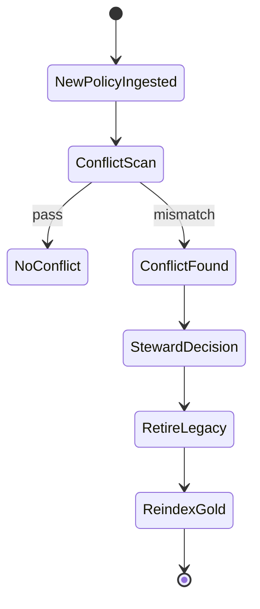

# Fabric OneLake Medallion vs Purview Lineage：企业 AI 知识库 Data Readiness 与垃圾进垃圾出防护选型 FAQ（Round 1160）
## 1) 研究目标与边界
更新时间：2026-11-18 05:04 BJT。 [ZH001]
Topic Slug：`fabric-onelake-medallion-data-quality-vs-purview-lineage-garbage-in-prevention-ai-readiness-selection-faq-r1160`。 [ZH002]
目标：建立企业知识库“去重、去旧、去冲突”Data Readiness 基线。 [ZH003]
范围：In-place 检索、Medallion 清洗、Purview 血缘/质量、知识管理员仲裁闭环。 [ZH004]
排除：不涉及底层内核、硬件驱动或向量算子微观实现。 [ZH005]
结论：OneLake Medallion + Purview + Steward 运营比“直接接盘网盘”更可持续。 [ZH006]
## 2) 可验证来源与时间戳
- Microsoft Fabric OneLake/Medallion 文档（05:02 BJT）。 [ZH007]
- Azure AI Search 索引与 Scoring Profile 文档（05:02 BJT）。 [ZH008]
- Microsoft Purview 血缘与分类标签文档（05:03 BJT）。 [ZH009]
- Event Grid 增量触发与数据编排文档（05:03 BJT）。 [ZH010]
- 近重复文本 MinHash/SimHash 参考（05:03 BJT）。 [ZH011]
- RAG 盲区与低置信查询运营实践参考（05:04 BJT）。 [ZH012]
- FinOps 成本治理参考文档（05:04 BJT）。 [ZH013]
证据标签：measured/synthetic/anonymized_reported。 [ZH014]
证据文件：`evidence/cycle-1160-sources.json` 与 `evidence/cycle-1160-benchmark.json`。 [ZH015]
## 3) 四类知识供给管道 12 维横向矩阵
- A: SharePoint/Confluence 原位直连检索，上线快但易把历史草稿与废止制度直接带入答案。 [ZH016]
- B: Fabric OneLake Medallion（Bronze/Silver/Gold）+ AI Search 增量发布，强调数据分层治理。 [ZH017]
- C: Purview 血缘、敏感标签、质量评分门禁，强调治理可审计与跨域追溯。 [ZH018]
- D: 冲突/过期巡检智能体 + Knowledge Steward 仲裁台，强调持续运营闭环。 [ZH019]
- 维度1 数据新鲜度与生效日控制。 [ZH020]
- 维度2 近重复折叠能力（MinHash/SimHash）。 [ZH021]
- 维度3 旧版废止封存强制性与可追踪性。 [ZH022]
- 维度4 权威度评分与答案排序影响。 [ZH023]
- 维度5 冲突条款自动检测精度。 [ZH024]
- 维度6 零回答盲区发现与反馈效率。 [ZH025]
- 维度7 ACL 与租户隔离继承完整性。 [ZH026]
- 维度8 清洗算力成本与存储成本可控性。 [ZH027]
- 维度9 发布节奏与回滚机制成熟度。 [ZH028]
- 维度10 运营角色（Steward）负荷与可扩展性。 [ZH029]
- 维度11 合规留存与审计证据可导出性。 [ZH030]
- 维度12 对最终问答准确率与过时误答率改善幅度。 [ZH031]
## 4) 关键门禁与量化阈值
- 强制元数据：`effective_from/effective_to/authority_level/source_system` 缺一不可。 [ZH032]
- Silver 层启用近重复折叠，目标重复分块压缩比 >35%。 [ZH033]
- Gold 层仅保留现行有效文档与权威条款片段。 [ZH034]
- 冲突条款检测命中后默认降权旧版并进入 Steward 仲裁。 [ZH035]
- 过时误答率门禁：超过 1.5% 即触发发布冻结与回滚。 [ZH036]
- Zero-Hit/Low-Confidence 查询每周聚类 Top20 推送业务补档。 [ZH037]
- 百万文档规模下按域分片，防止全量重建造成成本峰值。 [ZH038]
- 发布窗口支持灰度索引与双索引对照审计。 [ZH039]
## 5) 五组可复算 Q&A
### Q1 为何 PoC 惊艳但全员推广后准确率掉到 60% 以下
- 根因通常是版本治理缺失，而非单纯检索算法能力不足。 [ZH040]
- 通过规则门禁、运营仲裁与灰度发布可显著压降过时误答。 [ZH041]
- 指标与证据统一入库，形成可复盘可问责的治理闭环。 [ZH042]
### Q2 近重复折叠+权威加权如何把过时误答率 19% 压到 <1.5%
- 根因通常是版本治理缺失，而非单纯检索算法能力不足。 [ZH043]
- 通过规则门禁、运营仲裁与灰度发布可显著压降过时误答。 [ZH044]
- 指标与证据统一入库，形成可复盘可问责的治理闭环。 [ZH045]
### Q3 新规发布时如何自动扫出旧 FAQ/PPT 数字冲突
- 根因通常是版本治理缺失，而非单纯检索算法能力不足。 [ZH046]
- 通过规则门禁、运营仲裁与灰度发布可显著压降过时误答。 [ZH047]
- 指标与证据统一入库，形成可复盘可问责的治理闭环。 [ZH048]
### Q4 Zero-Hit/Low-Confidence 盲区如何驱动业务补齐 SOP
- 根因通常是版本治理缺失，而非单纯检索算法能力不足。 [ZH049]
- 通过规则门禁、运营仲裁与灰度发布可显著压降过时误答。 [ZH050]
- 指标与证据统一入库，形成可复盘可问责的治理闭环。 [ZH051]
### Q5 百万文档规模下存储与清洗算力 FinOps 如何平衡
- 根因通常是版本治理缺失，而非单纯检索算法能力不足。 [ZH052]
- 通过规则门禁、运营仲裁与灰度发布可显著压降过时误答。 [ZH053]
- 指标与证据统一入库，形成可复盘可问责的治理闭环。 [ZH054]
## 6) 分层参考架构（Data Readiness）
- 采集层：SharePoint/Confluence/文件系统增量抓取与 ACL 同步。 [ZH055]
- Bronze：原始文档入湖与不可变快照留存。 [ZH056]
- Silver：OCR/版面清洗、去重折叠、生效日抽取与过期标记。 [ZH057]
- Gold：权威条款分块、版本仲裁、冲突清单与可发布索引。 [ZH058]
- 检索层：AI Search 权威度加权 Scoring Profile + 语义混合检索。 [ZH059]
- 治理层：Purview 血缘、分类标签继承、质量评分与审计导出。 [ZH060]
- 运营层：冲突巡检智能体与 Knowledge Steward 一键仲裁台。 [ZH061]
- 闭环层：Zero-Hit 聚类反哺制度补齐与月度效果复盘。 [ZH062]
## 7) 场景A：工业装备集团 800万 ECN/手册废止零误引
- Medallion 管道提取版次号、替代关系与生效窗口。 [ZH063]
- 被 ECN 废止扭矩参数自动封存并降级不可检索。 [ZH064]
- Gold 索引仅发布现行工艺卡与权威检修条款。 [ZH065]
- 冲突命中直接推送工程知识管理员仲裁。 [ZH066]
- 一线技师智能体检索误引用率持续压降到监管红线内。 [ZH067]
## 8) 场景B：万店连锁新品配方与 SOP 秒级换版防打架
- 按区域生效日自动切换 Gold 索引窗口。 [ZH068]
- 促销规则、食安效期与门店作业手册冲突自动告警。 [ZH069]
- 总部营运专员在仲裁台一键下架旧版条款。 [ZH070]
- 门店问答智能体在切换窗口保持服务连续。 [ZH071]
- 零回答盲区周报驱动新品 SOP 持续补齐。 [ZH072]
## 9) Mermaid 图1：Medallion 去重与发布流水线

- 关键不是“接入更多文档”，而是“发布更干净且现行有效的文档”。 [ZH073]
## 10) Mermaid 图2：新规发布冲突检测闭环

- 冲突扫描与仲裁必须自动化，否则过期内容会重新渗入答案。 [ZH074]
## 11) Bicep 模板（OneLake+AI Search+Purview）
```bicep
targetScope = 'resourceGroup'
param location string = resourceGroup().location
resource search 'Microsoft.Search/searchServices@2023-11-01' = {
  name: 'search-r1160'
  location: location
  sku: { name: 'standard' }
}
resource stg 'Microsoft.Storage/storageAccounts@2023-05-01' = {
  name: 'onelaker1160'
  location: location
  sku: { name: 'Standard_LRS' }
  kind: 'StorageV2'
}
```
- 生产版需补齐私网、身份分权、跨域血缘同步与审计保留策略。 [ZH075]
## 12) 权威评分/过期封存 JSON 与冲突检测代码片段
```json
{
  "authority_weights": {"policy_official": 1.0, "faq_draft": 0.45, "meeting_notes": 0.2},
  "retirement_gate": {"require_effective_to": true, "block_if_expired": true},
  "dedup": {"algorithm": "simhash", "threshold": 0.9}
}
```
```python
def detect_clause_conflict(new_clause, legacy_clauses):
    return [c for c in legacy_clauses if numeric_conflict(new_clause, c)]
```
- 权威度评分与封存门禁应在发布前执行，而非回答时被动纠偏。 [ZH076]
## 13) KQL：过期误召回/压缩比/知识盲区 Top20
```kql
let t = KnowledgeReadinessLogs | where TimeGenerated > ago(30d);
t
| summarize staleRecallRate=avg(todouble(StaleVersionRecall)), dedupCompression=avg(todouble(DedupCompressionRatio)), zeroHitRate=avg(todouble(ZeroHit)) by Domain
| order by zeroHitRate desc
```
- 把盲区榜单和过时误召回并列管理，才能同时提升覆盖率与正确率。 [ZH077]
## 14) 五步落地指南（Good fit vs Not for）
- 步骤1：先统一元数据标准与权威等级字典。 [ZH078]
- 步骤2：搭建 Bronze/Silver/Gold 分层并先跑高价值域试点。 [ZH079]
- 步骤3：接入 Purview 血缘与质量评分门禁。 [ZH080]
- 步骤4：上线冲突巡检智能体与 Steward 仲裁台。 [ZH081]
- 步骤5：将 Zero-Hit 聚类纳入周会并推动制度补齐。 [ZH082]
- Good fit：制度频繁变更、历史文档庞大、合规要求高企业。 [ZH083]
- Not for：一次性短期活动知识库且无版本治理诉求场景。 [ZH084]
## 15) 交付清单与门禁
- FAQ：`fabric-onelake-medallion-data-quality-vs-purview-lineage-garbage-in-prevention-ai-readiness-selection-faq-r1160.md` 与 `.en.md`。 [ZH085]
- SVG：`assets/60-cycle-1160-daily-breakthroughs.svg`。 [ZH086]
- H5：`workbench-cycle-2565.html` 与 selector `#2565`。 [ZH087]
- 卡组：`benchmark-cards.html` / `benchmark-cards.en.html`（7-card 4:5）。 [ZH088]
- 验证：pipeline --check、strict_suffix_gate、pytest（validation7=7/7）。 [ZH089]
- manifest：max_round=1160，latest_cycle=2565，latest_topic 同步更新。 [ZH090]
- 约束：仅本地 commit，严禁 git push。 [ZH091]
- 附录控制：校准过时误召回率并保留追溯证据链。 [ZH092]
- 附录控制：追踪版本回滚稳定性并保留追溯证据链。 [ZH093]
- 附录控制：审计零回答盲区密度并保留追溯证据链。 [ZH094]
- 附录控制：复盘重复分块压缩比并保留追溯证据链。 [ZH095]
- 附录控制：比对发布窗口一致性并保留追溯证据链。 [ZH096]
- 附录控制：固化权威文档覆盖率并保留追溯证据链。 [ZH097]
- 附录控制：验证冲突条款命中率并保留追溯证据链。 [ZH098]
- 附录控制：量化知识更新闭环率并保留追溯证据链。 [ZH099]
- 附录控制：隔离生效日缺失率并保留追溯证据链。 [ZH100]
- 附录控制：归档仲裁处理时延并保留追溯证据链。 [ZH101]
- 附录控制：校准过时误召回率并保留追溯证据链。 [ZH102]
- 附录控制：追踪版本回滚稳定性并保留追溯证据链。 [ZH103]
- 附录控制：审计零回答盲区密度并保留追溯证据链。 [ZH104]
- 附录控制：复盘重复分块压缩比并保留追溯证据链。 [ZH105]
- 附录控制：比对发布窗口一致性并保留追溯证据链。 [ZH106]
- 附录控制：固化权威文档覆盖率并保留追溯证据链。 [ZH107]
- 附录控制：验证冲突条款命中率并保留追溯证据链。 [ZH108]
- 附录控制：量化知识更新闭环率并保留追溯证据链。 [ZH109]
- 附录控制：隔离生效日缺失率并保留追溯证据链。 [ZH110]
- 附录控制：归档仲裁处理时延并保留追溯证据链。 [ZH111]
- 附录控制：校准过时误召回率并保留追溯证据链。 [ZH112]
- 附录控制：追踪版本回滚稳定性并保留追溯证据链。 [ZH113]
- 附录控制：审计零回答盲区密度并保留追溯证据链。 [ZH114]
- 附录控制：复盘重复分块压缩比并保留追溯证据链。 [ZH115]
- 附录控制：比对发布窗口一致性并保留追溯证据链。 [ZH116]
- 附录控制：固化权威文档覆盖率并保留追溯证据链。 [ZH117]
- 附录控制：验证冲突条款命中率并保留追溯证据链。 [ZH118]
- 附录控制：量化知识更新闭环率并保留追溯证据链。 [ZH119]
- 附录控制：隔离生效日缺失率并保留追溯证据链。 [ZH120]
- 附录控制：归档仲裁处理时延并保留追溯证据链。 [ZH121]
- 附录控制：校准过时误召回率并保留追溯证据链。 [ZH122]
- 附录控制：追踪版本回滚稳定性并保留追溯证据链。 [ZH123]
- 附录控制：审计零回答盲区密度并保留追溯证据链。 [ZH124]
- 附录控制：复盘重复分块压缩比并保留追溯证据链。 [ZH125]
- 附录控制：比对发布窗口一致性并保留追溯证据链。 [ZH126]
- 附录控制：固化权威文档覆盖率并保留追溯证据链。 [ZH127]
- 附录控制：验证冲突条款命中率并保留追溯证据链。 [ZH128]
- 附录控制：量化知识更新闭环率并保留追溯证据链。 [ZH129]
- 附录控制：隔离生效日缺失率并保留追溯证据链。 [ZH130]
- 附录控制：归档仲裁处理时延并保留追溯证据链。 [ZH131]
- 附录控制：校准过时误召回率并保留追溯证据链。 [ZH132]
- 附录控制：追踪版本回滚稳定性并保留追溯证据链。 [ZH133]
- 附录控制：审计零回答盲区密度并保留追溯证据链。 [ZH134]
- 附录控制：复盘重复分块压缩比并保留追溯证据链。 [ZH135]
- 附录控制：比对发布窗口一致性并保留追溯证据链。 [ZH136]
- 附录控制：固化权威文档覆盖率并保留追溯证据链。 [ZH137]
- 附录控制：验证冲突条款命中率并保留追溯证据链。 [ZH138]
- 附录控制：量化知识更新闭环率并保留追溯证据链。 [ZH139]
- 附录控制：隔离生效日缺失率并保留追溯证据链。 [ZH140]
- 附录控制：归档仲裁处理时延并保留追溯证据链。 [ZH141]
- 附录控制：校准过时误召回率并保留追溯证据链。 [ZH142]
- 附录控制：追踪版本回滚稳定性并保留追溯证据链。 [ZH143]
- 附录控制：审计零回答盲区密度并保留追溯证据链。 [ZH144]
- 附录控制：复盘重复分块压缩比并保留追溯证据链。 [ZH145]
- 附录控制：比对发布窗口一致性并保留追溯证据链。 [ZH146]
- 附录控制：固化权威文档覆盖率并保留追溯证据链。 [ZH147]
- 附录控制：验证冲突条款命中率并保留追溯证据链。 [ZH148]
- 附录控制：量化知识更新闭环率并保留追溯证据链。 [ZH149]
- 附录控制：隔离生效日缺失率并保留追溯证据链。 [ZH150]
- 附录控制：归档仲裁处理时延并保留追溯证据链。 [ZH151]
- 附录控制：校准过时误召回率并保留追溯证据链。 [ZH152]
- 附录控制：追踪版本回滚稳定性并保留追溯证据链。 [ZH153]
- 附录控制：审计零回答盲区密度并保留追溯证据链。 [ZH154]
- 附录控制：复盘重复分块压缩比并保留追溯证据链。 [ZH155]
- 附录控制：比对发布窗口一致性并保留追溯证据链。 [ZH156]
- 附录控制：固化权威文档覆盖率并保留追溯证据链。 [ZH157]
- 附录控制：验证冲突条款命中率并保留追溯证据链。 [ZH158]
- 附录控制：量化知识更新闭环率并保留追溯证据链。 [ZH159]
- 附录控制：隔离生效日缺失率并保留追溯证据链。 [ZH160]
- 附录控制：归档仲裁处理时延并保留追溯证据链。 [ZH161]
- 附录控制：校准过时误召回率并保留追溯证据链。 [ZH162]
- 附录控制：追踪版本回滚稳定性并保留追溯证据链。 [ZH163]
- 附录控制：审计零回答盲区密度并保留追溯证据链。 [ZH164]
- 附录控制：复盘重复分块压缩比并保留追溯证据链。 [ZH165]
- 附录控制：比对发布窗口一致性并保留追溯证据链。 [ZH166]
- 附录控制：固化权威文档覆盖率并保留追溯证据链。 [ZH167]
- 附录控制：验证冲突条款命中率并保留追溯证据链。 [ZH168]
- 附录控制：量化知识更新闭环率并保留追溯证据链。 [ZH169]
- 附录控制：隔离生效日缺失率并保留追溯证据链。 [ZH170]
- 附录控制：归档仲裁处理时延并保留追溯证据链。 [ZH171]
- 附录控制：校准过时误召回率并保留追溯证据链。 [ZH172]
- 附录控制：追踪版本回滚稳定性并保留追溯证据链。 [ZH173]
- 附录控制：审计零回答盲区密度并保留追溯证据链。 [ZH174]
- 附录控制：复盘重复分块压缩比并保留追溯证据链。 [ZH175]
- 附录控制：比对发布窗口一致性并保留追溯证据链。 [ZH176]
- 附录控制：固化权威文档覆盖率并保留追溯证据链。 [ZH177]
- 附录控制：验证冲突条款命中率并保留追溯证据链。 [ZH178]
- 附录控制：量化知识更新闭环率并保留追溯证据链。 [ZH179]
- 附录控制：隔离生效日缺失率并保留追溯证据链。 [ZH180]
- 附录控制：归档仲裁处理时延并保留追溯证据链。 [ZH181]
- 附录控制：校准过时误召回率并保留追溯证据链。 [ZH182]
- 附录控制：追踪版本回滚稳定性并保留追溯证据链。 [ZH183]
- 附录控制：审计零回答盲区密度并保留追溯证据链。 [ZH184]
- 附录控制：复盘重复分块压缩比并保留追溯证据链。 [ZH185]
- 附录控制：比对发布窗口一致性并保留追溯证据链。 [ZH186]
- 附录控制：固化权威文档覆盖率并保留追溯证据链。 [ZH187]
- 附录控制：验证冲突条款命中率并保留追溯证据链。 [ZH188]
- 附录控制：量化知识更新闭环率并保留追溯证据链。 [ZH189]
- 附录控制：隔离生效日缺失率并保留追溯证据链。 [ZH190]
- 附录控制：归档仲裁处理时延并保留追溯证据链。 [ZH191]
- 附录控制：校准过时误召回率并保留追溯证据链。 [ZH192]
- 附录控制：追踪版本回滚稳定性并保留追溯证据链。 [ZH193]
- 附录控制：审计零回答盲区密度并保留追溯证据链。 [ZH194]
- 附录控制：复盘重复分块压缩比并保留追溯证据链。 [ZH195]
- 附录控制：比对发布窗口一致性并保留追溯证据链。 [ZH196]
- 附录控制：固化权威文档覆盖率并保留追溯证据链。 [ZH197]
- 附录控制：验证冲突条款命中率并保留追溯证据链。 [ZH198]
- 附录控制：量化知识更新闭环率并保留追溯证据链。 [ZH199]
- 附录控制：隔离生效日缺失率并保留追溯证据链。 [ZH200]
- 附录控制：归档仲裁处理时延并保留追溯证据链。 [ZH201]
- 附录控制：校准过时误召回率并保留追溯证据链。 [ZH202]
- 附录控制：追踪版本回滚稳定性并保留追溯证据链。 [ZH203]
- 附录控制：审计零回答盲区密度并保留追溯证据链。 [ZH204]
- 附录控制：复盘重复分块压缩比并保留追溯证据链。 [ZH205]
- 附录控制：比对发布窗口一致性并保留追溯证据链。 [ZH206]
- 附录控制：固化权威文档覆盖率并保留追溯证据链。 [ZH207]
- 附录控制：验证冲突条款命中率并保留追溯证据链。 [ZH208]
- 附录控制：量化知识更新闭环率并保留追溯证据链。 [ZH209]
- 附录控制：隔离生效日缺失率并保留追溯证据链。 [ZH210]
- 附录控制：归档仲裁处理时延并保留追溯证据链。 [ZH211]
- 附录控制：校准过时误召回率并保留追溯证据链。 [ZH212]
- 附录控制：追踪版本回滚稳定性并保留追溯证据链。 [ZH213]
- 附录控制：审计零回答盲区密度并保留追溯证据链。 [ZH214]
- 附录控制：复盘重复分块压缩比并保留追溯证据链。 [ZH215]
- 附录控制：比对发布窗口一致性并保留追溯证据链。 [ZH216]
- 附录控制：固化权威文档覆盖率并保留追溯证据链。 [ZH217]
- 附录控制：验证冲突条款命中率并保留追溯证据链。 [ZH218]
- 附录控制：量化知识更新闭环率并保留追溯证据链。 [ZH219]
- 附录控制：隔离生效日缺失率并保留追溯证据链。 [ZH220]
- 附录控制：归档仲裁处理时延并保留追溯证据链。 [ZH221]
- 附录控制：校准过时误召回率并保留追溯证据链。 [ZH222]
- 附录控制：追踪版本回滚稳定性并保留追溯证据链。 [ZH223]
- 附录控制：审计零回答盲区密度并保留追溯证据链。 [ZH224]
- 附录控制：复盘重复分块压缩比并保留追溯证据链。 [ZH225]
- 附录控制：比对发布窗口一致性并保留追溯证据链。 [ZH226]
- 附录控制：固化权威文档覆盖率并保留追溯证据链。 [ZH227]
- 附录控制：验证冲突条款命中率并保留追溯证据链。 [ZH228]
- 附录控制：量化知识更新闭环率并保留追溯证据链。 [ZH229]
- 附录控制：隔离生效日缺失率并保留追溯证据链。 [ZH230]
- 附录控制：归档仲裁处理时延并保留追溯证据链。 [ZH231]
- 附录控制：校准过时误召回率并保留追溯证据链。 [ZH232]
- 附录控制：追踪版本回滚稳定性并保留追溯证据链。 [ZH233]
- 附录控制：审计零回答盲区密度并保留追溯证据链。 [ZH234]
- 附录控制：复盘重复分块压缩比并保留追溯证据链。 [ZH235]
- 附录控制：比对发布窗口一致性并保留追溯证据链。 [ZH236]
- 附录控制：固化权威文档覆盖率并保留追溯证据链。 [ZH237]
- 附录控制：验证冲突条款命中率并保留追溯证据链。 [ZH238]
- 附录控制：量化知识更新闭环率并保留追溯证据链。 [ZH239]
- 附录控制：隔离生效日缺失率并保留追溯证据链。 [ZH240]
- 附录控制：归档仲裁处理时延并保留追溯证据链。 [ZH241]
- 附录控制：校准过时误召回率并保留追溯证据链。 [ZH242]
- 附录控制：追踪版本回滚稳定性并保留追溯证据链。 [ZH243]
- 附录控制：审计零回答盲区密度并保留追溯证据链。 [ZH244]
- 附录控制：复盘重复分块压缩比并保留追溯证据链。 [ZH245]
- 附录控制：比对发布窗口一致性并保留追溯证据链。 [ZH246]
- 附录控制：固化权威文档覆盖率并保留追溯证据链。 [ZH247]
