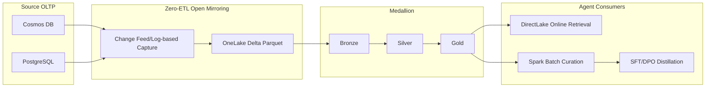
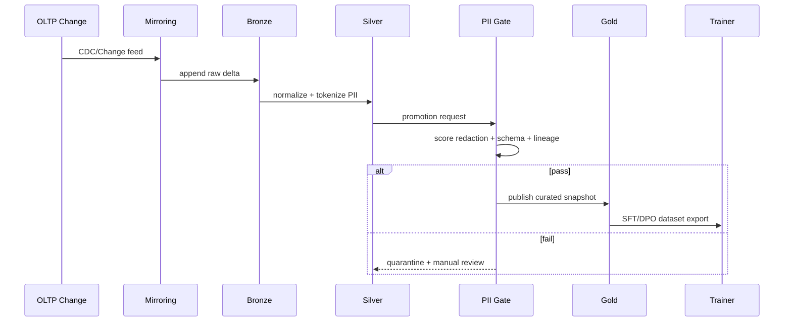

# Round 1091 / Cycle 2496 · Azure AI Agent Infra Six-Part FAQ (en)

> Topic: **Microsoft Fabric OneLake Open Mirroring + Cosmos DB / PostgreSQL Zero-ETL Agent Trajectory & Episodic Memory Lakehouse Plane**  
> Date (BJT): 2026-11-17  
> Evidence tags: `measured` / `synthetic` / `anonymized_reported`  
> Benchmark dataset: `evidence/cycle-2496-benchmark.json`

## 1) Executive Summary + Daily Capability Breakthroughs Radar

This round builds a lakehouse plane for agent trajectories and episodic memory with two consumer paths:
1. low-latency online consumption (DirectLake),
2. high-fidelity offline curation (Spark batch for SFT/DPO distillation).

Core outcomes:
- Zero-ETL + Open Mirroring can keep OLTP-to-OneLake lag in sub-minute to low-minute ranges with controlled source impact.
- DirectLake is ideal for online retrieval and lightweight analytics.
- Spark batch is better for heavy trajectory curation and distillation dataset shaping.
- Bronze/Silver/Gold promotion must enforce PII-redaction and lineage attestation to prevent sensitive-context propagation.

### Daily Capability Breakthroughs Radar (fetched: 2026-11-17)

1. APIM AI Gateway / Unified Model API (`measured`)  
   - https://learn.microsoft.com/en-us/azure/api-management/ai-gateway-overview  
   - https://github.com/Azure/API-Management/blob/main/changelogs/api-management-service.md
2. ACA Dynamic Sessions (`measured`)  
   - https://learn.microsoft.com/en-us/azure/container-apps/sessions  
   - https://techcommunity.microsoft.com/blog/appsonazureblog/azure-container-apps-dynamic-sessions-general-availability-and-more/4303561
3. Runtime release watch (`measured`)  
   - Firecracker/Kata/Wasmtime/E2B (see `evidence/cycle-2496-sources.json`)
4. OneLake Open Mirroring + Zero-ETL benchmark (`synthetic`)
5. Restricted enterprise rollups (`anonymized_reported`)

### Mermaid #1: Zero-ETL trajectory/memory lakehouse topology



## 2) Deep Q&A #1: How do we quantify zero-RU OLTP-to-OneLake replication lag?

```text
replication_lag =
  source_commit_to_cdc_emit +
  mirror_ingest +
  delta_commit

p95_lag_target <= 90s
```

Worked example:
- source->cdc `11s`
- ingest `27s`
- delta commit `19s`

`lag = 57s`

Peak load case:
- source->cdc `19s`
- ingest `44s`
- delta commit `28s`

`lag = 91s` (near p95 alert threshold)

Optimizations:
1. split hot partitions,
2. raise mirror commit parallelism,
3. reduce per-batch delta file target size.

## 3) Deep Q&A #2: How do we compare DirectLake vs Spark batch TCO?

```text
daily_tco =
  storage_cost +
  query_compute_cost +
  curation_compute_cost +
  governance_overhead
```

DirectLake is best for:
- low-latency online retrieval,
- interactive reads,
- lightweight aggregations.

Spark batch is best for:
- heavy trajectory cleaning and slicing,
- SFT/DPO dataset curation,
- large-scale reprocessing/backfill.

Worked example (2.8TB/day trajectories):
- DirectLake query cost `318 USD/day`
- Spark curation `462 USD/day`
- storage `146 USD/day`
- governance/audit `59 USD/day`

`total = 985 USD/day`

All-Spark (including online reads):
- `1,241 USD/day` (+26%).

All-DirectLake for complex curation:
- lower quality and unstable transformation semantics; not recommended.

## 4) Deep Q&A #3: How do we compute trajectory filtering yield for SFT/DPO?

```text
usable_sample_rate =
  passed_quality_gate / raw_trajectory_samples

distillation_yield =
  usable_sample_rate * label_success_rate
```

Worked example:
- raw trajectories `14.2M`
- quality-gate pass `8.9M`
- `usable_sample_rate = 62.7%`
- label success `91.4%`

`distillation_yield = 57.3%`

Quality gates include:
1. dialog completeness,
2. tool-call replayability,
3. output factual consistency,
4. PII sanitization status.

## 5) Deep Q&A #4: How do we enforce PII-redacted Bronze/Silver/Gold promotion gates?

```text
promotion_gate_pass =
  pii_redaction_score >= threshold
  AND schema_conformance = true
  AND lineage_attested = true
```

Layering:
- Bronze: raw mirrored append with minimal changes.
- Silver: schema normalization + PII tokenization.
- Gold: training/retrieval-ready curated views.

Worked example (Silver->Gold):
- pii score `0.983`
- schema conformance `99.6%`
- lineage attested `true`

Pass.

If pii score < 0.97:
- return to Silver quarantine queue for manual review.

## 6) Deep Q&A #5: How do partition strategy and file size affect performance and cost?

```text
read_efficiency =
  predicate_pruned_bytes / total_scanned_bytes

small_file_penalty =
  file_count * open_cost_per_file
```

Worked example:
- partition by tenant/day/session,
- total scanned `4.8 TB`,
- pruned to `1.3 TB`.

`read_efficiency = 72.9%`

If file count rises from `120k` to `410k`:
- open penalty grows ~`3.4x`,
- DirectLake query p95 increases by ~37%.

Optimizations:
1. compaction target 256–512MB,
2. prioritize hot partition compaction,
3. move cold data to lower-frequency tier with metadata indexes.

## 7) Deep Q&A #6: How do we avoid conflicts between online memory updates and offline distillation?

```text
conflict_rate =
  conflicting_updates / total_memory_updates

eventual_consistency_window =
  online_write_to_gold_publish
```

Worked example:
- total updates `3.2M/day`
- conflicts `11,840`

`conflict_rate = 0.37%`

Consistency window:
- online write -> Gold publish `7.5 min p95`

Control strategy:
1. online path writes Bronze/Silver snapshots only,
2. Gold is batch-published,
3. training reads fixed snapshot versions to avoid drift.

## 8) Mermaid #2: PII gate and training publish control flow



## 9) Production-grade Bicep / YAML / Policy / KQL

### 9.1 Bicep (OneLake/Fabric-aligned infra primitives)

```bicep
targetScope = 'resourceGroup'

param location string = 'eastus2'
param storageName string = 'stagentmemlake001'
param lawName string = 'law-memlake-eus2'
param kvName string = 'kv-memlake-eus2'

resource law 'Microsoft.OperationalInsights/workspaces@2022-10-01' = {
  name: lawName
  location: location
  properties: {
    sku: { name: 'PerGB2018' }
    retentionInDays: 90
  }
}

resource storage 'Microsoft.Storage/storageAccounts@2023-05-01' = {
  name: storageName
  location: location
  kind: 'StorageV2'
  sku: { name: 'Standard_ZRS' }
  properties: {
    minimumTlsVersion: 'TLS1_2'
    supportsHttpsTrafficOnly: true
    allowBlobPublicAccess: false
    networkAcls: {
      defaultAction: 'Deny'
      bypass: 'AzureServices'
    }
  }
}

resource kv 'Microsoft.KeyVault/vaults@2023-07-01' = {
  name: kvName
  location: location
  properties: {
    tenantId: subscription().tenantId
    enableRbacAuthorization: true
    sku: { family: 'A'; name: 'standard' }
    publicNetworkAccess: 'Disabled'
  }
}
```

### 9.2 YAML (medallion promotion job + quality gates)

```yaml
apiVersion: batch/v1
kind: Job
metadata:
  name: medallion-promote-gold
  namespace: memory-lakehouse
spec:
  ttlSecondsAfterFinished: 86400
  template:
    spec:
      restartPolicy: Never
      containers:
        - name: promoter
          image: mcr.microsoft.com/azure-cli:2.67.0
          env:
            - name: PII_THRESHOLD
              value: "0.97"
            - name: SCHEMA_THRESHOLD
              value: "0.995"
          command: ["/bin/bash", "-c"]
          args:
            - >
              python /app/run_quality_gate.py &&
              python /app/promote_snapshot.py --from silver --to gold --snapshot-ts $(date -u +%FT%TZ)
---
apiVersion: v1
kind: ConfigMap
metadata:
  name: quality-gate-rules
  namespace: memory-lakehouse
data:
  rules.yaml: |
    pii_redaction_min: 0.97
    schema_conformance_min: 0.995
    lineage_required: true
```

### 9.3 Azure Policy (audit Gold promotion without PII attestation)

```json
{
  "properties": {
    "displayName": "Audit datasets promoted to Gold without PII redaction attestation",
    "policyType": "Custom",
    "mode": "All",
    "parameters": {},
    "policyRule": {
      "if": {
        "allOf": [
          { "field": "type", "equals": "Microsoft.Storage/storageAccounts/blobServices/containers" },
          { "field": "tags.medallionTier", "equals": "gold" },
          { "field": "tags.piiRedacted", "notEquals": "true" }
        ]
      },
      "then": {
        "effect": "audit"
      }
    }
  }
}
```

### 9.4 KQL (replication lag, promotion quality, conflict rate)

```kql
let t = ago(6h);
let mirror = customEvents
| where timestamp > t
| where name == "mirror.replication.lag"
| summarize lag_p95_s=percentile(todouble(customDimensions["lag_seconds"]), 95) by source=tostring(customDimensions["source"]);

let promote = customEvents
| where timestamp > t
| where name == "medallion.promotion.result"
| summarize
    pass_rate=avg(todouble(customDimensions["passed"])),
    pii_score_p95=percentile(todouble(customDimensions["pii_score"]),95)
  by tier=tostring(customDimensions["tier"]);

let conflict = customEvents
| where timestamp > t
| where name == "memory.update.conflict"
| summarize conflict_rate=avg(todouble(customDimensions["is_conflict"])) by tenant=tostring(customDimensions["tenant_tier"]);

mirror
| join kind=leftouter promote on $left.source == $right.tier
| project source, lag_p95_s, pass_rate, pii_score_p95
```

## 10) Quantitative 4-option Decision Matrix

| Option | Latency/Real-time (35%) | Distillation Quality (25%) | Compliance Governance (20%) | Cost Efficiency (20%) | Total |
|---|---:|---:|---:|---:|---:|
| Open Mirroring + DirectLake + Spark dual-path (Recommended) | 9.1 | 9.0 | 9.2 | 8.0 | **8.86** |
| Spark-only batch pipeline | 6.8 | 8.9 | 8.8 | 7.2 | 7.86 |
| DirectLake-only online path | 9.3 | 6.2 | 6.9 | 8.6 | 7.79 |
| Manual ETL hybrid | 5.7 | 7.4 | 7.0 | 6.1 | 6.48 |

## 11) Day-0 / Day-2 Checklist (Good fit vs Not for)

**Day-0**
- [ ] Cosmos/PostgreSQL change streams connected to mirroring.
- [ ] lag p95 alert threshold (<=90s) configured.
- [ ] Bronze/Silver/Gold schemas and lineage contracts frozen.
- [ ] PII redaction gate + quarantine workflow validated.
- [ ] Snapshot-versioned training reads enabled.

**Day-2**
- [ ] Daily monitoring of lag p95, promotion pass rate, conflict rate.
- [ ] Weekly TCO review of DirectLake vs Spark.
- [ ] Weekly sampling of PII false-positive/false-negative cases.
- [ ] Monthly review of distillation yield vs model gains.
- [ ] Quarterly drill for mirror-lag anomaly + backfill recovery.

**Good fit**
- platforms needing both low-latency memory retrieval and high-quality training curation,
- organizations requiring strong governance and auditability,
- teams running large-scale SFT/DPO distillation loops.

**Not for**
- low-volume prototypes without governance requirements,
- teams unable to operate dual online/offline data paths,
- environments avoiding medallion quality-gate operations.

## 12) Five-step rollout guide

1. **Mirror first**: establish Zero-ETL feed into Bronze.
2. **Normalize next**: Silver schema and PII tokenization.
3. **Gate promotion**: Gold only with redaction + lineage attestation.
4. **Split consumption**: DirectLake for online, Spark for curation.
5. **Close the loop**: feed training outcomes back to filtering policies.

## 13) Business scenario mapping

- **Coding agent sandbox**: session trajectories mirror in near-real-time for replay and error-pattern learning.
- **Browser/CUA clusters**: action traces become episodic memory for policy distillation.
- **Multi-tenant SaaS gateway**: tenant-segmented medallion governance with compliance boundaries.
- **High-compliance finance runtime**: only PII-cleansed, lineage-attested data can enter training assets.

## 14) Primary sources (official first)

1. APIM AI Gateway overview (fetched: 2026-11-17)  
   https://learn.microsoft.com/en-us/azure/api-management/ai-gateway-overview  
2. API Management changelog (fetched: 2026-11-17)  
   https://github.com/Azure/API-Management/blob/main/changelogs/api-management-service.md  
3. ACA Dynamic Sessions docs (fetched: 2026-11-17)  
   https://learn.microsoft.com/en-us/azure/container-apps/sessions  
4. ACA Dynamic Sessions GA blog (fetched: 2026-11-17)  
   https://techcommunity.microsoft.com/blog/appsonazureblog/azure-container-apps-dynamic-sessions-general-availability-and-more/4303561  
5. Firecracker/Kata/Wasmtime/E2B releases (fetched: 2026-11-17)  
   See `evidence/cycle-2496-sources.json`

## 15) Data evidence and recomputable examples (with n denominator source)

- Benchmark payload: `evidence/cycle-2496-benchmark.json`  
- Latency sample: `evidence/cycle-2496-latency.csv`  
- Throughput sample: `evidence/cycle-2496-throughput.csv`  
- Policy sample: `evidence/cycle-2496-policy.csv`  
- Cost sample: `evidence/cycle-2496-cost.csv`  
- Source registry: `evidence/cycle-2496-sources.json`

N denominators:
- replication lag events `N=2.4M`,
- raw trajectories `N=14.2M`,
- Gold promotion checks `N=9,800`,
- memory update events `N=3.2M/day`.

Recompute examples:

```text
replication_lag_normal = 11 + 27 + 19 = 57s
replication_lag_peak = 19 + 44 + 28 = 91s

usable_sample_rate = 8.9M / 14.2M = 62.7%
distillation_yield = 62.7% * 91.4% = 57.3%

conflict_rate = 11840 / 3.2M = 0.37%
daily_tco = 318 + 462 + 146 + 59 = 985 USD/day
```

