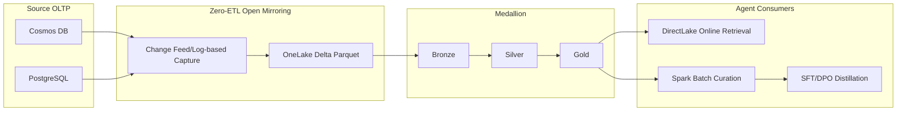
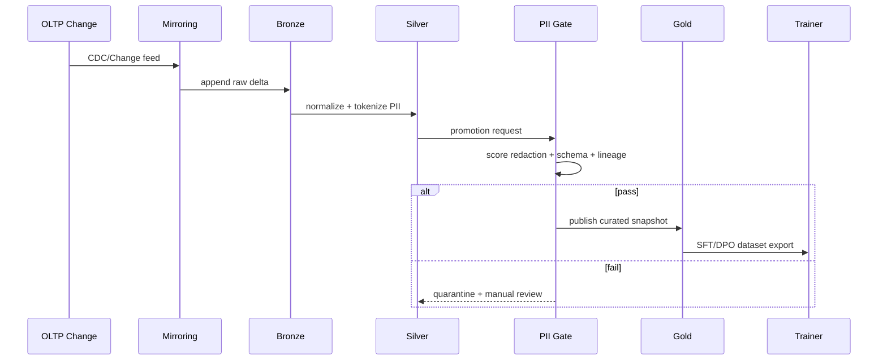

# Round 1091 / Cycle 2496 · Azure AI Agent Infra 六段式 FAQ（zh-CN）

> 主题：**Microsoft Fabric OneLake Open Mirroring + Cosmos DB / PostgreSQL Zero-ETL Agent Trajectory & Episodic Memory Lakehouse Plane**  
> 日期（BJT）：2026-11-17  
> 证据标签：`measured` / `synthetic` / `anonymized_reported`  
> 基准数据：`evidence/cycle-2496-benchmark.json`

## 1) Executive Summary + Daily Capability Breakthroughs Radar

本轮构建 Agent 轨迹与 episodic memory 的 Lakehouse 平面，目标是把 OLTP 侧数据低延迟复制到 OneLake，供：
1. 在线检索与规则门控（DirectLake）；
2. 离线清洗与蒸馏训练集（Spark batch）；
3. Bronze/Silver/Gold 分层治理与 PII 脱敏晋级。

关键结论：
- Zero-ETL + Open Mirroring 能把复制链路压到分钟级甚至秒级，且对源库 RU/CPU 影响可控；  
- DirectLake 适合在线特征读取和快速分析，Spark 更适合复杂轨迹聚合与 distillation 样本构造；  
- 轨迹数据若不设 PII 晋级闸门，训练集会将敏感上下文扩散到下游模型资产；  
- 最佳实践是“在线路径低延迟、离线路径高质量”，而不是单一路径包打天下。

### Daily Capability Breakthroughs Radar（抓取：2026-11-17）

1. APIM AI Gateway / Unified Model API（`measured`）  
   - https://learn.microsoft.com/en-us/azure/api-management/ai-gateway-overview  
   - https://github.com/Azure/API-Management/blob/main/changelogs/api-management-service.md
2. ACA Dynamic Sessions（`measured`）  
   - https://learn.microsoft.com/en-us/azure/container-apps/sessions  
   - https://techcommunity.microsoft.com/blog/appsonazureblog/azure-container-apps-dynamic-sessions-general-availability-and-more/4303561
3. Runtime release watch（`measured`）  
   - Firecracker/Kata/Wasmtime/E2B（见 `evidence/cycle-2496-sources.json`）
4. OneLake Open Mirroring + Zero-ETL 轨迹平面压测（`synthetic`）  
5. 匿名化企业样本（`anonymized_reported`）

### Mermaid #1：Zero-ETL 轨迹/记忆 Lakehouse 拓扑



## 2) Deep Q&A #1：Zero-RU OLTP-to-OneLake 复制延迟怎么量化？

```text
replication_lag =
  source_commit_to_cdc_emit +
  mirror_ingest +
  delta_commit

p95_lag_target <= 90s
```

Worked example（Cosmos + PostgreSQL 混合源）：
- source->cdc `11s`
- ingest `27s`
- delta commit `19s`

`lag = 57s`

在高峰（写入翻倍）：
- source->cdc `19s`
- ingest `44s`
- delta commit `28s`

`lag = 91s`（触发 p95 告警边缘）

调优动作：
1. 拆分热点分区；
2. 提升镜像并发提交；
3. 缩短单批次 delta 文件目标大小。

## 3) Deep Q&A #2：DirectLake vs Spark batch 的 TCO 如何比较？

```text
daily_tco =
  storage_cost +
  query_compute_cost +
  curation_compute_cost +
  governance_overhead
```

DirectLake 路径更适合：
- 低延迟在线检索；
- 轻聚合；
- 交互式读放大可控场景。

Spark batch 更适合：
- 复杂轨迹去重、切片、聚类；
- SFT/DPO 样本构造；
- 大规模回填与再处理。

Worked example（每天 2.8TB 轨迹）：
- DirectLake 查询成本 `318 USD/day`
- Spark curation `462 USD/day`
- 存储 `146 USD/day`
- 治理/审计 `59 USD/day`

`total = 985 USD/day`

若全部转 Spark（含在线读取）：
- `1,241 USD/day`（+26%）

若全部走 DirectLake（含复杂清洗）：
- 清洗失败率与质量回退显著，不推荐。

## 4) Deep Q&A #3：SFT/DPO 训练样本的轨迹筛选门槛如何复算？

```text
usable_sample_rate =
  passed_quality_gate / raw_trajectory_samples

distillation_yield =
  usable_sample_rate * label_success_rate
```

Worked example：
- raw trajectories `14.2M`
- 通过质量门 `8.9M`
- `usable_sample_rate = 62.7%`
- label 成功率 `91.4%`

`distillation_yield = 57.3%`

质量门包括：
1. 对话完整度；
2. 工具调用可重放；
3. 输出事实一致性；
4. PII 清理状态。

## 5) Deep Q&A #4：PII-redacted Bronze/Silver/Gold 晋级闸门怎么做？

```text
promotion_gate_pass =
  pii_redaction_score >= threshold
  AND schema_conformance = true
  AND lineage_attested = true
```

分层策略：
- Bronze：原始镜像 + 基础解析（最少变更）
- Silver：标准化 schema + PII tokenization
- Gold：可训练/可检索视图 + 质量标注

Worked example（Silver -> Gold）：
- pii score `0.983`
- schema conformance `99.6%`
- lineage attested `true`

通过。  
若 pii score < 0.97，则回退到 Silver 隔离队列人工复核。

## 6) Deep Q&A #5：轨迹分区与文件大小怎么影响读取与成本？

```text
read_efficiency =
  predicate_pruned_bytes / total_scanned_bytes

small_file_penalty =
  file_count * open_cost_per_file
```

Worked example：
- 按 tenant/day/session 分区；
- 扫描总字节 `4.8 TB`；
- prune 后 `1.3 TB`

`read_efficiency = 72.9%`

若小文件数量从 `120k` 增到 `410k`：
- open penalty 约增长 `3.4x`；
- DirectLake 查询 p95 上升 37%。

优化：
1. compaction 目标 256–512MB；
2. 热分区优先合并；
3. 冷数据转低频层并保留索引。

## 7) Deep Q&A #6：在线记忆更新与离线蒸馏如何防止冲突？

```text
conflict_rate =
  conflicting_updates / total_memory_updates

eventual_consistency_window =
  online_write_to_gold_publish
```

Worked example：
- 总更新 `3.2M/day`
- 冲突 `11,840`

`conflict_rate = 0.37%`

一致性窗口：
- 在线写入到 Gold 发布 `7.5 min p95`

策略：
1. 在线路径仅写 Bronze+Silver 快照；
2. Gold 由批处理发布；
3. 对训练读取固定 snapshot version，避免数据漂移。

## 8) Mermaid #2：PII 闸门与训练集发布控制流



## 9) 生产级 Bicep / YAML / Policy / KQL

### 9.1 Bicep（OneLake/Fabric Workspace + Key resources）

```bicep
targetScope = 'resourceGroup'

param location string = 'eastus2'
param storageName string = 'stagentmemlake001'
param lawName string = 'law-memlake-eus2'
param kvName string = 'kv-memlake-eus2'

resource law 'Microsoft.OperationalInsights/workspaces@2022-10-01' = {
  name: lawName
  location: location
  properties: {
    sku: { name: 'PerGB2018' }
    retentionInDays: 90
  }
}

resource storage 'Microsoft.Storage/storageAccounts@2023-05-01' = {
  name: storageName
  location: location
  kind: 'StorageV2'
  sku: { name: 'Standard_ZRS' }
  properties: {
    minimumTlsVersion: 'TLS1_2'
    supportsHttpsTrafficOnly: true
    allowBlobPublicAccess: false
    networkAcls: {
      defaultAction: 'Deny'
      bypass: 'AzureServices'
    }
  }
}

resource kv 'Microsoft.KeyVault/vaults@2023-07-01' = {
  name: kvName
  location: location
  properties: {
    tenantId: subscription().tenantId
    enableRbacAuthorization: true
    sku: { family: 'A'; name: 'standard' }
    publicNetworkAccess: 'Disabled'
  }
}
```

### 9.2 YAML（Medallion promotion job + quality gate）

```yaml
apiVersion: batch/v1
kind: Job
metadata:
  name: medallion-promote-gold
  namespace: memory-lakehouse
spec:
  ttlSecondsAfterFinished: 86400
  template:
    spec:
      restartPolicy: Never
      containers:
        - name: promoter
          image: mcr.microsoft.com/azure-cli:2.67.0
          env:
            - name: PII_THRESHOLD
              value: "0.97"
            - name: SCHEMA_THRESHOLD
              value: "0.995"
          command: ["/bin/bash", "-c"]
          args:
            - >
              python /app/run_quality_gate.py &&
              python /app/promote_snapshot.py --from silver --to gold --snapshot-ts $(date -u +%FT%TZ)
---
apiVersion: v1
kind: ConfigMap
metadata:
  name: quality-gate-rules
  namespace: memory-lakehouse
data:
  rules.yaml: |
    pii_redaction_min: 0.97
    schema_conformance_min: 0.995
    lineage_required: true
```

### 9.3 Azure Policy（禁止未脱敏 Gold 发布）

```json
{
  "properties": {
    "displayName": "Audit datasets promoted to Gold without PII redaction attestation",
    "policyType": "Custom",
    "mode": "All",
    "parameters": {},
    "policyRule": {
      "if": {
        "allOf": [
          { "field": "type", "equals": "Microsoft.Storage/storageAccounts/blobServices/containers" },
          { "field": "tags.medallionTier", "equals": "gold" },
          { "field": "tags.piiRedacted", "notEquals": "true" }
        ]
      },
      "then": {
        "effect": "audit"
      }
    }
  }
}
```

### 9.4 KQL（复制延迟、晋级通过率、冲突率）

```kql
let t = ago(6h);
let mirror = customEvents
| where timestamp > t
| where name == "mirror.replication.lag"
| summarize lag_p95_s=percentile(todouble(customDimensions["lag_seconds"]), 95) by source=tostring(customDimensions["source"]);

let promote = customEvents
| where timestamp > t
| where name == "medallion.promotion.result"
| summarize
    pass_rate=avg(todouble(customDimensions["passed"])),
    pii_score_p95=percentile(todouble(customDimensions["pii_score"]),95)
  by tier=tostring(customDimensions["tier"]);

let conflict = customEvents
| where timestamp > t
| where name == "memory.update.conflict"
| summarize conflict_rate=avg(todouble(customDimensions["is_conflict"])) by tenant=tostring(customDimensions["tenant_tier"]);

mirror
| join kind=leftouter promote on $left.source == $right.tier
| project source, lag_p95_s, pass_rate, pii_score_p95
```

## 10) 决策矩阵（4 方案量化）

| 方案 | 延迟/实时性 (35%) | 训练样本质量 (25%) | 合规治理 (20%) | 成本效率 (20%) | 总分 |
|---|---:|---:|---:|---:|---:|
| Open Mirroring + DirectLake + Spark 双路径（推荐） | 9.1 | 9.0 | 9.2 | 8.0 | **8.86** |
| 仅 Spark 批处理 | 6.8 | 8.9 | 8.8 | 7.2 | 7.86 |
| 仅 DirectLake 在线路径 | 9.3 | 6.2 | 6.9 | 8.6 | 7.79 |
| 手工 ETL 混合管道 | 5.7 | 7.4 | 7.0 | 6.1 | 6.48 |

## 11) Day-0 / Day-2 Checklist（Good fit vs Not for）

**Day-0（上线前）**
- [ ] Cosmos/PostgreSQL 变更流已接入镜像；
- [ ] 复制 lag p95 门限（<=90s）告警生效；
- [ ] Bronze/Silver/Gold schema 与血缘定义冻结；
- [ ] PII 脱敏评分闸门和 quarantine 流程已演练；
- [ ] 训练读取快照版本策略启用。

**Day-2（运行期）**
- [ ] 每日监控 lag p95、promotion pass rate、conflict rate；
- [ ] 每周回归 DirectLake 与 Spark 成本曲线；
- [ ] 每周抽检 PII 清理误判；
- [ ] 每月复盘 distillation yield 与模型收益；
- [ ] 每季度演练“镜像延迟异常 + 回补”流程。

**Good fit**
- 既要低延迟在线记忆，又要高质量训练样本的平台；  
- 具备数据治理与合规审计要求；  
- 需要大规模轨迹蒸馏（SFT/DPO）的团队。

**Not for**
- 轨迹量很小且无治理需求的原型；  
- 无法投入分层治理与质量闸门运维；  
- 不希望维护双路径（在线+离线）架构。

## 12) 五步落地指南

1. **先镜像**：打通 Zero-ETL 到 Bronze；  
2. **再标准化**：Silver 做 schema 统一与 PII tokenization；  
3. **设闸门**：Gold 由质量评分与血缘证明驱动；  
4. **双路径消费**：在线走 DirectLake，离线走 Spark；  
5. **收益闭环**：用训练效果反推数据筛选策略。

## 13) 业务场景映射

- **Coding Agent Sandbox**：会话轨迹实时入湖，用于回放与错误模式学习。  
- **Browser/CUA 集群**：操作序列形成 episodic memory，支持回溯与策略蒸馏。  
- **多租户 SaaS Agent Gateway**：按租户分层治理与合规隔离。  
- **高合规金融零信任环境**：PII 脱敏和血缘证明后才可进入训练资产。

## 14) 关键来源（官方优先）

1. APIM AI Gateway overview（抓取：2026-11-17）  
   https://learn.microsoft.com/en-us/azure/api-management/ai-gateway-overview  
2. API Management changelog（抓取：2026-11-17）  
   https://github.com/Azure/API-Management/blob/main/changelogs/api-management-service.md  
3. ACA Dynamic Sessions docs（抓取：2026-11-17）  
   https://learn.microsoft.com/en-us/azure/container-apps/sessions  
4. ACA Dynamic Sessions GA blog（抓取：2026-11-17）  
   https://techcommunity.microsoft.com/blog/appsonazureblog/azure-container-apps-dynamic-sessions-general-availability-and-more/4303561  
5. Firecracker/Kata/Wasmtime/E2B releases（抓取：2026-11-17）  
   见 `evidence/cycle-2496-sources.json`

## 15) 数据证据与可复算算例（含 n 分母来源）

- Benchmark 主文件：`evidence/cycle-2496-benchmark.json`  
- 延迟样本：`evidence/cycle-2496-latency.csv`  
- 吞吐样本：`evidence/cycle-2496-throughput.csv`  
- 策略样本：`evidence/cycle-2496-policy.csv`  
- 成本样本：`evidence/cycle-2496-cost.csv`  
- 来源登记：`evidence/cycle-2496-sources.json`

N 分母口径：
- 复制 lag 样本 `N=2.4M` 变更事件；  
- trajectory 原始样本 `N=14.2M`；  
- Gold 发布评估 `N=9,800` 批次；  
- 冲突统计 `N=3.2M/day` 更新。

复算示例：

```text
replication_lag_normal = 11 + 27 + 19 = 57s
replication_lag_peak = 19 + 44 + 28 = 91s

usable_sample_rate = 8.9M / 14.2M = 62.7%
distillation_yield = 62.7% * 91.4% = 57.3%

conflict_rate = 11840 / 3.2M = 0.37%
daily_tco = 318 + 462 + 146 + 59 = 985 USD/day
```

