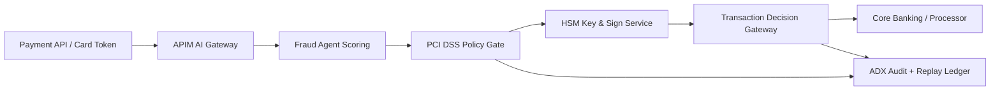

# Round 1047 / Cycle 2452 · Azure AI Agent Infra FAQ & Decision Guide (en)

> Topic: **Financial Payments Fraud Agent + PCI DSS + HSM Transaction Gateway**
>
> Date (BJT): 2026-11-16  
> Evidence labels: `measured` / `synthetic` / `anonymized_reported`  
> Benchmark payload: `evidence/cycle-2452-benchmark.json`

## 1) Executive Summary

This round addresses payment risk infrastructure: agentic fraud scoring must achieve low-latency decisions while preserving **PCI DSS cardholder-data boundaries**.  
Key outcome: APIM AI Gateway + versioned risk policies + HSM-backed transaction signing provides production-grade control without exposing PAN-sensitive paths.

## 2) Daily capability breakthroughs radar (2026-11-16)

1. **APIM AI Gateway / Unified Model API** (`measured`)  
   - Learn: https://learn.microsoft.com/en-us/azure/api-management/ai-gateway-overview  
   - Changelog: https://github.com/Azure/API-Management/blob/main/changelogs/api-management-service.md
2. **ACA Dynamic Sessions** (`measured`)  
   - Docs: https://learn.microsoft.com/en-us/azure/container-apps/sessions
3. **Sandbox/runtime release cadence** (`measured`)  
   - Firecracker/Kata/Wasmtime/E2B releases (tracked in `evidence/cycle-2452-sources.json`)

## 3) Core architecture Q&A (payment safety boundaries)

**Q1: Why can’t a high-accuracy model directly approve/reject payments?**  
A: Fraud decisions require auditable policy versions, replayability, and deterministic rollback. Model output is an input signal, not the final compliance gate.

**Q2: What is the minimum PCI DSS implementation for agent infra?**  
A: traffic partitioning, tokenization, sensitive-field redaction, HSM key custody, policy approval chain, and immutable audit trail.

**Q3: How to balance false-decline vs fraud leakage?**  
A: release `risk-policy-version` by tenant and transaction bucket with replay-driven recalibration.

## 4) Mermaid architecture (Fraud + HSM transaction gateway)

## 5) Decision matrix (payment risk architecture options)

| Architecture path | Compliance | Real-time performance | Cost | Ops complexity | Recommendation |
|---|---:|---:|---:|---:|---|
| Rules-only engine | High | High | Medium | Medium | Stable portfolios |
| LLM-only direct decision | Low | Medium | Medium | Low | Never in production |
| Agent scoring + policy gate + HSM gateway | **High** | **High** | Medium-high | Medium-high | **Recommended for production payments** |
| Multi-model direct core-banking writes | Low | High | High | High | Not recommended |

## 6) Good fit vs Not for + five-step rollout

### Good fit
- Real-time fraud/risk/payment orchestration with strict auditability.
- Teams with HSM/KMS and PCI operations ownership.
- Multi-tenant or multi-country payment stacks requiring policy segmentation.

### Not for
- Teams lacking policy version governance and replay operations.
- Environments insisting on direct model auto-approval without dual controls.

### Five-step rollout
1. Define risk buckets and tenant policy domains.  
2. Implement `risk-policy-version` publish/rollback flow.  
3. Integrate HSM-backed signing and tokenization gateways.  
4. Wire APIM, policy gate, and core processors into one audit timeline.  
5. Recalibrate weekly with fraud replay packs for false-decline/fraud-loss/cost tradeoffs.  
