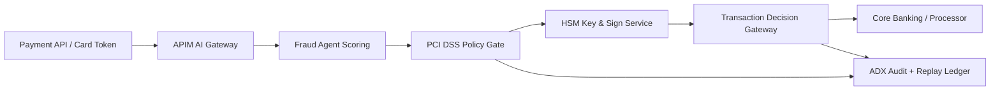

# Round 1047 / Cycle 2452 · Azure AI Agent Infra FAQ & 决策指南（zh-CN）

> Topic: **Financial Payments Fraud Agent + PCI DSS + HSM Transaction Gateway**
>
> Date (BJT): 2026-11-16  
> Evidence labels: `measured` / `synthetic` / `anonymized_reported`  
> Benchmark payload: `evidence/cycle-2452-benchmark.json`

## 1) Executive Summary

本轮面向金融支付场景：在实时反欺诈与交易路由中，Agent 必须同时满足 **毫秒级响应** 与 **PCI DSS 卡数据域隔离**。  
核心结论：采用 APIM AI Gateway + 风险策略版本化 + HSM 密钥托管的分层控制面，可在不泄露 PAN/敏感数据的前提下实现高并发决策。

## 2) Daily capability breakthroughs radar（2026-11-16）

1. **APIM AI Gateway / Unified Model API**（`measured`）  
   - Learn: https://learn.microsoft.com/en-us/azure/api-management/ai-gateway-overview  
   - Changelog: https://github.com/Azure/API-Management/blob/main/changelogs/api-management-service.md
2. **ACA Dynamic Sessions**（`measured`）  
   - Docs: https://learn.microsoft.com/en-us/azure/container-apps/sessions
3. **Sandbox/runtime release cadence**（`measured`）  
   - Firecracker/Kata/Wasmtime/E2B releases（见 `evidence/cycle-2452-sources.json`）

## 3) Core architecture Q&A（支付 Agent 安全边界）

**Q1: 为什么“高准确率模型”不能直接写支付决策？**  
A: 欺诈策略需要可审计版本、可回放证据和双写回滚能力；模型输出只能作为决策输入之一，不能跳过合规控制面。

**Q2: PCI DSS 在 Agent 基础设施上的最小落地是什么？**  
A: 交易流分区、令牌化、敏感字段脱敏、HSM 管钥、策略审批链与不可抵赖审计。

**Q3: 如何控制误杀与漏放的平衡？**  
A: 采用 `risk-policy-version` 分层发布，按租户与交易类型做分桶阈值，并用回放集持续标定。

## 4) Mermaid architecture（Fraud + HSM 交易网关）

## 5) Decision matrix（支付风控架构选型）

| 架构路径 | 合规性 | 实时性 | 成本 | 运维复杂度 | 推荐 |
|---|---:|---:|---:|---:|---|
| 纯规则引擎 | 高 | 高 | 中 | 中 | 稳态业务 |
| 纯 LLM 决策 | 低 | 中 | 中 | 低 | 禁止生产 |
| Agent 评分 + 策略门 + HSM 网关 | **高** | **高** | 中高 | 中高 | **金融生产推荐** |
| 多模型直连核心账务 | 低 | 高 | 高 | 高 | 不建议 |

## 6) Good fit vs Not for + 五步落地

### Good fit
- 需要实时风控、交易编排、审计追溯的一体化支付平台。  
- 有 HSM/KMS 与 PCI 合规团队，可长期运营策略生命周期。  
- 多租户或多国家业务，需要策略分区与灰度发布。

### Not for
- 无法维护策略版本与审计回放体系的团队。  
- 追求“模型直接放行”而不接受双重门控的场景。

### 五步落地
1. 定义交易风险分级与租户策略域。  
2. 建立 `risk-policy-version` 发布/回滚机制。  
3. 接入 HSM 托管签名与令牌化网关。  
4. 打通 APIM、策略门、账务系统的审计链路。  
5. 每周用欺诈回放集复盘误杀/漏放与成本。  
