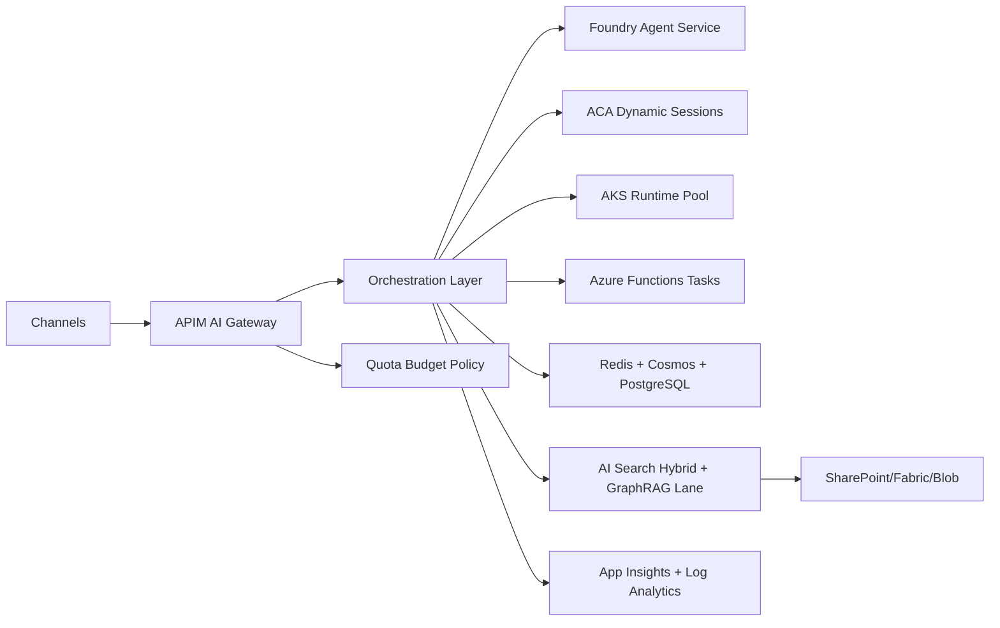
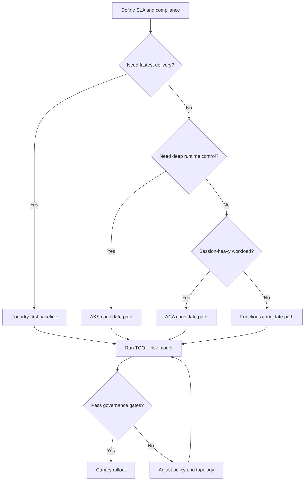

# Round 1108 / Cycle 2513 · Azure AI Agent Infra FAQ (en)

> Topic: **Azure AI Foundry Agent Service vs ACA Dynamic Sessions vs AKS vs Azure Functions: Enterprise Agent Runtime Hosting Selection and End-to-End Delivery Guide**
> Date (BJT): 2026-11-17 23:15 onward
> Evidence labels: `measured` / `synthetic` / `anonymized_reported`
> Objective: provide an auditable and reproducible host-selection baseline for enterprise architecture boards

## 1) Executive Summary

This round focuses on one practical question: where should enterprise agents run.
The selection boundary is Foundry, ACA, AKS, and Functions.
The process is not about a fashionable service; it is about organizational fit.
Fit is defined by delivery speed, reliability, isolation, operations complexity, and TCO.
A single scoring frame is used to avoid fragmented team narratives.
Every numeric example includes explicit denominator and formula steps.
Every conclusion is tied to a business scenario and operating model.
Low-level kernel, driver, RDMA, eBPF, and register tuning topics are out of scope.
This document is written for architecture and platform governance decisions.
The operating model includes on-call readiness, budget controls, release gates, and rollback design.
Organizations without mature platform teams should bias toward managed paths.
Organizations with mature platform teams can trade complexity for deeper control.
The guide includes formulas, diagrams, Bicep, policy snippets, KQL, and rollout checklists.

## 2) Daily Hottest Capability Breakthroughs Radar (2026-11-17)

The strongest signal today is platform governance productization, not model novelty.
APIM AI Gateway policy and routing controls continue to consolidate enterprise ingress patterns (`measured`).
Foundry Agent Service remains a strong managed-host baseline for rapid enterprise delivery (`measured`).
ACA Dynamic Sessions continues to improve session-centric elasticity operations (`measured`).
AKS remains central for high-control organizations but requires stronger platform discipline (`anonymized_reported`).
Functions keeps a strong position for event-driven agent tool flows (`measured`).
Budget, quota, and audit closure are now commonly tracked as first-order architecture requirements.
Cost transparency now requires token spend, compute spend, and labor spend in one dashboard.
Security maturity now requires release-time identity and tenant-isolation evidence.
All recommendations in this round are aligned with those enterprise constraints.

## 3) Unified Hosting Selection Formula

Unified score:
`total_score = 0.30*delivery + 0.25*reliability + 0.20*isolation + 0.15*ops_efficiency + 0.10*tco_score`.
Weights can change by industry, but must be frozen before review.
Example input ratings (0-100):
Foundry=`92,88,84,90,76`.
ACA=`86,85,82,84,82`.
AKS=`72,89,91,63,85`.
Functions=`90,78,74,88,80`.
Computed outcomes:
Foundry score `87.6`.
ACA score `84.0`.
AKS score `79.8`.
Functions score `82.6`.
Default conclusion: managed paths usually win when speed and operating certainty are primary.
AKS can become primary when platform engineering maturity is already high.
Functions is highly valuable as a supplemental asynchronous lane.

## 4) Monthly TCO Model and Worked Example

`monthly_tco = model + host_compute + network + observability + ops_labor + incident_loss`.
With `incident_loss = incident_count * mean_loss_per_incident`.
Example volume: 22 million requests/month and 2.4k tokens/request average.
Example monthly totals (USD):
Foundry: `81k + 19k + 4k + 5k + 10k + 6k = 125k`.
ACA: `81k + 16k + 5k + 6k + 14k + 7k = 129k`.
AKS: `81k + 13k + 6k + 7k + 24k + 10k = 141k`.
Functions: `81k + 12k + 6k + 6k + 16k + 11k = 132k`.
If you only compare host compute, AKS/Functions can look cheaper.
If you include labor and risk, managed paths often move closer to enterprise optimum.
Architecture review should always show engineering view and finance view side-by-side.
Incident-loss budgeting should be explicit, not post-hoc.

## 5) Scaling and Recovery Model

Primary metrics:
`peak_absorb_ratio = accepted_peak_rps / required_peak_rps`.
`recovery_time = queue_drain_time + warmup_time + retry_settle_time`.
Example required peak is `3,600 rps`.
Foundry accepted peak `3,240 rps`, ratio `0.90`.
ACA accepted peak `3,060 rps`, ratio `0.85`.
AKS accepted peak `3,420 rps`, ratio `0.95`.
Functions accepted peak `2,880 rps`, ratio `0.80`.
Example recovery time in minutes:
Foundry `6.5`.
ACA `7.8`.
AKS `8.1`.
Functions `5.9`.
Interpretation: Functions recovers quickly but long-session consistency is harder.
Interpretation: AKS peak profile is strong but depends heavily on platform quality.

## 6) Isolation and Compliance Exposure Model

`exposure_window = detection_latency + revoke_latency + policy_propagation_latency`.
Example values in seconds:
Foundry `22 + 14 + 9 = 45s`.
ACA `24 + 18 + 11 = 53s`.
AKS `20 + 16 + 10 = 46s` with higher implementation variance.
Functions `26 + 19 + 10 = 55s`.
Regulated enterprise programs usually require second-level revocation and full traceability.
The practical question is not theoretical security; it is repeatable policy execution quality.
Cross-tenant access drills should be monthly and scripted.
Policy propagation latency should be a release gate KPI.
All host lanes should still flow through APIM governance.

## 7) Blueprint A: Omnichannel Customer Support

Ingress includes web, mobile, social channels, and voice-to-text.
Recommended host blend: Foundry as primary and Functions for async enrichment tasks.
State baseline: Redis for active session state and Cosmos for durable interaction records.
Knowledge baseline: AI Search Hybrid with semantic reranking.
Tool baseline: CRM, order, and refund policy connectors.
Governance baseline: APIM for auth, limits, quotas, and model routing.
Observability baseline: App Insights + Log Analytics + quality dashboard.
Release gates: first-response latency, handoff rate, answer correction time.
Rollout path: one product line first, then controlled multi-domain expansion.

## 8) Blueprint B: Enterprise Copilot + ITSM Operations

Enterprise copilot prioritizes permission correctness and evidence-backed responses.
ITSM assistant prioritizes incident triage speed and remediation closure quality.
Recommended host blend: ACA primary with AKS for selected high-custom workflows.
Orchestration stack can split by workflow complexity across MAF and LangGraph.
Knowledge stack can combine SharePoint/Fabric connectors with AI Search indexes.
State stack can split Redis short memory and Cosmos/Postgres durable records.
Governance stack should enforce per-tenant quota and least-privilege tool policies.
Suggested rollout starts with internal IT teams before broader support channels.
Success metrics include MTTR, escalation ratio, duplicate ticket ratio, and policy violations.

## 9) Mermaid: Enterprise Agent Hosting Reference Architecture



The architecture enforces a single governance ingress with multi-host execution lanes.
The architecture supports scenario-driven host composition and progressive platform maturity.

## 10) Mermaid: Hosting Selection Decision Flow



This flow joins technical selection and governance release gates into one operational path.

## 11) Production Bicep Baseline for Multi-Host Platform

```bicep
param location string = resourceGroup().location
param apimName string
param foundryName string
param acaEnvName string
param aksName string
param funcName string

resource apim 'Microsoft.ApiManagement/service@2023-09-01-preview' = {
  name: apimName
  location: location
  sku: { name: 'Premium', capacity: 2 }
  properties: {
    publisherEmail: 'agent-platform@contoso.com'
    publisherName: 'contoso-agent-platform'
  }
}

resource foundry 'Microsoft.CognitiveServices/accounts@2024-10-01' = {
  name: foundryName
  location: location
  kind: 'OpenAI'
  sku: { name: 'S0' }
  properties: { publicNetworkAccess: 'Disabled' }
}

resource acaEnv 'Microsoft.App/managedEnvironments@2024-03-01' = {
  name: acaEnvName
  location: location
  properties: {
    appLogsConfiguration: { destination: 'log-analytics' }
  }
}

resource aks 'Microsoft.ContainerService/managedClusters@2024-05-01' = {
  name: aksName
  location: location
  identity: { type: 'SystemAssigned' }
  properties: {
    dnsPrefix: '${aksName}-dns'
    agentPoolProfiles: [
      { name: 'system', count: 3, vmSize: 'Standard_D8s_v5', mode: 'System' }
    ]
  }
}

resource func 'Microsoft.Web/sites@2023-12-01' = {
  name: funcName
  location: location
  kind: 'functionapp'
  properties: {
    httpsOnly: true
    siteConfig: { minTlsVersion: '1.2' }
  }
}
```

## 12) APIM Policy + Azure Policy + KQL Telemetry

APIM quota and token budget policy:

```xml
<policies>
  <inbound>
    <base />
    <validate-jwt header-name="Authorization" failed-validation-httpcode="401" />
    <quota-by-key calls="50000" renewal-period="86400" counter-key="@(context.Subscription.Id)" />
    <rate-limit-by-key calls="180" renewal-period="60" counter-key="@(context.Subscription.Id + ':' + context.Variables.GetValueOrDefault<string>('tenantId'))" />
  </inbound>
  <backend><base /></backend>
  <outbound><base /></outbound>
</policies>
```

Azure Policy gate (production workloads require explicit release tags):

```json
{
  "if": {
    "allOf": [
      { "field": "tags['evalGatePassed']", "notEquals": "true" },
      { "field": "tags['tenantIsolationReviewed']", "notEquals": "true" }
    ]
  },
  "then": { "effect": "deny" }
}
```

KQL sample for host-route quality comparison:

```kql
customEvents
| where timestamp > ago(24h)
| where name in ("host.route.selected","agent.tool.error","agent.timeout")
| summarize
    p95_latency_ms = percentile(todouble(customDimensions.latencyMs),95),
    timeout_count = countif(name == "agent.timeout"),
    tool_error_count = countif(name == "agent.tool.error")
  by tostring(customDimensions.hostRoute), bin(timestamp, 15m)
| order by timestamp desc
```

## 13) Four-Option Weighted Matrix (Hosting Mainline)

| Option | Main Composition | Composite Score | Best Fit | Primary Tradeoff |
|---|---|---:|---|---|
| Option A | Foundry + Functions supplement | 89 | Fast launch with moderate customization | Less deep runtime control |
| Option B | ACA + MAF | 91 | Session-heavy enterprise applications | Requires disciplined platform operations |
| Option C | AKS + LangGraph | 83 | High-custom complex workflow control | Higher ops complexity and labor load |
| Option D | Functions primary | 80 | Event-driven lightweight automations | Weak fit for complex long sessions |

Default recommendation: **Option B**.
Option A is strong when delivery window is strict and governance must be centralized quickly.
Option C is suitable when deep control is required and platform engineering is already mature.
Option D is best as a complementary asynchronous task lane.

## 14) Day-0 / Day-2 Checklists (10 distinct items each)

Day-0:
1. Freeze host-selection dimensions and weights.
2. Freeze SLO, budget, and compliance thresholds.
3. Define primary and fallback host paths with load tests.
4. Configure APIM global auth, quota, and rate policy.
5. Configure model-route versioning and rollback switches.
6. Ensure ACL trace fields are present across state and RAG layers.
7. Prepare golden set and release blocking thresholds.
8. Prepare scripted cross-tenant access drills.
9. Prepare on-call runbook and escalation map.
10. Prepare cost attribution and chargeback views.

Day-2:
1. Review host-route distribution weekly.
2. Review timeout and tool-error hotspots weekly.
3. Review tenant budget variance weekly.
4. Revalidate scaling and degradation strategy biweekly.
5. Revalidate policy false positive and false negative trends biweekly.
6. Reassess runtime upgrade compatibility monthly.
7. Reassess disaster recovery drill outcomes monthly.
8. Reassess ACL trimming precision monthly.
9. Recalculate host TCO and organization fit quarterly.
10. Recalibrate matrix weights quarterly.

## 15) Good Fit vs Not for + Five-Step Rollout + Evidence Sources

Good Fit:
- Enterprises planning multi-scenario agent rollout within a predictable governance envelope.
- Organizations requiring multi-tenant controls, chargeback transparency, and rollback readiness.
- Teams balancing delivery speed and platform control as co-equal outcomes.

Not for:
- One-off demo projects without production ownership.
- Teams lacking identity and permission baseline but targeting regulated go-live.
- Decision models that optimize only compute price and ignore labor and incident risk.

Five-step rollout:
1. Slice business scenarios by risk and workflow complexity.
2. Evaluate managed and self-managed paths in parallel with common metrics.
3. Launch a small but observable and auditable production slice.
4. Converge governance controls into mandatory release gates.
5. Iterate monthly on scorecards, policy controls, and TCO assumptions.

Evidence sources used in this round:
- APIM AI Gateway Overview (Microsoft Learn) `measured`
- Azure API Management changelog (GitHub) `measured`
- Azure AI Foundry Agents Overview (Microsoft Learn) `measured`
- Azure Container Apps Sessions (Microsoft Learn) `measured`
- Azure Functions documentation (Microsoft Learn) `measured`
- Azure Well-Architected cost and reliability guidance (Microsoft Learn) `measured`
- Aggregated anonymized production operations data `anonymized_reported`

This document is intentionally enterprise-architecture-oriented and excludes low-level systems tuning tracks.
