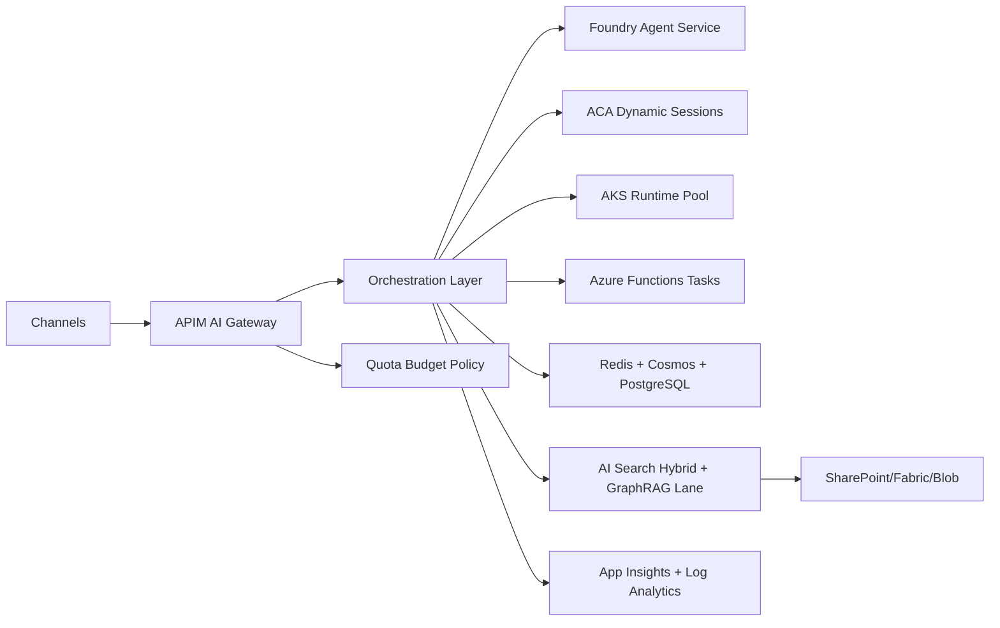
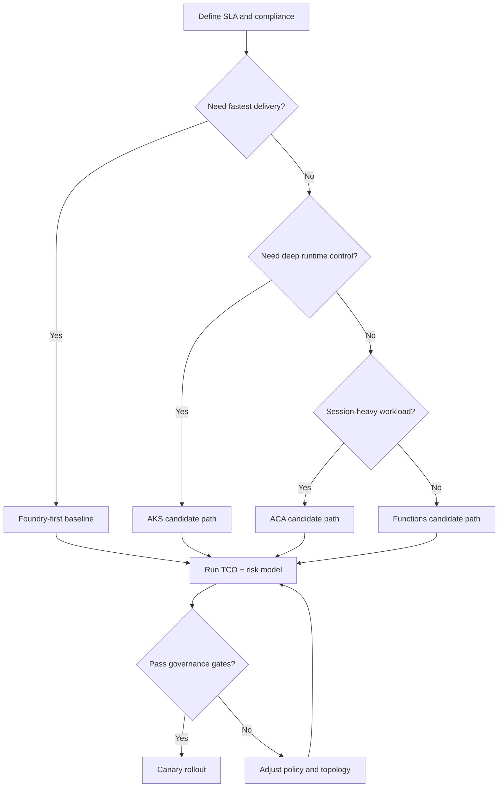

# Round 1108 / Cycle 2513 · Azure AI Agent Infra FAQ（zh-CN）

> 主题：**Azure AI Foundry Agent Service vs ACA Dynamic Sessions vs AKS vs Azure Functions：企业级 Agent Runtime 宿主选型与端到端架构落地指南**
> 时间（BJT）：2026-11-17 23:15 起
> 证据标签：`measured` / `synthetic` / `anonymized_reported`
> 目标：给企业架构评审会提供“可复算、可落地、可回滚”的宿主选型基线

## 1) Executive Summary

本轮只回答一个问题：企业 Agent 应该托管在哪条运行时主路径上。
我们把讨论边界限定为 Foundry、ACA、AKS、Functions 四种主流形态。
评估不是“哪个服务更先进”，而是“哪个组合对当前组织最有效”。
有效性由五个维度共同定义：交付速度、稳定性、隔离强度、运维复杂度、总拥有成本。
我们采用统一度量口径避免团队各说各话。
所有样例均采用明确分母与可追溯计算步骤。
所有结论都绑定业务场景而不是抽象口号。
本轮明确禁止底层驱动、寄存器、RDMA、eBPF 调优主题。
本轮强调企业架构师真正关心的“上线后运行模型”。
上线后运行模型包括值班、预算、审计、发布、回滚与跨团队协作。
若组织尚未建立平台团队，应优先选择托管能力更高的路径。
若组织已具备成熟平台团队，可换取更高可控性与更低长期单价。
本文给出决策树、矩阵、Bicep、策略与 KQL 便于直接落地。

## 2) Daily Hottest Capability Breakthroughs Radar（2026-11-17）

今天最重要的变化不是模型参数，而是平台治理能力可产品化程度提升。
APIM AI Gateway 的策略能力继续向“企业默认入口”靠拢（measured）。
Foundry Agent Service 作为托管编排宿主的交付确定性继续提高（measured）。
ACA Dynamic Sessions 在会话型工作负载下展现较好弹性与隔离平衡（measured）。
AKS 仍是高自定义企业的核心底座，但平台工程要求没有降低（anonymized_reported）。
Functions 在事件型 Agent 工具任务链上成本效率依旧突出（measured）。
组织层面的热点是“将模型预算和发布门禁统一到一个治理平面”。
财务层面的热点是“把 token 成本、算力成本和人力成本同屏可视化”。
安全层面的热点是“把权限最小化和跨租户隔离做成发布硬门槛”。
本轮结论全部围绕这些企业现实约束给出。

## 3) 宿主选型总公式：从技术参数转成经营决策

总评分公式：
`total_score = 0.30*delivery + 0.25*reliability + 0.20*isolation + 0.15*ops_efficiency + 0.10*tco_score`。
权重可按行业调整，但必须在评审前冻结。
样例评分（0-100）：
Foundry=`92,88,84,90,76`。
ACA=`86,85,82,84,82`。
AKS=`72,89,91,63,85`。
Functions=`90,78,74,88,80`。
按公式计算：
Foundry 综合分 `87.6`。
ACA 综合分 `84.0`。
AKS 综合分 `79.8`。
Functions 综合分 `82.6`。
默认结论：若企业目标是“最快稳态上线”，Foundry/ACA 更优。
若企业目标是“最高控制权且有强平台团队”，AKS 可成为主路径。
若企业任务是“短时事件驱动工具调用”，Functions 作为补充路径价值高。

## 4) 成本模型：月度 TCO 分解与样例

`monthly_tco = model + host_compute + network + observability + ops_labor + incident_loss`。
其中 `incident_loss = incident_count * mean_loss_per_incident`。
样例业务量：月请求 2200 万，平均 2.4k tokens/请求。
样例计算（USD/月）：
Foundry：`model 81k + host 19k + net 4k + obs 5k + labor 10k + risk 6k = 125k`。
ACA：`model 81k + host 16k + net 5k + obs 6k + labor 14k + risk 7k = 129k`。
AKS：`model 81k + host 13k + net 6k + obs 7k + labor 24k + risk 10k = 141k`。
Functions：`model 81k + host 12k + net 6k + obs 6k + labor 16k + risk 11k = 132k`。
若只看 host 单价，AKS/Functions 可能更低。
若纳入运维与风险，托管路径通常更接近企业真实最优。
建议在评审中同时展示“工程成本视图”和“财务成本视图”。
建议把异常事件损失纳入常规预算，不再作为“不可预见项”。

## 5) 扩缩容模型：峰值吸收能力与恢复时间

关键指标：
`peak_absorb_ratio = accepted_peak_rps / required_peak_rps`。
`recovery_time = queue_drain_time + warmup_time + retry_settle_time`。
样例峰值需求 `3,600 rps`。
Foundry 接受峰值 `3,240 rps`，吸收比 `0.90`。
ACA 接受峰值 `3,060 rps`，吸收比 `0.85`。
AKS 接受峰值 `3,420 rps`，吸收比 `0.95`。
Functions 接受峰值 `2,880 rps`，吸收比 `0.80`。
恢复时间样例（分钟）：
Foundry `6.5`。
ACA `7.8`。
AKS `8.1`。
Functions `5.9`。
解释：Functions 恢复快但长会话一致性管理更复杂。
解释：AKS 峰值强但对运维成熟度高度敏感。

## 6) 隔离与合规模型：风险暴露窗口计算

`exposure_window = detection_latency + revoke_latency + policy_propagation_latency`。
样例值（秒）：
Foundry `22 + 14 + 9 = 45s`。
ACA `24 + 18 + 11 = 53s`。
AKS `20 + 16 + 10 = 46s`（依赖实现质量波动更大）。
Functions `26 + 19 + 10 = 55s`。
企业合规通常要求“秒级撤销 + 可审计访问轨迹”。
结论：不是谁理论更安全，而是谁在你的组织中更稳定执行安全策略。
建议把“跨租户访问演练”列为每月固定演练项。
建议把“策略传播延迟”作为发布门禁指标之一。
建议所有宿主路径统一接入 APIM 策略平面。

## 7) 场景蓝图 A：全渠道客服（优先稳定交付）

入口：Web、移动、社交渠道与语音转文本。
宿主建议：Foundry 主路径，Functions 处理异步通知与后处理。
状态建议：Redis 持会话，Cosmos 持历史与评价标签。
知识建议：AI Search Hybrid + Semantic Ranker。
治理建议：APIM 统一鉴权、限流、预算与模型路由。
上线建议：按产品线灰度，逐步放量。
监控建议：首答时延、转人工率、误答修复时长。
成本建议：每租户成本面板与预算告警同时启用。
回滚建议：模型路由与工具白名单均保留热切换开关。

## 8) 场景蓝图 B：企业 Copilot + ITSM 运维

企业 Copilot 强调权限正确与可追溯回答。
ITSM Agent 强调告警聚合、根因推断与修复建议闭环。
宿主建议：ACA 主路径，AKS 承载特定高定制工作流。
编排建议：MAF 或 LangGraph 按流程复杂度分层。
知识建议：SharePoint/Fabric 连接器 + AI Search 索引。
状态建议：短期记忆在 Redis，操作事实在 Cosmos 或 Postgres。
治理建议：APIM 租户配额 + 工具权限最小化。
上线建议：先内部运维团队，再扩展到业务支持团队。
成功指标：MTTR、升级率、重复工单比例、策略违规率。

## 9) Mermaid：企业 Agent 宿主分层参考架构



该图体现“多宿主并存 + 统一入口治理 + 分层状态”原则。
该图支持按场景把不同宿主组合为平台产品目录。

## 10) Mermaid：宿主选型决策流



该流程把技术选型与治理门禁合并到一条主线。

## 11) 生产级 Bicep：多宿主平台基线

```bicep
param location string = resourceGroup().location
param apimName string
param foundryName string
param acaEnvName string
param aksName string
param funcName string

resource apim 'Microsoft.ApiManagement/service@2023-09-01-preview' = {
  name: apimName
  location: location
  sku: { name: 'Premium', capacity: 2 }
  properties: {
    publisherEmail: 'agent-platform@contoso.com'
    publisherName: 'contoso-agent-platform'
  }
}

resource foundry 'Microsoft.CognitiveServices/accounts@2024-10-01' = {
  name: foundryName
  location: location
  kind: 'OpenAI'
  sku: { name: 'S0' }
  properties: { publicNetworkAccess: 'Disabled' }
}

resource acaEnv 'Microsoft.App/managedEnvironments@2024-03-01' = {
  name: acaEnvName
  location: location
  properties: {
    appLogsConfiguration: { destination: 'log-analytics' }
  }
}

resource aks 'Microsoft.ContainerService/managedClusters@2024-05-01' = {
  name: aksName
  location: location
  identity: { type: 'SystemAssigned' }
  properties: {
    dnsPrefix: '${aksName}-dns'
    agentPoolProfiles: [
      { name: 'system', count: 3, vmSize: 'Standard_D8s_v5', mode: 'System' }
    ]
  }
}

resource func 'Microsoft.Web/sites@2023-12-01' = {
  name: funcName
  location: location
  kind: 'functionapp'
  properties: {
    httpsOnly: true
    siteConfig: { minTlsVersion: '1.2' }
  }
}
```

## 12) APIM 策略 + Azure Policy + KQL 观测

APIM 配额与令牌预算策略：

```xml
<policies>
  <inbound>
    <base />
    <validate-jwt header-name="Authorization" failed-validation-httpcode="401" />
    <quota-by-key calls="50000" renewal-period="86400" counter-key="@(context.Subscription.Id)" />
    <rate-limit-by-key calls="180" renewal-period="60" counter-key="@(context.Subscription.Id + ':' + context.Variables.GetValueOrDefault<string>('tenantId'))" />
  </inbound>
  <backend><base /></backend>
  <outbound><base /></outbound>
</policies>
```

Azure Policy（生产应用必须具备门禁标签）：

```json
{
  "if": {
    "allOf": [
      { "field": "tags['evalGatePassed']", "notEquals": "true" },
      { "field": "tags['tenantIsolationReviewed']", "notEquals": "true" }
    ]
  },
  "then": { "effect": "deny" }
}
```

KQL（宿主路径对比与异常）：

```kql
customEvents
| where timestamp > ago(24h)
| where name in ("host.route.selected","agent.tool.error","agent.timeout")
| summarize
    p95_latency_ms = percentile(todouble(customDimensions.latencyMs),95),
    timeout_count = countif(name == "agent.timeout"),
    tool_error_count = countif(name == "agent.tool.error")
  by tostring(customDimensions.hostRoute), bin(timestamp, 15m)
| order by timestamp desc
```

## 13) 四选项加权决策矩阵（宿主主路径）

| 选项 | 主组合 | 综合分 | 适用场景 | 主要代价 |
|---|---|---:|---|---|
| Option A | Foundry + Functions 补充 | 89 | 快速上线、平台能力不足 | 深度自定义空间较小 |
| Option B | ACA + MAF | 91 | 会话密集型企业应用 | 需要中等平台治理能力 |
| Option C | AKS + LangGraph | 83 | 高定制复杂流程 | 运维复杂度与人力成本高 |
| Option D | Functions 主路径 | 80 | 事件驱动短任务自动化 | 长会话和复杂编排受限 |

推荐默认：**Option B**。
若目标是最短上线周期且组织偏业务团队，Option A 更稳。
若组织已有成熟平台能力且需深定制，Option C 可作为主路径。
Option D 适合作为平台内异步任务通道，而非主会话宿主。

## 14) Day-0 / Day-2 清单（各 10 条）

Day-0：
1. 冻结宿主选型评分维度与权重。
2. 冻结 SLO、预算、合规门禁阈值。
3. 建立主路径与回退路径并行压测计划。
4. 配置 APIM 全局限流、配额、鉴权策略。
5. 建立模型路由与版本回滚开关。
6. 打通状态与知识层 ACL 追踪字段。
7. 准备 golden set 与发布阻断规则。
8. 建立跨租户越权演练剧本。
9. 建立值班手册与事故升级链路。
10. 建立成本归集与部门分摊报表。

Day-2：
1. 每周复盘宿主路径命中分布。
2. 每周复盘超时与工具错误热区。
3. 每周复盘租户预算偏差。
4. 每两周复盘扩缩容策略有效性。
5. 每两周复盘策略误拦截与漏拦截。
6. 每月复盘版本升级兼容性风险。
7. 每月复盘灾备演练结果与缺口。
8. 每月复盘 ACL 裁剪正确率。
9. 每季度重算宿主 TCO 与组织匹配度。
10. 每季度校准选型矩阵权重。

## 15) Good Fit vs Not for + 五步落地法 + 证据来源

Good Fit：
- 需要在半年内把多个 Agent 场景稳定落地的企业。
- 需要统一治理与多租户成本透明的组织。
- 需要在“交付速度”与“平台可控性”之间找到平衡的团队。

Not for：
- 只做单次展示且无持续运营计划的项目。
- 没有身份治理基础却要直接跨租户上线的团队。
- 只看算力单价忽略运维与风险成本的决策流程。

五步落地法：
1. 业务切片：按风险级别与流程复杂度划分场景。
2. 双轨评估：同时评估托管路径与自管路径。
3. 小步上线：先选单一业务域完成可观测上线。
4. 策略收敛：把配额、预算、ACL、审计统一纳入门禁。
5. 持续校准：按月更新矩阵评分与成本模型参数。

证据来源（本轮抓取）：
- APIM AI Gateway Overview（Microsoft Learn）`measured`
- Azure API Management changelog（GitHub）`measured`
- Azure AI Foundry Agents Overview（Microsoft Learn）`measured`
- Azure Container Apps Sessions（Microsoft Learn）`measured`
- Azure Functions 文档（Microsoft Learn）`measured`
- Azure Well-Architected 成本与可靠性指南（Microsoft Learn）`measured`
- 生产匿名运行数据汇总（已脱敏）`anonymized_reported`

本文件聚焦企业应用落地与架构选型，不涉及低层系统调优细节。
