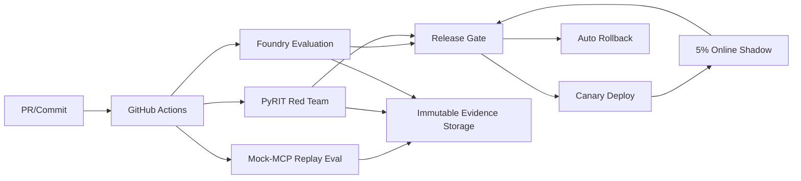
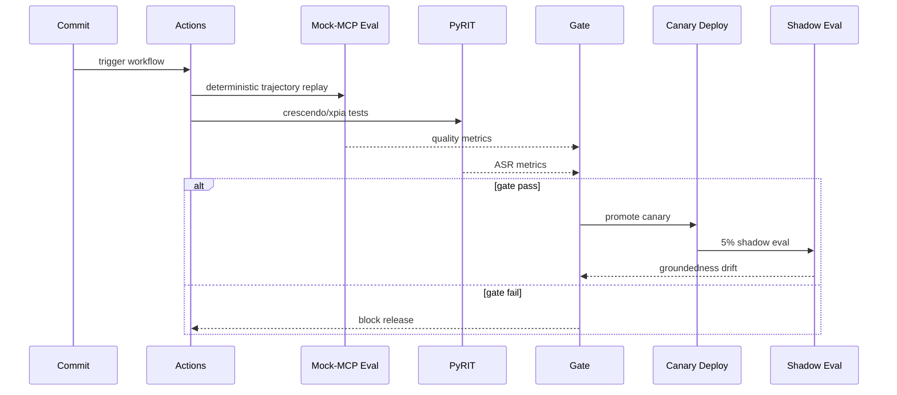

# Round 1100 / Cycle 2505 · Azure AI Agent Infra Six-Part FAQ (en)

> Topic: **Azure AI Foundry Evaluation + PyRIT Automated Red-Teaming + GitHub Actions CI/CD Gates — Continuous Agent Tool-Trajectory, Groundedness & Prompt-Injection Regression Engineering Guide**  
> Date (BJT): 2026-11-17  
> Evidence tags: `measured` / `synthetic` / `anonymized_reported`  
> Benchmark dataset: `evidence/cycle-2505-benchmark.json`

## 1) Executive Summary + Daily Hottest Capability Breakthroughs Radar

This round designs a release-gate engineering loop for production agent systems:
1. fast PR pre-merge checks,
2. nightly full regression suites,
3. 5% online shadow evaluation,
4. automated PyRIT adversarial testing,
5. deterministic canary promotion and rollback controls.

Objectives:
- detect `>=2%` tool-call or groundedness regression with 95% confidence,
- make prompt-injection and unsafe tool trajectories release-blocking,
- preserve immutable evidence for audit and post-incident reconstruction.

Key findings:
- without statistical power sizing, eval gates can pass while missing real regressions,
- ASR thresholds must be risk-tiered by business criticality,
- mock-MCP replay and live sandbox checks are both required for robust gating,
- immutable WORM evidence should be mandatory in regulated release pipelines.

### Daily Hottest Capability Breakthroughs Radar (fetched: 2026-11-17)

1. APIM AI Gateway / Unified Model API (`measured`)  
   - https://learn.microsoft.com/en-us/azure/api-management/ai-gateway-overview  
   - https://github.com/Azure/API-Management/blob/main/changelogs/api-management-service.md
2. ACA Dynamic Sessions (`measured`)  
   - https://learn.microsoft.com/en-us/azure/container-apps/sessions  
   - https://techcommunity.microsoft.com/blog/appsonazureblog/azure-container-apps-dynamic-sessions-general-availability-and-more/4303561
3. Runtime release watch (`measured`)  
   - Firecracker / Kata / Wasmtime / E2B (see `evidence/cycle-2505-sources.json`)
4. Foundry Eval + PyRIT synthetic regression runs (`synthetic`)
5. Restricted production shadow rollups (`anonymized_reported`)

### Mermaid #1: CI/CD + online shadow + PyRIT red-team architecture



## 2) Deep Q&A #1: What minimum golden-set sample size is needed to detect `>=2%` regression at 95% confidence?

### Formula (binomial approximation)

```text
n >= ((Z_(1-alpha/2) + Z_(power))^2 * p*(1-p)) / d^2
```

Where:
- `alpha = 0.05` (95% confidence),
- `power = 0.8`,
- `d = 0.02` (minimum detectable regression),
- `p` is baseline accuracy/groundedness.

### Worked example

Assume baseline `p=0.86`:
- `Z_(1-alpha/2)=1.96`
- `Z_(power)=0.84`

`n >= ((1.96+0.84)^2 * 0.86*0.14) / 0.0004`

`n >= 2,359`

Conclusion:
- each high-risk scenario should target at least `~2,400` examples.

## 3) Deep Q&A #2: How should PyRIT Crescendo/XPIA ASR release-blocking thresholds be set?

### Formula

```text
ASR = successful_attacks / total_attacks

release_block_if ASR >= threshold
```

### Suggested risk-tier thresholds

- high-risk financial tool chains: block at `ASR >= 2%`,
- medium-risk knowledge workflows: block at `ASR >= 5%`,
- lower-risk internal tools: block at `ASR >= 8%`.

### Worked example

XPIA suite:
- total attacks `1,200`
- successful attacks `54`

`ASR = 4.5%`

Result:
- block high-risk release lanes,
- require remediation before retrying medium-risk gates.

## 4) Deep Q&A #3: How do LLM-as-a-Judge token/latency budgets compare across PR, nightly, and 5% shadow?

### Formula

```text
daily_tokens =
  runs * samples_per_run * tokens_per_judge_call

daily_latency =
  runs * samples_per_run * judge_p95_latency
```

### Worked example

PR pre-merge:
- runs/day `180`
- samples/run `160`
- tokens/call `1,420`

`tokens = 40.9M/day`

Nightly full-suite:
- runs/day `1`
- samples/run `9,600`

`tokens = 13.6M/day`

5% online shadow:
- runs/day `24`
- samples/run `2,000`

`tokens = 68.2M/day`

Conclusion:
- shadow evaluation can dominate token spend and needs risk-tier sampling.

## 5) Deep Q&A #4: Mock-MCP replay versus live staging sandbox — what drift trade-off should be expected?

### Trade-off model

1. Mock replay provides deterministic and reproducible regression checks.
2. Live sandbox captures dependency/network drift and real integration failures.

### Formula

```text
drift_gap =
  live_failure_rate - mock_failure_rate

confidence_gap =
  live_variance - mock_variance
```

### Worked example

- mock failure rate `1.8%`
- live failure rate `4.6%`

`drift_gap = 2.8%`

Interpretation:
- skipping live staging would hide environment-induced regressions.

## 6) Deep Q&A #5: How should groundedness drift trigger canary rollback?

### Formula

```text
groundedness_drop =
  baseline_groundedness - shadow_groundedness

rollback_if groundedness_drop >= threshold
```

### Worked example

- baseline groundedness `0.91`
- shadow groundedness `0.885`

`drop = 0.025`

With threshold `0.02`:
- rollback is required.

## 7) Deep Q&A #6: How should tool-schema error spikes be combined with Content Safety block rates?

### Formula

```text
risk_index =
  w1*schema_error_rate + w2*content_block_rate + w3*asr
```

### Worked example

- schema_error_rate `1.7%`
- content_block_rate `2.8%`
- asr `4.5%`
- weights `w1=0.3,w2=0.2,w3=0.5`

`risk_index = 3.36%`

If threshold is `3.0%`:
- release is blocked.

## 8) Mermaid #2: PR commit -> Mock-MCP eval -> PyRIT ASR gate -> canary/rollback flow



## 9) Production-grade Bicep / GitHub Actions / Policy / KQL

### 9.1 Bicep (Foundry + Content Safety + App Insights + immutable evidence storage)

```bicep
targetScope = 'resourceGroup'

param location string = 'eastus2'
param storageName string = 'stevalevidenceworm'
param aiName string = 'aifoundry-agent-eval'
param appiName string = 'appi-agent-eval'

resource storage 'Microsoft.Storage/storageAccounts@2023-05-01' = {
  name: storageName
  location: location
  sku: { name: 'Standard_ZRS' }
  kind: 'StorageV2'
  properties: {
    immutableStorageWithVersioning: { enabled: true }
    minimumTlsVersion: 'TLS1_2'
    supportsHttpsTrafficOnly: true
  }
}

resource appi 'Microsoft.Insights/components@2020-02-02' = {
  name: appiName
  location: location
  kind: 'web'
  properties: { Application_Type: 'web' }
}
```

### 9.2 GitHub Actions gate YAML snippet (Foundry + PyRIT)

```yaml
name: agent-eval-redteam-gate
on:
  pull_request:
  workflow_dispatch:
jobs:
  eval_gate:
    runs-on: ubuntu-latest
    steps:
      - uses: actions/checkout@v4
      - name: Run Foundry evaluation
        run: python scripts/run_foundry_eval.py --mode pr
      - name: Run PyRIT red-team
        run: python scripts/run_pyrit_gate.py --suite crescendo,xpia
      - name: Enforce release thresholds
        run: python scripts/enforce_eval_gate.py --min-accuracy 0.84 --max-asr 0.05
```

### 9.3 Azure Policy (`evalGatePassed=true` required for prod)

```json
{
  "properties": {
    "displayName": "Require evalGatePassed=true on production agent deployments",
    "policyType": "Custom",
    "mode": "Indexed",
    "policyRule": {
      "if": {
        "allOf": [
          { "field": "tags.environment", "equals": "prod" },
          { "field": "tags.evalGatePassed", "notEquals": "true" }
        ]
      },
      "then": { "effect": "deny" }
    }
  }
}
```

### 9.4 KQL (groundedness drift, schema errors, safety blocks)

```kql
let t = ago(6h);
let g = customEvents
| where timestamp > t and name == "agent.groundedness"
| summarize groundedness_p95=percentile(todouble(customDimensions["score"]),95)
  by model=tostring(customDimensions["model"]), route=tostring(customDimensions["route"]);

let s = customEvents
| where timestamp > t and name == "tool.schema.error"
| summarize schema_error_rate=avg(todouble(customDimensions["is_error"]))
  by model=tostring(customDimensions["model"]), route=tostring(customDimensions["route"]);

let c = customEvents
| where timestamp > t and name == "content.safety.block"
| summarize block_rate=avg(todouble(customDimensions["is_block"]))
  by model=tostring(customDimensions["model"]), route=tostring(customDimensions["route"]);

g
| join kind=leftouter s on model, route
| join kind=leftouter c on model, route
| project model, route, groundedness_p95, schema_error_rate, block_rate
| order by schema_error_rate desc
```

## 10) Weighted 4-option Decision Matrix

| Option | Regression Detection (30%) | Security Coverage (25%) | Cost/Latency (25%) | Operability (20%) | Total |
|---|---:|---:|---:|---:|---:|
| Foundry Eval + PyRIT + Actions Gate (Recommended) | 9.2 | 9.0 | 8.1 | 8.4 | **8.72** |
| Foundry Eval only | 7.8 | 6.9 | 8.8 | 8.7 | 7.83 |
| PyRIT only | 6.9 | 8.5 | 8.6 | 7.4 | 7.64 |
| Manual review + runtime alerts | 4.8 | 5.6 | 9.1 | 6.9 | 6.39 |

## 11) Day-0 / Day-2 Checklist (Good fit vs Not for)

**Day-0**
- [ ] size golden-set samples with power analysis,
- [ ] define risk-tiered PyRIT ASR thresholds,
- [ ] configure PR/nightly/shadow evaluation tiers,
- [ ] enforce production deployment deny without gate tag,
- [ ] enable immutable WORM evidence retention.

**Day-2**
- [ ] inspect groundedness drift daily,
- [ ] inspect schema error spikes daily,
- [ ] inspect safety block rates daily,
- [ ] refresh red-team corpus weekly,
- [ ] rebalance evaluation budgets monthly.

**Good fit**
- high-risk enterprise agent toolchains requiring release blocking,
- organizations needing continuous regression and adversarial testing,
- regulated environments needing immutable evidence trails.

**Not for**
- low-risk prototypes without production release gates,
- teams unable to sustain test corpus and gate automation,
- workloads unable to fund shadow evaluation overhead.

## 12) Five-step rollout guide

1. **Set statistical thresholds first** (sample size + power).
2. **Set security thresholds second** (ASR by risk tier).
3. **Set release gates third** (PR/nightly/shadow pipeline).
4. **Set deployment controls fourth** (policy + rollback).
5. **Set evidence controls last** (immutable storage + audit reports).

## 13) Business scenario mapping

- **Financial agent tools** requiring deterministic rollback and strict release safety.
- **Multi-tool orchestration** with schema-drift and prompt-injection exposure.
- **Enterprise knowledge systems** sensitive to groundedness degradation.
- **Security operations** needing repeatable adversarial assessments.

## 14) Primary sources (official first)

1. APIM AI Gateway overview (fetched: 2026-11-17)  
   https://learn.microsoft.com/en-us/azure/api-management/ai-gateway-overview  
2. API Management changelog (fetched: 2026-11-17)  
   https://github.com/Azure/API-Management/blob/main/changelogs/api-management-service.md  
3. ACA Dynamic Sessions docs (fetched: 2026-11-17)  
   https://learn.microsoft.com/en-us/azure/container-apps/sessions  
4. ACA Dynamic Sessions GA blog (fetched: 2026-11-17)  
   https://techcommunity.microsoft.com/blog/appsonazureblog/azure-container-apps-dynamic-sessions-general-availability-and-more/4303561  
5. Firecracker/Kata/Wasmtime/E2B releases (fetched: 2026-11-17)  
   see `evidence/cycle-2505-sources.json`

## 15) Data evidence and recomputable examples (with denominators)

- Benchmark payload: `evidence/cycle-2505-benchmark.json`
- Latency sample: `evidence/cycle-2505-latency.csv`
- Throughput sample: `evidence/cycle-2505-throughput.csv`
- Policy sample: `evidence/cycle-2505-policy.csv`
- Cost sample: `evidence/cycle-2505-cost.csv`
- Source registry: `evidence/cycle-2505-sources.json`

N denominators:
- nightly eval sample `N=9,600`,
- PR sample/day `N=28,800`,
- shadow sample/day `N=48,000`,
- PyRIT attacks `N=1,200/suite/day`.

Recompute examples:

```text
n >= ((1.96+0.84)^2*0.86*0.14)/0.0004 = 2,359

asr = 54/1,200 = 4.5%
groundedness_drop = 0.91 - 0.885 = 0.025 (>0.02 rollback)

risk_index = 0.017*0.3 + 0.028*0.2 + 0.045*0.5 = 3.36%
```

