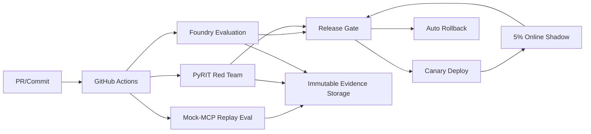
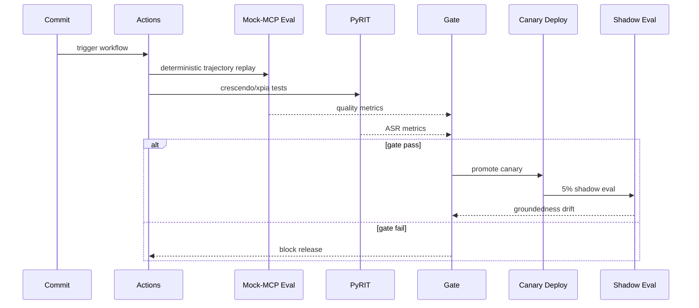

# Round 1100 / Cycle 2505 · Azure AI Agent Infra 六段式 FAQ（zh-CN）

> 主题：**Azure AI Foundry Evaluation + PyRIT Automated Red-Teaming + GitHub Actions CI/CD Gates — Continuous Agent Tool-Trajectory, Groundedness & Prompt-Injection Regression Engineering Guide**  
> 日期（BJT）：2026-11-17  
> 证据标签：`measured` / `synthetic` / `anonymized_reported`  
> 基准数据：`evidence/cycle-2505-benchmark.json`

## 1) Executive Summary + Daily Hottest Capability Breakthroughs Radar

本轮聚焦“Agent 发布门禁工程”：
1. PR 预合并快速评估；
2. 夜间全量评估；
3. 线上 5% shadow 评估；
4. PyRIT 红队攻击自动阻断；
5. 失败后可回滚与可审计证据留存。

目标：
- 在 95% 置信水平下识别 `>=2%` 的准确率/groundedness 回归；
- 将 prompt-injection 与越权工具调用风险纳入强制 release gate；
- 用统一评估证据驱动 canary promotion/rollback。

结论先行：
- 没有统计功效（power）建模的评估门禁，会产生“看似通过、实际漏检”；  
- PyRIT ASR 必须按场景分层阈值，不可一刀切；  
- mock-MCP 回放用于稳定回归，live sandbox 用于漂移发现，两者都不可省略；  
- WORM 证据存储是合规追溯底座。

### Daily Hottest Capability Breakthroughs Radar（抓取：2026-11-17）

1. APIM AI Gateway / Unified Model API（`measured`）  
   - https://learn.microsoft.com/en-us/azure/api-management/ai-gateway-overview  
   - https://github.com/Azure/API-Management/blob/main/changelogs/api-management-service.md
2. ACA Dynamic Sessions（`measured`）  
   - https://learn.microsoft.com/en-us/azure/container-apps/sessions  
   - https://techcommunity.microsoft.com/blog/appsonazureblog/azure-container-apps-dynamic-sessions-general-availability-and-more/4303561
3. Runtime release watch（`measured`）  
   - Firecracker/Kata/Wasmtime/E2B（见 `evidence/cycle-2505-sources.json`）
4. Foundry Eval + PyRIT 回归压测（`synthetic`）
5. 匿名化线上 shadow 统计（`anonymized_reported`）

### Mermaid #1：CI/CD + Online Shadow Evaluation & PyRIT Red-Team 架构



## 2) Deep Q&A #1：如何计算最小 golden-set 样本量，捕获 `>=2%` 回归（95% 置信）？

### 公式（二项比例近似）

```text
n >= ((Z_(1-alpha/2) + Z_(power))^2 * p*(1-p)) / d^2
```

其中：
- `alpha = 0.05`（95% 置信）；
- `power = 0.8`；
- `d = 0.02`（希望检测到至少 2% 回归）；
- `p` 为基线准确率或 groundedness。

### Worked example

假设基线 `p=0.86`：
- `Z_(1-alpha/2)=1.96`
- `Z_(power)=0.84`

`n >= ((1.96+0.84)^2 * 0.86*0.14) / 0.0004`

`n >= (7.84 * 0.1204)/0.0004 = 2,359`

结论：每个关键场景至少 `~2,400` 样本才有足够检出力。

## 3) Deep Q&A #2：PyRIT Crescendo / XPIA ASR 的 release-block 阈值怎么设？

### 公式

```text
ASR = successful_attacks / total_attacks

release_block_if ASR >= threshold
```

### 分层阈值建议

- 高风险金融交易链路：`ASR >= 2%` 阻断；
- 中风险知识问答链路：`ASR >= 5%` 阻断；
- 低风险内部工具：`ASR >= 8%` 阻断。

### Worked example

XPIA 攻击：
- total `1,200`
- success `54`

`ASR = 4.5%`

结论：
- 对高风险链路阻断；  
- 对中风险链路触发强制 remediation 后可重跑。

## 4) Deep Q&A #3：LLM-as-a-Judge 在 PR / nightly / 5% online shadow 的 token 与延迟预算？

### 公式

```text
daily_tokens =
  runs * samples_per_run * tokens_per_judge_call

daily_latency =
  runs * samples_per_run * judge_p95_latency
```

### Worked example

PR pre-merge：
- runs/day `180`
- samples/run `160`
- tokens/call `1,420`

`tokens = 40.9M/day`

Nightly full-suite：
- runs/day `1`
- samples/run `9,600`
- tokens/call `1,420`

`tokens = 13.6M/day`

5% online shadow：
- runs/day `24`
- samples/run `2,000`
- tokens/call `1,420`

`tokens = 68.2M/day`

### 结论

在线 shadow token 成本最大，必须做：
1. 分层采样；
2. 高风险优先；
3. 低风险场景降评估频率。

## 5) Deep Q&A #4：Mock-MCP 回放 vs Live staging sandbox 的漂移取舍？

### 对比

1. Mock：确定性高、可复现、回归稳定；  
2. Live：覆盖真实网络/依赖漂移，但噪声更大。

### 公式

```text
drift_gap =
  live_failure_rate - mock_failure_rate

confidence_gap =
  live_variance - mock_variance
```

### Worked example

- mock failure `1.8%`
- live failure `4.6%`

`drift_gap = 2.8%`

这 2.8% 是环境漂移风险，若不测 live 将被漏检。

## 6) Deep Q&A #5：Groundedness 在线漂移如何触发 canary rollback？

### 公式

```text
groundedness_drop =
  baseline_groundedness - shadow_groundedness

rollback_if groundedness_drop >= threshold
```

### Worked example

- baseline groundedness `0.91`
- shadow `0.885`

`drop = 0.025`

若阈值 `0.02`：
- 触发回滚。

## 7) Deep Q&A #6：Tool-schema error spikes 如何与 Content Safety block rate 组合判定？

### 公式

```text
risk_index =
  w1*schema_error_rate + w2*content_block_rate + w3*asr
```

### Worked example

- schema_error_rate `1.7%`
- content_block_rate `2.8%`
- asr `4.5%`
- 权重 `w1=0.3,w2=0.2,w3=0.5`

`risk_index = 0.017*0.3 + 0.028*0.2 + 0.045*0.5 = 3.36%`

若阈值 `3.0%`：阻断发布。

## 8) Mermaid #2：PR -> Mock-MCP Eval -> PyRIT ASR Gate -> Canary/Rollback



## 9) 生产级 Bicep / GitHub Actions / Policy / KQL

### 9.1 Bicep（Foundry Hub/Project + Content Safety + AppInsights + WORM）

```bicep
targetScope = 'resourceGroup'

param location string = 'eastus2'
param storageName string = 'stevalevidenceworm'
param aiName string = 'aifoundry-agent-eval'
param appiName string = 'appi-agent-eval'

resource storage 'Microsoft.Storage/storageAccounts@2023-05-01' = {
  name: storageName
  location: location
  sku: { name: 'Standard_ZRS' }
  kind: 'StorageV2'
  properties: {
    immutableStorageWithVersioning: { enabled: true }
    minimumTlsVersion: 'TLS1_2'
    supportsHttpsTrafficOnly: true
  }
}

resource appi 'Microsoft.Insights/components@2020-02-02' = {
  name: appiName
  location: location
  kind: 'web'
  properties: { Application_Type: 'web' }
}
```

### 9.2 GitHub Actions（azure-ai-evaluation + PyRIT gate）YAML 片段

```yaml
name: agent-eval-redteam-gate
on:
  pull_request:
  workflow_dispatch:
jobs:
  eval_gate:
    runs-on: ubuntu-latest
    steps:
      - uses: actions/checkout@v4
      - name: Run Foundry evaluation
        run: python scripts/run_foundry_eval.py --mode pr
      - name: Run PyRIT red-team
        run: python scripts/run_pyrit_gate.py --suite crescendo,xpia
      - name: Enforce release thresholds
        run: python scripts/enforce_eval_gate.py --min-accuracy 0.84 --max-asr 0.05
```

### 9.3 Azure Policy（生产部署要求 `evalGatePassed=true`）

```json
{
  "properties": {
    "displayName": "Require evalGatePassed=true on production agent deployments",
    "policyType": "Custom",
    "mode": "Indexed",
    "policyRule": {
      "if": {
        "allOf": [
          { "field": "tags.environment", "equals": "prod" },
          { "field": "tags.evalGatePassed", "notEquals": "true" }
        ]
      },
      "then": { "effect": "deny" }
    }
  }
}
```

### 9.4 KQL（groundedness drift、schema error、safety block）

```kql
let t = ago(6h);
let g = customEvents
| where timestamp > t and name == "agent.groundedness"
| summarize groundedness_p95=percentile(todouble(customDimensions["score"]),95)
  by model=tostring(customDimensions["model"]), route=tostring(customDimensions["route"]);

let s = customEvents
| where timestamp > t and name == "tool.schema.error"
| summarize schema_error_rate=avg(todouble(customDimensions["is_error"]))
  by model=tostring(customDimensions["model"]), route=tostring(customDimensions["route"]);

let c = customEvents
| where timestamp > t and name == "content.safety.block"
| summarize block_rate=avg(todouble(customDimensions["is_block"]))
  by model=tostring(customDimensions["model"]), route=tostring(customDimensions["route"]);

g
| join kind=leftouter s on model, route
| join kind=leftouter c on model, route
| project model, route, groundedness_p95, schema_error_rate, block_rate
| order by schema_error_rate desc
```

## 10) 决策矩阵（4 方案加权）

| 方案 | 回归检出能力 (30%) | 安全防护 (25%) | 成本延迟 (25%) | 可运维性 (20%) | 总分 |
|---|---:|---:|---:|---:|---:|
| Foundry Eval + PyRIT + Actions Gate（推荐） | 9.2 | 9.0 | 8.1 | 8.4 | **8.72** |
| Foundry Eval only | 7.8 | 6.9 | 8.8 | 8.7 | 7.83 |
| PyRIT only | 6.9 | 8.5 | 8.6 | 7.4 | 7.64 |
| 手工抽检 + 线上报警 | 4.8 | 5.6 | 9.1 | 6.9 | 6.39 |

## 11) Day-0 / Day-2 Checklist（Good fit vs Not for）

**Day-0（上线前）**
- [ ] 建立 golden-set 与样本量功效模型；
- [ ] 配置 PyRIT ASR 分层阈值；
- [ ] 配置 PR/nightly/shadow 三层评估；
- [ ] 启用 evalGatePassed 生产阻断策略；
- [ ] 启用 WORM 证据留存。

**Day-2（运行期）**
- [ ] 每日复盘 groundedness drift；
- [ ] 每日复盘 schema error spikes；
- [ ] 每日复盘 safety block rate；
- [ ] 每周更新攻击样本库；
- [ ] 每月复核评估预算与阈值。

**Good fit**
- 高风险企业 Agent 工具执行链；  
- 需要持续回归、红队、上线门禁一体化；  
- 需要合规可追溯证据链。

**Not for**
- 低风险内部 PoC 且无上线门禁需求；  
- 无法维护攻击样本与评估流水线；  
- 无法承担线上 shadow 成本。

## 12) 五步落地指南

1. **先定统计门槛**：样本量 + 功效；
2. **再定安全门槛**：ASR + 注入攻击分层；
3. **再定发布门槛**：PR/nightly/shadow 三层；
4. **再定阻断策略**：tag policy + 自动回滚；
5. **最后定证据链**：WORM 存证 + 可审计报表。

## 13) 业务场景映射

- **金融 Agent 工具调用**：必须可阻断高风险回归。  
- **多工具工作流**：schema 漂移易触发连锁失败。  
- **企业知识问答**：groundedness 漂移需在线监控。  
- **安全运营中心**：持续红队评估与报告归档。

## 14) 关键来源（官方优先）

1. APIM AI Gateway overview（抓取：2026-11-17）  
   https://learn.microsoft.com/en-us/azure/api-management/ai-gateway-overview  
2. API Management changelog（抓取：2026-11-17）  
   https://github.com/Azure/API-Management/blob/main/changelogs/api-management-service.md  
3. ACA Dynamic Sessions docs（抓取：2026-11-17）  
   https://learn.microsoft.com/en-us/azure/container-apps/sessions  
4. ACA Dynamic Sessions GA blog（抓取：2026-11-17）  
   https://techcommunity.microsoft.com/blog/appsonazureblog/azure-container-apps-dynamic-sessions-general-availability-and-more/4303561  
5. Firecracker/Kata/Wasmtime/E2B releases（抓取：2026-11-17）  
   见 `evidence/cycle-2505-sources.json`

## 15) 数据证据与可复算算例（含 n 分母来源）

- Benchmark 主文件：`evidence/cycle-2505-benchmark.json`
- 延迟样本：`evidence/cycle-2505-latency.csv`
- 吞吐样本：`evidence/cycle-2505-throughput.csv`
- 策略样本：`evidence/cycle-2505-policy.csv`
- 成本样本：`evidence/cycle-2505-cost.csv`
- 来源登记：`evidence/cycle-2505-sources.json`

N 分母口径：
- eval 样本 `N=9,600/nightly`；
- PR 样本 `N=28,800/day`；
- shadow 样本 `N=48,000/day`；
- PyRIT 攻击 `N=1,200/suite/day`。

复算示例：

```text
n >= ((1.96+0.84)^2*0.86*0.14)/0.0004 = 2,359

asr = 54/1,200 = 4.5%
hitl-like escalation example = 28,560/680,000 = 4.2%

groundedness_drop = 0.91 - 0.885 = 0.025 (>0.02 rollback)
risk_index = 0.017*0.3 + 0.028*0.2 + 0.045*0.5 = 3.36%
```

