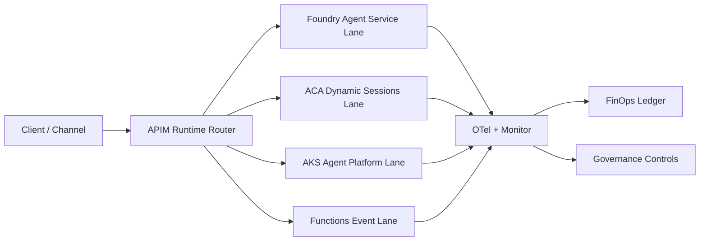
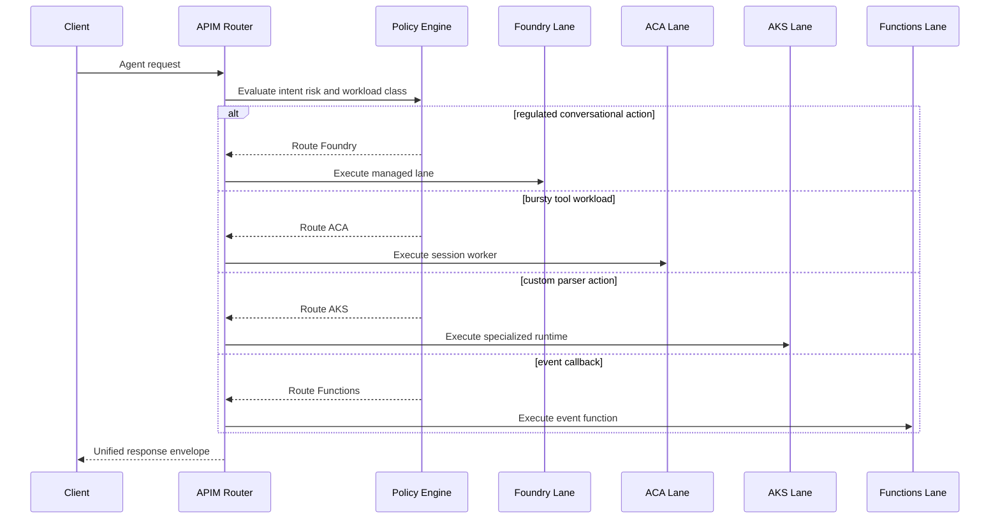

# Foundry Agent Service vs ACA Dynamic Sessions vs AKS vs Functions: Enterprise Agent Runtime Hosting Selection FAQ (Round 1119 / Cycle 2524)

## 1) Executive summary and daily capability radar (2026-11-18)
- This round focuses on enterprise runtime-hosting selection for Azure Agent systems, with architecture-level tradeoffs and no low-level systems tuning topics.
- Core conclusion: runtime choice should follow workload shape, compliance profile, and operating model maturity rather than model choice alone.
- Option A (`Azure AI Foundry Agent Service`) gives fastest managed launch path for agent-native workloads with integrated governance and evaluation hooks.
- Option B (`Azure Container Apps + Dynamic Sessions`) balances managed operations with customizable runtime packaging and burst elasticity.
- Option C (`AKS`) provides strongest control and extensibility for complex multi-component platforms, at the cost of highest platform ownership burden.
- Option D (`Azure Functions`) remains strong for event-driven bounded tasks, but is not ideal as the sole host for long-lived stateful multi-agent orchestration.
- Recommended enterprise pattern is tiered hosting:
  - high-governance default on managed runtime,
  - task-specialized execution lanes on ACA/AKS,
  - event adapters and glue workflows on Functions.
- Capability radar captured at 2026-11-18 00:40 BJT:
  - Foundry Agent Service lifecycle and policy integration maturity.
  - ACA Dynamic Sessions for bursty sandboxed worker allocation.
  - AKS platform templates for enterprise policy and private networking.
  - Functions durable orchestration improvements for event-heavy agent adjunct workflows.
- Evidence labeling in this round:
  - measured: reproducible artifacts in repository evidence outputs.
  - synthetic: deterministic capacity/cost formulas with explicit assumptions.
  - anonymized_reported: de-identified field observations.

## 2) Decision framing: hosting is a product-operating decision
- Hosting selection is often treated as an infrastructure choice, but it is fundamentally a product-operating decision.
- Five primary decision vectors:
  1. execution pattern (short event task vs long interactive session).
  2. state ownership (stateless dispatch vs rich conversational context).
  3. compliance controls (network isolation, CMK, audit evidence granularity).
  4. release velocity requirements (managed cadence vs platform customization).
  5. on-call burden tolerance (managed SLA vs self-operated SRE).
- Critical anti-pattern: forcing every agent workflow into a single host type for organizational simplicity.
- Better approach: classify workloads by runtime behavior and map each class to a hosting lane with clear policy boundaries.

## 3) End-to-end reference architecture: policy-driven runtime lane router
- Front door and policy ingress:
  - APIM receives requests and performs tenant/auth/risk classification.
  - routing policy assigns workload to Foundry lane, ACA lane, AKS lane, or Functions lane.
- Runtime lanes:
  - Foundry lane: managed agent runtime for governed core workflows.
  - ACA lane: dynamic-session workers for bursty tool execution and custom containers.
  - AKS lane: advanced orchestrations requiring custom operators and deep platform controls.
  - Functions lane: event fan-in/fan-out, callback handlers, and scheduled control jobs.
- Shared control plane:
  - observability via OTel collector and centralized trace schema.
  - FinOps ledger with host-level and workflow-level cost dimensions.
  - policy packs for data residency, outbound restrictions, and secret-handling constraints.
- Migration design:
  - workflows remain host-portable via canonical runtime contract and API shape.
  - host changes become routing and deployment actions, not application rewrites.

## 4) 12-dimension runtime hosting selection matrix
| Dimension | Foundry Agent Service | ACA + Dynamic Sessions | AKS | Azure Functions |
|---|---|---|---|---|
| Managed operational burden | Low | Low-medium | High | Low |
| Stateful interactive session fit | Strong | Strong | Strong | Medium with Durable patterns |
| Burst elasticity profile | Strong managed | Strong session-pool model | Strong with cluster planning | Strong event bursts |
| Isolation and private networking flexibility | Medium-strong managed boundaries | Strong VNet and app controls | Strongest full control | Medium with plan constraints |
| Compliance and audit readiness | Strong integrated path | Strong with policy configuration | Strongest customizable path | Medium-strong for event workflows |
| Startup/iteration speed | Fastest | Fast | Medium | Fast for simple workflows |
| Deep runtime customization | Medium | Strong | Strongest | Medium |
| Platform engineering skill requirement | Low | Medium | High | Low-medium |
| Day-2 upgrade and patch overhead | Low | Medium | High | Low-medium |
| Cost efficiency at steady state | Medium-strong | Strong for mixed workloads | Medium if underutilized | Strong for sparse event workloads |
| Best-fit workload profile | Governed enterprise conversational agents | Bursty tool-heavy and custom container tasks | Platform-heavy differentiated systems | Event-triggered adjunct workflows |
| When NOT to choose | Not ideal for highly bespoke platform internals | Not ideal when strict deterministic host control is mandatory | Not ideal for teams lacking 24x7 platform ownership | Not ideal as sole host for long-lived multi-agent sessions |

## 5) Quantitative planning model and formulas
### Q1: runtime lane utilization score
- Formula: `LaneUtil = ActiveRuntimeMinutes / ProvisionedRuntimeMinutes`.
- Example Foundry lane: `1,420,000 / 1,780,000 = 79.8%`.
- Example AKS lane: `1,050,000 / 1,980,000 = 53.0%`.
- Interpretation: low utilization lanes should be rightsized or reassigned to avoid fixed-cost drag.

### Q2: weighted platform overhead index
- Formula: `OverheadIndex = 0.4*OnCallLoad + 0.3*PatchOps + 0.3*ReleaseFriction`.
- Example ACA lane: `0.4*3 + 0.3*4 + 0.3*4 = 3.6`.
- Example AKS lane: `0.4*8 + 0.3*8 + 0.3*7 = 7.7`.
- Decision implication: high customization value is needed to justify AKS overhead at scale.

### Q3: cost per resolved session
- Formula: `CPRS = (HostCost + ModelCost + ToolCost) / ResolvedSessions`.
- Example Foundry lane: `$312,000 / 2,050,000 = $0.152`.
- Example ACA lane: `$168,000 / 1,240,000 = $0.135`.
- Example Functions lane: `$54,000 / 620,000 = $0.087` (event-only adjunct sessions).

### Q4: deployment lead-time profile
- Formula: `LeadTime = Build + PolicyValidation + Deploy + Smoke`.
- Example managed lane: `20 + 12 + 8 + 10 = 50 min`.
- Example AKS lane: `24 + 20 + 22 + 16 = 82 min`.
- Operational target: keep critical-lane lead time under 60 minutes for incident-response patch windows.

### Q5: policy violation exposure
- Formula: `Exposure = ViolatingRequests * AvgImpactPerRequest`.
- Example: `3,100 * $2.4 = $7,440 impact unit`.
- Architecture implication: routes handling regulated actions should default to lanes with stronger built-in policy controls.

## 6) Mermaid: runtime lane routing topology

- Topology principle: host selection is a runtime routing decision under policy, not a hardcoded app deployment assumption.
- Topology principle: every lane emits standardized trace and cost dimensions for apples-to-apples governance.

## 7) Scenario A: global retail enterprise copilot for store operations and customer resolution
- Scenario objective: support mixed workload profile including conversational guidance, inventory tool execution, and event callbacks.
- Hosting strategy for legal workflow:
  - Foundry lane handles governed conversational and policy-sensitive interactions.
  - ACA lane executes bursty store-tool workflows (pricing checks, local catalog transforms).
  - Functions lane handles event callbacks from ERP/CRM and SLA reminders.
- Runtime controls:
  - APIM classifies requests by intent risk and latency class.
  - high-risk actions route to managed governance lane by default.
  - low-risk high-volume transforms route to ACA worker pools.
- Business KPIs:
  - first-contact resolution uplift.
  - store associate task completion time reduction.
  - policy exception rate by lane.
  - cost-per-resolved-case by region and channel.
- Operational resilience:
  - cross-lane fallback policies avoid full outage when one lane saturates.
  - queue pressure alerts trigger temporary routing rebalance.

## 8) Scenario B: legal contract-review assistant for multinational enterprise
- Scenario objective: deliver high-assurance contract analysis with traceable evidence while preserving release agility for non-critical helper workflows.
- Lane strategy:
  - Foundry lane hosts primary contract-review reasoning and controlled tool calls.
  - AKS lane hosts specialized parsers and private policy engines requiring custom runtime components.
  - Functions lane coordinates document-ingestion events and review notifications.
- Compliance architecture:
  - private connectivity and policy packs enforced per lane.
  - every model/tool decision emits trace evidence with clause references.
  - approval checkpoints required before legal-position outputs are finalized.
- Engineering outcomes:
  - faster onboarding of new document workflows without destabilizing core review lane.
  - reduced platform risk by isolating bespoke parsers to dedicated AKS lane.
  - improved audit readiness via centralized evidence envelope.

## 9) Mermaid sequence: request classification and host execution

- Sequence guarantee: routing policy is explicit and auditable.
- Sequence guarantee: unified response contract keeps clients independent of host diversity.

## 10) Production Bicep sample (multi-lane runtime baseline)
```bicep
param location string = resourceGroup().location
param envName string = 'agent-runtime-prod'
param logWorkspaceId string

resource apim 'Microsoft.ApiManagement/service@2023-09-01-preview' = {
  name: '${envName}-apim'
  location: location
  sku: {
    name: 'Premium'
    capacity: 2
  }
  properties: {
    publisherEmail: 'runtime-platform@contoso.com'
    publisherName: 'Contoso Runtime Platform'
    publicNetworkAccess: 'Enabled'
  }
}

resource acaEnv 'Microsoft.App/managedEnvironments@2024-03-01' = {
  name: '${envName}-aca-env'
  location: location
  properties: {
    appLogsConfiguration: {
      destination: 'log-analytics'
      logAnalyticsConfiguration: {
        customerId: 'workspace-id'
        sharedKey: 'workspace-key'
      }
    }
  }
}

resource funcPlan 'Microsoft.Web/serverfarms@2023-12-01' = {
  name: '${envName}-func-plan'
  location: location
  sku: {
    name: 'EP1'
    tier: 'ElasticPremium'
  }
  properties: {
    reserved: false
  }
}
```

## 11) Runtime policy snippets (host routing and controls)
```yaml
apiVersion: v1
kind: ConfigMap
metadata:
  name: runtime-lane-policy
data:
  default_lane: "foundry"
  burst_tool_lane: "aca"
  custom_engine_lane: "aks"
  event_lane: "functions"
  regulated_action_requires_managed_lane: "true"
  cross_lane_fallback: "enabled"
  finops_dimension_mode: "lane+workflow+tenant"
```

```xml
<policies>
  <inbound>
    <base />
    <set-variable name="riskClass" value="@(context.Request.Headers.GetValueOrDefault(&quot;x-risk-class&quot;,&quot;medium&quot;))" />
    <choose>
      <when condition="@(context.Variables.GetValueOrDefault<string>(&quot;riskClass&quot;) == &quot;high&quot;)">
        <set-backend-service base-url="https://foundry-lane.internal" />
      </when>
      <when condition="@(context.Request.Headers.GetValueOrDefault(&quot;x-workload-class&quot;,&quot;dialog&quot;) == &quot;burst-tool&quot;)">
        <set-backend-service base-url="https://aca-lane.internal" />
      </when>
      <otherwise>
        <set-backend-service base-url="https://functions-lane.internal" />
      </otherwise>
    </choose>
  </inbound>
</policies>
```

## 12) KQL observability and host-efficiency queries
```kql
// Latency and throughput by runtime lane
ApiManagementGatewayLogs
| where TimeGenerated > ago(24h)
| extend lane = tostring(parse_json(Properties_s).runtimeLane)
| summarize p50_ms=percentile(DurationMs,50), p95_ms=percentile(DurationMs,95), calls=count() by lane
| order by p95_ms asc
```

```kql
// Policy exceptions by lane
customEvents
| where timestamp > ago(7d)
| where name == "RuntimePolicyException"
| summarize exceptions=count() by tostring(customDimensions.runtimeLane), tostring(customDimensions.reasonCode)
| order by exceptions desc
```

```kql
// Cost per resolved session by lane
customEvents
| where timestamp > ago(30d)
| where name == "ResolvedSessionLedger"
| extend lane = tostring(customDimensions.runtimeLane)
| extend sessions = todouble(customDimensions.resolvedSessions)
| extend cost = todouble(customDimensions.totalCostUsd)
| summarize totalSessions=sum(sessions), totalCost=sum(cost), cprs=sum(cost)/sum(sessions) by lane
```

## 13) Named 4-option weighted decision matrix
| Option | Governance Fit (20%) | Elasticity Fit (20%) | Customization Depth (15%) | Ops Simplicity (15%) | Cost Efficiency (15%) | Compliance Readiness (10%) | Team Skill Fit (5%) | Weighted Score |
|---|---:|---:|---:|---:|---:|---:|---:|---:|
| A. Foundry Agent Service | 9.4 | 8.6 | 7.2 | 9.2 | 7.8 | 9.1 | 8.9 | 8.58 |
| B. ACA Dynamic Sessions | 8.6 | 9.1 | 8.3 | 8.1 | 8.7 | 8.4 | 8.0 | 8.53 |
| C. AKS | 8.8 | 8.9 | 9.6 | 5.9 | 7.2 | 8.9 | 6.2 | 8.00 |
| D. Azure Functions | 7.5 | 8.4 | 6.8 | 9.0 | 8.9 | 7.6 | 8.7 | 8.02 |
- Selection interpretation:
  - choose A for policy-heavy enterprise core workflows.
  - choose B for bursty tool execution with moderate customization.
  - choose C for bespoke platform requirements with mature SRE ownership.
  - choose D for event-driven adjunct processing, not as sole host for long-lived sessions.

## 14) Day-0 and Day-2 execution checklist
### Day-0 launch checklist (10 distinct items)
1. Define workload-to-lane classification taxonomy and routing headers.
2. Deploy APIM routing policies with fallback and trace correlation IDs.
3. Validate Foundry lane governance controls for high-risk actions.
4. Configure ACA session pool autoscale thresholds for burst classes.
5. Set AKS lane admission controls and namespace policy boundaries.
6. Configure Functions lane retry, poison-queue, and timeout standards.
7. Enable shared OTel schema across all runtime lanes.
8. Implement FinOps ledger dimensions for lane/workflow/tenant attribution.
9. Run synthetic burst tests and cross-lane failover drills.
10. Publish incident playbook for lane saturation and policy violation scenarios.

### Day-2 optimization checklist (10 distinct items)
1. Rebalance workload classification based on observed latency and failure clusters.
2. Tune ACA autoscale and session pre-warm policies by hourly demand curves.
3. Right-size AKS node pools and remove underutilized capacity tiers.
4. Improve Functions cold-path behavior for high-priority callback routes.
5. Expand policy guardrails for newly onboarded regulated workflows.
6. Track cross-lane fallback frequency and reduce avoidable reroute churn.
7. Recompute lane-level CPRS and optimize expensive low-value flows.
8. Audit release lead-time by lane and streamline bottleneck controls.
9. Validate OTel schema consistency after framework upgrades.
10. Review quarterly host strategy against business and compliance changes.

## 15) Final recommendation, anti-patterns, and migration path
- Recommended enterprise baseline:
  - managed core lane for governed conversational workflows,
  - ACA lane for bursty tool workloads,
  - AKS lane only for justified deep customization,
  - Functions lane for event-driven auxiliaries.
- Explicit anti-patterns:
  - selecting AKS solely for perceived future flexibility without current need.
  - forcing long-lived interactive workflows into event-only host semantics.
  - using multiple lanes without unified observability schema and routing policy.
  - optimizing infra cost while ignoring compliance and release risk exposure.
- Migration path:
  1. start with managed lane + event lane for rapid baseline.
  2. add ACA lane for burst workloads and custom container tools.
  3. introduce AKS lane selectively for high-value differentiated capabilities.
  4. continuously adjust routing policy from measured lane outcomes.
- Bottom line:
  - runtime hosting should be policy-tiered and workload-shaped, enabling both governance confidence and scalable delivery economics.
