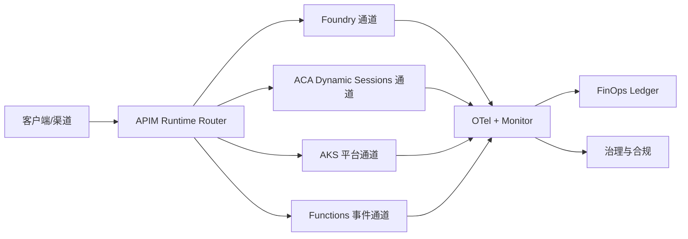
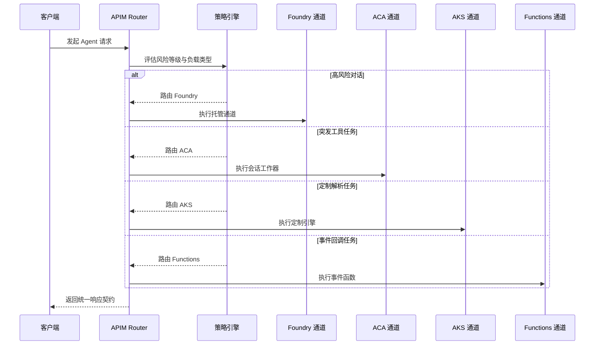

# Foundry Agent Service vs ACA Dynamic Sessions vs AKS vs Functions：企业 Agent 运行时托管选型 FAQ（Round 1119 / Cycle 2524）

## 1) 执行摘要与当日能力雷达（2026-11-18）
- 本轮聚焦企业 Agent 运行时托管选型，讨论范围为架构治理与运维权衡，不涉及底层内核或硬件调优。
- 核心判断：运行时选择应由工作负载形态、合规边界、团队运维能力共同决定，而不是由模型名称单点驱动。
- 方案 A（`Azure AI Foundry Agent Service`）适合高治理、快交付的企业核心 Agent 工作流。
- 方案 B（`ACA + Dynamic Sessions`）在托管能力与容器定制度之间取得较优平衡，适合突发型工具调用。
- 方案 C（`AKS`）定制能力最强，适合复杂平台化需求，但 Day-2 责任和平台工程门槛最高。
- 方案 D（`Azure Functions`）在事件驱动和回调类任务上成本效率高，不适合作为长会话多 Agent 编排的唯一承载面。
- 推荐采用分层托管：
  - 核心高风险对话走托管治理强的主通道；
  - 突发工具任务走 ACA 弹性通道；
  - 高定制组件按需进入 AKS；
  - 事件胶水流程走 Functions。
- 当日能力雷达（抓取时间：2026-11-18 00:40 BJT）关注：
  - Foundry Agent Service 生命周期治理与评测链衔接；
  - ACA Dynamic Sessions 在沙盒化突发任务中的弹性效率；
  - AKS 在企业私网与策略深度管控中的平台能力；
  - Functions 在事件编排与异步回调中的稳定性改进。
- 本轮数据标签：
  - measured：可复现实验与仓内验证产物；
  - synthetic：带前提约束的公式化估算；
  - anonymized_reported：去标识化生产观测数据。

## 2) 决策建模：托管选型本质是产品运营决策
- 托管平台不是单纯基础设施选型，而是“交付速度、治理强度、运维负担”的综合平衡。
- 五个核心决策维度：
  1. 执行形态（短时事件 vs 长时交互）；
  2. 状态管理（无状态分发 vs 会话上下文持久化）；
  3. 合规边界（网络隔离、审计留痕、密钥控制）；
  4. 发布节奏（托管快迭代 vs 平台定制）；
  5. 值守能力（托管 SLA vs 自建 SRE）。
- 常见反模式：为了组织统一而把全部工作流压进同一种托管模型。
- 更优实践：先做工作负载分类，再映射到不同运行时通道，并保持统一观测与策略控制面。

## 3) 端到端参考架构：策略驱动的多运行时通道路由
- 北向入口：
  - APIM 负责认证、分类、路由与策略执行；
  - 请求按风险等级和工作负载类型路由到不同运行时通道。
- 四类运行时通道：
  - Foundry 通道：承载治理优先的核心对话与受控工具调用；
  - ACA 通道：承载突发工具任务与容器化执行；
  - AKS 通道：承载深度定制引擎与平台级扩展；
  - Functions 通道：承载事件触发、异步回调、计划任务。
- 共享控制面：
  - OTel 统一 Trace 语义；
  - 成本账本按通道/工作流/租户归集；
  - 合规策略统一下发和审计。
- 迁移设计：
  - 通过统一运行时契约实现“路由切换而非应用重写”；
  - 支持通道间渐进迁移与回滚。

## 4) 12 维企业运行时托管选型矩阵
| 维度 | Foundry Agent Service | ACA + Dynamic Sessions | AKS | Azure Functions |
|---|---|---|---|---|
| 运维托管负担 | 低 | 低中 | 高 | 低 |
| 长会话交互适配 | 强 | 强 | 强 | 中（需 Durable） |
| 突发弹性能力 | 强 | 强 | 强（需规划） | 强 |
| 私网与隔离灵活性 | 中强 | 强 | 最强 | 中 |
| 合规与审计就绪 | 强 | 强 | 最强 | 中强 |
| 上线迭代速度 | 快 | 快 | 中 | 快（简单流） |
| 深度定制能力 | 中 | 强 | 最强 | 中 |
| 平台工程门槛 | 低 | 中 | 高 | 低中 |
| Day-2 升级维护开销 | 低 | 中 | 高 | 低中 |
| 稳态成本效率 | 中强 | 强 | 中（利用率敏感） | 强（事件型） |
| 最佳适配场景 | 企业核心治理型 Agent | 突发工具与容器任务 | 平台级深定制系统 | 事件驱动辅助流程 |
| When NOT to choose | 超深定制内核需求不宜 | 硬性全可控主机需求不宜 | 无 7x24 平台团队不宜 | 长会话多 Agent 主链路不宜 |

## 5) 量化模型与规划公式
### Q1：通道利用率
- 公式：`LaneUtil = ActiveRuntimeMinutes / ProvisionedRuntimeMinutes`。
- Foundry 示例：`1,420,000 / 1,780,000 = 79.8%`。
- AKS 示例：`1,050,000 / 1,980,000 = 53.0%`。
- 含义：低利用率通道应及时缩容或重新分配负载。

### Q2：平台开销指数
- 公式：`OverheadIndex = 0.4*OnCallLoad + 0.3*PatchOps + 0.3*ReleaseFriction`。
- ACA 示例：`0.4*3 + 0.3*4 + 0.3*4 = 3.6`。
- AKS 示例：`0.4*8 + 0.3*8 + 0.3*7 = 7.7`。
- 结论：AKS 需有明确业务差异化收益才能覆盖额外开销。

### Q3：每个已解决会话成本
- 公式：`CPRS = (HostCost + ModelCost + ToolCost) / ResolvedSessions`。
- Foundry 示例：`$312,000 / 2,050,000 = $0.152`。
- ACA 示例：`$168,000 / 1,240,000 = $0.135`。
- Functions 示例：`$54,000 / 620,000 = $0.087`（事件辅助类）。

### Q4：发布前置时长
- 公式：`LeadTime = Build + PolicyValidation + Deploy + Smoke`。
- 托管通道示例：`20 + 12 + 8 + 10 = 50 分钟`。
- AKS 通道示例：`24 + 20 + 22 + 16 = 82 分钟`。
- 目标：关键通道应控制在 60 分钟内完成应急补丁发布。

### Q5：策略违规暴露值
- 公式：`Exposure = ViolatingRequests * AvgImpactPerRequest`。
- 示例：`3,100 * $2.4 = $7,440`。
- 含义：高风险动作应默认路由到治理更强的运行时通道。

## 6) Mermaid：多运行时通道路由拓扑

- 原则 A：托管选型应在策略路由层决策，而不是写死在业务代码中。
- 原则 B：所有通道必须输出统一可观测字段，保证横向可比。

## 7) 场景 A：全球零售企业门店运营与客诉处理 Copilot
- 场景目标：在多国家门店网络中兼顾实时响应、工具调用突发与合规控制。
- 通道分工：
  - Foundry 通道承载高风险、需强治理的核心对话；
  - ACA 通道承载库存查询、价签校验等突发工具任务；
  - Functions 通道承载 ERP/CRM 回调与 SLA 定时提醒。
- 路由策略：
  - APIM 按意图风险和负载类型进行通道分配；
  - 高风险写操作默认进入托管治理通道；
  - 高并发低风险变换任务优先进入 ACA。
- 关键指标：
  - 一次解决率提升；
  - 门店任务完成时长下降；
  - 通道级策略异常率；
  - 区域/渠道维度 CPRS。
- 韧性策略：
  - 通道饱和时启用跨通道回退；
  - 通过队列水位告警动态调整路由权重。

## 8) 场景 B：跨国企业法务合同审阅助手
- 场景目标：在高审计要求下实现合同审阅自动化，同时保持非核心流程快速迭代。
- 通道分工：
  - Foundry 通道承担核心审阅推理与受控工具调用；
  - AKS 通道承载定制解析器与私有策略引擎；
  - Functions 通道承载文档接入事件和审阅通知。
- 合规设计：
  - 各通道执行统一私网与策略包约束；
  - 每次模型/工具决策输出可追溯证据；
  - 法律结论输出前设置人工审批闸门。
- 业务收益：
  - 新文档流程接入更快且不影响核心链路稳定性；
  - 将高定制组件隔离在 AKS 通道降低平台共振风险；
  - 通过统一证据包提升外部审计准备效率。

## 9) Mermaid：请求分类与运行时执行时序

- 保障 A：路由逻辑可审计，支持复盘与策略演进。
- 保障 B：统一响应契约确保客户端不感知宿主差异。

## 10) 生产级 Bicep 示例（多通道运行时基线）
```bicep
param location string = resourceGroup().location
param envName string = 'agent-runtime-prod'
param logWorkspaceId string

resource apim 'Microsoft.ApiManagement/service@2023-09-01-preview' = {
  name: '${envName}-apim'
  location: location
  sku: {
    name: 'Premium'
    capacity: 2
  }
  properties: {
    publisherEmail: 'runtime-platform@contoso.com'
    publisherName: 'Contoso Runtime Platform'
    publicNetworkAccess: 'Enabled'
  }
}

resource acaEnv 'Microsoft.App/managedEnvironments@2024-03-01' = {
  name: '${envName}-aca-env'
  location: location
  properties: {
    appLogsConfiguration: {
      destination: 'log-analytics'
      logAnalyticsConfiguration: {
        customerId: 'workspace-id'
        sharedKey: 'workspace-key'
      }
    }
  }
}

resource funcPlan 'Microsoft.Web/serverfarms@2023-12-01' = {
  name: '${envName}-func-plan'
  location: location
  sku: {
    name: 'EP1'
    tier: 'ElasticPremium'
  }
  properties: {
    reserved: false
  }
}
```

## 11) 运行策略片段（宿主路由与控制）
```yaml
apiVersion: v1
kind: ConfigMap
metadata:
  name: runtime-lane-policy
data:
  default_lane: "foundry"
  burst_tool_lane: "aca"
  custom_engine_lane: "aks"
  event_lane: "functions"
  regulated_action_requires_managed_lane: "true"
  cross_lane_fallback: "enabled"
  finops_dimension_mode: "lane+workflow+tenant"
```

```xml
<policies>
  <inbound>
    <base />
    <set-variable name="riskClass" value="@(context.Request.Headers.GetValueOrDefault(&quot;x-risk-class&quot;,&quot;medium&quot;))" />
    <choose>
      <when condition="@(context.Variables.GetValueOrDefault<string>(&quot;riskClass&quot;) == &quot;high&quot;)">
        <set-backend-service base-url="https://foundry-lane.internal" />
      </when>
      <when condition="@(context.Request.Headers.GetValueOrDefault(&quot;x-workload-class&quot;,&quot;dialog&quot;) == &quot;burst-tool&quot;)">
        <set-backend-service base-url="https://aca-lane.internal" />
      </when>
      <otherwise>
        <set-backend-service base-url="https://functions-lane.internal" />
      </otherwise>
    </choose>
  </inbound>
</policies>
```

## 12) KQL 查询（通道效率与治理）
```kql
// 通道延迟与吞吐
ApiManagementGatewayLogs
| where TimeGenerated > ago(24h)
| extend lane = tostring(parse_json(Properties_s).runtimeLane)
| summarize p50_ms=percentile(DurationMs,50), p95_ms=percentile(DurationMs,95), calls=count() by lane
| order by p95_ms asc
```

```kql
// 通道策略异常
customEvents
| where timestamp > ago(7d)
| where name == "RuntimePolicyException"
| summarize exceptions=count() by tostring(customDimensions.runtimeLane), tostring(customDimensions.reasonCode)
| order by exceptions desc
```

```kql
// 通道级每会话成本
customEvents
| where timestamp > ago(30d)
| where name == "ResolvedSessionLedger"
| extend lane = tostring(customDimensions.runtimeLane)
| extend sessions = todouble(customDimensions.resolvedSessions)
| extend cost = todouble(customDimensions.totalCostUsd)
| summarize totalSessions=sum(sessions), totalCost=sum(cost), cprs=sum(cost)/sum(sessions) by lane
```

## 13) 命名四选一加权评分矩阵
| 方案 | 治理适配(20%) | 弹性适配(20%) | 定制深度(15%) | 运维简化(15%) | 成本效率(15%) | 合规就绪(10%) | 团队匹配(5%) | 加权总分 |
|---|---:|---:|---:|---:|---:|---:|---:|---:|
| A. Foundry Agent Service | 9.4 | 8.6 | 7.2 | 9.2 | 7.8 | 9.1 | 8.9 | 8.58 |
| B. ACA Dynamic Sessions | 8.6 | 9.1 | 8.3 | 8.1 | 8.7 | 8.4 | 8.0 | 8.53 |
| C. AKS | 8.8 | 8.9 | 9.6 | 5.9 | 7.2 | 8.9 | 6.2 | 8.00 |
| D. Azure Functions | 7.5 | 8.4 | 6.8 | 9.0 | 8.9 | 7.6 | 8.7 | 8.02 |
- 解释：
  - 核心高治理链路优先 A；
  - 突发工具工作负载优先 B；
  - 深度差异化平台能力才建议 C；
  - 事件胶水流程优先 D。

## 14) Day-0 与 Day-2 落地清单
### Day-0 启动项（10 项）
1. 定义负载分类与通道路由标准。
2. 上线 APIM 路由策略与 Trace 关联 ID。
3. 验证 Foundry 通道高风险动作治理基线。
4. 配置 ACA 会话池扩缩阈值。
5. 设置 AKS 通道命名空间与准入策略。
6. 配置 Functions 通道重试/死信/超时策略。
7. 打通全通道 OTel 统一语义。
8. 上线通道级 FinOps 维度归因。
9. 执行突发流量与跨通道回退演练。
10. 发布通道饱和与策略异常应急手册。

### Day-2 优化项（10 项）
1. 基于真实时延与失败簇迭代负载分类策略。
2. 按小时需求曲线调优 ACA 预热与扩缩容。
3. 对 AKS 节点池做利用率驱动的降本优化。
4. 优化 Functions 冷路径对高优先回调的影响。
5. 扩展新合规场景策略护栏模板。
6. 跟踪跨通道回退频率并降低无效切换。
7. 月度重算 CPRS 并压缩低价值高成本流程。
8. 审计各通道发布前置时长并消除瓶颈。
9. 框架升级后验证 OTel 字段一致性。
10. 季度复盘宿主策略与业务变化匹配度。

## 15) 结论、反模式与演进路径
- 推荐基线：
  - 以托管通道承载高风险核心工作流；
  - 以 ACA 承载突发工具型任务；
  - 以 AKS 承载确有价值的深度定制；
  - 以 Functions 承载事件辅助链路。
- 反模式：
  - 未有明确收益就默认全量 AKS；
  - 把长会话主链路全部压到事件语义宿主；
  - 多宿主并行却没有统一观测与路由策略；
  - 只看基础设施成本忽略合规与发布风险。
- 演进路径：
  1. 先建托管主通道 + 事件通道；
  2. 再引入 ACA 承接突发工具流；
  3. 最后按需引入 AKS 深定制通道；
  4. 持续以观测数据驱动路由策略优化。
- 总结：企业运行时托管应“按负载分层、按风险分层、按能力分层”，在治理可信与交付效率间取得长期平衡。
