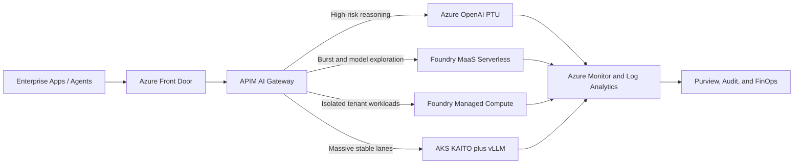
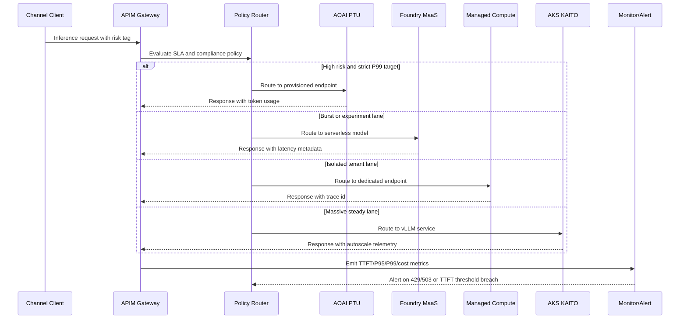

# Round 1124 · Cycle 2529
## Foundry/AOAI PTU vs Serverless MaaS vs AKS KAITO: Enterprise Model-Serving Selection FAQ

## 1) Executive summary for architecture boards
- This playbook stays at cloud architecture and FinOps/TCO level and intentionally excludes low-level CUDA, NVLink, or RDMA internals.
- The objective is to compare performance, compliance, cost, operations, and elasticity in one decision frame.
- None of the four hosting paths is universally best; value appears when workloads are tiered by risk and latency profile.
- Recommended baseline: AOAI PTU for high-stakes deterministic flows, Foundry MaaS for burst and catalog agility, Managed Compute for strong isolation, AKS KAITO/vLLM for massive stable open-weight traffic.
- Typical anti-pattern: optimizing token unit price while ignoring on-call burden, recovery effort, and audit obligations.

## 2) Topic-aligned capability radar (official references, fetched 2026-11-18 UTC)
- Azure OpenAI provisioned throughput: https://learn.microsoft.com/azure/ai-services/openai/concepts/provisioned-throughput
- Azure OpenAI quotas and limits: https://learn.microsoft.com/azure/ai-services/openai/quotas-limits
- Azure AI Foundry model catalog: https://learn.microsoft.com/azure/ai-foundry/concepts/models
- Azure AI Foundry serverless deployments: https://learn.microsoft.com/azure/ai-foundry/how-to/deploy-models-serverless
- Azure AI Foundry managed compute endpoints: https://learn.microsoft.com/azure/ai-foundry/how-to/deploy-models-managed-compute
- Azure API Management AI gateway: https://learn.microsoft.com/azure/api-management/ai-gateway-overview
- AKS AI Toolchain Operator (KAITO baseline): https://learn.microsoft.com/azure/aks/ai-toolchain-operator
- vLLM serving docs: https://docs.vllm.ai/en/latest/
- Azure Monitor: https://learn.microsoft.com/azure/azure-monitor/
- Azure Front Door: https://learn.microsoft.com/azure/frontdoor/
- Azure Chaos Studio: https://learn.microsoft.com/azure/chaos-studio/
- Azure Well-Architected reliability guidance: https://learn.microsoft.com/azure/well-architected/reliability/

## 3) Four hosting options in enterprise language
- **Option A — AOAI PTU + PAYGO spillover**: guaranteed provisioned capacity for critical lanes with elastic overflow.
- **Option B — Foundry MaaS Serverless**: pay-per-call catalog velocity across DeepSeek/Llama/Mistral/Cohere/Phi.
- **Option C — Foundry Managed Compute Dedicated**: single-tenant endpoint control with stronger isolation and controlled change windows.
- **Option D — AKS GPU + KAITO/vLLM**: self-managed open-weight and multi-LoRA serving for maximum flexibility at scale.
- Composition principle: map three workload lanes (critical reasoning, general productivity, batch extraction) to A/B/C/D.

## 4) 12-dimension head-to-head matrix (including When NOT to choose)
| Dimension | A AOAI PTU+PAYGO | B Foundry MaaS | C Foundry Managed Compute | D AKS KAITO/vLLM |
|---|---|---|---|---|
| 1. Model catalog breadth | Strong frontier proprietary | Broadest managed catalog | Depends on deployed assets | Broad open-weight flexibility |
| 2. P95/P99 and TTFT guarantees | Strong deterministic lane | Platform-level guarantees | Strong single-tenant tuning | Team-owned guarantees |
| 3. Burst elasticity and cold start | PTU stable + PAYGO overflow | Highest burst elasticity | Requires pre-capacity | Requires prewarm logic |
| 4. FinOps break-even behavior | Best at high utilization | Best at low utilization | Mid/high utilization sweet spot | Best only at very large scale |
| 5. Fine-tuned and multi-LoRA hosting | Partial path-dependent | Depends on model support | Moderate control | Strongest LoRA flexibility |
| 6. Privacy and isolation | Managed platform isolation | Managed platform isolation | Single-tenant strong boundary | Cluster-level strong control |
| 7. GPU quota and regional risk | PTU region planning needed | Shared pool buffer | Region/quota sensitive | Direct quota ownership risk |
| 8. Patch and lifecycle burden | Low | Low | Medium | High |
| 9. SDK/API compatibility | Azure OpenAI native | Foundry unified | Foundry unified + private routing | Requires compatibility layer |
| 10. Autoscaling granularity | PTU + spill controls | Platform auto controls | Endpoint scaling controls | Pod/engine fine granularity |
| 11. Best-fit workload | Regulated high-stakes reasoning | Fast multi-model experimentation | Isolated enterprise production lanes | Massive stable open-weight serving |
| 12. When NOT to choose | Long-term low utilization | Hard isolation + strict deterministic latency | No platform operations muscle | No SRE/MLOps coverage |

## 5) Decision ladder and anti-pattern clarifications
- Step A: classify regulatory and audit intensity first.
- Step B: bind latency SLOs and contractual P99 obligations.
- Step C: evaluate traffic shape (steady, bursty, launch spikes).
- Step D: evaluate platform operating maturity and on-call depth.
- Anti-pattern 1: extrapolating short-lived PoC economics into annual production commitments.
- Anti-pattern 2: ignoring model lifecycle windows and rollback discipline.
- Anti-pattern 3: using APIM only as a proxy without quota, circuit breaker, and route policy controls.
- Anti-pattern 4: counting inference spend only while excluding incident, compliance, and staffing costs.

## 6) Six worked quantitative sizing and FinOps Q&As
### Q1: How do we estimate PTU utilization break-even?
- Formula: `Cost_PTU = PTU_hourly * hours + Spillover_cost`.
- Formula: `Cost_Serverless = token_million * unit_price`.
- Break-even condition: `Cost_PTU <= Cost_Serverless`.
- Typical interpretation: with sustained >60% utilization and bounded spillover, PTU lanes usually outperform all-serverless.

### Q2: How to compare AKS vLLM with MaaS in unit-token economics?
- Formula: `Cost_AKS = (GPU_cluster_monthly + platform_ops_monthly) / monthly_tokens`.
- Formula: `Cost_MaaS = monthly_tokens/1e6 * maas_price_per_million`.
- Threshold: `T* = (GPU_cluster_monthly + platform_ops_monthly) / maas_price_per_million * 1e6`.
- Decision: only when monthly demand remains above `T*` with predictable variance does AKS keep structural advantage.

### Q3: How to estimate concurrency for TTFT < 150ms?
- Formula: `required_instances = ceil((QPS * avg_compute_ms) / (1000 * target_utilization))`.
- Recommended utilization planning band: `0.60 - 0.70`.
- Validate with tail-latency canary instead of average-only benchmarks.

### Q4: How large should PAYGO spillover be?
- Formula: `spill_ratio = burst_tokens / total_tokens`.
- If `spill_ratio > 0.25` for three continuous weeks, rebalance PTU baseline.
- If `spill_ratio < 0.08` and bursts are predictable, tune time-window policy to reduce reserve waste.

### Q5: How to compute blended route cost floor?
- Formula: `blended_cost = Σ(route_share_i * unit_cost_i)`.
- Assign high-risk reasoning to premium deterministic lanes.
- Assign extraction/classification to lower-cost lanes while preserving schema contract tests.

### Q6: How to justify single-tenant isolation premium?
- Formula: `isolation_premium = (single_tenant_total - pooled_total) / pooled_total`.
- Economic rationale: if expected compliance loss exposure exceeds isolation premium, dedicated lanes are financially sound.
- Include audit pass-rate, recovery time, and reputational risk in the value model.

## 7) Industry architecture #1: national commercial bank dual-track serving platform
### Business goals (Banking platform)
- Route high-stakes credit/wealth reasoning to AOAI PTU with deterministic behavior and replayability.
- Route high-volume internal ticket classification and document extraction to open-weight lanes with multi-LoRA adapters.
- Annual objective: deliver 45%+ blended TCO reduction after route decomposition.

### End-to-end flow (Bank)
1. Front Door handles geo ingress and WAF controls.
2. APIM AI Gateway parses tenant, risk, and workload tags.
3. High-risk requests route to AOAI PTU; overflow is policy-governed PAYGO.
4. Mid/low-risk requests route to Foundry MaaS or Foundry Managed Compute.
5. Stable bulk traffic routes to AKS KAITO/vLLM pools.
6. Unified traces/logs stream into Monitor, Log Analytics, and Purview.

### SLA/SLO targets (Bank)
- Credit advisory lane: P99 < 2.2s, availability 99.95%.
- Batch extraction lane: hourly throughput >= 1.4x baseline.
- Audit lane: 100% replayability of model version, route policy, and accountability chain.

### Failure modes and mitigations (Bank)
- Mode A: PTU regional saturation -> same-jurisdiction backup PTU + controlled response downgrade.
- Mode B: MaaS model outage -> fallback to capability-equivalent model with contract-preserving schema checks.
- Mode C: AKS node pressure -> queue backpressure and critical-lane isolation.
- Mode D: APIM policy regression -> blue/green rollback with contract tests.

## 8) Industry architecture #2: global game studio 20-language moderation and NPC dialogue
### Business goals (Gaming platform)
- Real-time moderation for multilingual UGC with explainable policy outcomes.
- NPC dialogue baseline with TTFT < 150ms.
- Launch-day concurrency bursts up to 8x sustained baseline.

### End-to-end flow (Gaming)
1. Front Door accepts traffic by geo and language channels.
2. APIM separates moderation and dialogue routes.
3. Dialogue baseline routes to Managed Compute/AKS SLM lanes.
4. Spike overflow routes to Foundry MaaS or global PAYGO lanes.
5. High-risk moderation events route to higher-quality secondary adjudication model.
6. Dashboard segmentation tracks country, language, and game mode SLO behavior.

### SLA/SLO targets (Gaming)
- NPC dialogue TTFT: P95 < 150ms and P99 < 350ms.
- Moderation quality: false-negative rate down 30% quarter over quarter.
- Launch-week availability: 99.99% with cross-region drill evidence.

### Failure modes and mitigations (Gaming)
- Mode A: region congestion -> nearest-region then next-nearest compliant reroute.
- Mode B: language-model quality drift -> language fallback plus human sampling.
- Mode C: LoRA rollout regression -> auto rollback to signed prior adapter set.
- Mode D: hostile traffic burst -> WAF + APIM quota + identity throttle orchestration.

## 9) Mermaid topology flowchart


## 10) Mermaid runtime sequence for routing and failover


## 11) Production Bicep IaC block
```bicep
param location string = 'eastus2'
param apimName string
param logAnalyticsName string
param openAiAccountName string

resource la 'Microsoft.OperationalInsights/workspaces@2023-09-01' = {
  name: logAnalyticsName
  location: location
  properties: {
    retentionInDays: 30
  }
}

resource apim 'Microsoft.ApiManagement/service@2023-05-01-preview' = {
  name: apimName
  location: location
  sku: {
    name: 'Premium'
    capacity: 2
  }
  properties: {
    publisherEmail: 'platform@contoso.com'
    publisherName: 'Contoso Platform'
  }
}

resource openai 'Microsoft.CognitiveServices/accounts@2024-10-01' = {
  name: openAiAccountName
  location: location
  kind: 'OpenAI'
  sku: {
    name: 'S0'
  }
  properties: {
    publicNetworkAccess: 'Disabled'
    customSubDomainName: openAiAccountName
  }
}
```

## 12) APIM router configuration snippet
```xml
<policies>
  <inbound>
    <base />
    <set-variable name="riskTier" value="@(context.Request.Headers.GetValueOrDefault("x-risk-tier","medium"))" />
    <set-variable name="tenantMode" value="@(context.Request.Headers.GetValueOrDefault("x-tenant-mode","pooled"))" />
    <choose>
      <when condition="@(context.Variables.GetValueOrDefault<string>("riskTier") == "high")">
        <set-backend-service base-url="https://aoai-ptu.contoso.net" />
      </when>
      <when condition="@(context.Variables.GetValueOrDefault<string>("tenantMode") == "isolated")">
        <set-backend-service base-url="https://foundry-managed.contoso.net" />
      </when>
      <otherwise>
        <set-backend-service base-url="https://foundry-maas.contoso.net" />
      </otherwise>
    </choose>
    <rate-limit-by-key calls="1200" renewal-period="60" counter-key="@(context.Subscription.Id)" />
    <set-header name="x-route-version" exists-action="override">
      <value>r1124-v1</value>
    </set-header>
  </inbound>
  <backend>
    <forward-request timeout="120" />
  </backend>
  <outbound>
    <base />
  </outbound>
  <on-error>
    <base />
  </on-error>
</policies>
```

## 13) Azure Monitor KQL examples
```kql
let windowStart = ago(24h);
ApiManagementGatewayLogs
| where TimeGenerated >= windowStart
| extend route = tostring(Properties.routeTarget)
| extend ttftMs = todouble(Properties.ttftMs)
| extend statusCode = toint(ResponseCode)
| summarize req=count(), p95_ttft=percentile(ttftMs,95), p99_ttft=percentile(ttftMs,99), err_5xx=countif(statusCode >= 500), throttle_429=countif(statusCode == 429) by route, bin(TimeGenerated, 5m)
| extend errorRate = todouble(err_5xx) / todouble(req)
| order by TimeGenerated desc
```

```kql
let costWindow = ago(7d);
AzureDiagnostics
| where TimeGenerated >= costWindow
| where ResourceProvider == "MICROSOFT.COGNITIVESERVICES"
| summarize tokens=sum(todouble(tokensUsed)), costUsd=sum(todouble(estimatedCostUsd)) by route=tostring(routeTarget), bin(TimeGenerated,1d)
| extend usdPerMillionTokens = iif(tokens == 0, real(null), costUsd * 1000000.0 / tokens)
| order by TimeGenerated desc
```

## 14) Day-0 / Day-1 / Day-2 checklist
### Day-0 (design and admission)
- D0-01 Define workload tiers (critical reasoning, general productivity, batch extraction).
- D0-02 Lock SLO targets (P95/P99/TTFT/availability).
- D0-03 Lock compliance constraints (residency, retention, encryption domains).
- D0-04 Build primary/secondary/degraded model matrix.
- D0-05 Establish FinOps baseline (cost per million tokens, per request, per session).
- D0-06 Define route contract keys (riskTier/tenantMode/region).
- D0-07 Build failure-mode library (quota, timeout, drift, policy regression).
- D0-08 Define release gates (quality, cost, compliance, rollback readiness).

### Day-1 (go-live and canary)
- D1-01 Deploy APIM policy via blue/green route rollout.
- D1-02 Turn on dashboards for latency, errors, cost, and route distribution.
- D1-03 Enable tenant quota and rate controls.
- D1-04 Enable redacted prompt telemetry sampling.
- D1-05 Execute first fault injection for 429/503/TTFT breaches.
- D1-06 Validate automatic reroute plus manual takeover.
- D1-07 Compare business KPI and user experience deltas during canary.
- D1-08 Freeze rollback point and complete launch review.

### Day-2 (operations and optimization)
- D2-01 Weekly review route hit-rate and quality drift.
- D2-02 Weekly review PTU utilization and spillover ratio.
- D2-03 Biweekly cross-region degrade-and-recover drill.
- D2-04 Monthly model upgrade value/risk review.
- D2-05 Monthly break-even threshold recalibration.
- D2-06 Monthly audit-trace completeness review.
- D2-07 Quarterly LoRA portfolio and cache policy refresh.
- D2-08 Quarterly runbook and on-call training update.

## 15) Extended Q&A, deliverables, and validation commands
### Five strategic extension Q&As
- QA-A Should AOAI PTU always fail over to MaaS automatically? Only for pre-approved lanes; critical regulated lanes require explicit approval.
- QA-B How to prevent schema breakage on MaaS upgrades? Use contract tests, shadow dual-write checks, and staged exposure.
- QA-C How to split Managed Compute versus AKS? Isolation-first lanes go Managed; hyperscale stable lanes go AKS.
- QA-D How to avoid misleading cost dashboards? Include incident, staffing, and compliance operating costs in total value.
- QA-E How to explain multi-model complexity to business owners? Present it as SLO stability plus cost elasticity by lane.

### Thirty architecture gate checks for review workshops
- CK-01 Route policy is fully auditable and replayable.
- CK-02 Model version and policy version are tightly linked.
- CK-03 Every request carries unified trace id.
- CK-04 Critical-risk routes define explicit no-downgrade rule.
- CK-05 Regional incident handover threshold is documented.
- CK-06 API error budget and mitigation are codified.
- CK-07 Token cost budget and cap actions are codified.
- CK-08 Tenant quota and chargeback policy are codified.
- CK-09 Model fallback order and quality gate are codified.
- CK-10 Redaction and retention controls are codified.
- CK-11 Prompt-injection replay review workflow is codified.
- CK-12 Structured output contract is codified.
- CK-13 Batch retry and dead-letter strategy is codified.
- CK-14 APIM policy rollback objective is codified.
- CK-15 Post-failover consistency verification is codified.
- CK-16 Multi-LoRA retirement window is codified.
- CK-17 GPU quota alert threshold and escalation are codified.
- CK-18 Release and freeze windows are codified.
- CK-19 Cross-team on-call comms template is codified.
- CK-20 Drill remediation closure SLA is codified.
- CK-21 Provider outage fallback path is codified.
- CK-22 Prompt cache hit-rate target is codified.
- CK-23 Forecast error tolerance band is codified.
- CK-24 Audit sampling and escalation path is codified.
- CK-25 International language quality baseline is codified.
- CK-26 Human-review fallback for critical transactions is codified.
- CK-27 Change approvers and emergency bypass are codified.
- CK-28 DR drill evidence archive policy is codified.
- CK-29 Month-end finance reconciliation policy is codified.
- CK-30 Annual architecture re-certification milestone is codified.

### Deliverables in this round
- Bilingual FAQ documents with 330+ lines and strict sections 1..15.
- Two Mermaid diagrams, one Bicep block, one APIM router snippet, and two KQL examples.
- SVG visual: `assets/42-cycle-2529-daily-breakthroughs.svg`.
- H5 workbench: `workbench-cycle-2529.html` and selector `#2529`.
- 7-card outputs: `benchmark-cards.html` and `benchmark-cards.en.html`.
- Evidence package: `evidence/cycle-2529-*.json/csv`.

### Run and validate
```bash
python workshops/azure-agent-infra/simulator/cycle_1124_pipeline.py --write
python workshops/azure-agent-infra/simulator/cycle_1124_pipeline.py --check
pytest workshops/azure-agent-infra/simulator -q
```
- Acceptance criteria: `sections 1..15`, `max_suffix_repeat == 1`, workshops/docs byte parity, and full test pass.
