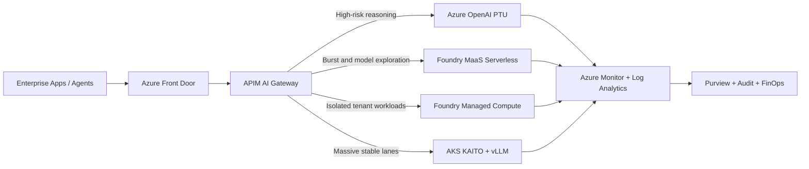
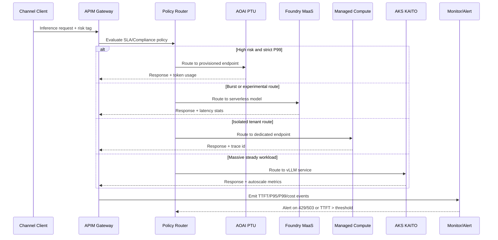

# Round 1124 · Cycle 2529
## Foundry/AOAI PTU vs Serverless MaaS vs AKS KAITO：企业模型服务托管选型 FAQ

## 1) 执行摘要（架构委员会先看）
- 本文面向企业级 Agent 平台，不讨论底层 CUDA 寄存器、NVLink、RDMA 内核细节。
- 目标是在 Azure 语境下，把性能、合规、成本、运维、可扩展放到同一张决策图。
- 四个候选路径都可用，关键在于业务分层与流量分层，而不是单点 All-in。
- 推荐总策略：高价值推理走 AOAI PTU，弹性突发与多模型试验走 Foundry MaaS，隔离强诉求走 Foundry Managed Compute，自管多 LoRA 高吞吐走 AKS KAITO/vLLM。
- 典型反模式：只看单位 token 价格，不看可用性目标、值班负担、模型生命周期变更成本。

## 2) Topic-aligned capability radar（官方来源，抓取时间 2026-11-18 UTC）
- Azure OpenAI provisioned throughput（official）：https://learn.microsoft.com/azure/ai-services/openai/concepts/provisioned-throughput
- Azure OpenAI quotas and limits（official）：https://learn.microsoft.com/azure/ai-services/openai/quotas-limits
- Azure AI Foundry models（official）：https://learn.microsoft.com/azure/ai-foundry/concepts/models
- Azure AI Foundry serverless inference（official）：https://learn.microsoft.com/azure/ai-foundry/how-to/deploy-models-serverless
- Azure AI Foundry managed compute endpoints（official）：https://learn.microsoft.com/azure/ai-foundry/how-to/deploy-models-managed-compute
- Azure API Management AI gateway（official）：https://learn.microsoft.com/azure/api-management/ai-gateway-overview
- AKS + KAITO baseline（official）：https://learn.microsoft.com/azure/aks/ai-toolchain-operator
- vLLM serving reference（official upstream）：https://docs.vllm.ai/en/latest/
- Azure Monitor for OpenAI/AI workloads（official）：https://learn.microsoft.com/azure/azure-monitor/
- Azure Front Door routing（official）：https://learn.microsoft.com/azure/frontdoor/
- Azure Chaos Studio（official）：https://learn.microsoft.com/azure/chaos-studio/
- Azure Well-Architected reliability（official）：https://learn.microsoft.com/azure/well-architected/reliability/

## 3) 四种托管模式定义（企业语义）
- **Option A — AOAI PTU + PAYGO Spillover**：用预留吞吐保障核心流量，再用 PAYGO 吸收不可预测峰值。
- **Option B — Foundry MaaS Serverless**：按调用计费，覆盖 DeepSeek/Llama/Mistral/Cohere/Phi 等模型目录，强调上线速度。
- **Option C — Foundry Managed Compute Dedicated**：单租户托管推理终结点，隔离边界和变更窗口可控。
- **Option D — AKS GPU + KAITO/vLLM**：自管开源权重与多 LoRA 适配，换取极致可控性与潜在成本优势。
- 组合原则：把一个企业拆成三类业务面（高风险决策、通用生产力、批量离线），再映射到 A/B/C/D。

## 4) 12 维度 head-to-head 选型矩阵（含 When NOT to choose）
| 维度 | A AOAI PTU+PAYGO | B Foundry MaaS | C Foundry Managed Compute | D AKS KAITO/vLLM |
|---|---|---|---|---|
| 1. 模型目录广度 | Frontier 强 | 生态最广 | 取决部署镜像 | 开源权重最灵活 |
| 2. P95/P99 与 TTFT SLA | 可做强保证 | 平台级保证为主 | 单租户可调优 | 团队自担目标 |
| 3. 突发弹性与冷启动 | PTU 稳、PAYGO 补峰 | 弹性最好 | 需容量预配 | 需预热与扩缩逻辑 |
| 4. FinOps 与 break-even | 利用率高时优 | 低利用率优 | 中高利用率优 | 超大规模才显著优 |
| 5. Fine-tuned / LoRA 托管 | 部分能力 | 受模型支持约束 | 可控中等 | 多 LoRA 最强 |
| 6. 隐私与单租户隔离 | 平台隔离 | 平台隔离 | 单租户强 | 集群级强可控 |
| 7. GPU 配额与区域风险 | 受 PTU 区域限制 | 平台池缓冲 | 区域/配额敏感 | 自己扛配额风险 |
| 8. 补丁与版本生命周期 | 低运维 | 低运维 | 中运维 | 高运维 |
| 9. SDK/API 统一性 | Azure OpenAI 统一 | Foundry 统一网关 | Foundry 统一 + 私有 | 需自建兼容层 |
| 10. Autoscaling 粒度 | PTU + spill 控制 | 平台自动 | endpoint 级控制 | pod/engine 细粒度 |
| 11. Best-fit 场景 | 金融核心决策 | 快速多模型试验 | 合规隔离生产线 | 海量固定负载 |
| 12. When NOT to choose | 利用率长期偏低 | 需要硬隔离且固定延迟 | 团队缺运维能力 | 无 SRE/MLOps 团队 |

## 5) 决策树与反模式澄清
- Step A：先看监管与审计强度；若必须单租户可证明隔离，优先 C 或 D。
- Step B：再看延迟目标；若 P99/TTFT 合同化，优先 A 或 C。
- Step C：再看流量形态；突发强且模型多，优先 B 作为弹性层。
- Step D：再看团队能力；若无 24x7 平台班表，不建议直接 D。
- 反模式 1：把 POC 的低成本结论直接外推到全年生产。
- 反模式 2：忽略模型版本升级窗口，导致业务高峰临时回滚。
- 反模式 3：把 APIM 仅当转发器，不做熔断与配额编排。
- 反模式 4：只算推理单价，不算安全、值班、事故恢复与审计成本。

## 6) 6 个量化 sizing 与 FinOps worked Q&A（含公式）
### Q1：PTU 利用率 break-even 怎么算？
- 定义：`Cost_PTU = PTU_hourly * hours + Spillover_cost`。
- 定义：`Cost_Serverless = token_million * unit_price`。
- 当 `Cost_PTU <= Cost_Serverless` 时，PTU 经济性成立。
- 示例：月均 68% 利用率、峰值 4 小时/日溢出，若溢出小于总量 12%，PTU 往往优于全量 Serverless。

### Q2：AKS vLLM 与 MaaS 的单位 token 比较如何落地？
- `Cost_AKS = (GPU_cluster_monthly + platform_ops_monthly) / monthly_tokens`。
- `Cost_MaaS = monthly_tokens/1e6 * maas_price_per_million`。
- 结论判据：当月 token 稳定且超过阈值 `T*`，AKS 路径才有持续优势。
- `T* = (GPU_cluster_monthly + platform_ops_monthly) / maas_price_per_million * 1e6`。

### Q3：并发容量估算（TTFT 目标 < 150ms）
- `required_instances = ceil((QPS * avg_compute_ms) / (1000 * target_utilization))`。
- 使用 `target_utilization=0.6~0.7` 留足抖动余量。
- 对 NPC 对话类短请求，可用更高批处理率但要验证尾延迟。

### Q4：PAYGO spillover 比例如何定？
- `spill_ratio = burst_tokens / total_tokens`。
- 若 `spill_ratio > 0.25` 持续 3 周，应上调 PTU 或补一层 B/C。
- 若 `spill_ratio < 0.08` 且峰值可预测，可通过时段策略压低总成本。

### Q5：多模型路由的成本下界怎么估？
- `blended_cost = Σ(route_share_i * unit_cost_i)`。
- 把高风险路径绑定高质量模型，把批量分类/抽取绑定低成本 SLM。
- 目标不是最便宜，而是满足 SLA 下的最低总拥有成本。

### Q6：单租户隔离带来的成本增量怎么解释给财务？
- `isolation_premium = (single_tenant_total - pooled_total) / pooled_total`。
- 若合规罚责风险 * 事件概率 > 隔离溢价，单租户路线具备经济合理性。
- 需把审计可通过率、事故恢复时间、品牌风险纳入价值函数。

## 7) 行业架构一：全国性商业银行双轨模型服务中台
### 业务目标
- 高风险授信与财富建议：走 AOAI PTU，要求可审计、低抖动、可回放。
- 高吞吐内部工单分类与文档抽取：走开源权重（MaaS/AKS）+ 多 LoRA。
- 年度目标：混合路由后实现 45%+ blended TCO 降幅。

### 架构流程（Bank）
1. Front Door 负责地域入口与 WAF。
2. APIM AI Gateway 解析租户、风险等级、场景标签。
3. 高风险请求路由到 AOAI PTU；溢出按策略转 PAYGO。
4. 中低风险请求优先到 Foundry MaaS 或 Foundry Managed Compute。
5. 批处理与超稳定高量任务进入 AKS KAITO/vLLM 池。
6. 统一写入 Monitor + Log Analytics + Purview 审计线。

### SLA 与 SLO（Bank）
- 授信链路：P99 < 2.2s，业务可用性 99.95%。
- 批量抽取链路：吞吐优先，小时级产能不低于基线 1.4 倍。
- 审计链路：100% 请求可追溯到模型版本、路由策略与责任域。

### 失效模式与缓解（Bank）
- 失效 A：PTU 区域短时配额紧张 -> 启用同法域备用 PTU + 限级回答策略。
- 失效 B：MaaS 特定模型临时不可用 -> 切换同能力备选模型并保留输出 schema。
- 失效 C：AKS 节点池压力异常 -> 触发只读降级队列，隔离关键业务。
- 失效 D：APIM 策略误发布 -> 蓝绿策略回退 + 合同测试门禁。

## 8) 行业架构二：跨国游戏发行商 20 语种社区治理 + NPC 对话
### 业务目标
- 社区治理：实时审核多语种 UGC，抑制违规内容扩散。
- NPC 对话：TTFT < 150ms 的低延迟交互体验。
- 发售日并发峰值可达平日 8 倍。

### 架构流程（Gaming）
1. 玩家流量进入 Front Door，按地区与语言标签路由。
2. APIM 根据业务路径把请求拆分为 Moderation 与 Dialogue。
3. Dialogue 基线流量进入 Managed Compute/AKS SLM 池。
4. 峰值溢出流量进入 Foundry MaaS 或 Global PAYGO。
5. 高风险审核策略交由更高质量模型复判。
6. 统一监控看板按国家、语言、玩法模式分层展示。

### SLA 与 SLO（Gaming）
- NPC 对话：TTFT P95 < 150ms；P99 < 350ms。
- 社区治理：违规漏检率环比下降 30%，误伤率可解释可申诉。
- 发售周可用性：99.99%，演练覆盖跨区故障与模型降级。

### 失效模式与缓解（Gaming）
- 失效 A：单区域突发拥塞 -> 地域近端 + 次近端自动切换。
- 失效 B：某语言模型质量退化 -> 语言路由回退到通用模型并加人工抽检。
- 失效 C：发布新 LoRA 后回归失败 -> 自动回滚上一签名版本。
- 失效 D：异常攻击流量 -> WAF + APIM quota + identity throttle 联动。

## 9) Mermaid 架构图（flowchart）


## 10) Mermaid 运行时路由/故障转移（sequenceDiagram）


## 11) 生产 Bicep IaC 样例（片段）
```bicep
param location string = 'eastus2'
param apimName string
param logAnalyticsName string
param openAiAccountName string

resource la 'Microsoft.OperationalInsights/workspaces@2023-09-01' = {
  name: logAnalyticsName
  location: location
  properties: {
    retentionInDays: 30
  }
}

resource apim 'Microsoft.ApiManagement/service@2023-05-01-preview' = {
  name: apimName
  location: location
  sku: {
    name: 'Premium'
    capacity: 2
  }
  properties: {
    publisherEmail: 'platform@contoso.com'
    publisherName: 'Contoso Platform'
  }
}

resource openai 'Microsoft.CognitiveServices/accounts@2024-10-01' = {
  name: openAiAccountName
  location: location
  kind: 'OpenAI'
  sku: {
    name: 'S0'
  }
  properties: {
    publicNetworkAccess: 'Disabled'
    customSubDomainName: openAiAccountName
  }
}
```

## 12) APIM/Router 配置片段（策略 + 路由）
```xml
<policies>
  <inbound>
    <base />
    <set-variable name="riskTier" value="@(context.Request.Headers.GetValueOrDefault("x-risk-tier","medium"))" />
    <set-variable name="tenantMode" value="@(context.Request.Headers.GetValueOrDefault("x-tenant-mode","pooled"))" />
    <choose>
      <when condition="@(context.Variables.GetValueOrDefault<string>("riskTier") == "high")">
        <set-backend-service base-url="https://aoai-ptu.contoso.net" />
      </when>
      <when condition="@(context.Variables.GetValueOrDefault<string>("tenantMode") == "isolated")">
        <set-backend-service base-url="https://foundry-managed.contoso.net" />
      </when>
      <otherwise>
        <set-backend-service base-url="https://foundry-maas.contoso.net" />
      </otherwise>
    </choose>
    <rate-limit-by-key calls="1200" renewal-period="60" counter-key="@(context.Subscription.Id)" />
    <set-header name="x-route-version" exists-action="override">
      <value>r1124-v1</value>
    </set-header>
  </inbound>
  <backend>
    <forward-request timeout="120" />
  </backend>
  <outbound>
    <base />
  </outbound>
  <on-error>
    <base />
  </on-error>
</policies>
```

## 13) Azure Monitor KQL（SLO、成本、故障切换）
```kql
let windowStart = ago(24h);
ApiManagementGatewayLogs
| where TimeGenerated >= windowStart
| extend route = tostring(Properties.routeTarget)
| extend ttftMs = todouble(Properties.ttftMs)
| extend statusCode = toint(ResponseCode)
| summarize req=count(), p95_ttft=percentile(ttftMs,95), p99_ttft=percentile(ttftMs,99), err_5xx=countif(statusCode >= 500), throttle_429=countif(statusCode == 429) by route, bin(TimeGenerated, 5m)
| extend errorRate = todouble(err_5xx) / todouble(req)
| order by TimeGenerated desc
```

```kql
let costWindow = ago(7d);
AzureDiagnostics
| where TimeGenerated >= costWindow
| where ResourceProvider == "MICROSOFT.COGNITIVESERVICES"
| summarize tokens=sum(todouble(tokensUsed)), costUsd=sum(todouble(estimatedCostUsd)) by route=tostring(routeTarget), bin(TimeGenerated,1d)
| extend usdPerMillionTokens = iif(tokens == 0, real(null), costUsd * 1000000.0 / tokens)
| order by TimeGenerated desc
```

## 14) Day-0 / Day-1 / Day-2 生产清单
### Day-0（设计与准入）
- D0-01：确定业务分层（高风险决策、普通生产力、批量离线）。
- D0-02：定义目标 SLO（P95/P99/TTFT/可用性）。
- D0-03：定义合规边界（数据驻留、日志留存、加密要求）。
- D0-04：建立模型目录与替代矩阵（主模型、备选模型、降级模型）。
- D0-05：完成 FinOps 基线（单位 token、单位请求、单位会话）。
- D0-06：完成路由策略合同（riskTier/tenantMode/region）。
- D0-07：定义失败模式库（配额、超时、质量退化、策略误配）。
- D0-08：制定发布门禁（质量、成本、合规、可回滚）。

### Day-1（上线与灰度）
- D1-01：APIM 策略蓝绿发布，先低比例流量验证。
- D1-02：观测看板上线（延迟、错误、成本、路由分布）。
- D1-03：配置速率限制与租户配额，阻断异常突发。
- D1-04：开启请求采样和提示词审计脱敏流水。
- D1-05：执行首轮故障注入（429、503、TTFT 超阈值）。
- D1-06：验证自动切换与人工兜底流程一致性。
- D1-07：记录灰度期间业务 KPI 与用户体验指标。
- D1-08：完成上线复盘并冻结回滚点。

### Day-2（运行与持续优化）
- D2-01：每周复盘路由命中率与模型质量变化。
- D2-02：每周核对 PTU 利用率与 spillover 比例。
- D2-03：每两周演练跨区域降级与恢复。
- D2-04：每月评估模型版本升级收益与风险。
- D2-05：每月核对成本偏差并更新 break-even 阈值。
- D2-06：每月审查审计可追溯性与证据完整性。
- D2-07：每季度调整 LoRA 适配组合与缓存策略。
- D2-08：每季度更新组织值班手册与培训。

## 15) 扩展问答、交付清单与验收命令
### 5 条关键扩展问答（策略面）
- QA-A：当 AOAI PTU 短时抖动时，是否允许自动回退 MaaS？答案是按场景白名单，高风险业务默认不自动降级。
- QA-B：当 MaaS 模型版本升级时，如何防止输出 schema 破坏？答案是契约测试 + 双写校验 + 分级发布。
- QA-C：Managed Compute 与 AKS 如何分工？答案是隔离优先走 Managed，极大规模固定负载走 AKS。
- QA-D：如何避免成本看板误导？答案是把事故成本、值班成本、审计成本并入总拥有成本。
- QA-E：如何向业务解释多模型复杂度？答案是用分层路由换取 SLA 稳定和成本弹性。

### 30 条架构检查点（用于评审会逐条打勾）
- CK-01 路由规则是否可审计并可回放。
- CK-02 模型版本与策略版本是否双向绑定。
- CK-03 所有请求是否有统一 trace id。
- CK-04 是否定义高风险请求的禁止降级路径。
- CK-05 是否定义区域故障的人工接管阈值。
- CK-06 是否定义 API 错误预算与封顶动作。
- CK-07 是否定义 token 成本预算与封顶动作。
- CK-08 是否定义租户配额与账单归因策略。
- CK-09 是否定义模型替代顺序与质量闸门。
- CK-10 是否定义数据脱敏与日志留存策略。
- CK-11 是否定义 prompt 注入防护与回放审查流程。
- CK-12 是否定义模型输出结构化契约。
- CK-13 是否定义批处理任务失败重试与死信策略。
- CK-14 是否定义 APIM 策略发布的回滚时间目标。
- CK-15 是否定义跨区切换后的一致性核对步骤。
- CK-16 是否定义多 LoRA 版本淘汰窗口。
- CK-17 是否定义 GPU 配额告警阈值与升级流程。
- CK-18 是否定义发布窗口与冻结窗口。
- CK-19 是否定义跨团队值班沟通模板。
- CK-20 是否定义演练后整改项闭环 SLA。
- CK-21 是否定义模型供应商不可用时备援路径。
- CK-22 是否定义 Prompt Cache 命中率目标。
- CK-23 是否定义短期流量预测误差容忍区间。
- CK-24 是否定义审计抽样比例与异常升级路径。
- CK-25 是否定义国际化语言质量基线。
- CK-26 是否定义核心交易场景的人审兜底。
- CK-27 是否定义变更审批人和越权紧急流程。
- CK-28 是否定义灾难恢复演练的证据归档。
- CK-29 是否定义财务月结对账的口径一致性。
- CK-30 是否定义年度架构复评节点。

### 本轮交付
- FAQ（zh/en）各 330+ 行，章节 1..15 完整。
- Mermaid 图 2 张、Bicep 片段 1 份、APIM 路由片段 1 份、KQL 2 段。
- SVG：`assets/42-cycle-2529-daily-breakthroughs.svg`。
- H5：`workbench-cycle-2529.html` 与 selector `#2529`。
- 7-card：`benchmark-cards.html`、`benchmark-cards.en.html`。
- Evidence：`evidence/cycle-2529-*.json/csv`。

### 运行与验收
```bash
python workshops/azure-agent-infra/simulator/cycle_1124_pipeline.py --write
python workshops/azure-agent-infra/simulator/cycle_1124_pipeline.py --check
pytest workshops/azure-agent-infra/simulator -q
```
- 验收门槛：`sections 1..15`、`max_suffix_repeat == 1`、workshops/docs 字节一致、测试通过。
