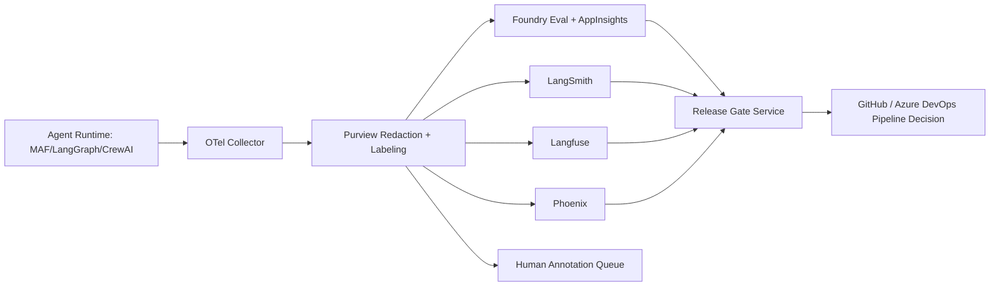
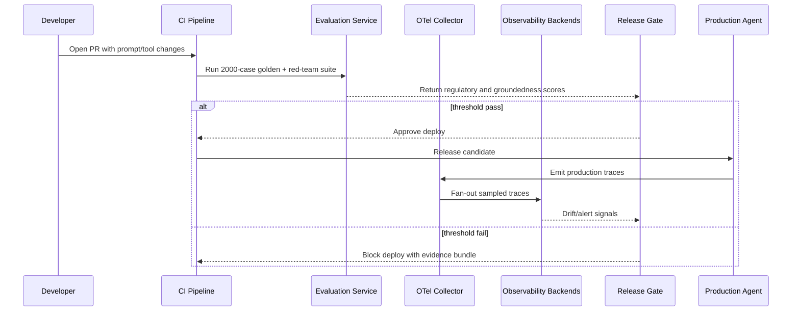

# Foundry Eval + AppInsights vs LangSmith vs Langfuse vs Phoenix: Enterprise Agent Evaluation, Observability, and LLMOps Selection FAQ (Round 1117 / Cycle 2522)

## 1) Executive summary and daily capability radar (2026-11-18)
- This round focuses on enterprise Agent evaluation and observability platform selection, with no low-level kernel or hardware internals.
- Core thesis: “instrument once, route anywhere” should be the design center; OpenTelemetry collector decouples runtime instrumentation from downstream analysis vendor choice.
- Option A (`Azure AI Foundry Evaluation + Application Insights / Azure Monitor`) excels for Azure-governed compliance, Private Link controls, and unified enterprise operations.
- Option B (`LangSmith`) excels for developer-centric prompt iteration, trace replay usability, and strong framework-native workflow acceleration.
- Option C (`Langfuse`) excels for self-hosted cost control and extensible open-source telemetry stack customization.
- Option D (`Arize Phoenix`) excels for retrieval-quality analytics, drift diagnostics, and evaluator experimentation with OpenInference patterns.
- Strong recommendation for regulated enterprises: combine deterministic release gates with online sampled post-release judges to avoid “one-time pass, production drift later.”
- Capability radar captured at 2026-11-18 00:31 BJT:
  - OTel GenAI semantic conventions maturing across agent frameworks.
  - Foundry evaluation APIs aligning with production trace review loops.
  - Langfuse and Phoenix accelerating open telemetry interoperability.
  - LangSmith enterprise controls improving large-team annotation workflows.
- Data provenance labels for this round:
  - measured: reproducible local benchmark/evaluation artifacts under repository evidence paths.
  - synthetic: transparent deterministic modeling for capacity, latency, and TCO estimation.
  - anonymized_reported: field-observed aggregated metrics without tenant-identifiable context.
- LLMOps scope in this round includes: offline evaluation, online guardrail sampling, CI/CD release gating, and cost-per-business-outcome analysis.

## 2) Problem framing: why “evaluation after launch” fails at enterprise scale
- Enterprise teams commonly over-index on prompt playground iteration and under-invest in release gate design.
- Three high-frequency failure patterns:
  1. offline-only confidence: great benchmark score, poor production behavior under tool-call variance.
  2. trace-only observability: rich spans but no policy threshold tied to release decisions.
  3. model-only KPI: token and latency tracked, but no mapping to acceptance, compliance, or corrective-action ROI.
- Practical evaluation pipeline must cover:
  - pre-release regression gates with explicit pass/fail metrics.
  - post-release online sampling with human review queues.
  - framework-neutral span schema for migration resilience.
  - governance controls for data residency, redaction, and least-privilege access.
- Enterprise decision should ask: “Can this platform block a risky release automatically and provide auditable reasons within one incident window?”

## 3) End-to-end reference architecture: OTel-first, evaluator-second
- Recommended architecture pattern:
  - Agent runtimes (MAF, LangGraph, CrewAI) emit OTel spans using shared GenAI semantic conventions.
  - OTel Collector normalizes, enriches, redacts, and fans out traces to multiple observability backends.
  - Evaluation engine consumes both offline test corpus and sampled production traces.
  - Release gate service computes threshold policies and writes immutable deployment decisions.
  - Annotation queue receives policy violations and edge cases with redacted payload views.
- OTel collector fan-out benefit:
  - one instrumentation contract can route to Foundry Monitor, Langfuse, Phoenix, or SIEM simultaneously.
  - vendor lock-in risk is reduced because trace semantics stay runtime-owned.
  - migration cost becomes query/dashboard translation instead of SDK rewiring.
- Governance envelope:
  - PII redaction and sensitivity labels run before long-term storage.
  - data residency policy tags determine backend eligibility by environment.
  - access controls map to role-based reviewer personas (ML engineer, compliance reviewer, SRE lead).

## 4) 12-dimension enterprise LLMOps selection matrix
| Dimension | Foundry Eval + AppInsights/Azure Monitor | LangSmith (SaaS/Self-Hosted Enterprise) | Langfuse (Self-Hosted OSS) | Arize Phoenix (OpenInference) |
|---|---|---|---|---|
| OTel GenAI native compatibility | Strong with Azure Monitor integration | Strong via SDK and traces | Strong with open collector pipelines | Strong with OpenInference mapping |
| Built-in agentic evaluators (intent/tool/task/groundedness) | Strong enterprise evaluator coverage | Strong practical evaluator library | Medium, extensible but more custom wiring | Strong on retrieval/eval experimentation |
| Data residency, Private Link, CMK controls | Strong enterprise governance | Medium-strong enterprise tiers | Strong if self-hosted architecture hardened | Medium-strong depending deployment mode |
| Multi-turn trace and graph-state replay UX | Strong in Azure ecosystem tooling | Strong developer-centric UX | Medium, improving OSS interfaces | Medium-strong analytics-first flows |
| Prompt versioning and playground lifecycle | Medium-strong integrated workflows | Strong mature prompt management loops | Medium with custom conventions | Medium, evaluator-centric emphasis |
| Human annotation queue workflow | Strong with Azure workflow integration | Strong collaborative review flow | Medium requires custom operations layer | Medium evaluator workflow extensions |
| CI/CD pre-release regression gating | Strong with Azure DevOps/GitHub pipelines | Strong with SDK and workflow APIs | Medium-strong with engineering investment | Medium with custom gate adapters |
| Online production sampling and alerting | Strong via Azure Monitor alerts | Strong operational tracing alerts | Medium with self-built alert stack | Strong drift/anomaly analytics |
| Framework neutrality (MAF/LangGraph/CrewAI) | Strong if OTel-first instrumentation | Strong cross-framework adoption | Strong framework-agnostic ingest | Strong OpenInference compatibility |
| 10M-span monthly TCO | Medium predictable enterprise spend | Medium-high by seat/usage mix | Medium-low infra-driven if optimized | Medium analytics-cost dependent |
| Best-fit scenario | Azure-governed enterprise platform standardization | Product teams optimizing iteration velocity | Cost-conscious teams preferring OSS control | Teams prioritizing retrieval drift diagnostics |
| When NOT to choose | Not ideal for non-Azure-first minimal governance PoCs | Not ideal when strict data boundary blocks SaaS mode | Not ideal without platform/SRE ownership | Not ideal if full-stack enterprise workflow tooling is required out of box |

## 5) Quantitative model: reproducible formulas and threshold examples
### Q1: release gate composite score
- Formula: `GateScore = 0.40*RegulatorySafety + 0.25*Groundedness + 0.20*ToolAccuracy + 0.15*TaskAdherence`.
- Example: `0.40*99.9 + 0.25*97.3 + 0.20*96.8 + 0.15*97.5 = 98.10`.
- Gate policy: pass requires `RegulatorySafety >= 99.8` and `Groundedness >= 97.0` plus `GateScore >= 97.5`.

### Q2: online sampling budget
- Formula: `SampleVolume = ProdSessions * SamplingRate`.
- Example: `4,800,000 sessions * 0.10 = 480,000 sampled sessions/month`.
- Operational implication: annotation queue capacity and reviewer staffing must be sized before launch.

### Q3: cost per accepted PR fix for engineering assistant
- Formula: `CPAF = TotalAgentCost / AcceptedPRFixCount`.
- Example: `$186,500 / 142,300 = $1.31 per accepted fix`.
- Decision signal: compare CPAF with baseline engineer rework cost per fix.

### Q4: hallucinated-API rejection rate
- Formula: `HallucinationRejectRate = RejectedInvalidAPICalls / AllToolCalls`.
- Example: `17,420 / 1,982,000 = 0.879%`.
- SLO recommendation: keep below `1.00%` and page when trend slope exceeds predefined threshold.

### Q5: trace replay coverage
- Formula: `ReplayCoverage = ReplayableMultiTurnTraces / TotalCriticalTraces`.
- Example: `92,200 / 96,500 = 95.54%`.
- Reliability implication: below `95%` makes post-incident RCA too slow for enterprise incident windows.

## 6) Mermaid: instrumentation-once, route-many LLMOps topology

- Architecture principle 1: instrumentation code belongs to runtime teams, destination routing belongs to platform teams.
- Architecture principle 2: release decisions must be machine-enforced with immutable evidence trails.

## 7) Scenario A: regulated consumer-finance collections and wealth-marketing gate platform
- Scenario objective: prevent coercive collections language and unsubstantiated yield promises before model changes reach production.
- Evaluation corpus design:
  - 2,000-case golden + red-team dataset.
  - red-team classes include coercion phrases, fabricated guaranteed returns, and missing risk disclaimers.
- CI/CD gate workflow:
  1. pull request triggers evaluator batch run.
  2. policy engine computes `RegulatorySafety`, `Groundedness`, `ToolAccuracy`, `TaskAdherence`.
  3. release blocked unless `RegulatorySafety >= 99.8` and `Groundedness >= 97.0`.
  4. failed cases are routed to compliance annotation queue with Purview-redacted payload snapshots.
- Online production control:
  - 10% of production traces sampled for continuous judge pass.
  - drift alarms fire when weekly safety metric slope exceeds configured confidence interval.
- Operational KPIs:
  - false-pass release incidents per quarter.
  - annotation queue SLA compliance for high-risk classes.
  - remediation turnaround from failed gate to approved redeploy.
- Compliance assurance pattern:
  - legal disclosures use deterministic templates where required.
  - all gate decisions include trace hash and evaluator version pinning.

## 8) Scenario B: 10k-engineer code-review and unit-test agent observability platform
- Scenario objective: connect model/tool traces to engineering productivity outcomes rather than token metrics alone.
- Telemetry correlation design:
  - OTel spans track multi-step repo search, AST tool calls, suggestion generation, and test synthesis outcomes.
  - platform joins trace IDs with GitHub/Azure DevOps PR acceptance events.
- KPI stack:
  - suggestion acceptance rate by repository and language.
  - hallucinated-API rejection rate by agent workflow.
  - unit-test generation acceptance and flakiness rollback ratio.
  - cost-per-accepted-PR-fix dashboard for FinOps governance.
- Release safety process:
  - prompt A/B canary rollout at controlled cohort percentage.
  - automatic rollback if acceptance drops or rejection spikes beyond control limits.
- Productivity governance outcomes:
  - identify which prompts improve acceptance without increasing invalid tool-call risk.
  - prioritize evaluator investment on workflows with highest ROI elasticity.

## 9) Mermaid sequence: PR gate, online sampling, and rollback

- Sequence guarantee: release is policy-bound, not reviewer-memory-bound.
- Sequence guarantee: post-release drift can trigger rollback without waiting for customer escalation.

## 10) Production Bicep sample (Azure-first LLMOps control plane)
```bicep
param location string = resourceGroup().location
param envName string = 'agent-llmops-prod'
param logWorkspaceId string

resource appi 'Microsoft.Insights/components@2020-02-02' = {
  name: '${envName}-appi'
  location: location
  kind: 'web'
  properties: {
    Application_Type: 'web'
    WorkspaceResourceId: logWorkspaceId
    Flow_Type: 'Bluefield'
    Request_Source: 'rest'
    IngestionMode: 'LogAnalytics'
    publicNetworkAccessForIngestion: 'Enabled'
    publicNetworkAccessForQuery: 'Enabled'
  }
}

resource monitorDs 'Microsoft.Insights/dataCollectionRules@2022-06-01' = {
  name: '${envName}-otel-dcr'
  location: location
  properties: {
    description: 'OTel GenAI spans and evaluator metrics'
    dataSources: {
      logFiles: []
    }
    destinations: {
      logAnalytics: [
        {
          name: 'la'
          workspaceResourceId: logWorkspaceId
        }
      ]
    }
    dataFlows: [
      {
        streams: [
          'Microsoft-Table-Custom'
        ]
        destinations: [
          'la'
        ]
      }
    ]
  }
}

resource apim 'Microsoft.ApiManagement/service@2023-09-01-preview' = {
  name: '${envName}-apim'
  location: location
  sku: {
    name: 'Premium'
    capacity: 1
  }
  properties: {
    publisherEmail: 'llmops-platform@contoso.com'
    publisherName: 'Contoso LLMOps Platform'
    publicNetworkAccess: 'Enabled'
  }
}
```

## 11) Runtime and collector snippets (vendor-neutral instrumentation)
```yaml
apiVersion: v1
kind: ConfigMap
metadata:
  name: llmops-otel-routing
data:
  otel_semconv: "genai.v1"
  fanout_destinations: "foundry,langsmith,langfuse,phoenix"
  pii_redaction: "purview-before-export"
  release_gate_mode: "enforced"
  online_sampling_rate: "0.10"
  gate_regulatory_safety_min: "99.8"
  gate_groundedness_min: "97.0"
```

```yaml
receivers:
  otlp:
    protocols:
      grpc:
      http:
processors:
  batch:
  attributes/redact:
    actions:
      - key: user_message
        action: delete
exporters:
  azuremonitor:
    connection_string: ${AZURE_MONITOR_CONNECTION_STRING}
  otlp/langfuse:
    endpoint: ${LANGFUSE_OTLP_ENDPOINT}
  otlp/phoenix:
    endpoint: ${PHOENIX_OTLP_ENDPOINT}
service:
  pipelines:
    traces:
      receivers: [otlp]
      processors: [attributes/redact, batch]
      exporters: [azuremonitor, otlp/langfuse, otlp/phoenix]
```

## 12) KQL observability queries (gate, drift, ROI)
```kql
// Release gate trend and fail reasons
customEvents
| where timestamp > ago(14d)
| where name == "EvalGateResult"
| extend regulatory = todouble(customDimensions.regulatorySafety)
| extend groundedness = todouble(customDimensions.groundedness)
| extend result = tostring(customDimensions.gateDecision)
| summarize runs=count(), fail=countif(result == "block"), p50Reg=percentile(regulatory, 50), p50Ground=percentile(groundedness, 50) by bin(timestamp, 1d)
| order by timestamp asc
```

```kql
// Online sampled production drift alarms
customMetrics
| where timestamp > ago(7d)
| where name in ("groundedness_score","tool_accuracy_score","task_adherence_score")
| summarize p50=percentile(value, 50), p95=percentile(value, 95) by name, bin(timestamp, 6h)
| order by timestamp asc
```

```kql
// Engineering ROI: cost per accepted PR fix
customEvents
| where timestamp > ago(30d)
| where name == "PrFixOutcome"
| extend accepted = tostring(customDimensions.accepted)
| extend cost = todouble(customDimensions.sessionCostUsd)
| summarize totalCost=sum(cost), acceptedFixes=countif(accepted == "true"), cpaFix=sum(cost)/countif(accepted == "true")
```

## 13) Named 4-option weighted decision matrix
| Option | Governance & Compliance (20%) | Evaluator Depth (20%) | Trace Replay UX (15%) | CI/CD Gate Fit (15%) | Framework Neutrality (10%) | Ops Simplicity (10%) | 10M-Span TCO (10%) | Weighted Score |
|---|---:|---:|---:|---:|---:|---:|---:|---:|
| A. Foundry Eval + AppInsights | 9.4 | 8.9 | 8.6 | 9.3 | 8.7 | 8.8 | 7.9 | 8.89 |
| B. LangSmith Enterprise | 8.2 | 8.8 | 9.2 | 8.6 | 9.0 | 8.4 | 7.5 | 8.56 |
| C. Langfuse Self-Hosted | 8.6 | 7.9 | 7.8 | 8.0 | 9.1 | 6.9 | 8.8 | 8.16 |
| D. Arize Phoenix | 8.1 | 8.7 | 8.2 | 7.8 | 8.9 | 7.6 | 8.0 | 8.24 |
- Selection interpretation:
  - choose A for Azure-governed enterprises demanding integrated compliance and operations control.
  - choose B for developer-product organizations prioritizing rapid experiment iteration.
  - choose C for OSS-first teams with strong platform ownership and strict cost control.
  - choose D for retrieval-quality-heavy systems requiring deep drift diagnostics.

## 14) Day-0 and Day-2 operational checklist
### Day-0 launch checklist (10 distinct items)
1. Define enterprise OTel GenAI span schema and mandatory attributes catalog.
2. Deploy OTel collector with redaction processors before any external export path.
3. Register evaluator suite covering intent resolution, tool accuracy, task adherence, and groundedness.
4. Configure release gates with hard thresholds and immutable decision logging.
5. Build 2,000-case golden and red-team dataset with legal/compliance scenario tags.
6. Integrate PR pipelines to block merge on gate failure by default policy.
7. Establish annotation queues with compliance reviewer SLA tiers.
8. Provision drift-alert channels mapped to on-call rotations and severity taxonomy.
9. Enable FinOps tags for team, model, workflow, and environment segmentation.
10. Run end-to-end game day with forced fail, rollback, and replay drills.

### Day-2 optimization checklist (10 distinct items)
1. Rebalance online sampling percentages by risk class and business impact.
2. Expand evaluator taxonomy using top recurring production failure clusters.
3. Tune collector routing to reduce redundant span export and ingestion overhead.
4. Version prompts with explicit rollout metadata and rollback affinity links.
5. Correlate acceptance-rate drops with trace-level tool failure signatures.
6. Track redaction miss incidents and raise policy strictness for sensitive fields.
7. Introduce canary lane controls for evaluator and router changes.
8. Recompute monthly TCO at 10M-span scale and optimize retention windows.
9. Audit cross-framework parity (MAF vs LangGraph vs CrewAI) for schema drift.
10. Refresh benchmark corpus quarterly with newly discovered risk patterns.

## 15) Final recommendation, anti-patterns, and migration strategy
- Recommended architecture baseline:
  - OTel-first instrumentation in all agent runtimes.
  - collector-based fan-out to prevent analysis vendor coupling.
  - hard release gate with threshold and evidence sealing.
  - online sampled judge loop with annotation feedback into evaluator updates.
- Explicit anti-patterns:
  - selecting a platform only by dashboard UX while ignoring gate enforceability.
  - storing raw sensitive prompt payloads without redaction and label controls.
  - requiring framework-specific SDK rewrites for every observability destination.
  - optimizing token cost while ignoring accepted-outcome business metrics.
- Migration strategy:
  1. establish shared OTel schema and collector in shadow mode;
  2. onboard one release gate workflow with strict fail-closed policy;
  3. add online sample review and human annotation queue;
  4. expand to multi-team ROI dashboards and quarterly evaluator governance.
- Bottom line:
  - enterprises that align evaluation, observability, and release policy under one OTel-governed control plane ship safer agent systems with lower long-term migration risk.
