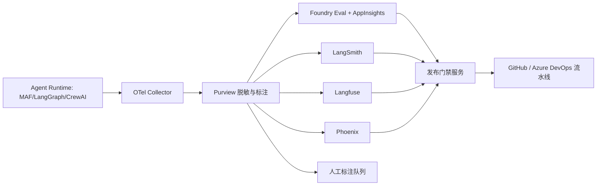
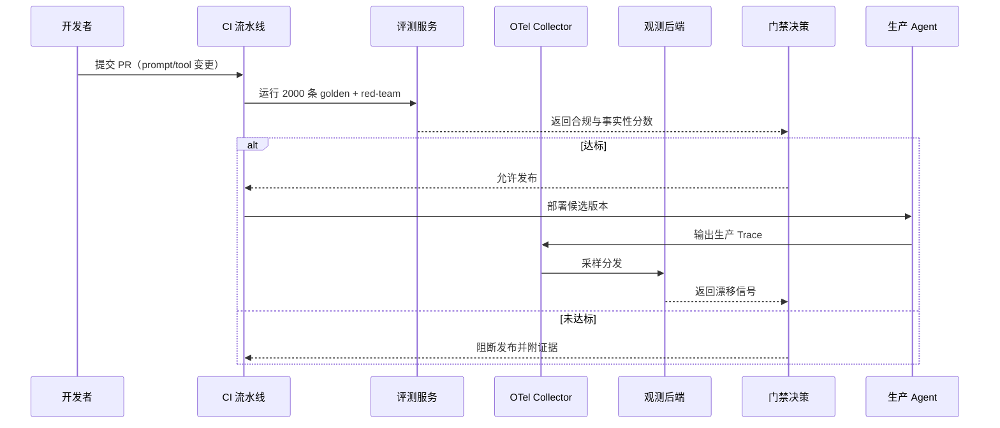

# Foundry Eval + AppInsights vs LangSmith vs Langfuse vs Phoenix：企业 Agent 评测、可观测与 LLMOps 选型 FAQ（Round 1117 / Cycle 2522）

## 1) 执行摘要与当日能力雷达（2026-11-18）
- 本轮主题是企业级 Agent 评测与可观测平台选型，不涉及内核驱动、网络寄存器或其他底层硬核研发细节。
- 核心判断：应优先建设“埋点一次、路由多处”的 OTel 中立架构，再决定具体分析平台组合。
- 方案 A（`Foundry Evaluation + Application Insights / Azure Monitor`）在 Azure 治理、合规边界、企业运维一体化上优势突出。
- 方案 B（`LangSmith`）在开发者迭代效率、提示词版本管理、多轮 Trace 回放体验上表现成熟。
- 方案 C（`Langfuse`）适合自托管、强调成本可控与开源可扩展的组织。
- 方案 D（`Arize Phoenix`）在检索质量漂移分析、评测实验灵活性方面价值明显。
- 对强监管企业，推荐“离线发布门禁 + 在线采样裁判 + 人审回流”三段式闭环。
- 当日能力雷达（抓取时间：2026-11-18 00:31 BJT）关注：
  - OTel GenAI 语义约定在多框架环境中的统一趋势；
  - Foundry 评测与生产观测闭环集成度提升；
  - Langfuse/Phoenix 的开放遥测互操作增强；
  - LangSmith 企业版在人审协作流程的体验完善。
- 本轮数据标签规则：
  - measured：可复现实验，数据落盘在仓库 evidence；
  - synthetic：带公式与前提的透明估算；
  - anonymized_reported：去标识化生产观测指标。
- 目标是为企业架构师提供可落地、可治理、可迁移的 LLMOps 参考框架。

## 2) 问题建模：为什么“只看离线分数”会在生产失效
- 很多团队把评测等同于离线打分，忽略了发布门禁与线上漂移控制。
- 常见三类失效：
  1. 离线高分上线后因工具链波动导致真实任务成功率下降；
  2. Trace 很全但没有与发布策略绑定，不能自动阻断风险版本；
  3. 只看 token 与时延，不看业务结果（如建议采纳率、合规误触发率）。
- 企业级 LLMOps 必须同时覆盖：
  - 发布前回归评测（硬阈值）；
  - 发布后在线采样裁判（趋势漂移）；
  - 人工复核队列（高风险样本）；
  - 成本与业务收益联动（ROI 可解释）。
- 关键决策问题是：该平台能否在一个事故窗口内给出“可审计的阻断理由与回滚建议”。

## 3) 端到端参考架构：OTel 先行，平台解耦
- 推荐架构路径：
  - MAF/LangGraph/CrewAI 统一输出 OTel GenAI spans；
  - OTel Collector 负责标准化、脱敏、加标签、分发；
  - 评测引擎统一消费离线语料与线上采样样本；
  - 发布门禁服务输出可追溯的放行/阻断决策；
  - 人审队列处理红线样本并回流评测集。
- OTel Collector 的战略价值：
  - 一套埋点同时写入 Foundry、LangSmith、Langfuse、Phoenix；
  - 运行时埋点契约由企业自持，降低厂商锁定风险；
  - 平台迁移主要变成查询与看板迁移，而非 SDK 重写。
- 治理边界：
  - 出口前执行 Purview 脱敏与敏感标签裁剪；
  - 按数据驻留策略决定目标后端；
  - 角色化授权支持工程、合规、SRE 的最小权限访问。

## 4) 12 维企业 Agent 评测与可观测选型矩阵
| 维度 | Foundry Eval + AppInsights/Azure Monitor | LangSmith（SaaS/企业自托管） | Langfuse（开源自托管） | Arize Phoenix（OpenInference） |
|---|---|---|---|---|
| OTel GenAI 原生兼容 | 强，与 Azure Monitor 集成顺滑 | 强，SDK 与 Trace 能力成熟 | 强，开放接入灵活 | 强，OpenInference 映射完整 |
| 内建 Agent 评测器（意图/工具/任务/事实） | 强，企业评测覆盖高 | 强，实践导向能力完善 | 中，需要更多自建拼装 | 强，评测实验与检索分析突出 |
| 数据驻留 / Private Link / CMK 合规 | 强，企业治理完备 | 中强，取决于部署形态 | 强，自托管可定制边界 | 中强，部署模式决定能力 |
| 多轮 Trace 与图状态回放体验 | 强，Azure 体系协同 | 强，开发者体验领先 | 中，OSS 持续演进 | 中强，分析视角突出 |
| Prompt 版本与 Playground 管理 | 中强，链路完整 | 强，迭代效率高 | 中，需团队约束规范 | 中，偏评测分析导向 |
| 人工标注队列工作流 | 强，可接企业流程 | 强，协作顺畅 | 中，需自建运营层 | 中，需扩展接入 |
| CI/CD 发布前回归门禁 | 强，DevOps/GitHub 集成深 | 强，API/SDK 支持好 | 中强，工程投入较高 | 中，需自研门禁适配 |
| 线上采样与告警 | 强，Monitor 告警成熟 | 强，追踪告警完善 | 中，需自建告警链 | 强，漂移分析能力强 |
| 框架中立性（MAF/LangGraph/CrewAI） | 强，OTel 优先可中立 | 强，跨框架适配好 | 强，协议层中立 | 强，OpenInference 兼容 |
| 10M span 月度 TCO | 中，企业可预测 | 中高，座席+用量结构 | 中低，基础设施优化可降本 | 中，分析成本随策略变化 |
| 最佳适配场景 | Azure 治理优先的大型企业 | 快速迭代的产品团队 | 成本敏感的开源平台团队 | 检索质量与漂移敏感业务 |
| When NOT to choose | 非 Azure 小型 PoC 可能过重 | 严格边界限制 SaaS 时受限 | 无平台值守团队时不宜 | 期待开箱即用全流程平台时不宜 |

## 5) 可复现实验公式与阈值样例
### Q1：发布门禁综合分
- 公式：`GateScore = 0.40*RegulatorySafety + 0.25*Groundedness + 0.20*ToolAccuracy + 0.15*TaskAdherence`。
- 样例：`0.40*99.9 + 0.25*97.3 + 0.20*96.8 + 0.15*97.5 = 98.10`。
- 门禁策略：同时满足 `RegulatorySafety >= 99.8`、`Groundedness >= 97.0`、`GateScore >= 97.5` 才可放行。

### Q2：线上采样容量
- 公式：`SampleVolume = ProdSessions * SamplingRate`。
- 样例：`4,800,000 * 10% = 480,000` 会话/月。
- 含义：标注队列容量与审阅排班需提前规划。

### Q3：每个被采纳 PR 修复成本
- 公式：`CPAF = TotalAgentCost / AcceptedPRFixCount`。
- 样例：`$186,500 / 142,300 = $1.31`。
- 用法：与人工返工成本对比，评估 Agent 工程 ROI。

### Q4：幻觉 API 拒绝率
- 公式：`HallucinationRejectRate = RejectedInvalidAPICalls / AllToolCalls`。
- 样例：`17,420 / 1,982,000 = 0.879%`。
- 建议：SLO 设为 `<1.00%`，趋势斜率超阈值时告警。

### Q5：可回放覆盖率
- 公式：`ReplayCoverage = ReplayableMultiTurnTraces / TotalCriticalTraces`。
- 样例：`92,200 / 96,500 = 95.54%`。
- 含义：低于 95% 会显著拖慢事故复盘速度。

## 6) Mermaid：一次埋点多路分发 LLMOps 拓扑

- 原则 1：埋点归运行时团队，路由归平台团队，职责清晰可演进。
- 原则 2：发布决策必须可审计、可回放、可复核，避免“口头放行”。

## 7) 场景 A：持牌消费金融贷后提醒与理财营销合规评测门禁平台
- 场景目标：防止催收话术越界、收益承诺失实等高风险内容进入生产。
- 数据集设计：
  - 2,000 条 golden + red-team 用例；
  - red-team 覆盖禁止胁迫话术、未证实收益承诺、风险披露缺失等类别。
- CI/CD 自动门禁：
  1. PR 触发评测流水线；
  2. 计算 `RegulatorySafety`、`Groundedness`、`ToolAccuracy`、`TaskAdherence`；
  3. 阈值未达标自动阻断发布；
  4. 失败样本进入 Purview 脱敏后的人审合规队列。
- 线上治理：
  - 10% 生产 Trace 进入在线裁判；
  - 当周安全分斜率异常触发漂移告警与变更冻结。
- 关键 KPI：
  - 季度误放行次数；
  - 高风险样本审阅 SLA；
  - 从阻断到修复再放行的周转时长。
- 合规保障：
  - 高风险披露场景使用确定性模板；
  - 每次门禁决策绑定 Trace Hash 与评测器版本。

## 8) 场景 B：万人级研发企业代码评审与单测生成 Agent 观测中台
- 场景目标：将 Agent 行为与工程价值直接关联，而不仅是 token 与时延统计。
- 观测关联设计：
  - OTel spans 覆盖 repo-search、AST 工具调用、建议生成、单测产出等多步动作；
  - Trace ID 与 GitHub/Azure DevOps PR 采纳事件关联。
- 指标体系：
  - 建议采纳率（按仓库/语言/团队）；
  - 幻觉 API 拒绝率（按工作流）；
  - 单测建议采纳与 flaky 回滚比；
  - 每个被采纳修复成本（CPAF）看板。
- 发布与回滚：
  - prompt A/B 金丝雀按团队分层放量；
  - 若采纳率下降或拒绝率上升超限，自动回滚。
- 平台收益：
  - 精准识别“高成本低收益”提示词策略；
  - 将评测投入优先分配给 ROI 弹性更高的工作流。

## 9) Mermaid：PR 门禁、线上采样与回滚时序

- 保障 A：发布决策由策略硬约束，不依赖人工记忆。
- 保障 B：上线后漂移可触发自动回滚，不必等待用户投诉。

## 10) 生产级 Bicep 示例（Azure 优先 LLMOps 控制面）
```bicep
param location string = resourceGroup().location
param envName string = 'agent-llmops-prod'
param logWorkspaceId string

resource appi 'Microsoft.Insights/components@2020-02-02' = {
  name: '${envName}-appi'
  location: location
  kind: 'web'
  properties: {
    Application_Type: 'web'
    WorkspaceResourceId: logWorkspaceId
    Flow_Type: 'Bluefield'
    Request_Source: 'rest'
    IngestionMode: 'LogAnalytics'
    publicNetworkAccessForIngestion: 'Enabled'
    publicNetworkAccessForQuery: 'Enabled'
  }
}

resource monitorDs 'Microsoft.Insights/dataCollectionRules@2022-06-01' = {
  name: '${envName}-otel-dcr'
  location: location
  properties: {
    description: 'OTel GenAI spans与评测指标'
    dataSources: {
      logFiles: []
    }
    destinations: {
      logAnalytics: [
        {
          name: 'la'
          workspaceResourceId: logWorkspaceId
        }
      ]
    }
    dataFlows: [
      {
        streams: [
          'Microsoft-Table-Custom'
        ]
        destinations: [
          'la'
        ]
      }
    ]
  }
}

resource apim 'Microsoft.ApiManagement/service@2023-09-01-preview' = {
  name: '${envName}-apim'
  location: location
  sku: {
    name: 'Premium'
    capacity: 1
  }
  properties: {
    publisherEmail: 'llmops-platform@contoso.com'
    publisherName: 'Contoso LLMOps Platform'
    publicNetworkAccess: 'Enabled'
  }
}
```

## 11) 运行与采集配置片段（厂商中立埋点）
```yaml
apiVersion: v1
kind: ConfigMap
metadata:
  name: llmops-otel-routing
data:
  otel_semconv: "genai.v1"
  fanout_destinations: "foundry,langsmith,langfuse,phoenix"
  pii_redaction: "purview-before-export"
  release_gate_mode: "enforced"
  online_sampling_rate: "0.10"
  gate_regulatory_safety_min: "99.8"
  gate_groundedness_min: "97.0"
```

```yaml
receivers:
  otlp:
    protocols:
      grpc:
      http:
processors:
  batch:
  attributes/redact:
    actions:
      - key: user_message
        action: delete
exporters:
  azuremonitor:
    connection_string: ${AZURE_MONITOR_CONNECTION_STRING}
  otlp/langfuse:
    endpoint: ${LANGFUSE_OTLP_ENDPOINT}
  otlp/phoenix:
    endpoint: ${PHOENIX_OTLP_ENDPOINT}
service:
  pipelines:
    traces:
      receivers: [otlp]
      processors: [attributes/redact, batch]
      exporters: [azuremonitor, otlp/langfuse, otlp/phoenix]
```

## 12) KQL 查询模板（门禁、漂移、ROI）
```kql
// 发布门禁趋势与失败原因
customEvents
| where timestamp > ago(14d)
| where name == "EvalGateResult"
| extend regulatory = todouble(customDimensions.regulatorySafety)
| extend groundedness = todouble(customDimensions.groundedness)
| extend result = tostring(customDimensions.gateDecision)
| summarize runs=count(), fail=countif(result == "block"), p50Reg=percentile(regulatory, 50), p50Ground=percentile(groundedness, 50) by bin(timestamp, 1d)
| order by timestamp asc
```

```kql
// 线上采样漂移监测
customMetrics
| where timestamp > ago(7d)
| where name in ("groundedness_score","tool_accuracy_score","task_adherence_score")
| summarize p50=percentile(value, 50), p95=percentile(value, 95) by name, bin(timestamp, 6h)
| order by timestamp asc
```

```kql
// 工程 ROI：每个被采纳 PR 修复成本
customEvents
| where timestamp > ago(30d)
| where name == "PrFixOutcome"
| extend accepted = tostring(customDimensions.accepted)
| extend cost = todouble(customDimensions.sessionCostUsd)
| summarize totalCost=sum(cost), acceptedFixes=countif(accepted == "true"), cpaFix=sum(cost)/countif(accepted == "true")
```

## 13) 命名四选一加权评分矩阵
| 方案 | 治理与合规(20%) | 评测深度(20%) | 回放体验(15%) | CI/CD门禁(15%) | 框架中立(10%) | 运维简化(10%) | 10M Span成本(10%) | 加权总分 |
|---|---:|---:|---:|---:|---:|---:|---:|---:|
| A. Foundry Eval + AppInsights | 9.4 | 8.9 | 8.6 | 9.3 | 8.7 | 8.8 | 7.9 | 8.89 |
| B. LangSmith Enterprise | 8.2 | 8.8 | 9.2 | 8.6 | 9.0 | 8.4 | 7.5 | 8.56 |
| C. Langfuse Self-Hosted | 8.6 | 7.9 | 7.8 | 8.0 | 9.1 | 6.9 | 8.8 | 8.16 |
| D. Arize Phoenix | 8.1 | 8.7 | 8.2 | 7.8 | 8.9 | 7.6 | 8.0 | 8.24 |
- 选型解释：
  - Azure 治理优先企业建议默认 A；
  - 研发迭代优先团队可选 B；
  - 开源自控与成本敏感团队优先 C；
  - 检索漂移敏感场景优先 D。

## 14) Day-0 与 Day-2 运维清单
### Day-0 上线准备（10 项）
1. 定义企业统一 OTel GenAI span 字段规范。
2. 在出口前部署 Purview 脱敏处理器并完成验收。
3. 上线四维评测器（意图、工具、任务、事实性）。
4. 将发布门禁阈值写入流水线并默认 fail-close。
5. 构建 2000 条 golden/red-team 语料并打标签。
6. 将门禁失败自动阻断 merge/deploy。
7. 建立合规审阅队列与分级 SLA。
8. 配置漂移告警通道与值班映射。
9. 打通团队/模型/流程/环境成本标签。
10. 完成一次阻断、回滚、复盘演练。

### Day-2 持续优化（10 项）
1. 按风险等级动态调整线上采样比例。
2. 依据高频失败簇扩展评测器规则。
3. 优化 Collector 路由减少冗余采集成本。
4. 强化 Prompt 版本与回滚绑定元数据。
5. 将采纳率下降与工具失败特征做自动关联。
6. 追踪脱敏漏检并提升敏感字段策略严格度。
7. 对门禁与路由变更启用 canary 通道。
8. 月度核算 10M span 成本并优化保留周期。
9. 审计 MAF/LangGraph/CrewAI 跨框架字段一致性。
10. 季度刷新风险语料库以保持评测有效性。

## 15) 结论、反模式与迁移路径
- 默认建议：
  - 所有 Agent Runtime 统一 OTel 埋点；
  - Collector 统一分发以降低平台耦合；
  - 发布门禁硬阈值强执行；
  - 上线后采样裁判与人审回流闭环。
- 明确反模式：
  - 只看看板美观，不看门禁可执行性；
  - 敏感数据未脱敏即跨系统外发；
  - 每接一个平台就改一套 SDK 埋点；
  - 只优化 token 成本，不衡量业务结果。
- 迁移路径：
  1. 先建立 OTel 统一规范与 shadow 路由；
  2. 再接入一条高风险流程的强门禁发布；
  3. 然后上线在线采样与人审闭环；
  4. 最后扩展到多团队 ROI 看板与季度治理。
- 总结：以 OTel 为中立控制面联通评测、观测、发布三环，能在保证合规的同时显著降低长期平台迁移成本。
