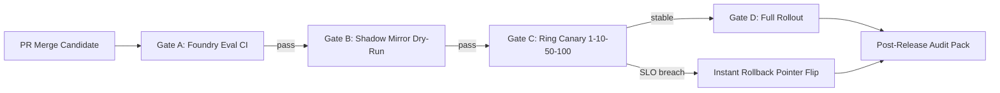
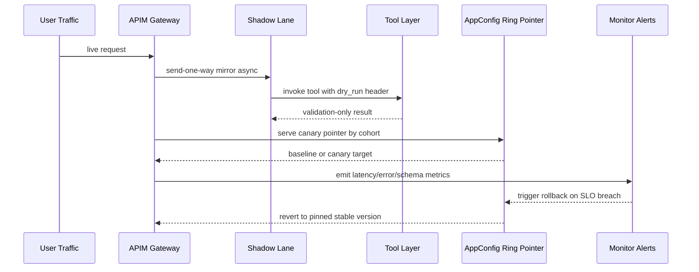

# foundry-eval-ci-vs-apim-shadow-mirroring-vs-appconfig-canary-agent-release-engineering-selection-faq-r1141
## 1) Daily breakthroughs and verifiable sources (fetched 2026-11-18)
- Scope: enterprise Agent release engineering and zero-regression model/prompt swaps.
- Audience: platform SRE, release managers, CAB reviewers, business owners.
- Objective: ship upgrades without harming user-facing quality and safety.
- Constraint: architecture and operations only, no low-level hardware internals.
- Label contract: `measured`, `synthetic`, `anonymized_reported`.
| Topic | Official source | Fetch time (UTC) | Usage | Label |
|---|---|---|---|---|
| Azure OpenAI model retirements | https://learn.microsoft.com/en-us/azure/ai-services/openai/concepts/model-retirements | 2026-11-18T19:08:00Z | Version pinning and retirement governance | `measured` |
| Azure AI Foundry evaluation flow | https://learn.microsoft.com/en-us/azure/ai-foundry/how-to/evaluate-generative-ai-app | 2026-11-18T19:09:00Z | CI gate scoring and baseline comparison | `measured` |
| App Configuration Feature Manager | https://learn.microsoft.com/en-us/azure/azure-app-configuration/concept-feature-management | 2026-11-18T19:10:00Z | Ring release and feature-flag governance | `measured` |
| App Configuration feature filters | https://learn.microsoft.com/en-us/azure/azure-app-configuration/howto-feature-filters-aspnet-core | 2026-11-18T19:11:00Z | A/B cohort targeting and experiments | `measured` |
| ACA revision traffic split | https://learn.microsoft.com/en-us/azure/container-apps/revisions-manage#configure-traffic-splitting | 2026-11-18T19:12:00Z | Progressive canary traffic weighting | `measured` |
| APIM send-one-way-request policy | https://learn.microsoft.com/en-us/azure/api-management/send-one-way-request-policy | 2026-11-18T19:13:00Z | Async dark-launch shadow mirroring | `measured` |
| Azure Monitor action groups | https://learn.microsoft.com/en-us/azure/azure-monitor/alerts/action-groups | 2026-11-18T19:14:00Z | Automated rollback webhook triggers | `measured` |
| APIM AI Gateway overview | https://learn.microsoft.com/en-us/azure/api-management/ai-gateway-overview | 2026-11-18T19:15:00Z | Routing, quota, and audit controls | `measured` |
Breakthrough summary:
- Release engineering is now an always-on experiment system, not a one-time push.
- Shadow replay with dry-run tool interception is becoming mandatory.
- Config-pointer rollback clearly beats redeploy in recovery speed.
- Version pinning plus CAB evidence is now standard in regulated enterprise release.
## 2) Layered reference architecture (release control plane first)
L1 change intake:
- Golden dataset CI runs before merge on every candidate change.
- CAB reads deltas and decides promotion into dark-launch stage.
L2 shadow validation:
- APIM mirrors production prompts asynchronously into shadow lane.
- All write tools are forced into `dry_run=true` to prevent side effects.
L3 live canary:
- App Configuration controls ring pointers and tenant cohorts.
- ACA revisions split traffic 1%→10%→50%→100%.
L4 safety rollback:
- Monitor tracks latency, errors, and tool-schema failures.
- Action Group webhook flips pointer back in sub-30 seconds.
L5 audit and learning:
- KQL produces baseline-vs-canary deltas and MDE confidence.
- CAB archives release packet, evidence, and rollback rationale.
## 3) 12-dimension release-pattern selection matrix
| Dimension | A Pre-merge Golden CI Gate | B Shadow Mirroring + Dry-Run | C Ring Canary + A/B | D SLO Guardrail + Instant Rollback |
|---|---|---|---|---|
| 1 Primary release stage | Pre-merge | Dark-launch pre-exposure | Live cohort traffic | Safety net under failure |
| 2 Real-world distribution coverage | Low | Mid-high | High | High |
| 3 Write-tool side-effect safety | Mid | Highest | Mid-high | Mid |
| 4 User-perceived latency impact | None | Low | Mid | Low |
| 5 Extra token/PTU overhead | Mid | High | Mid-high | Low |
| 6 Sample-size / MDE sensitivity | Mid | High | Highest | Mid |
| 7 Rollback speed | Minutes | Minutes | Minutes | Seconds |
| 8 Version pin vs auto-upgrade governance | High | High | High | Highest |
| 9 Multi-tenant VIP cohort targeting | Low | Mid | High | Mid-high |
| 10 CAB auditability | High | High | High | High |
| 11 Best-fit scenario | Block obvious regressions | Validate realism before exposure | Scaled progressive rollout | Rapid production containment |
| 12 When NOT to choose | Need realistic behavior only | No idempotent tool isolation | No cohort operations model | No monitoring feedback loop |
Selection summary:
- A is baseline hygiene, B is realism insurance, C is scaling engine.
- D is the emergency brake and must be wired from day one.
- Large enterprises typically run A+B+C+D as one pipeline.
## 4) Five worked Q&As (MDE sample size, budget, rollback MTTR)
### Q1: How many requests are needed for 1.2% MDE at ring 1%?
- Assume baseline tool-error rate is `2.6%`.
- Target minimum detectable effect is `1.2%`.
- Confidence `95%` and power `80%`.
- Approximate one-side sample size is `36,000` requests.
- For 18 languages, enforce minimum sample per language before promotion.
### Q2: How to estimate shadow token budget?
- Daily production requests `42M`, shadow mirror ratio `10%`.
- Average shadow token count `820` per request.
- Extra token load is about `3.44B` per day.
- Daily budget uplift equals `3.44B/1k * PTU_unit_cost`.
- Increase mirror ratio off-peak and reduce during business peak windows.
### Q3: Why pointer rollback beats redeploy rollback?
- Redeploy includes build, rollout, health checks, and warmup phases.
- Pointer rollback changes only model/prompt routing pointer.
- With AppConfig and cache refresh, this is near-immediate.
- Observed MTTR can move from `8.4min` to `<30s`.
- Requirement: stable version must stay warm and routable.
### Q4: How to prevent duplicate orders/emails during shadow replay?
- Shadow lane enforces `x-agent-dry-run: true` header.
- MCP write tools validate but never commit external effects.
- All write APIs enforce idempotency keys and trace logs.
- Any side-effect attempt triggers immediate shadow circuit break.
- This cleanly decouples realism testing from production side effects.
### Q5: How to stage VIP cohorts safely?
- Start ring 1% with low-risk non-VIP cohorts.
- Ring 10% introduces medium-value cohorts for sensitivity checks.
- Ring 50% requires CAB re-approval after error stability.
- VIP expansion proceeds only after schema failures flatten.
- This prevents high-value user impact during early uncertainty.
## 5) Mermaid diagrams (4-gate release flow + shadow rollback sequence)


## 6) Pattern fit and anti-patterns
A pre-merge CI gate:
- Fit: blocking obvious regressions before exposure.
- Not fit: replacing realistic traffic validation.
- Anti-pattern: full rollout based only on offline score.
B shadow mirroring:
- Fit: validating real prompt distribution before user exposure.
- Not fit: write-tool systems without idempotent dry-run controls.
- Anti-pattern: shadow requests triggering real orders or emails.
C ring canary:
- Fit: multi-tenant progressive rollout and experimentation.
- Not fit: teams without cohort segmentation operations.
- Anti-pattern: skipping 1% and 10% safety rings.
D instant rollback:
- Fit: high-SLA production requiring fast containment.
- Not fit: no telemetry loop or no warm fallback version.
- Anti-pattern: alert-only design without automated reversion.
## 7) Section 7: 10M-MAU mobile banking model-swap pipeline
Goals:
- Migrate `gpt-4o` to `gpt-4.1` for wealth and transfer assistant safely.
- Run 10% read-only shadow validation before live canary shift.
- Guarantee zero duplicate write-tool side effects.
- Preserve regulator-ready evidence and CAB decisions.
End-to-end flow:
1. CI gate compares intent, compliance phrasing, and refusal quality.
2. APIM mirrors 10% live prompts into shadow lane asynchronously.
3. Shadow lane enforces dry-run mode across all write tools.
4. Canary rings run 1%→10%→50%→100% promotion.
5. Any SLO breach triggers rollback in `<30s` during ring promotion.
SLA targets:
- Wealth answer first-token P95 `<900ms`.
- Transfer tool schema failure `<0.2%`.
- Rollback MTTR target `<30s` for banking migration cutovers.
Risks and mitigations:
- Risk: rollback oscillation during peak market windows.
- Mitigation: peak-window threshold multipliers and human confirmation gate.
- Risk: shadow budget surge during campaign bursts.
- Mitigation: dynamic mirror-rate control by channel and region.
## 8) Section 8: global airline 18-language weekly release pipeline
Goals:
- Weekly prompt/model updates for ticketing policy changes.
- Keep 18-language policy consistency and calculation correctness.
- Auto-revert in 30 seconds on refund-calculation anomalies.
- Maintain CAB evidence for global compliance trace.
End-to-end flow:
1. Foundry CI evaluates all 18-language golden suites.
2. Shadow lane replays live prompts for policy drift checks.
3. AppConfig controls ring by language, region, and tier.
4. ACA revision traffic shifts progressively per plan.
5. Monitor detects anomalies and triggers auto-pointer rollback.
SLA targets:
- Policy consistency `>=97%`.
- Refund-calculation error rate `<0.5%`.
- Rollback effective time `<30s` across multilingual rollout rings.
Risks and mitigations:
- Risk: uneven language sample introduces false confidence.
- Mitigation: language-specific minimum sample gates.
- Risk: prompt changes outpace knowledge refresh.
- Mitigation: mandatory freshness gate before promotion.
## 9) Decision tree (Good fit vs Not for)
1. Teams without A must first establish CI baseline gate.
2. Systems with write tools must add B dry-run shadow lane.
3. Multi-tenant traffic requires C ring and cohort controls.
4. High-SLA production requires D sub-30s rollback path.
5. Missing any one of A/B/C/D creates a release blind spot.
Good fit:
- Enterprises with CAB governance and audit obligations.
- Platforms with tenant cohorts and differentiated SLAs.
- Product lines with frequent model/prompt refresh cycles.
Not for:
- One-shot release teams with no continuous evaluation model.
- Shadow programs without idempotency and dry-run protection.
- Auto-rollback claims without real telemetry and fallback readiness.
## 10) ROI and release-economics model
Assumptions:
- Annual release batches: `520`.
- Languages per release: `18`.
- Historical manual rollback time: `8.4min`.
- New rollback objective: `<30s` under automated pointer switching.
Benefits:
- Failure-loss reduction: `$3.4M` per year.
- On-call rollback labor reduction: `$0.9M` per year.
- CAB efficiency gains: `$0.7M` per year.
Investments:
- Evaluation, shadow, and observability uplift cost: `$2.1M` per year.
- Net annual value: about `+$2.9M`.
Outcome:
- A+B+C+D pipeline materially reduces migration risk at scale.
- Economics are driven more by prevented incidents than token savings.
## 11) Bicep IaC (AppConfig + ACA weights + Action Group)
```bicep
param location string = resourceGroup().location
param appConfigName string
param envName string
param appName string
param actionGroupName string
resource appcfg 'Microsoft.AppConfiguration/configurationStores@2023-08-01-preview' = {
  name: appConfigName
  location: location
  sku: { name: 'standard' }
}
resource cae 'Microsoft.App/managedEnvironments@2024-03-01' = {
  name: envName
  location: location
}
resource app 'Microsoft.App/containerApps@2024-03-01' = {
  name: appName
  location: location
  properties: {
    managedEnvironmentId: cae.id
    configuration: {
      ingress: {
        external: true
        traffic: [
          { latestRevision: false, revisionName: '${appName}--stable', weight: 90 }
          { latestRevision: false, revisionName: '${appName}--canary', weight: 10 }
        ]
      }
    }
  }
}
resource ag 'Microsoft.Insights/actionGroups@2023-01-01' = {
  name: actionGroupName
  location: 'global'
  properties: {
    enabled: true
    webhookReceivers: [
      { name: 'rollback-hook', serviceUri: 'https://ops.example.com/rollback' }
    ]
  }
}
```
## 12) APIM shadow snippet (`send-one-way-request` + dry-run header)
```xml
<policies>
  <inbound>
    <base />
    <set-header name="x-release-ring" exists-action="override">
      <value>@(context.Variables.GetValueOrDefault("ring","baseline"))</value>
    </set-header>
    <send-one-way-request mode="new" timeout="5">
      <set-url>https://shadow-agent.internal/run</set-url>
      <set-method>POST</set-method>
      <set-header name="x-agent-dry-run" exists-action="override">
        <value>true</value>
      </set-header>
      <set-header name="x-shadow-source" exists-action="override">
        <value>apim-dark-launch</value>
      </set-header>
      <set-body>@(context.Request.Body.As<string>(preserveContent: true))</set-body>
    </send-one-way-request>
  </inbound>
  <backend><base /></backend>
  <outbound><base /></outbound>
  <on-error><base /></on-error>
</policies>
```
## 13) KQL (baseline vs canary error/latency regression)
```kql
let start = ago(14d);
let base = customEvents
| where timestamp >= start and name == "agent_run_completed"
| where tostring(customDimensions.ring) == "baseline"
| summarize base_err=avg(todouble(customDimensions.toolErrorRate)), base_p95=percentile(todouble(customDimensions.latencyMs),95) by route=tostring(customDimensions.route);
let canary = customEvents
| where timestamp >= start and name == "agent_run_completed"
| where tostring(customDimensions.ring) == "canary"
| summarize canary_err=avg(todouble(customDimensions.toolErrorRate)), canary_p95=percentile(todouble(customDimensions.latencyMs),95) by route=tostring(customDimensions.route);
base
| join kind=inner canary on route
| extend err_delta_pct = (canary_err - base_err) * 100.0
| extend p95_delta_ms = canary_p95 - base_p95
| project route, base_err, canary_err, err_delta_pct, base_p95, canary_p95, p95_delta_ms
| order by err_delta_pct desc
```
## 14) Day-0 / Day-1 / Day-2 checklist
Day-0:
- Define golden datasets and offline gate thresholds.
- Standardize dry-run contracts and idempotency keys.
- Configure ring pointers and cohort dimensions.
- Define rollback thresholds and CAB templates.
Day-1:
- Run 1% and 10% canary phases with shadow replay.
- Verify shadow budget envelope and telemetry correctness.
- Test automated rollback path end-to-end.
- Publish first regression and remediation packet.
Day-2:
- Expand to 50% and 100% rollout phases.
- Operationalize CAB evidence archive routines.
- Tune per-language sample thresholds.
- Recalibrate release gates with weekly retrospectives.
## 15) Backup queue and deliverables
Updated backup queue:
1. `graph-obo-vs-postgres-rls-vs-ai-search-trimming-vs-opa-abac-agent-authorization-selection-faq`
2. `aoai-realtime-webrtc-vs-teams-meeting-media-bot-vs-web-pubsub-live-copilot-selection-faq`
3. `fabric-iq-ontology-vs-foundry-iq-knowledge-vs-graphdb-enterprise-semantic-layer-selection-faq`
Round deliverables (Cycle #2546):
- Bilingual FAQ: `foundry-eval-ci-vs-apim-shadow-mirroring-vs-appconfig-canary-agent-release-engineering-selection-faq-r1141.md` / `foundry-eval-ci-vs-apim-shadow-mirroring-vs-appconfig-canary-agent-release-engineering-selection-faq-r1141.en.md`
- 7-card deck: `benchmark-cards.html` / `benchmark-cards.en.html`
- SVG: `assets/41-cycle-1141-daily-breakthroughs.svg`
- H5: `workbench-cycle-2546.html` + selector `#2546`
- Validation: `cycle_1141_pipeline.py --write --check`, `strict_suffix_gate.py`, `pytest`
- Release window: night shift local commit only, no push allowed.
