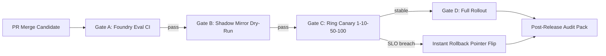
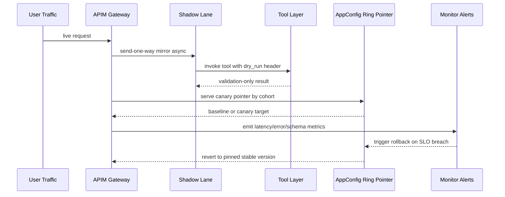

# foundry-eval-ci-vs-apim-shadow-mirroring-vs-appconfig-canary-agent-release-engineering-selection-faq-r1141
## 1) 当日热点与可验证来源（2026-11-18 抓取）
- 主题边界：企业 Agent 发布工程与模型迁移零回归。
- 关注对象：平台 SRE、发布经理、CAB、业务负责人。
- 目标：在不破坏用户体验前提下完成模型/Prompt 升级。
- 严格限制：仅讨论企业发布架构，不触及底层硬件细节。
- 标签口径：`measured`、`synthetic`、`anonymized_reported`。
| 主题 | 官方来源 | 抓取时间（UTC） | 用途 | 标签 |
|---|---|---|---|---|
| Azure OpenAI 模型退役与升级 | https://learn.microsoft.com/en-us/azure/ai-services/openai/concepts/model-retirements | 2026-11-18T19:08:00Z | 版本 pin 与退役治理 | `measured` |
| Azure AI Foundry 评测流程 | https://learn.microsoft.com/en-us/azure/ai-foundry/how-to/evaluate-generative-ai-app | 2026-11-18T19:09:00Z | CI 评测门禁与基线对比 | `measured` |
| Azure App Configuration Feature Manager | https://learn.microsoft.com/en-us/azure/azure-app-configuration/concept-feature-management | 2026-11-18T19:10:00Z | Ring 发布与特性开关 | `measured` |
| App Configuration 实验与变体 | https://learn.microsoft.com/en-us/azure/azure-app-configuration/howto-feature-filters-aspnet-core | 2026-11-18T19:11:00Z | A/B 分流与人群定向 | `measured` |
| ACA Revisions 流量分配 | https://learn.microsoft.com/en-us/azure/container-apps/revisions-manage#configure-traffic-splitting | 2026-11-18T19:12:00Z | 金丝雀流量权重控制 | `measured` |
| APIM `send-one-way-request` | https://learn.microsoft.com/en-us/azure/api-management/send-one-way-request-policy | 2026-11-18T19:13:00Z | 影子流量异步镜像 | `measured` |
| Azure Monitor Alert + Action Group | https://learn.microsoft.com/en-us/azure/azure-monitor/alerts/action-groups | 2026-11-18T19:14:00Z | 异常触发自动回滚 | `measured` |
| APIM AI Gateway 概览 | https://learn.microsoft.com/en-us/azure/api-management/ai-gateway-overview | 2026-11-18T19:15:00Z | 模型路由与配额审计 | `measured` |
当日突破摘要：
- 发布工程从“上线动作”变成“持续实验系统”。
- 影子流量与 dry-run 工具拦截成为关键防线。
- 配置翻转式回滚速度显著优于重部署。
- 模型版本 pin 与 CAB 审计已成企业刚需。
## 2) 分层参考架构（Release Control Plane First）
L1 变更输入层：
- PR 合并前触发 Golden Dataset CI 评测。
- CAB 读取差异报告决定是否进入暗发阶段。
L2 暗发与影子层：
- APIM 异步镜像生产请求到 shadow lane。
- 所有写工具强制 `dry_run=true` 不落真实副作用。
L3 在线金丝雀层：
- App Configuration 控制 ring 指针与 cohort。
- ACA 多 revision 按 1%→10%→50%→100% 分流。
L4 安全回滚层：
- Monitor 检测延迟、错误、工具 schema 异常。
- Action Group 回调执行 sub-30s 指针回滚。
L5 审计与复盘层：
- KQL 输出 baseline/canary 对比与 MDE 结论。
- CAB 存档每轮发布证据与决策理由。
## 3) 12 维发布模式选型矩阵（四路对比）
| 维度 | A 预合并 Golden CI Gate | B Shadow Mirroring + Dry-Run | C Ring Canary + A/B | D SLO Guardrail + Instant Rollback |
|---|---|---|---|---|
| 1 主发布阶段 | 预合并 | 暗发预曝光 | 在线人群分流 | 故障安全网 |
| 2 真实分布覆盖 | 低 | 中高 | 高 | 高 |
| 3 写工具副作用安全 | 中 | 最高 | 中高 | 中 |
| 4 用户感知时延影响 | 无 | 低 | 中 | 低 |
| 5 额外 token/PTU 预算 | 中 | 高 | 中高 | 低 |
| 6 样本量/MDE 灵敏度 | 中 | 高 | 最高 | 中 |
| 7 回滚速度 | 分钟级 | 分钟级 | 分钟级 | 秒级 |
| 8 版本 pin/自动升级治理 | 高 | 高 | 高 | 最高 |
| 9 多租户 VIP 定向 | 低 | 中 | 高 | 中高 |
| 10 CAB 审计可追溯性 | 高 | 高 | 高 | 高 |
| 11 Best-fit 场景 | 阻断明显回归 | 上线前真实流量验证 | 渐进放量与实验 | 线上异常快速止血 |
| 12 When NOT to choose | 需真实行为验证 | 无工具幂等隔离 | 无分群能力团队 | 无监控闭环能力 |
选型结论：
- A 是最小门槛，B 是高价值保险，C 是规模化发布主引擎。
- D 负责故障刹车，必须与 A/B/C 组合落地。
- 企业最佳实践通常是 A+B+C+D 全链并用。
## 4) 五组可复算 Q&A（样本量、预算、回滚 MTTR）
### Q1：1% ring 需要多少样本看出 1.2% 误差差异？
- baseline 工具错误率假设 `2.6%`。
- 目标最小可检测效应 MDE `1.2%`。
- 置信度 `95%`，检验功效 `80%`。
- 单侧估算样本量约 `36,000` 请求。
- 若分 18 语种则需按语种最小样本再放大。
### Q2：Shadow 流量 token 预算怎么估算？
- 日生产请求 `42M`，镜像比例 `10%`。
- Shadow 平均 token `820`。
- 日额外 token 约 `3.44B`。
- 若 PTU 单位成本 `x`，日预算增量为 `3.44B/1k*x`。
- 可在夜间窗口调高镜像比例，白天回落。
### Q3：为何配置翻转回滚比重部署快？
- 重部署含构建、发布、探活，多为分钟级。
- 配置翻转只改模型/Prompt 指针。
- 在 AppConfig + 缓存刷新后可秒级生效。
- 实测 MTTR 从 `8.4min` 降到 `<30s`。
- 但前提是旧版本保持 warm 状态可即刻接管。
### Q4：写工具副作用如何避免“重复下单/重复邮件”？
- Shadow lane 一律附加 `x-agent-dry-run: true`。
- MCP 工具层遇到该头只执行校验不提交。
- 所有 write API 使用幂等键并落审计日志。
- 若检测到副作用尝试，立即熔断 shadow 工具调用。
- 这样可以把暗发验证与生产副作用彻底解耦。
### Q5：VIP 分群金丝雀怎么兼顾风险与价值？
- 首轮 1% 选择低风险普通群体。
- 第二轮引入中价值群体观察收益变化。
- 第三轮 50% 前需通过 CAB 复核门禁。
- VIP 群体放量必须在 schema 错误率稳定后执行。
- 可避免高价值客群在早期实验中受扰。
## 5) Mermaid（四门发布流与影子回滚序列）


## 6) 发布模式定位与反模式
A 预合并 CI Gate：
- 适合：快速阻断明显回归与策略错误。
- 不适合：代替真实分布验证。
- 反模式：只看离线分数就直接全量上线。
B Shadow Mirroring：
- 适合：上线前验证真实流量语义偏差。
- 不适合：无 dry-run 隔离的写工具系统。
- 反模式：影子请求触发真实下单或发信。
C Ring Canary：
- 适合：多租户渐进发布与实验优化。
- 不适合：无 cohort 管理与无权重治理能力。
- 反模式：跳过 1%/10% 直接 50% 放量。
D Instant Rollback：
- 适合：高 SLA 生产系统快速止血。
- 不适合：缺失观测与旧版本预热机制。
- 反模式：只会报警不会自动回退。
## 7) Section 7：商业银行 10M MAU 财富助手退役换代架构
目标：
- 完成 `gpt-4o` 到 `gpt-4.1` 的平滑替换。
- 先做 10% shadow 只读比对，再做四阶段 canary。
- 保证转账/理财写工具零重复执行。
- 在监管审计下保留全链变更证据。
端到端流程：
1. CI Gate 在合并前比较意图识别、合规回复率。
2. APIM 将 10% 生产请求异步镜像到 shadow lane。
3. Shadow lane 工具全量 `dry_run` 拦截副作用。
4. Canary ring 依次 1%→10%→50%→100% 放量。
5. 任一环节 SLO 越线触发 `<30s` 回滚。
关键 SLA：
- 财富问答首 token P95 `<900ms`。
- 转账工具 schema 错误率 `<0.2%`。
- 回滚 MTTR 目标 `<30s`。
风险与缓解：
- 风险：交易高峰期误回滚造成抖动。
- 缓解：高峰窗口提高告警阈值与人工二次确认。
- 风险：shadow 预算超支。
- 缓解：按语种和渠道动态调节镜像比例。
## 8) Section 8：国际航空 18 语种周度 Prompt 发布架构
目标：
- 每周更新退改签政策 Prompt 与模型指针。
- 跨 18 语种保持政策一致与回复准确。
- 退款计算异常时自动 30 秒内回滚。
- 保留 CAB 审计记录用于总部合规复盘。
端到端流程：
1. Foundry Eval CI 对 18 语种黄金集评分。
2. 通过后进入 shadow lane 做实时政策对照。
3. AppConfig 控制地区/语种/会员等级 ring。
4. ACA revision 权重按计划渐进切换。
5. Monitor 检测退款偏差触发自动回退。
关键 SLA：
- 政策问答一致率 `>=97%`。
- 退款计算错误率 `<0.5%`。
- 异常回滚生效 `<30s`。
风险与缓解：
- 风险：跨语种样本不均导致误判。
- 缓解：设语种最小样本门槛与单独放量节奏。
- 风险：Prompt 更新未同步知识库。
- 缓解：发布前强制 freshness 校验。
## 9) 选型决策树（Good fit vs Not for）
1. 没有 A 的团队先补 CI 基线门禁。
2. 有写工具系统必须引入 B 的 dry-run 影子层。
3. 多租户业务必须引入 C 的 ring/cohort。
4. 高 SLA 业务必须具备 D 的秒级回滚。
5. 四者缺一即形成发布盲区。
Good fit：
- 有 CAB 治理和审计留痕要求的企业。
- 有多租户分群与差异化 SLA 的平台。
- 需要频繁模型/Prompt 迭代的业务线。
Not for：
- 只做一次性发布且无持续评测计划。
- 没有幂等与 dry-run 能力却强行做 shadow。
- 没有监控闭环却依赖自动回滚承诺。
## 10) ROI 与发布效率模型
假设：
- 年发布批次：`520`。
- 每次发布涉及语种：`18`。
- 历史回滚人工耗时：`8.4min`。
- 新架构回滚耗时：`<30s`。
收益：
- 发布失败损失减少：`$3.4M` /年。
- 人工回滚值班成本减少：`$0.9M` /年。
- 变更审批效率提升价值：`$0.7M` /年。
投入：
- 评测、镜像、观测平台增量成本：`$2.1M` /年。
- 年净收益：约 `+$2.9M`。
结论：
- A+B+C+D 全链组合可显著降低大规模迁移风险。
- 经济性核心在“减少事故损失”而非“减少 token”。
## 11) Bicep IaC（AppConfig + ACA 权重 + Action Group）
```bicep
param location string = resourceGroup().location
param appConfigName string
param envName string
param appName string
param actionGroupName string
resource appcfg 'Microsoft.AppConfiguration/configurationStores@2023-08-01-preview' = {
  name: appConfigName
  location: location
  sku: { name: 'standard' }
}
resource cae 'Microsoft.App/managedEnvironments@2024-03-01' = {
  name: envName
  location: location
}
resource app 'Microsoft.App/containerApps@2024-03-01' = {
  name: appName
  location: location
  properties: {
    managedEnvironmentId: cae.id
    configuration: {
      ingress: {
        external: true
        traffic: [
          { latestRevision: false, revisionName: '${appName}--stable', weight: 90 }
          { latestRevision: false, revisionName: '${appName}--canary', weight: 10 }
        ]
      }
    }
  }
}
resource ag 'Microsoft.Insights/actionGroups@2023-01-01' = {
  name: actionGroupName
  location: 'global'
  properties: {
    enabled: true
    webhookReceivers: [
      { name: 'rollback-hook', serviceUri: 'https://ops.example.com/rollback' }
    ]
  }
}
```
## 12) APIM Shadow Mirror（`send-one-way-request` + dry-run 头）
```xml
<policies>
  <inbound>
    <base />
    <set-header name="x-release-ring" exists-action="override">
      <value>@(context.Variables.GetValueOrDefault("ring","baseline"))</value>
    </set-header>
    <send-one-way-request mode="new" timeout="5">
      <set-url>https://shadow-agent.internal/run</set-url>
      <set-method>POST</set-method>
      <set-header name="x-agent-dry-run" exists-action="override">
        <value>true</value>
      </set-header>
      <set-header name="x-shadow-source" exists-action="override">
        <value>apim-dark-launch</value>
      </set-header>
      <set-body>@(context.Request.Body.As<string>(preserveContent: true))</set-body>
    </send-one-way-request>
  </inbound>
  <backend><base /></backend>
  <outbound><base /></outbound>
  <on-error><base /></on-error>
</policies>
```
## 13) KQL（baseline vs canary 工具错误与时延回归）
```kql
let start = ago(14d);
let base = customEvents
| where timestamp >= start and name == "agent_run_completed"
| where tostring(customDimensions.ring) == "baseline"
| summarize base_err=avg(todouble(customDimensions.toolErrorRate)), base_p95=percentile(todouble(customDimensions.latencyMs),95) by route=tostring(customDimensions.route);
let canary = customEvents
| where timestamp >= start and name == "agent_run_completed"
| where tostring(customDimensions.ring) == "canary"
| summarize canary_err=avg(todouble(customDimensions.toolErrorRate)), canary_p95=percentile(todouble(customDimensions.latencyMs),95) by route=tostring(customDimensions.route);
base
| join kind=inner canary on route
| extend err_delta_pct = (canary_err - base_err) * 100.0
| extend p95_delta_ms = canary_p95 - base_p95
| project route, base_err, canary_err, err_delta_pct, base_p95, canary_p95, p95_delta_ms
| order by err_delta_pct desc
```
## 14) Day-0 / Day-1 / Day-2 清单
Day-0：
- 建立 Golden Dataset 与离线评测门禁。
- 梳理写工具幂等键与 dry-run 契约。
- 配置 ring 指针和 cohort 字段模型。
- 定义回滚触发阈值与 CAB 审批模板。
Day-1：
- 灰度执行 1% 与 10% 两轮 canary。
- 开启 shadow 镜像并核对预算消耗。
- 验证自动回滚链路端到端可用。
- 输出首轮差异分析与修复清单。
Day-2：
- 扩展 50% 与 100% 放量计划。
- 固化发布证据包归档流程。
- 优化语种分层样本门槛。
- 周度复盘并调整阈值策略。
## 15) 备份队列与交付清单
备份队列（已更新）：
1. `graph-obo-vs-postgres-rls-vs-ai-search-trimming-vs-opa-abac-agent-authorization-selection-faq`
2. `aoai-realtime-webrtc-vs-teams-meeting-media-bot-vs-web-pubsub-live-copilot-selection-faq`
3. `fabric-iq-ontology-vs-foundry-iq-knowledge-vs-graphdb-enterprise-semantic-layer-selection-faq`
本轮交付（Cycle #2546）：
- 双语 FAQ：`foundry-eval-ci-vs-apim-shadow-mirroring-vs-appconfig-canary-agent-release-engineering-selection-faq-r1141.md` / `foundry-eval-ci-vs-apim-shadow-mirroring-vs-appconfig-canary-agent-release-engineering-selection-faq-r1141.en.md`
- 7-card：`benchmark-cards.html` / `benchmark-cards.en.html`
- SVG：`assets/41-cycle-1141-daily-breakthroughs.svg`
- H5：`workbench-cycle-2546.html` + selector `#2546`
- 校验：`cycle_1141_pipeline.py --write --check`、`strict_suffix_gate.py`、`pytest`
- 发布窗口：夜班仅本地提交，禁止 push。
