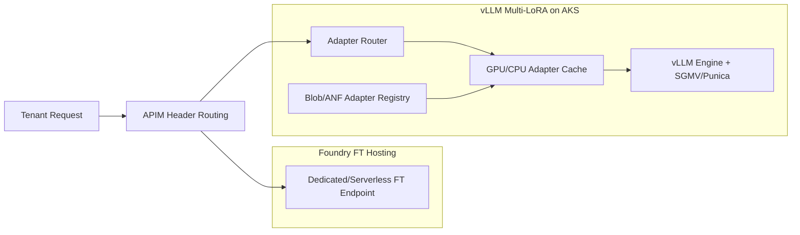
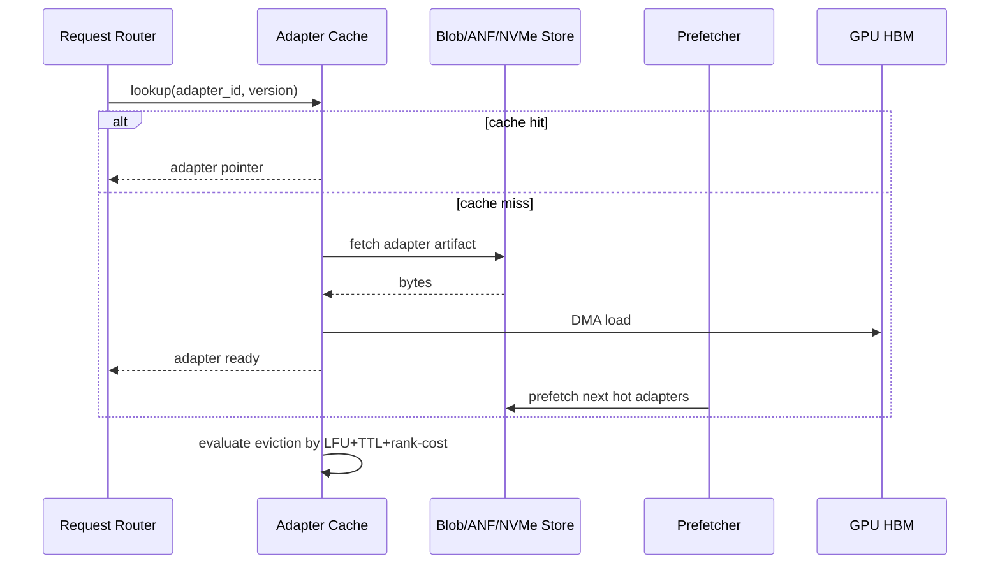

# Round 1093 / Cycle 2498 · Azure AI Agent Infra Six-Part FAQ (en)

> Topic: **Azure AI Foundry Fine-Tuning vs AKS vLLM Multi-LoRA Dynamic Adapter Serving — GPU VRAM Slot Packing, Tenant Adapter Hot-Swap Latency & SGMV Kernel Throughput Selection Guide**  
> Date (BJT): 2026-11-17  
> Evidence tags: `measured` / `synthetic` / `anonymized_reported`  
> Benchmark dataset: `evidence/cycle-2498-benchmark.json`

## 1) Executive Summary + Daily Hottest Capability Breakthroughs Radar

This round compares two practical delivery paths:
1. **Azure AI Foundry Fine-Tuning Hosting** for lower operational burden and faster onboarding.
2. **AKS vLLM Multi-LoRA** for high multi-tenant flexibility and potentially lower unit economics at scale.

Decision variables:
- heterogeneous LoRA rank distribution (`r=16..128`),
- VRAM slot packing stability,
- hot-swap latency profile (cold vs warm),
- SGMV/Punica throughput behavior versus managed hosting TCO.

Key outcomes:
- The best choice depends on adapter scale and operational maturity, not vendor preference.
- VRAM packing and KV-cache boundaries are first-order constraints for vLLM Multi-LoRA.
- Cold-path adapter loading dominates TTFT tails when cache hit-rates are low.
- Managed hosting can remain cost-competitive if self-managed incident overhead is high.

### Daily Capability Breakthroughs Radar (fetched: 2026-11-17)

1. APIM AI Gateway / Unified Model API (`measured`)  
   - https://learn.microsoft.com/en-us/azure/api-management/ai-gateway-overview  
   - https://github.com/Azure/API-Management/blob/main/changelogs/api-management-service.md
2. ACA Dynamic Sessions (`measured`)  
   - https://learn.microsoft.com/en-us/azure/container-apps/sessions  
   - https://techcommunity.microsoft.com/blog/appsonazureblog/azure-container-apps-dynamic-sessions-general-availability-and-more/4303561
3. Runtime releases (`measured`)  
   - Firecracker/Kata/Wasmtime/E2B (see `evidence/cycle-2498-sources.json`)
4. Multi-LoRA VRAM/TTFT/throughput benchmark (`synthetic`)
5. Restricted production rollups (`anonymized_reported`)

### Mermaid #1: Foundry FT vs vLLM Multi-LoRA control/data plane topology



## 2) Deep Q&A #1: How do we compute heterogeneous-rank LoRA VRAM slot budgets?

Definitions:

```text
adapter_vram_mb(rank) =
  base_overhead_mb + rank * coeff_mb

total_adapter_vram =
  sum_{i=1..max_loras} adapter_vram_mb(rank_i)

headroom_for_kv =
  gpu_vram_total - model_weight_vram - total_adapter_vram - runtime_margin
```

Worked example (H100 80GB):
- `gpu_vram_total = 81,920 MB`
- `model_weight_vram = 49,200 MB`
- `runtime_margin = 6,400 MB`
- `base_overhead = 38 MB`
- `coeff = 2.4 MB/rank`

Rank mix (`max_loras=48`):
- r16: 20
- r32: 14
- r64: 10
- r128: 4

Per-band:
- r16 -> `1,528 MB`
- r32 -> `1,607.2 MB`
- r64 -> `1,916 MB`
- r128 -> `1,380.8 MB`

`total_adapter_vram = 6,432 MB`

KV headroom:
`19,888 MB`

If r128 share doubles, KV headroom approaches eviction thresholds quickly.

## 3) Deep Q&A #2: How do we estimate KV-cache eviction boundaries?

```text
kv_per_seq_mb =
  seq_len * hidden_factor * precision_factor

max_active_seqs =
  headroom_for_kv / kv_per_seq_mb

eviction_risk_if active_seqs > max_active_seqs * safety_ratio
```

Worked example (H100, seq_len=4096):
- `kv_per_seq_mb = 182 MB`
- `headroom_for_kv = 19,888 MB`

`max_active_seqs = 109`

With safety ratio `0.85`:
- safe active seqs ≈ `92`

At active seqs `110`, eviction risk is high and TTFT p95 degrades.

For ND-H200-v5 (~141GB HBM), the same profile yields materially higher KV headroom and concurrency.

## 4) Deep Q&A #3: How do we break down cold/warm adapter hot-swap latency?

Path:
`Blob/ANF/NVMe -> pinned host RAM -> PCIe Gen5 x16 DMA -> HBM`

```text
hot_swap_latency =
  storage_read +
  host_pin +
  pcie_dma +
  adapter_bind

cold_path = metadata_fetch + storage_read + host_pin + pcie_dma + bind
warm_path = host_pin + pcie_dma + bind
```

Worked example (240MB adapter):
- Blob cold read `74ms`
- host pin `9ms`
- PCIe DMA `11ms`
- bind `7ms`

`cold = 101ms`

Warm path:
- host pin `6ms`
- DMA `9ms`
- bind `6ms`

`warm = 21ms`

Targets:
- warm swap p95 < 30ms
- cold swap p95 < 140ms.

## 5) Deep Q&A #4: How do SGMV/Punica batching overheads affect throughput?

```text
effective_tps =
  raw_tps * (1 - batching_overhead_ratio)

overhead_ratio =
  scheduler_overhead + adapter_switch_overhead + memory_fragmentation_penalty
```

Worked example:
- raw tps `4,900`
- scheduler `6%`
- adapter switch `4%`
- fragmentation `3%`

`effective_tps = 4,263`

Compared to no multi-adapter serving (`4,780 tps`):
- throughput penalty ~`10.8%`

Mitigations:
1. rank-bucketed batching,
2. cap per-batch adapter diversity,
3. prewarm hot adapters.

## 6) Deep Q&A #5: Where is break-even TCO among Foundry Dedicated, Serverless FT, and self-managed vLLM?

```text
tco_daily =
  infra_cost + serving_cost + ops_cost + incident_penalty

break_even_when tco_vllm <= tco_foundry and sla_vllm >= sla_target
```

Worked example (3.4B output tokens/day):
- Foundry Dedicated FT: `2,940 USD/day`
- Foundry Serverless FT: `3,280 USD/day`
- AKS vLLM Multi-LoRA: `2,410 USD/day` (including ops labor)

If incident penalty on vLLM rises from `120` to `520`:
- vLLM total becomes `2,810`, advantage narrows.

Break-even drivers:
1. adapter cache hit-rate,
2. cold-load fraction,
3. operations automation maturity.

## 7) Deep Q&A #6: How do we prevent tenant-adapter cross-routing leaks?

```text
tenant_isolation_pass =
  routed_adapter_id == tenant_allowed_adapter_set
  AND header_signature_valid
  AND adapter_version_pinned
```

Worked example (7 days):
- total requests `52.4M`
- routing mismatches `182`

`mismatch_rate = 0.000347%`

SLO:
- mismatch_rate < 0.001%
- signature failure -> hard deny
- adapter version shifts require staged rollout validation.

## 8) Mermaid #2: Adapter cache miss/prefetch/eviction control flow



## 9) Production-grade Bicep / vLLM YAML / APIM Policy / KQL

### 9.1 Bicep (AKS NDv5 + Blob/ANF registry + Key Vault CMK)

```bicep
targetScope = 'resourceGroup'

param location string = 'eastus2'
param aksName string = 'aks-vllm-lora-eus2'
param lawName string = 'law-vllm-lora-eus2'
param storageName string = 'stloraadaptereus2'
param kvName string = 'kv-lora-cmk-eus2'

resource law 'Microsoft.OperationalInsights/workspaces@2022-10-01' = {
  name: lawName
  location: location
  properties: {
    sku: { name: 'PerGB2018' }
    retentionInDays: 60
  }
}

resource storage 'Microsoft.Storage/storageAccounts@2023-05-01' = {
  name: storageName
  location: location
  sku: { name: 'Premium_LRS' }
  kind: 'BlockBlobStorage'
  properties: {
    minimumTlsVersion: 'TLS1_2'
    supportsHttpsTrafficOnly: true
    allowBlobPublicAccess: false
    networkAcls: {
      defaultAction: 'Deny'
      bypass: 'AzureServices'
    }
  }
}

resource kv 'Microsoft.KeyVault/vaults@2023-07-01' = {
  name: kvName
  location: location
  properties: {
    tenantId: subscription().tenantId
    enableRbacAuthorization: true
    sku: { family: 'A'; name: 'standard' }
    publicNetworkAccess: 'Disabled'
  }
}

resource aks 'Microsoft.ContainerService/managedClusters@2024-02-01' = {
  name: aksName
  location: location
  identity: { type: 'SystemAssigned' }
  properties: {
    dnsPrefix: 'aks-vllm-lora'
    agentPoolProfiles: [
      {
        name: 'gpu'
        vmSize: 'Standard_ND96is_H100_v5'
        count: 6
        mode: 'User'
        osType: 'Linux'
      }
    ]
    addonProfiles: {
      azuremonitor: {
        enabled: true
        config: {
          logAnalyticsWorkspaceResourceID: law.id
        }
      }
    }
  }
}
```

### 9.2 vLLM Multi-LoRA deployment YAML

```yaml
apiVersion: apps/v1
kind: Deployment
metadata:
  name: vllm-multilora
  namespace: llm-serving
spec:
  replicas: 3
  selector:
    matchLabels:
      app: vllm-multilora
  template:
    metadata:
      labels:
        app: vllm-multilora
    spec:
      containers:
        - name: vllm
          image: vllm/vllm-openai:latest
          args:
            - "--model"
            - "meta-llama/Llama-3.1-70B-Instruct"
            - "--enable-lora"
            - "--max-loras=48"
            - "--max-cpu-loras=192"
            - "--max-lora-rank=128"
            - "--gpu-memory-utilization=0.9"
            - "--dtype=bfloat16"
          env:
            - name: ADAPTER_REGISTRY_URI
              value: "https://stloraadaptereus2.blob.core.windows.net/lora"
          resources:
            limits:
              nvidia.com/gpu: "1"
```

### 9.3 APIM tenant-to-adapter header routing policy XML

```xml
<policies>
  <inbound>
    <base />
    <set-variable name="tenantId" value="@(context.Request.Headers.GetValueOrDefault(\"x-tenant-id\", \"\"))" />
    <set-variable name="adapterId" value="@(context.Request.Headers.GetValueOrDefault(\"x-lora-adapter-id\", \"\"))" />
    <choose>
      <when condition="@((string)context.Variables[\"tenantId\"] == \"tenant-a\" && (string)context.Variables[\"adapterId\"] != \"adapter-a-v3\")">
        <return-response>
          <set-status code="403" reason="Adapter not allowed for tenant-a" />
        </return-response>
      </when>
      <when condition="@((string)context.Variables[\"tenantId\"] == \"tenant-b\" && (string)context.Variables[\"adapterId\"] != \"adapter-b-v5\")">
        <return-response>
          <set-status code="403" reason="Adapter not allowed for tenant-b" />
        </return-response>
      </when>
    </choose>
  </inbound>
  <backend><base /></backend>
  <outbound><base /></outbound>
  <on-error><base /></on-error>
</policies>
```

### 9.4 KQL (adapter cache hit-rate and TTFT tail)

```kql
let t = ago(6h);
let cache = customEvents
| where timestamp > t
| where name == "adapter.cache.lookup"
| summarize
    hit_rate=avg(todouble(customDimensions["hit"])),
    cold_load_p95_ms=percentile(todouble(customDimensions["cold_load_ms"]),95)
  by tenant=tostring(customDimensions["tenant"]);

let ttft = customEvents
| where timestamp > t
| where name == "inference.ttft"
| summarize
    ttft_p95_ms=percentile(todouble(customDimensions["ttft_ms"]),95),
    ttft_p99_ms=percentile(todouble(customDimensions["ttft_ms"]),99)
  by tenant=tostring(customDimensions["tenant"]);

cache
| join kind=leftouter ttft on tenant
| project tenant, hit_rate, cold_load_p95_ms, ttft_p95_ms, ttft_p99_ms
| order by hit_rate asc
```

## 10) Quantitative 4-option Decision Matrix

| Option | Cost Efficiency (35%) | Performance/Latency (25%) | Multi-tenant Flexibility (20%) | Ops Complexity (20%) | Total |
|---|---:|---:|---:|---:|---:|
| AKS vLLM Multi-LoRA (for mature teams, Recommended) | 9.2 | 8.8 | 9.4 | 6.9 | **8.53** |
| Foundry Dedicated FT Hosting (stable path) | 7.6 | 8.5 | 7.2 | 9.0 | 8.02 |
| Foundry Serverless FT (fast pilot) | 7.1 | 7.8 | 7.5 | 9.2 | 7.89 |
| Static single-adapter serving (anti-pattern) | 5.2 | 6.4 | 3.8 | 8.5 | 5.80 |

## 11) Day-0 / Day-2 Checklist (Good fit vs Not for)

**Day-0**
- [ ] LoRA rank distribution and `max_loras` budget stress-tested.
- [ ] KV eviction boundaries and concurrency caps configured.
- [ ] Cold/warm adapter load telemetry wired.
- [ ] APIM tenant->adapter policy and signature checks enforced.
- [ ] Cold/warm swap SLOs verified.

**Day-2**
- [ ] Daily monitor: cache hit-rate, cold_load_p95, ttft_p99.
- [ ] Weekly review: rank drift and memory fragmentation.
- [ ] Weekly review: tenant-adapter mismatch rate.
- [ ] Monthly review: vLLM vs Foundry TCO.
- [ ] Quarterly resilience drills (registry faults, GPU pool shrink).

**Good fit**
- large multi-tenant adapter fleets,
- teams with GPU inference platform ownership,
- workloads requiring high flexibility and cost optimization.

**Not for**
- teams lacking deep inference/GPU operations capability,
- low-scale use cases with few adapters,
- organizations preferring fully managed governance at all layers.

## 12) Five-step rollout guide

1. **Profile rank distribution**: capture real `r=16..128` mix.
2. **Set slot/kv budgets**: align `max_loras/max_lora_rank` with KV boundaries.
3. **Optimize cold path**: improve Blob/ANF/NVMe->HBM transfer chain.
4. **Enforce tenant routing**: policy-driven tenant->adapter mapping in APIM.
5. **Re-evaluate monthly**: compare managed vs self-managed TCO and SLO.

## 13) Business scenario mapping

- **Coding agent sandbox**: many team personas via dynamic adapter switching.
- **Browser/CUA clusters**: rapid tenant-specific behavior adaptation.
- **Multi-tenant SaaS gateway**: strict header-routed adapter governance.
- **High-compliance finance runtime**: version-pinned and auditable adapter assignment.

## 14) Primary sources (official first)

1. APIM AI Gateway overview (fetched: 2026-11-17)  
   https://learn.microsoft.com/en-us/azure/api-management/ai-gateway-overview  
2. API Management changelog (fetched: 2026-11-17)  
   https://github.com/Azure/API-Management/blob/main/changelogs/api-management-service.md  
3. ACA Dynamic Sessions docs (fetched: 2026-11-17)  
   https://learn.microsoft.com/en-us/azure/container-apps/sessions  
4. ACA Dynamic Sessions GA blog (fetched: 2026-11-17)  
   https://techcommunity.microsoft.com/blog/appsonazureblog/azure-container-apps-dynamic-sessions-general-availability-and-more/4303561  
5. Firecracker/Kata/Wasmtime/E2B releases (fetched: 2026-11-17)  
   See `evidence/cycle-2498-sources.json`

## 15) Data evidence and recomputable examples (with n denominator source)

- Benchmark payload: `evidence/cycle-2498-benchmark.json`  
- Latency sample: `evidence/cycle-2498-latency.csv`  
- Throughput sample: `evidence/cycle-2498-throughput.csv`  
- Policy sample: `evidence/cycle-2498-policy.csv`  
- Cost sample: `evidence/cycle-2498-cost.csv`  
- Source registry: `evidence/cycle-2498-sources.json`

N denominators:
- adapter lookups `N=48.6M`,
- TTFT sample `N=7.9M`,
- tenant routing audits `N=52.4M`,
- TCO windows `N=30 days`.

Recompute examples:

```text
total_adapter_vram = 6,432 MB
headroom_for_kv = 19,888 MB
max_active_seqs = 19,888 / 182 = 109

cold_swap = 74 + 9 + 11 + 7 = 101ms
warm_swap = 6 + 9 + 6 = 21ms

effective_tps = 4,900 * (1 - 0.13) = 4,263
tenant_mismatch_rate = 182 / 52.4M = 0.000347%
```

