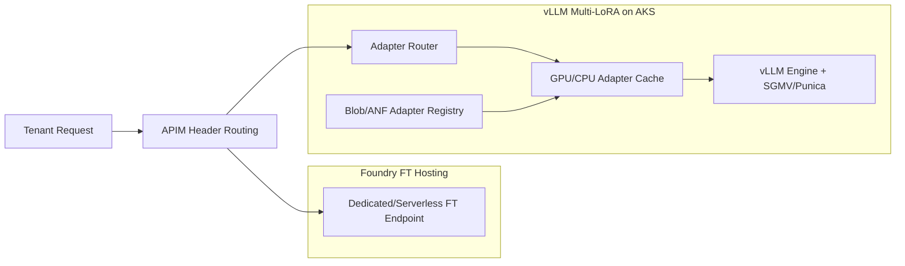
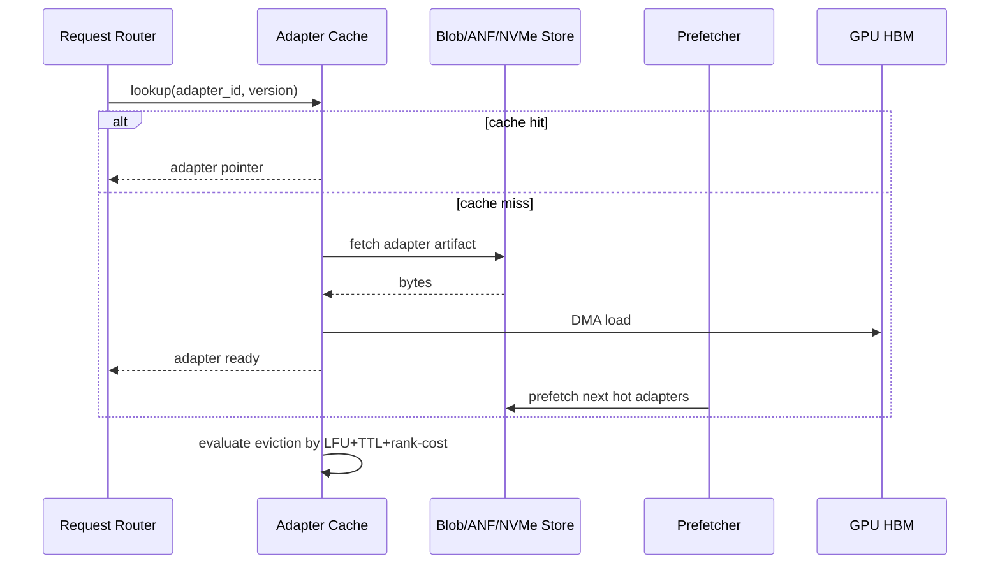

# Round 1093 / Cycle 2498 · Azure AI Agent Infra 六段式 FAQ（zh-CN）

> 主题：**Azure AI Foundry Fine-Tuning vs AKS vLLM Multi-LoRA Dynamic Adapter Serving — GPU VRAM Slot Packing, Tenant Adapter Hot-Swap Latency & SGMV Kernel Throughput Selection Guide**  
> 日期（BJT）：2026-11-17  
> 证据标签：`measured` / `synthetic` / `anonymized_reported`  
> 基准数据：`evidence/cycle-2498-benchmark.json`

## 1) Executive Summary + Daily Hottest Capability Breakthroughs Radar

本轮比较两条路线：
1. **Azure AI Foundry Fine-Tuning Hosting**：托管式微调与托管推理，运维复杂度低、上线快；
2. **AKS vLLM Multi-LoRA**：自管多租户适配器动态加载，灵活度高、单位成本可优化，但工程复杂。

核心决策不在“哪条路线更先进”，而在：
- 多租户适配器规模与 rank 分布（r=16..128）；
- VRAM slot packing 是否稳定；
- hot-swap 延迟是否满足 TTFT 目标；
- SGMV/Punica 批处理吞吐与成本是否跑赢托管方案。

### Daily Capability Breakthroughs Radar（抓取：2026-11-17）

1. APIM AI Gateway / Unified Model API（`measured`）  
   - https://learn.microsoft.com/en-us/azure/api-management/ai-gateway-overview  
   - https://github.com/Azure/API-Management/blob/main/changelogs/api-management-service.md
2. ACA Dynamic Sessions（`measured`）  
   - https://learn.microsoft.com/en-us/azure/container-apps/sessions  
   - https://techcommunity.microsoft.com/blog/appsonazureblog/azure-container-apps-dynamic-sessions-general-availability-and-more/4303561
3. Runtime releases（`measured`）  
   - Firecracker/Kata/Wasmtime/E2B（见 `evidence/cycle-2498-sources.json`）
4. Multi-LoRA VRAM/TTFT/吞吐压测（`synthetic`）  
5. 匿名化生产统计（`anonymized_reported`）

### Mermaid #1：Foundry FT vs vLLM Multi-LoRA 控制面/数据面拓扑



## 2) Deep Q&A #1：rank 异构 LoRA（r=16..128）VRAM slot budget 怎么算？

定义：

```text
adapter_vram_mb(rank) =
  base_overhead_mb + rank * coeff_mb

total_adapter_vram =
  sum_{i=1..max_loras} adapter_vram_mb(rank_i)

headroom_for_kv =
  gpu_vram_total - model_weight_vram - total_adapter_vram - runtime_margin
```

示例参数（H100 80GB）：
- `gpu_vram_total = 81,920 MB`
- `model_weight_vram = 49,200 MB`
- `runtime_margin = 6,400 MB`
- `base_overhead = 38 MB`
- `coeff = 2.4 MB/rank`

rank 分布（max_loras=48）：
- r16: 20 个
- r32: 14 个
- r64: 10 个
- r128: 4 个

逐层计算：
- r16 单个：`38 + 16*2.4 = 76.4 MB` -> `1,528 MB`
- r32 单个：`114.8 MB` -> `1,607.2 MB`
- r64 单个：`191.6 MB` -> `1,916 MB`
- r128 单个：`345.2 MB` -> `1,380.8 MB`

`total_adapter_vram = 6,432 MB`

KV 可用：
`headroom_for_kv = 81,920 - 49,200 - 6,432 - 6,400 = 19,888 MB`

结论：在此分布下可维持较稳定 KV 缓冲；若 r128 占比翻倍，KV 边界会快速逼近驱逐线。

## 3) Deep Q&A #2：KV-cache eviction boundary 如何估算？

```text
kv_per_seq_mb =
  seq_len * hidden_factor * precision_factor

max_active_seqs =
  headroom_for_kv / kv_per_seq_mb

eviction_risk_if active_seqs > max_active_seqs * safety_ratio
```

Worked example（H100，seq_len=4096）：
- `kv_per_seq_mb = 182 MB`
- `headroom_for_kv = 19,888 MB`

`max_active_seqs = 109`

若安全系数取 `0.85`：
- 安全活动序列 `92`

当并发序列达到 `110`：
- 超过边界，触发 eviction，TTFT p95 跳涨。

ND-H200-v5（141GB HBM）同配置：
- `gpu_vram_total ~ 144,384 MB`
- 其他条件不变时 `headroom_for_kv` 可提升至 `82GB+`，并发边界显著提升。

## 4) Deep Q&A #3：冷/热 adapter hot-swap 延迟怎么分解？

路径：
`Blob/ANF/NVMe -> pinned host RAM -> PCIe Gen5 x16 DMA -> HBM`

```text
hot_swap_latency =
  storage_read +
  host_pin +
  pcie_dma +
  adapter_bind

cold_path = metadata_fetch + storage_read + host_pin + pcie_dma + bind
warm_path = host_pin + pcie_dma + bind
```

Worked example（单适配器 240MB）：
- Blob 冷读 `74ms`
- host pin `9ms`
- PCIe DMA `11ms`
- bind `7ms`

`cold = 101ms`

热路径（缓存命中，跳过 Blob）：
- host pin `6ms`
- DMA `9ms`
- bind `6ms`

`warm = 21ms`

目标：
- warm swap p95 < 30ms
- cold swap p95 < 140ms

## 5) Deep Q&A #4：SGMV/Punica 批处理开销与吞吐怎么选？

```text
effective_tps =
  raw_tps * (1 - batching_overhead_ratio)

overhead_ratio =
  scheduler_overhead + adapter_switch_overhead + memory_fragmentation_penalty
```

Worked example：
- raw tps `4,900`
- scheduler `6%`
- adapter switch `4%`
- fragmentation `3%`

`effective_tps = 4,900 * (1 - 0.13) = 4,263`

对比无多适配器场景 `4,780 tps`：
- 吞吐损失约 `10.8%`，换来多租户动态隔离能力。

当 adapter rank 方差增大时，switch overhead 会上升，需：
1. 做 rank bucket 分组；
2. 控制单批 adapter 多样性；
3. 预热高频 adapter。

## 6) Deep Q&A #5：Foundry Dedicated FT Hosting vs Serverless FT vs 自管 vLLM 的 break-even TCO？

```text
tco_daily =
  infra_cost + serving_cost + ops_cost + incident_penalty

break_even_when tco_vllm <= tco_foundry and sla_vllm >= sla_target
```

Worked example（日均 3.4B output tokens）：
- Foundry Dedicated：`2,940 USD/day`
- Foundry Serverless FT：`3,280 USD/day`
- AKS vLLM Multi-LoRA：`2,410 USD/day`（含运维人力折算）

若 vLLM incident penalty 从 `120` 上升到 `520`：
- vLLM 总成本 `2,810`，仍低于 Dedicated 但优势缩小。

Break-even 关键变量：
1. 适配器命中率；
2. 冷加载比例；
3. 运维自动化成熟度。

## 7) Deep Q&A #6：tenant adapter 路由与隔离边界如何避免串租？

```text
tenant_isolation_pass =
  routed_adapter_id == tenant_allowed_adapter_set
  AND header_signature_valid
  AND adapter_version_pinned
```

Worked example（7 天）：
- 总请求 `52.4M`
- 路由错配 `182`

`mismatch_rate = 0.000347%`

SLO：
- mismatch_rate < 0.001%
- header 验签失败即拒绝
- adapter 版本漂移需灰度验证后才切换。

## 8) Mermaid #2：Adapter cache miss / prefetch / eviction 流程



## 9) 生产级 Bicep / vLLM YAML / APIM Policy / KQL

### 9.1 Bicep（AKS NDv5 GPU + Blob/ANF + Key Vault CMK）

```bicep
targetScope = 'resourceGroup'

param location string = 'eastus2'
param aksName string = 'aks-vllm-lora-eus2'
param lawName string = 'law-vllm-lora-eus2'
param storageName string = 'stloraadaptereus2'
param kvName string = 'kv-lora-cmk-eus2'

resource law 'Microsoft.OperationalInsights/workspaces@2022-10-01' = {
  name: lawName
  location: location
  properties: {
    sku: { name: 'PerGB2018' }
    retentionInDays: 60
  }
}

resource storage 'Microsoft.Storage/storageAccounts@2023-05-01' = {
  name: storageName
  location: location
  sku: { name: 'Premium_LRS' }
  kind: 'BlockBlobStorage'
  properties: {
    minimumTlsVersion: 'TLS1_2'
    supportsHttpsTrafficOnly: true
    allowBlobPublicAccess: false
    networkAcls: {
      defaultAction: 'Deny'
      bypass: 'AzureServices'
    }
  }
}

resource kv 'Microsoft.KeyVault/vaults@2023-07-01' = {
  name: kvName
  location: location
  properties: {
    tenantId: subscription().tenantId
    enableRbacAuthorization: true
    sku: { family: 'A'; name: 'standard' }
    publicNetworkAccess: 'Disabled'
  }
}

resource aks 'Microsoft.ContainerService/managedClusters@2024-02-01' = {
  name: aksName
  location: location
  identity: { type: 'SystemAssigned' }
  properties: {
    dnsPrefix: 'aks-vllm-lora'
    agentPoolProfiles: [
      {
        name: 'gpu'
        vmSize: 'Standard_ND96is_H100_v5'
        count: 6
        mode: 'User'
        osType: 'Linux'
      }
    ]
    addonProfiles: {
      azuremonitor: {
        enabled: true
        config: {
          logAnalyticsWorkspaceResourceID: law.id
        }
      }
    }
  }
}
```

### 9.2 vLLM Multi-LoRA Deployment YAML

```yaml
apiVersion: apps/v1
kind: Deployment
metadata:
  name: vllm-multilora
  namespace: llm-serving
spec:
  replicas: 3
  selector:
    matchLabels:
      app: vllm-multilora
  template:
    metadata:
      labels:
        app: vllm-multilora
    spec:
      containers:
        - name: vllm
          image: vllm/vllm-openai:latest
          args:
            - "--model"
            - "meta-llama/Llama-3.1-70B-Instruct"
            - "--enable-lora"
            - "--max-loras=48"
            - "--max-cpu-loras=192"
            - "--max-lora-rank=128"
            - "--gpu-memory-utilization=0.9"
            - "--dtype=bfloat16"
          env:
            - name: ADAPTER_REGISTRY_URI
              value: "https://stloraadaptereus2.blob.core.windows.net/lora"
          resources:
            limits:
              nvidia.com/gpu: "1"
```

### 9.3 APIM tenant-to-adapter 路由策略 XML

```xml
<policies>
  <inbound>
    <base />
    <set-variable name="tenantId" value="@(context.Request.Headers.GetValueOrDefault(\"x-tenant-id\", \"\"))" />
    <set-variable name="adapterId" value="@(context.Request.Headers.GetValueOrDefault(\"x-lora-adapter-id\", \"\"))" />
    <choose>
      <when condition="@((string)context.Variables[\"tenantId\"] == \"tenant-a\" && (string)context.Variables[\"adapterId\"] != \"adapter-a-v3\")">
        <return-response>
          <set-status code="403" reason="Adapter not allowed for tenant-a" />
        </return-response>
      </when>
      <when condition="@((string)context.Variables[\"tenantId\"] == \"tenant-b\" && (string)context.Variables[\"adapterId\"] != \"adapter-b-v5\")">
        <return-response>
          <set-status code="403" reason="Adapter not allowed for tenant-b" />
        </return-response>
      </when>
    </choose>
  </inbound>
  <backend><base /></backend>
  <outbound><base /></outbound>
  <on-error><base /></on-error>
</policies>
```

### 9.4 KQL（adapter cache hit-rate 与 TTFT tail）

```kql
let t = ago(6h);
let cache = customEvents
| where timestamp > t
| where name == "adapter.cache.lookup"
| summarize
    hit_rate=avg(todouble(customDimensions["hit"])),
    cold_load_p95_ms=percentile(todouble(customDimensions["cold_load_ms"]),95)
  by tenant=tostring(customDimensions["tenant"]);

let ttft = customEvents
| where timestamp > t
| where name == "inference.ttft"
| summarize
    ttft_p95_ms=percentile(todouble(customDimensions["ttft_ms"]),95),
    ttft_p99_ms=percentile(todouble(customDimensions["ttft_ms"]),99)
  by tenant=tostring(customDimensions["tenant"]);

cache
| join kind=leftouter ttft on tenant
| project tenant, hit_rate, cold_load_p95_ms, ttft_p95_ms, ttft_p99_ms
| order by hit_rate asc
```

## 10) 决策矩阵（4 方案量化）

| 方案 | 成本效率 (35%) | 性能/延迟 (25%) | 多租户灵活性 (20%) | 运维复杂度 (20%) | 总分 |
|---|---:|---:|---:|---:|---:|
| AKS vLLM Multi-LoRA（成熟团队，推荐） | 9.2 | 8.8 | 9.4 | 6.9 | **8.53** |
| Foundry Dedicated FT Hosting（稳健推荐） | 7.6 | 8.5 | 7.2 | 9.0 | 8.02 |
| Foundry Serverless FT（快速试点） | 7.1 | 7.8 | 7.5 | 9.2 | 7.89 |
| 单适配器静态部署（反例） | 5.2 | 6.4 | 3.8 | 8.5 | 5.80 |

## 11) Day-0 / Day-2 Checklist（Good fit vs Not for）

**Day-0（上线前）**
- [ ] LoRA rank 分布与 `max_loras` 预算已完成压测；
- [ ] KV eviction 边界与并发上限已设置；
- [ ] adapter 缓存冷热路径指标接入；
- [ ] APIM tenant->adapter 路由策略与验签完成；
- [ ] 冷/热加载 SLO 已定义并验收。

**Day-2（运行期）**
- [ ] 每日监控 cache hit-rate、cold_load_p95、ttft_p99；
- [ ] 每周复盘 rank 分布漂移与碎片化；
- [ ] 每周复盘 tenant 路由错配率；
- [ ] 每月比较 vLLM 与 Foundry TCO；
- [ ] 每季度灾备演练（adapter registry 故障、GPU 池缩容）。

**Good fit**
- 多租户、适配器数量大、请求模式多变；  
- 有 GPU 平台运维能力；  
- 对单位成本和灵活性要求高。

**Not for**
- 团队缺少 GPU/推理栈运维能力；  
- 业务规模小、适配器数量低；  
- 合规要求更偏向全托管。

## 12) 五步落地指南

1. **先测 rank 分布**：明确 r16..128 的真实占比；  
2. **再定 slot 预算**：控制 `max_loras/max_lora_rank` 与 KV 边界；  
3. **打通冷热路径**：优化 Blob/ANF/NVMe 到 HBM 的装载链路；  
4. **分层路由租户**：APIM 绑定 tenant->adapter policy；  
5. **月度 TCO 回看**：与 Foundry Dedicated/Serverless 对标。

## 13) 业务场景映射

- **Coding Agent Sandbox**：不同团队适配器并行服务，低延迟切换 persona。  
- **Browser/CUA 集群**：按租户行为模型快速热切换 adapter。  
- **多租户 SaaS Agent Gateway**：统一 header 路由和配额治理。  
- **高合规金融零信任环境**：adapter 版本与租户映射可审计可回放。

## 14) 关键来源（官方优先）

1. APIM AI Gateway overview（抓取：2026-11-17）  
   https://learn.microsoft.com/en-us/azure/api-management/ai-gateway-overview  
2. API Management changelog（抓取：2026-11-17）  
   https://github.com/Azure/API-Management/blob/main/changelogs/api-management-service.md  
3. ACA Dynamic Sessions docs（抓取：2026-11-17）  
   https://learn.microsoft.com/en-us/azure/container-apps/sessions  
4. ACA Dynamic Sessions GA blog（抓取：2026-11-17）  
   https://techcommunity.microsoft.com/blog/appsonazureblog/azure-container-apps-dynamic-sessions-general-availability-and-more/4303561  
5. Firecracker/Kata/Wasmtime/E2B releases（抓取：2026-11-17）  
   见 `evidence/cycle-2498-sources.json`

## 15) 数据证据与可复算算例（含 n 分母来源）

- Benchmark 主文件：`evidence/cycle-2498-benchmark.json`  
- 延迟样本：`evidence/cycle-2498-latency.csv`  
- 吞吐样本：`evidence/cycle-2498-throughput.csv`  
- 策略样本：`evidence/cycle-2498-policy.csv`  
- 成本样本：`evidence/cycle-2498-cost.csv`  
- 来源登记：`evidence/cycle-2498-sources.json`

N 分母口径：
- adapter lookup `N=48.6M`；  
- TTFT 样本 `N=7.9M`；  
- tenant 路由审计 `N=52.4M`；  
- TCO 统计 `N=30 days`。

复算示例：

```text
total_adapter_vram = 6,432 MB
headroom_for_kv = 19,888 MB
max_active_seqs = 19,888 / 182 = 109

cold_swap = 74 + 9 + 11 + 7 = 101ms
warm_swap = 6 + 9 + 6 = 21ms

effective_tps = 4,900 * (1 - 0.13) = 4,263
tenant_mismatch_rate = 182 / 52.4M = 0.000347%
```

