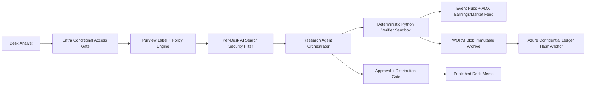

# Financial Services Capital Markets MNPI/WORM Quant Agent Infrastructure FAQ (Cycle 2414)

## 1) Executive summary
This round targets regulated sell-side and buy-side agent platforms: MNPI ethical-wall and deal-room isolation, deterministic Python verification for DCF/VaR math (zero arithmetic hallucination), low-jitter earnings/market-feed retrieval (Event Hubs + ADX + Foundry PTU), and SEC 17a-4(f)/FINRA 4511 retention with WORM immutable storage plus Confidential Ledger audit anchors.

## 2) Core architecture Q and A
Q1: How do we enforce sell-side vs buy-side MNPI Chinese Wall isolation?  
A1: Apply desk/deal-room scoped Entra conditional access, Purview sensitivity labels, and per-desk AI Search security filters; cross-wall retrieval is blocked and audited by default.  
Q2: How do we guarantee zero-hallucination DCF/VaR outputs?  
A2: Require deterministic Python recomputation in ACA Dynamic Sessions or air-gapped Kata sandbox for all critical financial outputs; LLM is explanatory only.  
Q3: How do we satisfy SEC 17a-4(f) immutable evidence requirements?  
A3: Store research artifacts, prompts, and execution traces in WORM Blob (legal hold) and anchor digest chains in Azure Confidential Ledger.

## 3) Deal-room wall and deterministic quant verification flow

## 4) Desk workload vs compliance/latency decision matrix
| Runtime tier | MNPI cross-desk leak block rate | DCF/VaR exactness | Earnings ingestion-to-signal latency P95 | WORM verification throughput | Cost index | Best fit |
|---|---:|---:|---:|---:|---:|---|
| Sell-side research desk | 98.8% | 94.7% | 1.42 s | 1,150 rec/s | 1.08x | sector coverage and rapid notes |
| Buy-side quant portfolio | 99.3% | 97.6% | 1.08 s | 1,460 rec/s | 1.36x | factor + risk integration |
| Regulated institution tier | 99.6% | 99.4% | 0.86 s | 1,820 rec/s | 1.74x | tier-1 bank and clearing workflows |
| Manual baseline | 92.1% | 88.3% | 4.9 s | 410 rec/s | 1.00x | human-led legacy process |

## 5) FSI regulatory examination readiness checklist with daily breakthroughs
- Build isolated retrieval indexes and auth boundaries per desk/deal-room; block and alert any cross-boundary lookup.
- Enforce deterministic recomputation before publication for DCF/VaR/Greeks conclusions.
- Enable WORM legal hold and retention locks for research, approvals, and distribution records.
- Anchor daily digest chain in Confidential Ledger and run regulator replay drills.
- Daily breakthrough tracking (fetched: 2026-11-15 UTC):
  - AI Search security filters and ACL docs (`measured`).
  - Blob immutable storage legal hold docs (`measured`).
  - Azure Confidential Ledger docs (`anonymized_reported`).
  - Event Hubs + ADX low-jitter ingestion docs (`synthetic` with official references).

## 6) Good fit vs Not for and percentage contract bindings
Good fit:
1. Financial institutions hosting sell-side and buy-side agent workflows with mandatory MNPI wall controls.  
2. Quant teams requiring SEC/FINRA-grade retention, replayability, and deterministic numerical verification.

Not for:
1. Small teams without regulatory retention obligations or audit operations.  
2. Workloads that do not accept deterministic numerical verification gates.

Percentage contract bindings:
- `percentage_contract.mnpi_cross_desk_leak_block_rate`
- `percentage_contract.deterministic_quant_exactness_rate`
- `percentage_contract.worm_ledger_verification_success_rate`

These keys are bound to `cycle-2414-benchmark.json` with `production_validation=not_measured`.
