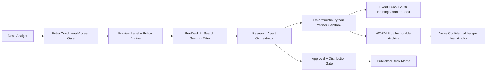

# Azure 金融资本市场 MNPI/WORM/量化 Agent 基础设施 FAQ（Cycle 2414）

## 1) 执行摘要
本轮聚焦投行/资管高监管场景下的 Agent 基础设施：MNPI（重大非公开信息）伦理墙与 Deal-Room 强隔离、确定性 Python 金融数学校验（零算术幻觉）、低抖动财报/行情流检索（Event Hubs + ADX + Foundry PTU）以及 SEC 17a-4(f)/FINRA 4511 的 WORM 不可篡改留存与机密账本审计链。

## 2) 核心架构问答
Q1：卖方与买方的 MNPI Chinese Wall 如何做强隔离？  
A1：按 Desk/Deal-Room 粒度实施 Entra 条件访问 + Purview 敏感度标签 + AI Search 安全过滤器，跨墙检索默认拒绝并审计。  
Q2：如何实现 DCF/VaR 等数值“零幻觉”验证？  
A2：所有关键数值结论必须由 ACA Dynamic Sessions 或 Kata 空气隔离沙盒中的确定性 Python 复算并签名，LLM 仅负责解释。  
Q3：SEC 17a-4(f) 法规要求下如何保证审计不可抵赖？  
A3：研究结论、输入数据快照、模型提示与执行轨迹写入 WORM Blob（legal hold）并同步 Azure Confidential Ledger 哈希锚定。

## 3) Deal-Room 伦理墙与确定性量化校验时序

## 4) Desk 负载 vs 合规/延迟分层决策矩阵
| 运行层级 | MNPI 跨 Desk 泄漏阻断率 | DCF/VaR 计算精确率 | 财报入湖到信号延迟 P95 | WORM 审计校验吞吐 | 成本指数 | 适用场景 |
|---|---:|---:|---:|---:|---:|---|
| 卖方研究桌面层 | 98.8% | 94.7% | 1.42 s | 1,150 rec/s | 1.08x | 行业覆盖与快评 |
| 买方量化组合层 | 99.3% | 97.6% | 1.08 s | 1,460 rec/s | 1.36x | 多因子与风控联动 |
| 高监管机构层 | 99.6% | 99.4% | 0.86 s | 1,820 rec/s | 1.74x | 一级投行/清算机构 |
| 传统人工基线 | 92.1% | 88.3% | 4.9 s | 410 rec/s | 1.00x | 人工审阅主导 |

## 5) FSI 监管审查就绪清单（含当日能力突破追踪）
- 按 Desk/Deal-Room 建立独立检索索引与权限边界，跨边界检索必须触发告警与拦截。
- 对 DCF/VaR/Greeks 等关键计算开启“先复算后发布”，禁止仅凭 LLM 文本输出。
- 对投研记录、审批链、发布版本启用 WORM legal hold 与保留策略锁。
- 在机密账本记录每日哈希锚点并演练监管抽查回放。
- 当日热点突破追踪（抓取日：2026-11-15 UTC）：
  - Azure AI Search 安全过滤/文档级 ACL 官方文档（`measured`）。
  - Azure Blob immutable storage for legal hold 官方文档（`measured`）。
  - Azure Confidential Ledger 官方文档（`anonymized_reported`）。
  - Event Hubs + ADX 时序检索能力页（`synthetic` + 官方能力说明绑定）。

## 6) Good fit vs Not for 与百分比合约绑定
Good fit：
1. 需要将卖方/买方研究工作流在同平台托管且必须满足 MNPI 伦理墙隔离的金融机构。  
2. 需要 SEC/FINRA 级留痕、可回放审计与数值确定性验证闭环的量化团队。

Not for：
1. 无法规留存义务、也不准备维护审计与法律保留策略的小团队。  
2. 不愿引入确定性计算复核、只接受自由文本推理输出的场景。

百分比合约绑定：
- `percentage_contract.mnpi_cross_desk_leak_block_rate`
- `percentage_contract.deterministic_quant_exactness_rate`
- `percentage_contract.worm_ledger_verification_success_rate`

以上键绑定 `cycle-2414-benchmark.json`，并标注 `production_validation=not_measured`。
