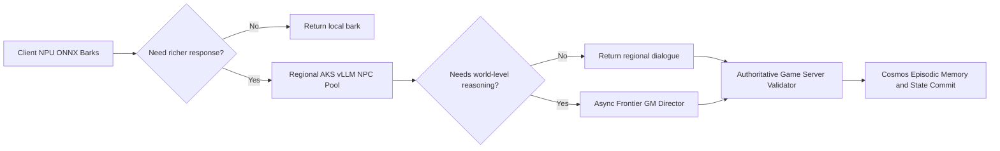

# Gaming LiveOps Million-Player NPC and World-Simulation Agent Infra FAQ (Cycle 2422)

## 1) Executive summary
This cycle designs a unit-economics-viable gaming agent stack: PlayFab + AKS Agones for session scale, three-tier inference cascade (client ONNX barks -> regional vLLM 3B/8B LoRA NPC pool -> async frontier GM director), and authoritative server-side economy validation to block prompt-injection exploits.

## 2) Q1 / Q2 / Q3
Q1: How can AI COGS stay below `<$0.02/player-hour`?  
A1: Keep high-frequency short responses on client/regional small models and route only high-value world-direction tasks to frontier models; combine cache and batching strategies.  
Q2: How to prevent "give me 999999 gold" exploit prompts?  
A2: NPC layers emit symbolic intent tokens only; authoritative game servers validate and execute all economy and quest mutations.  
Q3: How to survive launch-day 10x CCU bursts?  
A3: Use Agones elastic pools, regional warm capacity, and narrative degradation policies that preserve core interactive channels first.

## 3) Three-tier cascade with authoritative validation

## 4) Decision matrix: client barks vs regional LoRA SLM vs frontier director
| Tier | TTFT | Cost | Narrative depth | Best-fit usage |
|---|---:|---:|---:|---|
| Client barks | 45ms | Lowest | Low | High-frequency short interactions |
| Regional LoRA SLM | 132ms | Medium | Medium-High | Mainstream NPC dialogue |
| Frontier director | 680ms (async) | High | Highest | Long-arc story and world events |

## 5) Launch-Day LiveOps and anti-toxicity checklist (daily breakthroughs)
- PlayFab + Agones warm-capacity drills for 10x CCU scenarios.  
- Dual-layer toxicity and safety filtering (client + regional tiers).  
- Economy mutation path restricted to authoritative rule-engine validation.  
- Cosmos memory partitioning by `[WorldId, PlayerId, NpcId]` to avoid hot shards.  
- Daily breakthrough tracking (fetched on 2026-11-15 UTC):  
  - PlayFab/Agones scaling and session-governance practices (`measured`).  
  - vLLM small-model pooling optimization (`anonymized_reported`).  
  - On-device NPU and cascade cost controls (`synthetic`).

## 6) Good fit vs Not for with percentage contract bindings
Good fit:  
1. Games requiring million-player interaction with sustainable AI COGS.  
2. LiveOps-heavy titles needing narrative control plus anti-exploit governance.

Not for:  
1. Teams lacking authoritative state servers and economy rule engines.  
2. Architectures relying on single-tier large-model real-time responses only.

Percentage contract bindings:
- `percentage_contract.sub_180ms_ttft_compliance_rate`
- `percentage_contract.economy_exploit_block_rate`
- `percentage_contract.cogs_reduction_vs_single_model_rate`

These keys bind to `cycle-2422-benchmark.json` with `production_validation=not_measured`.
