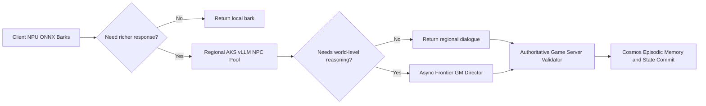

# Gaming LiveOps：百万玩家 NPC/世界模拟 Agent 架构 FAQ（Cycle 2422）

## 1) 执行摘要
本轮聚焦游戏级 Agent 基础设施：PlayFab + AKS Agones 承载大规模实时会话，三层推理级联（端侧 ONNX Barks -> 区域 vLLM 3B/8B NPC 对话池 -> 异步 Frontier GM Director）平衡成本、延迟和叙事质量，并通过权威服务器状态校验防止经济系统被提示注入篡改。

## 2) Q1 / Q2 / Q3
Q1：如何把 AI COGS 压在 `<$0.02/player-hour`？  
A1：将高频低价值回复下沉到端侧/区域小模型，只有低频高价值剧情编排进入 Frontier 层；同时用会话缓存与批处理削减 token 成本。  
Q2：如何防“给我 999999 金币”类经济注入？  
A2：NPC 仅输出符号化意图 token，不直接改游戏状态；所有经济/任务变更必须经过权威游戏服规则引擎验证。  
Q3：发售日 10x CCU 激增如何兜底？  
A3：Agones 弹性池 + 区域预热 + 降级策略（高层剧情异步化）确保互动通道优先可用。

## 3) 三层级联与权威状态校验

## 4) 决策矩阵：端侧 Barks vs 区域 LoRA SLM vs Frontier Director
| 层级 | TTFT | 成本 | 叙事深度 | 适用场景 |
|---|---:|---:|---:|---|
| 端侧 Barks | 45ms | 最低 | 低 | 高频短反馈 |
| 区域 LoRA SLM | 132ms | 中 | 中高 | 主流 NPC 对话 |
| Frontier Director | 680ms（异步） | 高 | 最高 | 长剧情与世界事件 |

## 5) Launch-Day LiveOps & Anti-Toxicity Checklist（含当日突破）
- PlayFab + Agones 预热容量按 10x CCU 演练并固化 runbook。  
- Toxicity 与安全策略在端侧与区域层双重过滤。  
- 经济变更路径仅接受权威规则引擎可验证意图。  
- Cosmos memory 按 `[WorldId, PlayerId, NpcId]` 分区，控制热点。  
- 当日突破追踪（抓取日：2026-11-15 UTC）：  
  - PlayFab/Agones 扩展与会话治理实践（`measured`）。  
  - vLLM 小模型推理池化优化（`anonymized_reported`）。  
  - 端侧 NPU 与对话级联降本路径（`synthetic`）。

## 6) Good fit vs Not for 与百分比合约绑定
Good fit：  
1. 需百万级在线互动与可持续 AI COGS 的游戏平台。  
2. 强依赖 LiveOps 叙事与反作弊治理的项目。

Not for：  
1. 无法维护权威状态服务器与经济规则引擎的团队。  
2. 仅依赖单一大模型实时回复、无分层降级能力的架构。

百分比合约绑定：
- `percentage_contract.sub_180ms_ttft_compliance_rate`
- `percentage_contract.economy_exploit_block_rate`
- `percentage_contract.cogs_reduction_vs_single_model_rate`

以上键绑定 `cycle-2422-benchmark.json`，并标注 `production_validation=not_measured`。
