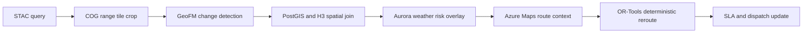

# Geospatial, Earth-Observation, and Climate/Logistics Routing Agent Infrastructure FAQ (Cycle 2427)

## 1) Executive summary
This cycle designs a petabyte-scale geospatial intelligence architecture: STAC catalog queries plus COG/Zarr windowed reads avoid full-scene downloads, PostGIS + H3 + pgvector provide deterministic spatial reasoning, and weather-risk overlays drive OR-Tools rerouting for catastrophe response and resilient logistics operations.

## 2) Q1 / Q2 / Q3
Q1: Why do LLM-only coordinate workflows fail on geometry tasks?  
A1: Spatial relations require deterministic PostGIS/H3 predicates (intersects, contains, buffers); LLMs should orchestrate but not decide geometry truth.  
Q2: Why is COG range-read better than full-scene ingestion for agents?  
A2: Windowed range requests fetch only required byte ranges, reducing latency and egress while scaling concurrent analysis.  
Q3: How do Aurora weather alerts drive routing actions?  
A3: Overlay weather risk grids onto route-edge geometry and trigger OR-Tools constrained recomputation for dispatch updates.

## 3) STAC to PostGIS and OR-Tools closed loop

## 4) Decision matrix: PostGIS+pgvector vs ADX geospatial vs Fabric Spark Sedona
| Option | Query precision | Real-time capability | Cost elasticity | Best-fit |
|---|---:|---:|---:|---|
| PostGIS + pgvector | Highest | High | Medium | Transactional spatial search and routing |
| ADX geospatial | High | Highest | Medium-High | Massive time-series geospatial alerts |
| Fabric Spark Sedona | High | Medium | High | Batch and offline geospatial analytics |

## 5) Geospatial and EO production checklist (daily breakthroughs)
- All spatial decisions must execute through verifiable PostGIS/H3 predicates.  
- Default image retrieval to windowed tile reads; block unconstrained full-scene pulls.  
- Feed weather risk and logistics constraints into deterministic reroute solvers.  
- Catastrophe triage outputs must trace to tile windows and spatial-query evidence.  
- Daily breakthrough tracking (fetched on 2026-11-15):  
  - Planetary Computer Pro STAC/TiTiler windowed data-path practices (`measured`).  
  - PostGIS + H3 stability under high-concurrency geospatial query loads (`anonymized_reported`).  
  - Aurora-to-OR-Tools weather-driven reroute simulation (`synthetic`).

## 6) Good fit vs Not for with percentage contract bindings
Good fit:  
1. Infrastructure teams operating large-scale imagery and spatial feature fusion workloads.  
2. Enterprises coupling weather risk with logistics dispatch and catastrophe claims triage.

Not for:  
1. Teams lacking spatial index, CRS, and geodata quality governance.
2. Systems relying on text-only LLM reasoning without deterministic spatial solvers.

Percentage contract bindings:
- `percentage_contract.cog_range_read_egress_savings_rate`
- `percentage_contract.postgis_h3_spatial_precision_rate`
- `percentage_contract.claim_triage_turnaround_improvement_rate`
- `percentage_contract.route_sla_preservation_rate`

These keys bind to `cycle-2427-benchmark.json` with `production_validation=not_measured`.
