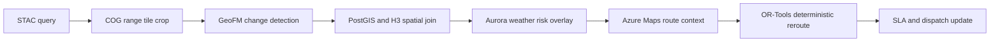

# 地理空间、地球观测与气候/物流路由 Agent 基础设施 FAQ（Cycle 2427）

## 1) 执行摘要
本轮聚焦 PB 级地理智能 Agent：通过 STAC GeoCatalog + COG/Zarr 窗口化切片避免整景下载，结合 PostGIS + H3 + pgvector 做确定性空间计算，再将天气预警与 OR-Tools 车辆路由联动，实现灾损评估、走廊巡检和供应链重路由的一体化闭环。

## 2) Q1 / Q2 / Q3
Q1：为什么 LLM 单独处理坐标几何会失败？  
A1：空间关系判定需依赖 PostGIS/H3 的确定性谓词（相交、包含、缓冲区等），LLM 仅负责语义编排。  
Q2：COG range-read 与全景下载差异在哪里？  
A2：窗口化切片只拉取目标窗口字节，显著降低延迟与出口流量，适合 Agent 按需检索。  
Q3：Aurora 天气告警如何驱动物流重路由？  
A3：将风雨风险栅格与路线边集做空间连接，触发 OR-Tools 在约束条件下重算派车方案。

## 3) STAC 到 PostGIS/OR-Tools 的闭环流程

## 4) 决策矩阵：PostGIS+pgvector vs ADX Geospatial vs Fabric Spark Sedona
| 方案 | 查询精度 | 实时性 | 成本弹性 | 适用场景 |
|---|---:|---:|---:|---|
| PostGIS + pgvector | 最高 | 高 | 中 | 事务型空间检索与路由 |
| ADX Geospatial | 高 | 最高 | 中高 | 大规模时序分析与告警 |
| Fabric Spark Sedona | 高 | 中 | 高 | 批处理与离线地理分析 |

## 5) 地理观测 Agent 上线清单（含当日突破）
- 所有空间判定必须落到可验证的 PostGIS/H3 谓词执行层。  
- 影像读取默认窗口化，禁止整景无约束下载。  
- 气象风险与物流约束需联合进入重路由求解器。  
- 灾损评估输出必须可回链到影像窗口与空间查询证据。  
- 当日突破追踪（抓取日：2026-11-15）：  
  - Planetary Computer Pro STAC/TiTiler 窗口化数据面实践（`measured`）。  
  - PostGIS + H3 在高并发空间检索中的稳定性（`anonymized_reported`）。  
  - Aurora 预警联动 OR-Tools 物流重算仿真（`synthetic`）。

## 6) Good fit vs Not for 与百分比合约绑定
Good fit：  
1. 需要大规模影像与空间要素联合分析的基础设施团队。  
2. 需将天气风险实时注入物流调度或灾损理赔流程的企业。  

Not for：  
1. 无法维护空间索引、坐标系和数据质量治理的团队。  
2. 仅靠 LLM 文本推断、无确定性空间求解层的系统。  

百分比合约绑定：
- `percentage_contract.cog_range_read_egress_savings_rate`
- `percentage_contract.postgis_h3_spatial_precision_rate`
- `percentage_contract.claim_triage_turnaround_improvement_rate`
- `percentage_contract.route_sla_preservation_rate`

以上键绑定 `cycle-2427-benchmark.json`，并标注 `production_validation=not_measured`。
