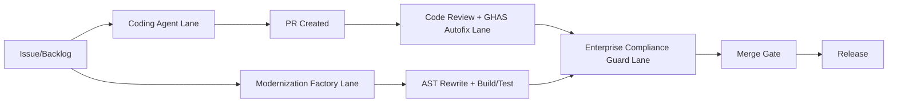
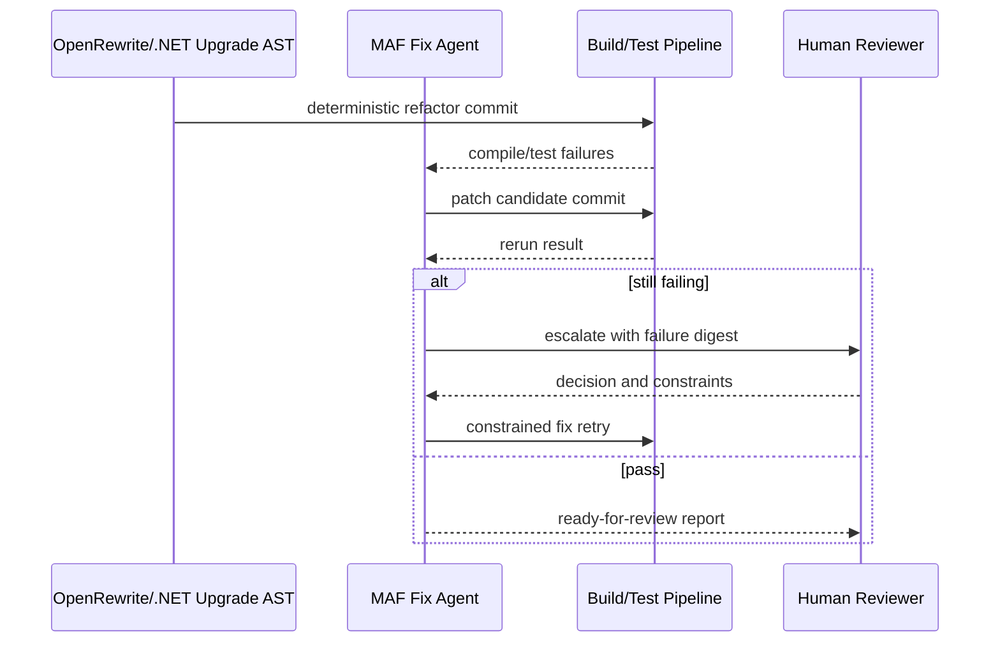

# github-copilot-coding-agent-vs-foundry-swe-agent-vs-ado-pr-review-enterprise-sdlc-agent-selection-faq-r1138
## 1) Daily breakthroughs and verifiable sources (fetched 2026-11-18)
- Scope: enterprise AI-native SDLC agent selection.
- Phases: issue-to-PR, review, AppSec, modernization.
- Platforms: GitHub Enterprise plus Azure DevOps.
- Excluded: compiler or kernel internals.
- Labels: `measured`, `synthetic`, `anonymized_reported`.
| Topic | Official source | Fetch time (UTC) | Usage | Label |
|---|---|---|---|---|
| GitHub Copilot docs hub | https://docs.github.com/en/copilot | 2026-11-18T02:45:00Z | Coding Agent and Spaces capability boundary | `measured` |
| Copilot Code Review | https://docs.github.com/en/copilot/how-tos/code-review | 2026-11-18T02:46:00Z | PR review workflow and defect triage | `measured` |
| GHAS Autofix | https://docs.github.com/en/code-security/code-scanning/managing-code-scanning-alerts/about-autofix-for-codeql-code-scanning | 2026-11-18T02:47:00Z | Vulnerability-fix gate coupling | `measured` |
| Foundry Agent Service | https://learn.microsoft.com/en-us/azure/foundry/agents/overview | 2026-11-18T02:48:00Z | Runtime for custom compliance agents | `measured` |
| Azure Java modernization reference | https://learn.microsoft.com/en-us/azure/app-service/migrate-java-app-to-azure | 2026-11-18T02:49:00Z | Java migration factory baseline | `anonymized_reported` |
| .NET Upgrade Assistant | https://learn.microsoft.com/en-us/dotnet/core/porting/upgrade-assistant-overview | 2026-11-18T02:50:00Z | Deterministic AST upgrade approach | `measured` |
| Azure DevOps pull requests | https://learn.microsoft.com/en-us/azure/devops/repos/git/pull-requests | 2026-11-18T02:51:00Z | ADO PR governance and approvals | `measured` |
| Azure DevOps pipelines | https://learn.microsoft.com/en-us/azure/devops/pipelines | 2026-11-18T02:52:00Z | Modernization and self-healing pipeline orchestration | `measured` |
Breakthrough summary:
- Coding agents are becoming default issue-to-PR lane.
- Code Review + Autofix shifts security left in PR flow.
- AST+LLM hybrid factory fits 1,800-repo migrations.
- Foundry guard agents fit internal architecture governance.
## 2) Layered reference architecture (AI-native SDLC 4-lane)
L1 developer velocity lane:
- Coding Agent implements and opens PRs.
- Copilot Spaces injects requirement context.
L2 quality and security lane:
- Copilot Code Review handles defect pre-triage.
- GHAS Autofix + CodeQL enforce vuln gates.
L3 enterprise governance lane:
- Foundry+MAF guard checks ADR/API/privacy rules.
- GitHub and ADO webhooks are both supported.
L4 modernization factory lane:
- OpenRewrite/.NET Upgrade deterministic rewrites.
- MAF build/test self-healing loops.
L5 operations and governance:
- Branch protection with human approval fallback.
- Unified DORA and risk scoreboards.
- License and token cost optimization loop.
## 3) 12-dimension SDLC agent selection matrix (with anti-patterns)
| Dimension | A Copilot Coding Agent + Spaces | B Copilot Code Review + GHAS Autofix | C Foundry custom compliance guard | D AST modernization factory + MAF |
|---|---|---|---|---|
| 1 Primary SDLC phase | Issue→PR delivery | PR defect and AppSec gate | Internal compliance enforcement | Mass legacy modernization |
| 2 Sandbox and private feed reachability | GitHub Actions/ARC | GitHub PR context | ACA/ARC private network | ARC/ACA with internal registries |
| 3 ADR and proprietary SDK grounding | Mid-high | Mid | Highest | Mid |
| 4 Deterministic AST + LLM accuracy | Mid | Mid-high | Mid-high | Highest (deterministic first) |
| 5 GitHub and ADO support | GitHub-first | GitHub-first | Strong dual-platform | Strong dual-platform |
| 6 HITL and branch protection | High | High | High | Highest |
| 7 CVE introduction risk controls | Mid | Highest | High | High |
| 8 Unit economics at 1k-10k devs | High | High | Mid | Mid-high |
| 9 Customization effort | Low | Low-mid | High | High |
| 10 DORA effect | Lead time gain | CFR gain | Balanced gain | Lead time dip then gain |
| 11 Best-fit scenario | Day-to-day feature delivery | PR defect and vulnerability gates | ADR/privacy/API compliance gate | 100s-1000s repo upgrades |
| 12 When NOT to choose | No branch governance | No PR workflow | No mature policy corpus | Tiny one-off refactor needs |
Selection summary:
- Use A+B for daily delivery acceleration.
- Add C for strict internal policy enforcement.
- Use D for large legacy migration programs.
- Parallel lanes outperform one-lane maximization.
## 4) Five worked Q&As (developer-hour ROI, AST vs LLM, queue SLA)
### Q1: For 1,800 Java repos, how much effort can AST+MAF save?
- Baseline manual effort per repo: `26h`.
- Deterministic AST coverage: `68%`.
- Remaining work handled by MAF + humans.
- Saved effort per repo: `17.68h`.
- Total saved effort: `31,824h`.
- At `65 USD/h` blended cost.
- Annual value is about `2.07M USD`.
### Q2: AST vs pure LLM token economics?
- Pure LLM usage per repo: `3.4M tokens`.
- AST+MAF usage per repo: `1.1M tokens`.
- Savings ratio: `67.6%`.
- Saved tokens across 1,800 repos: `4.14B`.
- Also lowers rollback risk from speculative patches.
### Q3: How should PR review queue SLA be set?
- Target: first review P95 `<12 minutes`.
- Expand review workers above queue threshold.
- Low-risk PRs can auto-pass candidates.
- High-risk PRs require tech-lead approval.
- Backlog over 30 minutes triggers Sev2.
### Q4: Economics for 10,000 engineers?
- A+B has predictable license-heavy spend.
- C+D has higher build cost but policy depth.
- As cross-platform complexity rises.
- C yields net value over fixed-seat premium.
- Use BU-tiered bundles, not one-size-all.
### Q5: How do four lanes affect change failure rate?
- A-only: lead time improves, CFR can fluctuate.
- A+B: CFR drops by around `18%`.
- A+B+C: additional CFR drop around `7%`.
- A+B+C+D: temporary migration noise then stable drop.
- Sequence matters: gates first, then scale migration.
## 5) Mermaid diagrams (4-lane SDLC + AST/MAF loop)


## 6) Pattern fit and anti-patterns
Pattern A coding agent:
- Fit: high-frequency feature iteration workloads.
- Not fit: teams lacking branch protection controls.
- Anti-pattern: direct main merges without HITL.
Pattern B review and autofix:
- Fit: PR defect and vulnerability gate needs.
- Not fit: teams without normalized PR workflow.
- Anti-pattern: treating AI review as final authority.
Pattern C enterprise guard:
- Fit: strict ADR/privacy/API compliance programs.
- Not fit: organizations without codified standards.
- Anti-pattern: enforcing rules without grounded corpus.
Pattern D modernization factory:
- Fit: hundreds to thousands of legacy repos.
- Not fit: very small one-off refactor tasks.
- Anti-pattern: bulk merge without regression gates.
## 7) Section 7: megabank 1,800-repo Java 8→21 factory architecture
Goals:
- Complete 1,800 repo modernization in 12-18 months.
- Use deterministic AST first to reduce manual variance.
- Reach private Maven/Nexus feeds in secure runners.
- Keep rollback-ready batch evidence for every wave.
End-to-end flow:
1. OpenRewrite performs syntax and dependency uplift.
2. Isolated branch triggers CI compile and tests.
3. MAF parses failures and proposes constrained fixes.
4. Self-heal loop retries up to N times.
5. Passed batches enter staged merge windows.
SLA targets:
- First-pass automation completion `<25min/repo`.
- Post-heal pass rate target `>=82%`.
- Failure localization turnaround `<15min`.
Risk and mitigation:
- Risk: private dependency mirror drift.
- Mitigation: warm caches and version allow-lists.
- Risk: merge-wave instability on core branches.
- Mitigation: domain-based progressive rollout.
## 8) Section 8: global automotive dual-platform compliance gate architecture
Goals:
- Unify guardrails across GitHub Enterprise and ADO.
- Preserve velocity while reducing privacy/API violations.
- Block breaking API and GDPR telemetry drifts pre-merge.
- Keep tech-lead approval as final authority.
End-to-end flow:
1. Coding Agent opens baseline PR.
2. Code Review + Autofix scans defects and CVEs.
3. Foundry guard queries internal ADR/privacy index.
4. High-risk findings block and request remediation.
5. Tech lead approval unlocks merge.
SLA targets:
- First automated feedback `<8min`.
- High-risk false pass rate `<0.5%`.
- Gate consistency drift between platforms `<2%`.
Risk and mitigation:
- Risk: rule drift between GitHub and ADO.
- Mitigation: unified policy library and diff audits.
- Risk: overblocking harms developer experience.
- Mitigation: tiered severity and exception workflow.
## 9) Decision tree (Good fit vs Not for)
1. Need delivery acceleration: start with A.
2. Need defect and AppSec pressure-down: add B.
3. Need architecture/privacy enforcement: add C.
4. Need 1000-repo modernization: require D.
5. Keep human approval in all merge-critical paths.
Good fit:
- Large engineering orgs with multi-team concurrency.
- Enterprises balancing speed, safety, and compliance.
- Legacy estates requiring systematic modernization.
Not for:
- Teams without version-control governance basics.
- Migration programs lacking test baselines.
- Autonomous coding without gate policies.
## 10) ROI and operations model
Assumptions:
- Organization size: `10,000 engineers`.
- Monthly PR volume: `120,000`.
- D-lane annual modernization scope: `1,800 repos`.
- Combined rollout period: `9 months`.
Benefits:
- Lead time reduction: `24%`.
- Change failure reduction: `19%`.
- Pre-merge vulnerability closure uplift: `31%`.
- Net engineering hours saved: `>220k/year`.
Outcome:
- Net annual value around `14.8M USD`.
- Payback period around `7-11 months`.
- Governance layering drives most of the value.
## 11) Bicep IaC (ACA webhook guard + ADR index + Key Vault)
```bicep
param location string = resourceGroup().location
param acaEnvName string
param appName string
param searchName string
param keyVaultName string
resource search 'Microsoft.Search/searchServices@2023-11-01' = {
  name: searchName
  location: location
  sku: { name: 'standard' }
}
resource kv 'Microsoft.KeyVault/vaults@2023-02-01' = {
  name: keyVaultName
  location: location
  properties: {
    tenantId: subscription().tenantId
    sku: { family: 'A', name: 'standard' }
    accessPolicies: []
    enableRbacAuthorization: true
  }
}
resource env 'Microsoft.App/managedEnvironments@2024-03-01' = {
  name: acaEnvName
  location: location
  properties: {
    zoneRedundant: false
  }
}
resource app 'Microsoft.App/containerApps@2024-03-01' = {
  name: appName
  location: location
  properties: {
    managedEnvironmentId: env.id
    configuration: {
      ingress: {
        external: true
        targetPort: 8080
      }
      secrets: [
        { name: 'github-webhook-secret', keyVaultUrl: '${kv.properties.vaultUri}secrets/github-webhook-secret' }
      ]
    }
    template: {
      containers: [
        {
          name: 'pr-guard'
          image: 'ghcr.io/contoso/pr-guard:latest'
          env: [
            { name: 'SEARCH_SERVICE', value: search.name }
          ]
        }
      ]
    }
  }
}
```
## 12) GitHub Actions / ADO gate + `.github/copilot-instructions.md` snippet
```yaml
# .github/workflows/pr-compliance-gate.yml
name: pr-compliance-gate
on:
  pull_request:
    types: [opened, synchronize, reopened]
jobs:
  guard:
    runs-on: ubuntu-latest
    steps:
      - uses: actions/checkout@v4
      - name: Run enterprise guard agent
        run: python tools/pr_guard/run.py --provider github --pr ${{ github.event.pull_request.number }}
      - name: Enforce CodeQL status
        run: python tools/pr_guard/check_codeql.py --require-pass
```
```yaml
# azure-pipelines.yml
trigger: none
pr:
  branches:
    include: ['main']
stages:
- stage: ComplianceGate
  jobs:
  - job: PRGuard
    pool:
      vmImage: 'ubuntu-latest'
    steps:
    - checkout: self
    - script: python tools/pr_guard/run.py --provider ado --pr $(System.PullRequest.PullRequestId)
```
```markdown
# .github/copilot-instructions.md
- All autonomous PRs must keep human approval.
- API breaking changes require ADR linkage.
- Telemetry schema changes require privacy checks.
- PRs failing CodeQL/Defender gates cannot merge.
```
## 13) KQL (review precision, escaped defects, token cost)
```kql
let start = ago(30d);
let reviews = customEvents
| where timestamp >= start
| where name in ("pr_guard_decision","human_override","post_merge_defect")
| summarize
    guard_accept=countif(name=="pr_guard_decision" and tostring(customDimensions.decision)=="accept"),
    guard_reject=countif(name=="pr_guard_decision" and tostring(customDimensions.decision)=="reject"),
    overrides=countif(name=="human_override"),
    escaped=countif(name=="post_merge_defect")
  by repo=tostring(customDimensions.repo);
let usage = customMetrics
| where timestamp >= start
| where name in ("agent_input_tokens","agent_output_tokens","repo_pr_count")
| summarize inTok=sumif(value,name=="agent_input_tokens"), outTok=sumif(value,name=="agent_output_tokens"), prs=sumif(value,name=="repo_pr_count") by repo=tostring(customDimensions.repo);
reviews
| join kind=leftouter usage on repo
| extend review_precision = iff((guard_accept+guard_reject)>0, todouble(guard_accept)/todouble(guard_accept+guard_reject), 0.0)
| extend escaped_defect_rate = iff(prs>0, todouble(escaped)/todouble(prs), 0.0)
| extend token_cost_per_repo = inTok + outTok
| order by escaped_defect_rate desc
```
## 14) Day-0 / Day-1 / Day-2 checklist
Day-0:
- Define lane ownership and approval accountability.
- Publish minimum PR gate policy baseline.
- Wire GitHub and ADO webhooks.
- Prepare ADR and privacy grounding corpus.
Day-1:
- Canary A+B lanes on 3-5 services.
- Replay C-lane policy scenarios and false positives.
- Pilot D-lane modernization on small repo batches.
- Integrate DORA and risk telemetry.
Day-2:
- Expand to portfolio-wide tiered onboarding.
- Review escaped defects and false positives weekly.
- Optimize license and token economics per BU.
- Refresh ADR/privacy corpus version cadence.
## 15) Backup queue and deliverables
Updated backup queue:
1. `b2b-isv-saas-agent-monetization-apim-metering-marketplace-chargeback-architecture-selection-faq`
2. `sharepoint-embedded-vs-blob-cmk-vs-cosmos-artifact-store-enterprise-document-lifecycle-selection-faq`
3. `foundry-eval-ci-vs-apim-shadow-mirroring-vs-appconfig-canary-agent-release-engineering-selection-faq`
Round deliverables (Cycle #2543):
- Bilingual FAQ: `github-copilot-coding-agent-vs-foundry-swe-agent-vs-ado-pr-review-enterprise-sdlc-agent-selection-faq-r1138.md` / `github-copilot-coding-agent-vs-foundry-swe-agent-vs-ado-pr-review-enterprise-sdlc-agent-selection-faq-r1138.en.md`
- 7-card deck: `benchmark-cards.html` / `benchmark-cards.en.html`
- SVG: `assets/38-cycle-1138-daily-breakthroughs.svg`
- H5: `workbench-cycle-2543.html` + selector `#2543`
- Validation: `cycle_1138_pipeline.py --write --check`, `strict_suffix_gate.py`, `pytest`
