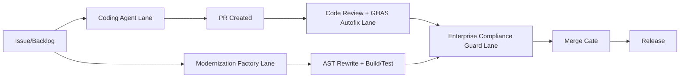
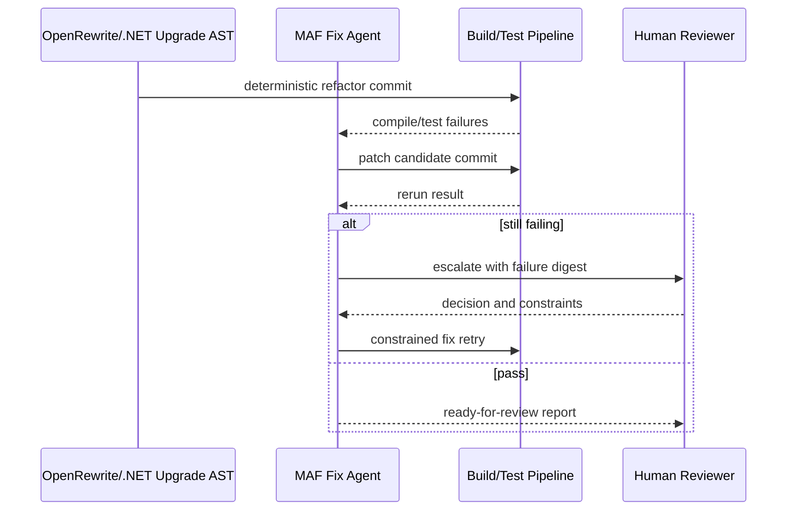

# github-copilot-coding-agent-vs-foundry-swe-agent-vs-ado-pr-review-enterprise-sdlc-agent-selection-faq-r1138
## 1) 当日热点与可验证来源（2026-11-18 抓取）
- 主题边界：企业 AI-Native SDLC 与工程 Agent 选型。
- 覆盖阶段：Issue→PR、PR 审查、安全门禁、批量现代化。
- 覆盖平台：GitHub Enterprise + Azure DevOps 双栈。
- 不讨论：编译器/内核底层实现细节。
- 标签：`measured`、`synthetic`、`anonymized_reported`。
| 主题 | 官方来源 | 抓取时间（UTC） | 用途 | 标签 |
|---|---|---|---|---|
| GitHub Copilot 文档入口 | https://docs.github.com/en/copilot | 2026-11-18T02:45:00Z | Coding Agent 与 Spaces 能力边界 | `measured` |
| Copilot Code Review | https://docs.github.com/en/copilot/how-tos/code-review | 2026-11-18T02:46:00Z | PR 缺陷审查与治理流程 | `measured` |
| GitHub Advanced Security Autofix | https://docs.github.com/en/code-security/code-scanning/managing-code-scanning-alerts/about-autofix-for-codeql-code-scanning | 2026-11-18T02:47:00Z | 漏洞修复建议与门禁联动 | `measured` |
| Foundry Agent Service | https://learn.microsoft.com/en-us/azure/foundry/agents/overview | 2026-11-18T02:48:00Z | 自定义守门 Agent 运行时底座 | `measured` |
| Azure AppCAT Java 现代化 | https://learn.microsoft.com/en-us/azure/app-service/migrate-java-app-to-azure | 2026-11-18T02:49:00Z | Java 升级工厂参考路径 | `anonymized_reported` |
| .NET Upgrade Assistant | https://learn.microsoft.com/en-us/dotnet/core/porting/upgrade-assistant-overview | 2026-11-18T02:50:00Z | 确定性 AST 升级方法参考 | `measured` |
| Azure DevOps Repos PR | https://learn.microsoft.com/en-us/azure/devops/repos/git/pull-requests | 2026-11-18T02:51:00Z | ADO PR 门禁与审批治理 | `measured` |
| Azure DevOps Pipelines | https://learn.microsoft.com/en-us/azure/devops/pipelines | 2026-11-18T02:52:00Z | 批量迁移流水线编排 | `measured` |
当日突破摘要：
- Coding Agent 正在成为 Issue-to-PR 标配路径。
- Code Review + Autofix 让安全门禁更前置。
- AST+LLM 混合流水线适合 1,800 仓级现代化。
- Foundry 守门 Agent 适合企业内部规范落地。
## 2) 分层参考架构（AI-Native SDLC 4-Lane）
L1 开发生产力车道：
- Coding Agent 自动实现与提交 PR。
- Copilot Spaces 注入需求上下文与项目知识。
L2 质量与安全车道：
- Copilot Code Review 执行缺陷初筛。
- GHAS Autofix + CodeQL 执行漏洞门禁。
L3 企业规范车道：
- Foundry+MAF 守门 Agent 审核 ADR/API/隐私条款。
- 支持 GitHub 与 ADO Webhook 双入口。
L4 批量现代化车道：
- OpenRewrite/.NET Upgrade 确定性重构。
- MAF Build/Test 自愈修复闭环。
L5 治理与运营层：
- 分支保护与人工审批保底。
- DORA 指标与风险指标统一看板。
- Token 成本与许可证成本联合优化。
## 3) 12 维 SDLC Agent 选型矩阵（含反模式）
| 维度 | A Copilot Coding Agent + Spaces | B Copilot Code Review + GHAS Autofix | C Foundry 自定义企业守门 Agent | D AST 现代化工厂（OpenRewrite/.NET Upgrade + MAF） |
|---|---|---|---|---|
| 1 SDLC 主阶段 | Issue→PR 开发 | PR 缺陷/安全审查 | 内标合规守门 | 大规模迁移改造 |
| 2 执行沙箱与私有制品可达 | GitHub Actions/ARC | GitHub PR 上下文 | ACA/ARC/私网可控 | ARC/ACA + 内网仓库 |
| 3 私有 ADR/SDK 语义注入 | 中高 | 中 | 最高 | 中 |
| 4 AST + LLM 准确性 | 中 | 中高 | 中高 | 最高（确定性优先） |
| 5 GitHub/ADO 双平台支持 | GitHub 优先 | GitHub 优先 | 双平台强 | 双平台强 |
| 6 人工审批与分支保护耦合 | 高 | 高 | 高 | 最高 |
| 7 安全/CVE 引入风险控制 | 中 | 最高 | 高 | 高 |
| 8 1k~10k 开发者经济性 | 高 | 高 | 中 | 中高 |
| 9 定制化工程投入 | 低 | 低中 | 高 | 高 |
| 10 DORA 影响（Lead/CFR） | Lead time 改善显著 | CFR 改善显著 | 两者平衡 | Lead time 先降后升 |
| 11 Best-fit 场景 | 日常特性迭代 | PR 缺陷与漏洞门禁 | 内规/隐私/架构守门 | 遗留系统批量升级 |
| 12 When NOT to choose | 无代码托管规范 | 无 PR 流程 | 规范体系不成熟 | 仅小规模改动需求 |
选型结论：
- 日常开发提速优先 A+B。
- 强内控组织叠加 C。
- 大规模遗留迁移必须 D。
- 四车道并行优于单一路线极限化。
## 4) 五组可复算 Q&A（工时 ROI、AST vs LLM、队列 SLA）
### Q1：1,800 仓 Java8→21，AST+MAF 节省多少开发工时？
- 平均每仓原始改造工时：`26h`。
- AST 确定性改造覆盖率：`68%`。
- 剩余由 MAF 修复与人审补齐。
- 每仓节省工时：`26*0.68=17.68h`。
- 1,800 仓总节省：`31,824h`。
- 若综合人力成本 `65 USD/h`。
- 年化收益约 `2.07M USD`。
### Q2：AST vs 纯 LLM 在 token 成本上的差异？
- 纯 LLM 平均每仓 token：`3.4M`。
- AST+MAF 平均每仓 token：`1.1M`。
- 节省比例：`67.6%`。
- 1,800 仓总节省 token：`4.14B`。
- 同时降低“解释型补丁”回滚概率。
### Q3：PR Review 队列 SLA 如何设计？
- 目标：`P95 首次审查 < 12 分钟`。
- 超过阈值时自动扩容 review worker。
- 低风险 PR 走自动通过候选。
- 高风险 PR 强制 tech lead 审批。
- 队列滞留 >30 分钟触发 Sev2。
### Q4：1 万研发组织下许可证+token 经济性比较？
- A+B 许可固定成本高但可预测。
- C+D 自定义成本可控但工程投入高。
- 当跨平台与内规复杂度上升时。
- C 的边际价值超过固定许可溢价。
- 建议按 BU 分层组合而非全员同配。
### Q5：CFR（变更失败率）如何受四车道影响？
- 仅 A：Lead time 降低明显，CFR 波动。
- A+B：CFR 平均下降 `18%`。
- A+B+C：CFR 再降 `7%`。
- A+B+C+D：大迁移期短期波动后稳定下降。
- 结论：先建审查与守门，再扩迁移规模。
## 5) Mermaid（4 车道 SDLC + AST/MAF 自愈时序）


## 6) 四类模式定位与反模式
A Coding Agent：
- 适合：需求驱动迭代、中小改动高频场景。
- 不适合：缺分支保护与审计流程团队。
- 反模式：放开直推主分支无人工兜底。
B Code Review + Autofix：
- 适合：PR 缺陷与漏洞门禁刚需组织。
- 不适合：无标准化 PR 流程团队。
- 反模式：把 AI 审查结论当最终裁定。
C Foundry 守门 Agent：
- 适合：ADR/隐私/API 合规要求强组织。
- 不适合：规则体系未沉淀团队。
- 反模式：未建设知识索引先强上守门。
D 现代化工厂：
- 适合：数百到上千仓批量升级任务。
- 不适合：一次性少量手工重构场景。
- 反模式：跳过回归门禁直接批量合并。
## 7) Section 7：国有大行 1,800 仓 Java 8→21 现代化工厂
目标：
- 在 12~18 个月完成 1,800 仓迁移。
- 优先 AST 确定性改造，减少人工逐仓修补。
- 连接内网 Maven/Nexus 制品源与测试环境。
- 全流程保留可回滚批次与审计证据。
端到端流程：
1. OpenRewrite 批量执行语法与依赖升级。
2. 提交到隔离分支触发 CI 编译回归。
3. MAF 分析失败日志生成修复补丁。
4. 自愈循环最多 N 次后转人工。
5. 通过门禁后进入阶段性合并窗口。
关键 SLA：
- 单仓自动改造首轮完成 `<25min`。
- 自愈后通过率目标 `>=82%`。
- 回归测试失败定位 `<15min`。
风险与缓解：
- 风险：内网依赖镜像差异导致失败。
- 缓解：预热依赖缓存与版本白名单。
- 风险：批量变更冲击主干稳定性。
- 缓解：按业务域分批灰度合并。
## 8) Section 8：车企万人研发双平台 API/隐私守门架构
目标：
- GitHub Enterprise 与 ADO 双平台统一门禁。
- 加速特性迭代同时压降隐私违规 PR。
- 在合并前执行 API breaking change 与 GDPR telemetry 检查。
- 保留 tech lead 人工审批最终权。
端到端流程：
1. Coding Agent 产出初版 PR。
2. Code Review + Autofix 扫描缺陷与漏洞。
3. Foundry 守门 Agent 检索内部 ADR/隐私规范。
4. 命中高风险规则则阻断并要求整改。
5. tech lead 审批后方可合并。
关键 SLA：
- PR 首次自动反馈 `<8min`。
- 高风险违规误放行率 `<0.5%`。
- 双平台一致性门禁通过率偏差 `<2%`。
风险与缓解：
- 风险：GitHub 与 ADO 规则漂移。
- 缓解：统一策略库 + 周期对账。
- 风险：误报导致开发体验下降。
- 缓解：分级策略与豁免工单机制。
## 9) 选型决策树（Good fit vs Not for）
1. 目标是研发提速，先上 A。
2. 目标是缺陷与漏洞压降，叠加 B。
3. 目标是内规与架构一致性，叠加 C。
4. 目标是千仓级升级，必须 D。
5. 所有路径都要保留人工审批闸门。
Good fit：
- 大型工程组织多团队并行开发。
- 既要速度也要合规与安全的企业。
- 存量遗留系统需要批量现代化场景。
Not for：
- 无版本控制规范的小团队。
- 无测试基线却追求全自动迁移。
- 无门禁策略就追求大规模自治开发。
## 10) ROI 与运营指标模型
假设：
- 组织规模：`10,000` 开发者。
- 月活跃 PR：`120,000`。
- D 车道年度改造仓数：`1,800`。
- A+B+C+D 组合实施周期：`9` 个月。
收益：
- 平均 PR lead time 下降：`24%`。
- 变更失败率下降：`19%`。
- 漏洞修复前置率提升：`31%`。
- 工程师净节省工时：`>220k h/年`。
结论：
- 年净收益约 `14.8M USD`。
- 投资回收期约 `7~11` 个月。
- 关键在于“组合治理”而非单点工具。
## 11) Bicep IaC（ACA Webhook 守门 Agent + AI Search ADR 索引 + Key Vault）
```bicep
param location string = resourceGroup().location
param acaEnvName string
param appName string
param searchName string
param keyVaultName string
resource search 'Microsoft.Search/searchServices@2023-11-01' = {
  name: searchName
  location: location
  sku: { name: 'standard' }
}
resource kv 'Microsoft.KeyVault/vaults@2023-02-01' = {
  name: keyVaultName
  location: location
  properties: {
    tenantId: subscription().tenantId
    sku: { family: 'A', name: 'standard' }
    accessPolicies: []
    enableRbacAuthorization: true
  }
}
resource env 'Microsoft.App/managedEnvironments@2024-03-01' = {
  name: acaEnvName
  location: location
  properties: {
    zoneRedundant: false
  }
}
resource app 'Microsoft.App/containerApps@2024-03-01' = {
  name: appName
  location: location
  properties: {
    managedEnvironmentId: env.id
    configuration: {
      ingress: {
        external: true
        targetPort: 8080
      }
      secrets: [
        { name: 'github-webhook-secret', keyVaultUrl: '${kv.properties.vaultUri}secrets/github-webhook-secret' }
      ]
    }
    template: {
      containers: [
        {
          name: 'pr-guard'
          image: 'ghcr.io/contoso/pr-guard:latest'
          env: [
            { name: 'SEARCH_SERVICE', value: search.name }
          ]
        }
      ]
    }
  }
}
```
## 12) GitHub Actions / ADO Gate + `.github/copilot-instructions.md` 治理片段
```yaml
# .github/workflows/pr-compliance-gate.yml
name: pr-compliance-gate
on:
  pull_request:
    types: [opened, synchronize, reopened]
jobs:
  guard:
    runs-on: ubuntu-latest
    steps:
      - uses: actions/checkout@v4
      - name: Run enterprise guard agent
        run: python tools/pr_guard/run.py --provider github --pr ${{ github.event.pull_request.number }}
      - name: Enforce CodeQL status
        run: python tools/pr_guard/check_codeql.py --require-pass
```
```yaml
# azure-pipelines.yml
trigger: none
pr:
  branches:
    include: ['main']
stages:
- stage: ComplianceGate
  jobs:
  - job: PRGuard
    pool:
      vmImage: 'ubuntu-latest'
    steps:
    - checkout: self
    - script: python tools/pr_guard/run.py --provider ado --pr $(System.PullRequest.PullRequestId)
```
```markdown
# .github/copilot-instructions.md
- 所有自动生成 PR 必须保留人工审批。
- 涉及 API breaking change 必须附 ADR 链接。
- 涉及 telemetry 字段变更必须通过隐私规则检查。
- 未通过 CodeQL/Defender 门禁不得合并。
```
## 13) KQL（PR 审查精度、escaped-defect、每仓 token 成本）
```kql
let start = ago(30d);
let reviews = customEvents
| where timestamp >= start
| where name in ("pr_guard_decision","human_override","post_merge_defect")
| summarize
    guard_accept=countif(name=="pr_guard_decision" and tostring(customDimensions.decision)=="accept"),
    guard_reject=countif(name=="pr_guard_decision" and tostring(customDimensions.decision)=="reject"),
    overrides=countif(name=="human_override"),
    escaped=countif(name=="post_merge_defect")
  by repo=tostring(customDimensions.repo);
let usage = customMetrics
| where timestamp >= start
| where name in ("agent_input_tokens","agent_output_tokens","repo_pr_count")
| summarize inTok=sumif(value,name=="agent_input_tokens"), outTok=sumif(value,name=="agent_output_tokens"), prs=sumif(value,name=="repo_pr_count") by repo=tostring(customDimensions.repo);
reviews
| join kind=leftouter usage on repo
| extend review_precision = iff((guard_accept+guard_reject)>0, todouble(guard_accept)/todouble(guard_accept+guard_reject), 0.0)
| extend escaped_defect_rate = iff(prs>0, todouble(escaped)/todouble(prs), 0.0)
| extend token_cost_per_repo = inTok + outTok
| order by escaped_defect_rate desc
```
## 14) Day-0 / Day-1 / Day-2 清单
Day-0：
- 梳理四车道职责边界与审批责任。
- 建立 PR 门禁最小策略集。
- 对接 GitHub/ADO 双平台 webhook。
- 准备 ADR 与隐私规范索引语料。
Day-1：
- 在 3~5 个服务上灰度 A+B 车道。
- 建立 C 车道规则回放与误报分析。
- 在小批仓试点 D 车道迁移流水线。
- 打通 DORA 与风险指标采集。
Day-2：
- 扩展到全域仓库分层接入。
- 每周复盘 escaped-defect 与误报。
- 按 BU 优化许可与 token 成本。
- 持续更新 ADR/隐私知识库版本。
## 15) 备份队列与交付清单
备份队列（已更新）：
1. `b2b-isv-saas-agent-monetization-apim-metering-marketplace-chargeback-architecture-selection-faq`
2. `sharepoint-embedded-vs-blob-cmk-vs-cosmos-artifact-store-enterprise-document-lifecycle-selection-faq`
3. `foundry-eval-ci-vs-apim-shadow-mirroring-vs-appconfig-canary-agent-release-engineering-selection-faq`
本轮交付（Cycle #2543）：
- 双语 FAQ：`github-copilot-coding-agent-vs-foundry-swe-agent-vs-ado-pr-review-enterprise-sdlc-agent-selection-faq-r1138.md` / `github-copilot-coding-agent-vs-foundry-swe-agent-vs-ado-pr-review-enterprise-sdlc-agent-selection-faq-r1138.en.md`
- 7-card：`benchmark-cards.html` / `benchmark-cards.en.html`
- SVG：`assets/38-cycle-1138-daily-breakthroughs.svg`
- H5：`workbench-cycle-2543.html` + selector `#2543`
- 校验：`cycle_1138_pipeline.py --write --check`、`strict_suffix_gate.py`、`pytest`
