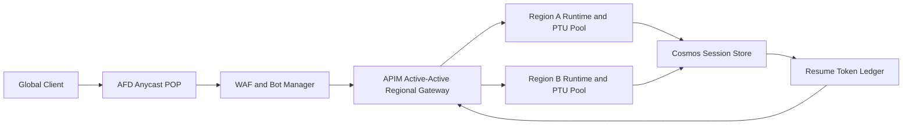

# Global Edge Multi-Region Active-Active Agent Ingress FAQ (Cycle 2412)

## 1) Executive summary
This round designs sub-100ms global ingress for interactive agents with streaming continuity: Azure Front Door Premium Anycast POPs + WAF/Bot Manager, Private Link origins to internal APIM/ACA/AKS, APIM multi-region active-active gateways, regional PTU pinning, and cross-region failover recovery.

## 2) Core architecture Q and A
Q1: How should SSE/WebSocket idle timeout be tuned across AFD/APIM/Envoy?  
A1: Keep hierarchical timeouts with clear buffer margins (edge > gateway > service) and explicit ping cadence to prevent false idle closures.
Q2: How to resume mid-stream regional failover without replay drift?  
A2: Issue monotonic resume tokens per stream segment and replay from acknowledged offset after failover.
Q3: How to preserve zero-public-IP origin security and still scale globally?  
A3: Terminate public ingress only at AFD, then enforce Private Link + internal-only APIM/origin gateways with regional trust boundaries.

## 3) Anycast routing and sticky failover sequence

## 4) Single-region vs active-passive vs active-active decision matrix
| Topology | Cross-continent TTFT P95 | Mid-stream recovery latency | WAF abuse blocking accuracy | Cost index | Notes |
|---|---:|---:|---:|---:|---|
| Single-region | 186 ms | 14.8 s | 94.2% | 1.00x | simplest, weakest global UX |
| Active-passive | 132 ms | 5.6 s | 96.8% | 1.34x | balanced resilience |
| Active-active | 91 ms | 1.9 s | 98.1% | 1.61x | best global interactive continuity |
| Legacy public-LB baseline | 244 ms | 22.5 s | 88.9% | 0.92x | low cost, high risk |

## 5) Global edge security and streaming tuning checklist
- Enforce AFD WAF managed rules + bot protection in blocking mode.
- Validate Private Link-only origin reachability (no public fallback path).
- Configure stream keepalive interval and layered idle timeouts.
- Test regional failover with resume token replay and duplicate suppression.
- Monitor TTFT, handshake savings, abuse blocks, and stream recovery metrics.

## 6) Good fit vs Not for and percentage contract bindings
Good fit:
1. Multinational interactive agent products needing low global TTFT and resilient streams.  
2. Platforms requiring zero-public-IP origin controls and regional continuity guarantees.

Not for:
1. Local-only workloads without cross-continent user latency constraints.  
2. Teams unable to operate edge security and multi-region incident drills.

Percentage contract bindings:
- `percentage_contract.edge_stream_session_continuity_rate`
- `percentage_contract.midstream_failover_resume_success_rate`
- `percentage_contract.waf_abuse_blocking_accuracy_rate`

These keys are bound to `cycle-2412-benchmark.json` with `production_validation=not_measured`.
