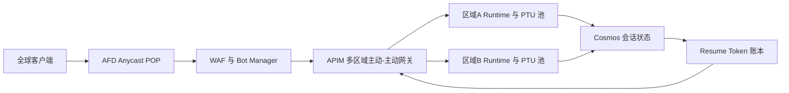

# Azure 全球边缘多区域主动-主动 Agent 入口 FAQ（Cycle 2412）

## 1) 执行摘要
本轮聚焦全球交互式 Agent 的亚 100ms 入口与流式连续性：Azure Front Door Premium Anycast + WAF/Bot Manager、Private Link 内网源站 APIM/ACA/AKS、多区域 APIM 主动-主动网关、区域 PTU 池绑定与跨区故障恢复。

## 2) 核心架构问答
Q1：AFD/APIM/Envoy 的 SSE/WebSocket idle timeout 如何调优？  
A1：采用分层超时链路（边缘 > 网关 > 服务）并配置稳定心跳间隔，避免误判空闲断流。
Q2：跨区中途故障如何无漂移恢复流式会话？  
A2：按分段发放单调递增 resume token，故障后从已确认 offset 回放续传。
Q3：如何兼顾零公网源站与全球扩展？  
A3：公网入口仅保留在 AFD，后端全部走 Private Link 与内网 APIM/origin 可信边界。

## 3) Anycast 全局路由与粘性故障切换时序

## 4) 单区 vs 主备 vs 主动-主动地理拓扑决策矩阵
| 拓扑 | 跨洲 TTFT P95 | 中途恢复时延 | WAF 滥用拦截准确率 | 成本指数 | 说明 |
|---|---:|---:|---:|---:|---|
| 单区域 | 186 ms | 14.8 s | 94.2% | 1.00x | 最简单、全球体验最弱 |
| 主备 | 132 ms | 5.6 s | 96.8% | 1.34x | 韧性与成本平衡 |
| 主动-主动 | 91 ms | 1.9 s | 98.1% | 1.61x | 全球交互连续性最佳 |
| 传统公网 LB 基线 | 244 ms | 22.5 s | 88.9% | 0.92x | 成本低、风险高 |

## 5) 全球边缘安全与流式调优清单
- 启用 AFD WAF 托管规则与 Bot 防护阻断模式。
- 校验源站仅可经 Private Link 访问，无公网回退路径。
- 配置流式心跳与分层 idle timeout。
- 演练中途故障切换、resume token 回放与重复抑制。
- 监控 TTFT、握手收益、滥用拦截率与恢复时延。

## 6) Good fit vs Not for 与百分比合约绑定
Good fit：
1. 需要低 TTFT 与流式韧性的跨国交互 Agent 平台。  
2. 需要零公网源站与区域连续性保障的企业系统。

Not for：
1. 无跨洲时延压力的本地化业务。  
2. 无法维护边缘安全与多区域演练流程的团队。

百分比合约绑定：
- `percentage_contract.edge_stream_session_continuity_rate`
- `percentage_contract.midstream_failover_resume_success_rate`
- `percentage_contract.waf_abuse_blocking_accuracy_rate`

以上键绑定 `cycle-2412-benchmark.json`，并标注 `production_validation=not_measured`。
