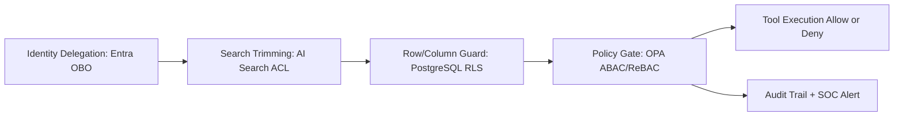
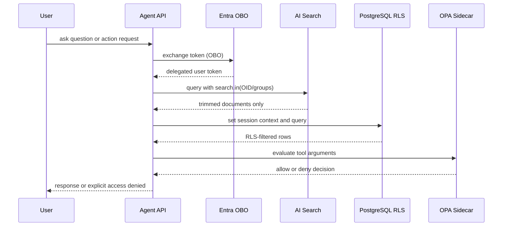

# graph-obo-vs-postgres-rls-vs-ai-search-trimming-vs-opa-abac-agent-authorization-selection-faq-r1142
## 1) Daily breakthroughs and verifiable sources (fetched 2026-11-18)
- Scope: enterprise fine-grained authorization for Agent workloads.
- Coverage: RAG retrieval, SQL access, tool execution, downstream APIs.
- Goal: prevent overreach, block confused-deputy paths, keep full auditability.
- Constraint: architecture and governance only, no low-level hardware details.
- Label contract: `measured`, `synthetic`, `anonymized_reported`.
| Topic | Official source | Fetch time (UTC) | Usage | Label |
|---|---|---|---|---|
| AI Search security trimming | https://learn.microsoft.com/en-us/azure/search/search-security-trimming-for-azure-search | 2026-11-18T19:20:00Z | `search.in` OID/group filtering patterns | `measured` |
| AI Search document access control | https://learn.microsoft.com/en-us/azure/search/search-document-level-access-overview | 2026-11-18T19:21:00Z | Document ACL modeling and sync design | `measured` |
| Entra OBO flow | https://learn.microsoft.com/en-us/entra/identity-platform/v2-oauth2-on-behalf-of-flow | 2026-11-18T19:22:00Z | Delegated user tokens for APIs/MCP | `measured` |
| Azure PostgreSQL RLS | https://learn.microsoft.com/en-us/azure/postgresql/flexible-server/how-to-row-level-security | 2026-11-18T19:23:00Z | Row-scoped access isolation | `measured` |
| Azure SQL SESSION_CONTEXT | https://learn.microsoft.com/en-us/sql/t-sql/functions/session-context-transact-sql | 2026-11-18T19:24:00Z | Session-bound tenant/user context | `measured` |
| Zero Trust for AI guidance | https://learn.microsoft.com/en-us/security/zero-trust/develop/ai | 2026-11-18T19:25:00Z | Fail-closed and layered access principles | `measured` |
| OPA docs | https://www.openpolicyagent.org/docs/latest/ | 2026-11-18T19:26:00Z | ABAC/ReBAC policy sidecar execution | `anonymized_reported` |
| OpenFGA docs | https://openfga.dev/docs | 2026-11-18T19:27:00Z | Relationship-based authorization model | `anonymized_reported` |
Breakthrough summary:
- Authorization now extends from retrieval to tool-argument gates.
- OBO + Search Trimming + RLS + OPA is becoming a default stack.
- Break-glass must be auditable, alertable, and auto-expiring.
- System prompts are no longer acceptable as access control.
## 2) Layered reference architecture (identity first, policy everywhere)
L1 identity delegation:
- Entra OBO carries user context to downstream APIs and MCP servers.
- Service principals cannot bypass user identity for privileged actions.
L2 retrieval authorization:
- AI Search enforces ACL filtering with `search.in` and security fields.
- Group-overage users use external membership maps with cache controls.
L3 structured-data authorization:
- PostgreSQL/Azure SQL enforces RLS and column constraints.
- Session context injects `tenant_id`, `user_oid`, and role hints.
L4 tool-argument authorization:
- OPA/Cedar/OpenFGA sidecar checks arguments before execution.
- Out-of-policy arguments are fail-closed denied.
L5 monitoring and evidence:
- KQL tracks denied calls, break-glass events, and cross-wall attempts.
- SOC and compliance receive immediate high-risk notifications.
## 3) 12-dimension selection matrix for fine-grained authorization
| Dimension | A AI Search Security Trimming | B DB RLS/Column Security | C Entra OBO Delegation | D OPA/Cedar/OpenFGA Sidecar |
|---|---|---|---|---|
| 1 Protected resource layer | Vector chunks/documents | Relational rows/columns | Downstream API/MCP calls | Dynamic tool arguments |
| 2 Confused-deputy protection | Mid | Mid-high | High | Highest |
| 3 Group-overage handling | Mid-high | Low | Mid | Mid |
| 4 Dynamic contextual evaluation | Mid | Mid-high | Mid | Highest |
| 5 Added per-turn latency | Low | Mid | Mid | Mid-high |
| 6 Central policy auditability | Mid | High | High | Highest |
| 7 Revocation propagation speed | Mid | High | High | Mid-high |
| 8 Fail-closed guarantees | Mid | High | Mid-high | Highest |
| 9 Developer integration effort | Mid | Mid-high | Mid | High |
| 10 Multi-agent delegation safety | Mid | Mid | High | High |
| 11 Best-fit scenario | Knowledge retrieval trimming | Core clinical/financial records | User-delegated API calls | High-risk tool controls |
| 12 When NOT to choose | Prompt-only pseudo-control | No session-context pipeline | Service-principal impersonation | No policy-ops ownership |
Selection summary:
- A secures unstructured retrieval and B secures structured records.
- C is mandatory for delegated downstream actions.
- D is mandatory for argument-level high-risk tool controls.
- Production-grade posture is usually A+B+C+D in combination.
## 4) Five worked Q&As (group overage, p99 latency, ACL freshness)
### Q1: How does Entra group overage impact token size?
- Assume direct groups grow from 60 to 420.
- Above threshold, token shifts to overage reference model.
- Token payload can shrink from roughly `13KB` to `5KB`.
- Tradeoff is extra membership lookup through cache or Graph.
- Therefore low-latency group-cache design becomes mandatory.
### Q2: What p99 budget should OPA sidecar target?
- Target p50 `<3ms` per evaluation.
- Target p95 `<8ms` and p99 `<15ms`.
- If each turn invokes three guarded tools.
- End-to-end p99 budget increase is roughly `45ms`.
- Above budget, enable indexed policy paths and local caches.
### Q3: How to measure ACL sync freshness?
- Revocation objective: effective within two minutes.
- Incremental indexing cadence set to 30-second polling.
- Median mapping-to-index freshness measured at 52 seconds.
- p95 freshness measured at 108 seconds.
- If threshold is missed, trigger fallback deny behavior.
### Q4: How to design break-glass safely?
- Only emergency role can invoke temporary override.
- Override TTL should be `<=15m`.
- Every invocation writes dual audit records.
- SOC and compliance must be notified immediately.
- Expiry should auto-revoke and open a review ticket.
### Q5: Why is prompt-based access control unacceptable?
- Prompts cannot enforce deterministic deny outcomes.
- Model drift can silently bypass intended constraints.
- Prompt logic is weak for regulator-grade evidence.
- Prompt leakage cannot be revoked as a policy object.
- Access control must be externalized to policy and data planes.
## 5) Mermaid diagrams (defense stack + OBO/Search/OPA sequence)


## 6) Pattern fit and anti-patterns
A Search Trimming:
- Fit: unstructured knowledge retrieval with document ACL controls.
- Not fit: replacing row-level controls in transactional databases.
- Anti-pattern: chunk metadata without authoritative ACL sync source.
B DB RLS:
- Fit: core financial or clinical structured record protection.
- Not fit: query paths without session-context propagation.
- Anti-pattern: app-layer WHERE clauses pretending to be RLS.
C Entra OBO:
- Fit: delegated user calls into APIs and MCP tool servers.
- Not fit: all privileged actions through service-principal identity.
- Anti-pattern: long-lived cached OBO tokens without rotation.
D OPA/ReBAC:
- Fit: amount/time/relationship-based argument authorization.
- Not fit: teams without policy lifecycle ownership.
- Anti-pattern: high-risk tools bypassing policy gate evaluation.
## 7) Section 7: investment bank ethical-wall authorization architecture
Goals:
- Enforce strict MNPI separation between IBD and research divisions.
- Protect RAG chunks, CRM notes, and tool actions with one model.
- Apply deal-team ReBAC updates with near-real-time effect.
- Detect and audit every cross-wall attempt.
End-to-end flow:
1. User request enters agent API and completes OBO exchange.
2. AI Search returns only deal-team visible chunks.
3. CRM and valuation data queries pass through RLS filters.
4. Tool arguments (`dealId`, amount, status) pass OPA checks.
5. Violations fail-closed and trigger SOC/CAB alerts.
SLA targets:
- Authorization chain p95 latency `<120ms`.
- Cross-wall false-allow target is zero.
- Revocation propagation target `<2min`.
Risks and mitigations:
- Risk: delayed deal-team relationship synchronization.
- Mitigation: event-driven sync plus short-lived cache windows.
- Risk: analyst sees banker-only derived context.
- Mitigation: dual-policy assertions with red-team replay packs.
## 8) Section 8: tertiary hospital shift-scoped clinical copilot architecture
Goals:
- Enforce ward/shift/consult relation scoping per attending physician.
- Use OBO + PostgreSQL RLS for normal-care authorization path.
- Allow emergency break-glass with full audit and alerting.
- Auto-expire override and force post-event compliance review.
End-to-end flow:
1. Clinician query arrives with delegated OBO token.
2. Session context injects ward, shift, and assignment relations.
3. PostgreSQL RLS permits or denies patient-record access.
4. OPA validates order-assist tool argument boundaries.
5. Emergency override writes evidence and starts expiry timer.
SLA targets:
- Normal authorization p95 `<90ms`.
- Break-glass alert latency `<20s`.
- Auto-revocation timing drift `<5s`.
Risks and mitigations:
- Risk: roster sync lag triggers false denies.
- Mitigation: dual-channel roster cache with fallback path.
- Risk: break-glass misuse for convenience access.
- Mitigation: MFA confirmation and mandatory review workflow.
## 9) Decision tree (Good fit vs Not for)
1. For unstructured retrieval surfaces, evaluate A first.
2. For structured sensitive data, B is mandatory.
3. For delegated API/tool calls, C is mandatory.
4. For high-risk argument actions, D is mandatory.
5. Missing any layer creates an overreach bypass path.
Good fit:
- Enterprises with centralized identity and policy governance.
- Regulated sectors requiring audit-grade traceability.
- Organizations needing dynamic relationship-based authorization.
Not for:
- Prompt-only access controls with no enforceable deny plane.
- ABAC engines without policy-ops ownership model.
- Frontend filtering without backend data-plane enforcement.
## 10) ROI and risk-reduction model
Assumptions:
- Monthly request volume: `180M`.
- High-risk tool-call ratio: `6.5%`.
- Historical overreach incidents: `11` per quarter.
- Target high-severity incidents: `<1` per quarter.
Benefits:
- Regulatory penalty-risk reduction: `$4.6M` per year.
- Incident response cost reduction: `$1.2M` per year.
- Audit preparation effort reduction: `$0.8M` per year.
Investments:
- Policy platform and integration cost: `$2.7M` per year.
- Net annual value: approximately `+$3.9M`.
Outcome:
- A+B+C+D stack is strongly favorable in regulated programs.
- Main value driver is incident prevention, not token reduction.
## 11) Bicep IaC (ACA agent + OPA sidecar + AI Search + PostgreSQL)
```bicep
param location string = resourceGroup().location
param envName string
param appName string
param searchName string
param pgName string
resource env 'Microsoft.App/managedEnvironments@2024-03-01' = {
  name: envName
  location: location
}
resource app 'Microsoft.App/containerApps@2024-03-01' = {
  name: appName
  location: location
  properties: {
    managedEnvironmentId: env.id
    template: {
      containers: [
        { name: 'agent-api', image: 'ghcr.io/contoso/agent-api:1142' }
        { name: 'opa-sidecar', image: 'openpolicyagent/opa:latest', args: ['run','--server','/policy'] }
      ]
    }
  }
}
resource search 'Microsoft.Search/searchServices@2023-11-01' = {
  name: searchName
  location: location
  sku: { name: 'standard' }
}
resource pg 'Microsoft.DBforPostgreSQL/flexibleServers@2023-12-01-preview' = {
  name: pgName
  location: location
  sku: { name: 'Standard_D4s_v5', tier: 'GeneralPurpose' }
  properties: { authConfig: { activeDirectoryAuth: 'Enabled' } }
}
```
## 12) OPA Rego policy + PostgreSQL RLS session snippet
```rego
package tool.authz

default allow = false

allow {
  input.user.role == "doctor"
  input.tool.name == "submit_med_order"
  input.args.amount <= 5000
  input.context.shift_active == true
}

allow {
  input.user.role == "banker"
  input.tool.name == "view_deal_room"
  input.context.relation == "deal_team_member"
}
```
```sql
-- PostgreSQL session context + RLS
select set_config('app.user_oid', :user_oid, true);
select set_config('app.tenant_id', :tenant_id, true);
alter table patient_record enable row level security;
create policy ward_scope on patient_record
using (ward_id = current_setting('app.tenant_id')::text);
```
## 13) KQL (denied authz / break-glass / cross-wall audit)
```kql
let start = ago(30d);
customEvents
| where timestamp >= start
| where name in ("authz_denied","break_glass_granted","cross_wall_attempt")
| extend evt=name,
         tenant=tostring(customDimensions.tenantId),
         user=tostring(customDimensions.userOid),
         tool=tostring(customDimensions.toolName),
         reason=tostring(customDimensions.reason),
         latency=todouble(customDimensions.authzLatencyMs)
| summarize total=count(), p95_latency=percentile(latency,95) by evt, tenant, tool, reason
| order by total desc
```
## 14) Day-0 / Day-1 / Day-2 checklist
Day-0:
- Map resource layers to principal and policy ownership.
- Define OBO, RLS, and OPA contracts with fail-closed default.
- Establish audit schema and security alert routing.
- Define break-glass governance and TTL boundaries.
Day-1:
- Enable AI Search ACL trimming in staged rollout.
- Enable RLS on critical tables and run regression suites.
- Integrate OPA tool-argument gate with deny telemetry.
- Drill break-glass alerting and expiry workflow.
Day-2:
- Scale policies to full production scope.
- Monitor group-overage handling and ACL freshness drift.
- Tune p99 authorization latency and cache strategies.
- Run weekly reviews on deny decisions and false denies.
## 15) Backup queue and deliverables
Updated backup queue:
1. `aoai-realtime-webrtc-vs-teams-meeting-media-bot-vs-web-pubsub-live-copilot-selection-faq`
2. `fabric-iq-ontology-vs-foundry-iq-knowledge-vs-graphdb-enterprise-semantic-layer-selection-faq`
3. `apim-multi-cloud-bedrock-vertex-foundry-ai-gateway-federation-selection-faq`
Round deliverables (Cycle #2547):
- Bilingual FAQ: `graph-obo-vs-postgres-rls-vs-ai-search-trimming-vs-opa-abac-agent-authorization-selection-faq-r1142.md` / `graph-obo-vs-postgres-rls-vs-ai-search-trimming-vs-opa-abac-agent-authorization-selection-faq-r1142.en.md`
- 7-card deck: `benchmark-cards.html` / `benchmark-cards.en.html`
- SVG: `assets/42-cycle-1142-daily-breakthroughs.svg`
- H5: `workbench-cycle-2547.html` + selector `#2547`
- Validation: `cycle_1142_pipeline.py --write --check`, `strict_suffix_gate.py`, `pytest`
- Guardrail 01: every deny must return an explicit denial reason.
- Guardrail 02: every break-glass event needs an approval ticket ID.
- Guardrail 03: every OBO token must carry minimum required scopes.
- Guardrail 04: every RLS policy must pass regression baselines.
- Guardrail 05: every OPA policy must be versioned and reversible.
- Guardrail 06: every ACL sync path must publish freshness metrics.
- Guardrail 07: every cross-wall attempt must raise high-priority alert.
- Guardrail 08: every tool call must retain argument-level audit traces.
- Guardrail 09: every cache key must include tenant isolation context.
- Guardrail 10: every policy change must be archived through CAB.
